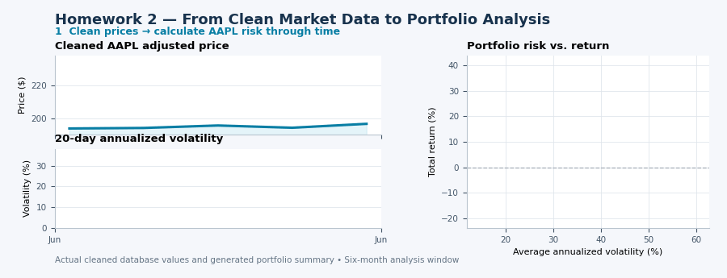

# Homework 2 — Scalable Stock Analysis Pipeline

This project cleans the supplied market data, generates parameterized
single-stock risk reports, and runs the analysis across all cleaned tickers.

<p align="center">
  
</p>

## Setup

Place the bCourses database at:

```text
data/data.db
```

The database is local and must not be committed.

Install the dependencies:

```bash
python -m pip install -r requirements.txt
```

## Run order

1. Run `01_data_cleaning.ipynb` from top to bottom.

   This creates the `ohlc_hw_cleaned` table while leaving `ohlc_hw`
   unchanged.

2. Run `02_stock_report_template.ipynb` interactively to test one stock.

3. Generate all reports:

```bash
python 03_run_all_stocks.py
```

Generated files are stored under:

```text
reports/YYYY-MM-DD/
```

## Data-cleaning decisions

- Ticker HTML markup, whitespace, and case differences are normalized before
  grouping and deduplication.
- Exact duplicate records are removed. Conflicting ticker/date records are
  investigated rather than selected arbitrarily.
- Missing trading dates are checked against the supplied `ohlc` calendar for
  each ticker.
- Partial raw-price gaps are forward-filled only within a sorted ticker.
  Unresolved leading gaps are quarantined.
- Missing volume is filled with zero and flagged. Observed zero volume is
  retained separately as a review flag.
- Invalid opening prices with valid same-day high, low, and close values are
  estimated from the median of those three prices.
- Missing or inconsistent adjusted closes are reconstructed using the exact
  ticker/date adjustment factor from the supplied `ohlc` table. Adjustment
  factors are never forward-filled across dates.
- Extreme raw-close returns that match the reference data are retained and
  flagged instead of being treated automatically as errors.
- Every repair is flagged, and all price, volume, key, and OHLC relationships
  are validated again after cleaning.

## Assumptions

- The supplied `ohlc` dates are the reference trading calendar for each
  ticker's available history.
- The supplied exact ticker/date adjustment factor is trusted for adjusted
  close reconstruction.
- A one-cent tolerance is used when comparing observed and expected adjusted
  closes.
- The automated analysis window is the six complete calendar months before
  the month containing the latest cleaned database observation.
- Stocks may have shorter actual coverage than the common requested window.
  Reports disclose their actual first and last observations, and no trailing
  prices are extrapolated.

## Report interpretation

- Returns are daily log returns calculated from adjusted close.
- Rolling volatility is the annualized sample standard deviation of 20 daily
  log returns.
- Maximum drawdown is the worst decline from a running adjusted-price peak.
- The Sharpe ratio uses the course approximation with a 2% annual risk-free
  rate.
- The portfolio summary stores fractional numeric values. Percentage
  formatting is applied only for display.
- Higher return does not necessarily imply better risk-adjusted performance;
  compare total return, volatility, drawdown, and Sharpe ratio together.

<p align="center">
  
</p>
