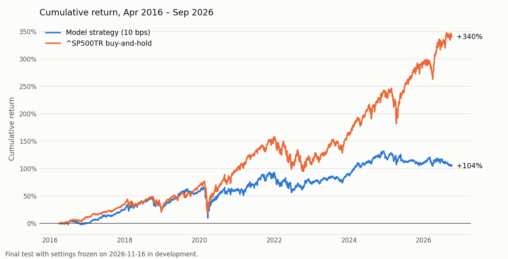
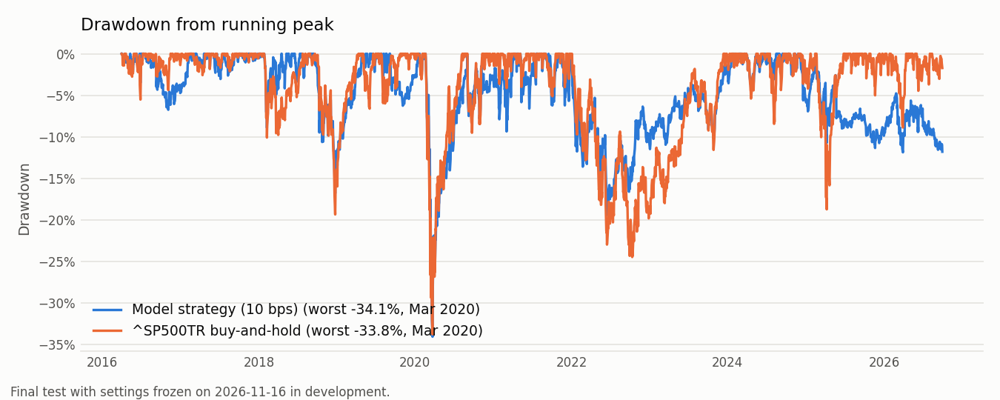

# HW4: Stock prediction and trading strategy (Ananya Das)

**The idea:** each time the strategy buys, a Ridge model ranks about 1,850 eligible US stocks by their
predicted 90-day return relative to the market. A long-only strategy buys the top 20 and holds each
purchase for exactly 90 days. My own backtester keeps the books, and the result is compared with
$1,000,000 in the S&P 500 total-return index (`^SP500TR`).

> **Bottom line: the strategy did not beat the S&P 500.** Over the out-of-sample final test (Apr 2016 –
> Sep 2026), $1,000,000 grew to **$2,043,242 (7.0% a year)**, against **$4,402,747 (15.2% a year)** for
> `^SP500TR`. The final test was run once, on 2026-11-16, with the settings frozen in development and
> nothing changed afterwards.

## Results at a glance

**Final test, Apr 2016 – Sep 2026 (out-of-sample):**

| | Strategy | ^SP500TR |
|---|---:|---:|
| Final value | **$2,043,242** | **$4,402,747** |
| Total return | 104.3% | 340.3% |
| CAGR | 7.04% | 15.16% |
| Max drawdown | −34.1% (Mar 2020) | −33.8% (Mar 2020) |
| Annualized volatility | 14.8% | 17.8% |
| Sharpe (2% risk-free) | 0.40 | 0.77 |

The strategy lost to the index by $2.36M (−8.1% CAGR), with a similar worst drawdown and lower
volatility. Two data problems found by the audit made the result worse, but neither explains the gap:
- **Missing split adjustments** (ORLY, COKE, KLAC) booked about $147k of artificial losses.
- **Takeover targets** (for example LLTC, CHNG, WWE, EA) stopped trading with no deal proceeds in
  the data, so up to 36% of the money sat frozen and was never reinvested.

Details are in [Final test](#final-test).

**Development (2010 – Mar 2016) and checks:**

| | Result |
|---|---|
| **Does the model predict anything?** | Yes, modestly. Out-of-sample rank IC **+0.06** on average over 2012–2015 (positive on 66% of dates). The top 10% of stocks beat the bottom 10% by **+3.2% per 90 days**. |
| **Is it consistent?** | No. By year the IC was +0.07, **−0.04**, +0.10, and +0.11; 2013 went the wrong way. |
| **What does it like?** | Profitable companies (operating ROA carries about a third of the weight), with lower volatility, positive 12-month momentum, and larger size. |
| **Did the strategy beat the index in development?** | **No.** 13.25% a year against 14.32% for the S&P 500 (2012 – Mar 2016), ending at $1,697,252 against $1,766,607. |
| **Risk?** | Slightly lower: worst drawdown −11.4% against −13.0%, volatility 12.3% against 13.2%, Sharpe 0.92 against 0.94. |
| **Costs?** | $45,000 in fees at 10 bps per side. At 5 bps the CAGR would be 13.68%; at 20 bps, 12.40%. |
| **Is the accounting right?** | Yes, as far as I can test: 149 hand-checked values match the code. All 20 automatic audit checks pass on the development trades, and 19 of 20 on the final-test trades. The one failure is the bad-print check, caused by splits missing from the data (see [Final test](#final-test)). |
| **Final test (out-of-sample)** | Did not beat the index: 7.04% against 15.16% a year (see above). One audit check, for bad prints while held, flagged 6 split-related positions, explained below. |

## Major steps

1. **Set the rules first.** Before any code, I wrote down the date splits (development 2010–2015,
   buffer Jan–Mar 2016, final test Apr 2016 – Sep 2026), the look-ahead rules, and the backtester
   rules. I locked the final test behind a switch (`RUN_FINAL_TEST = False`). While it's off, the
   loader and the backtester refuse any date after Mar 31, 2016.
2. **Build and test the backtester before any model.** The backtester tracks cash, every purchase
   as a separate lot, fills, and daily portfolio value. It uses 10 bps fees, sells after 90 days
   (on the next trading day if day 90 is a weekend or holiday), and handles missing prices without
   inventing trades. I checked it by hand on small made-up examples (`accounting_evidence.md`).
3. **Add the metrics and benchmark.** I wrote the final value, CAGR, max drawdown, Sharpe ratio, and
   buy-and-hold `^SP500TR` calculations, and hand-checked them on a 6-day made-up series.
4. **Run the whole pipeline on real data.** A no-signal "buy everything equally" baseline on the
   class database exposed a scheduling flaw: monthly buying left about a third of the money idle.
   I fixed it by reinvesting each batch's sale proceeds the next day (invested share rose from 77%
   to 97%) and added a liquidity screen.
5. **Build features and the model.** I built 8 features known at the signal date (price-based and
   financial), each turned into a percentile rank. The target is the 90-day return relative to the
   median stock. The model is a Ridge regression, with walk-forward validation over 2012–2015.
6. **Fix a data problem.** The first fit was worse than random. A few corrupt price series (for
   example a stock "jumping" from $0.19 to $26,000) produced 90-day returns of up to +5,000,000%
   and swamped the fit. Capping extreme training targets and screening out stocks with impossible
   one-day moves turned the IC from −0.01 to +0.06.
7. **Run the development backtest and freeze the settings.** I backtested Jan 2012 – Mar 2016 at
   5, 10, and 20 bps and audited every trade. Then I froze the settings in `frozen_config.json`.
8. **Run the final test once.** After approval, `python hw4.py final` ran Apr 2016 – Sep 2026 with
   the frozen settings. It refit each January on newly finished outcomes. The switch was turned off
   again afterwards.
9. **Investigate, don't tune.** One audit check failed. I traced it to splits missing from the
   adjusted prices, and I measured the frozen takeover positions. Both are reported as they are;
   nothing was changed or re-run after seeing the results.

## How to run

From the repository root, run `uv sync --locked`. Then download `equities_class.duckdb` and
`equities_top2000.duckdb` from bCourses into `Lectures/modeling/data/`. Run everything below from this
folder (`Homeworks/HW4/Ananya_Das/`):

| Command | What it does | Time |
|---|---|---|
| `../../../.venv/bin/python -m unittest test_hw4` | All 28 tests; rewrites `accounting_evidence.md` | ~30 s |
| `../../../.venv/bin/python hw4.py dev` | Validation + 2012–2015 backtest → `development_results.md`, `frozen_config.json`, `figures/dev_*.png` | ~30 s |
| `../../../.venv/bin/python hw4.py final` | Final test → `final_results.md`, `figures/final_*.png`. Refuses unless `RUN_FINAL_TEST = True` in `hw4.py` | — |

`hw4.ipynb` walks through the development run with tables and charts, then shows the saved final-test
results. It never re-runs the final test.

## Files

| File | What it does |
|---|---|
| `hw4.py` | All of the code: data loading, features, model, strategy, backtester, metrics, charts, and the two runs (`dev` and `final`). Its sections are listed below. |
| `test_hw4.py` | All 28 tests. They check the code against arithmetic done by hand and write `accounting_evidence.md`. |
| `hw4.ipynb` | A walkthrough with its outputs saved: data, features, validation, weights, the development backtest, fee sensitivity, charts, and the audit. The last section shows the final-test results, charts, and investigation from `final_results.md` without re-running anything. |
| `README.md` | This write-up. |
| `accounting_evidence.md` | Generated by the tests: 149 values worked out by hand, next to the code's output. |
| `development_results.md` | Generated by `hw4.py dev`: data counts, validation tables, feature weights, the backtest, fee sensitivity, and the 20-check audit. |
| `frozen_config.json` | Generated by `hw4.py dev`: the model penalty and every strategy setting, frozen before the final test. `hw4.py final` refuses to run if anything differs. |
| `figures/dev_cumulative.png` | Cumulative return of the strategy and the S&P 500, 2012 – Mar 2016. |
| `figures/dev_drawdown.png` | Drawdown from the running peak for both portfolios. |
| `figures/dev_invested.png` | Share of the portfolio invested, and the number of open positions over time. |
| `final_results.md` | Generated by `hw4.py final`: the out-of-sample comparison, fee sensitivity, and audit, plus my investigation of the failed bad-print check (added after the run) |
| `figures/final_cumulative.png`, `figures/final_drawdown.png`, `figures/final_invested.png` | Final-test charts: cumulative return, drawdown, and invested share / open positions |

**Inside `hw4.py`**, top to bottom:

| Section | What it does | Main pieces |
|---|---|---|
| Settings | All dates, paths, and parameters; the `RUN_FINAL_TEST` switch | `DEV_START`, `BUFFER_END`, `TEST_START`, `TOP_N`, `FEE_BPS`, `RIDGE_ALPHAS`, … |
| Data loading | Reads the DuckDB file. It refuses any date after Mar 31, 2016 (before opening the file) and re-checks every returned date. It sets aside invalid prices. | `check_end`, `load_data` |
| Backtester | My own accounting. It books each purchase as a separate lot with its fee, sells after 90 days on the next trading day, handles missing prices (stale, frozen, delayed), records daily cash, holdings, and NAV, and checks that the books reconcile. | `Portfolio`, `Backtester.run` |
| Metrics | Final value, CAGR, max drawdown, volatility, Sharpe, and the buy-and-hold `^SP500TR` benchmark on the same dates | `performance`, `benchmark_nav`, `compare` |
| Schedule and screens | When to buy and how much (three monthly ramp-up buys, then reinvest proceeds), the universe and liquidity screens, and the 5% per-name / 25% per-sector caps | `CohortStrategy`, `liquid_symbols`, `capped_allocation` |
| Features and targets | Builds the 8 features for any signal date using only data up to that date, applies the $5 and bad-print screens, and computes the 90-day target (future prices, training only) | `FeatureBuilder`, `financial_events`, `winsorize_by_date` |
| Model | The Ridge pipeline, the cutoff for training rows (targets must have ended), walk-forward validation, the January refit dates, and the strategy that buys the top 20 by score | `fit`, `walk_forward`, `refit_dates`, `ModelStrategy` |
| Audit and charts | 20 automatic checks on every real run's trades, the three charts, and the results tables | `audit`, `plot_run` |
| Development run | Loads data through Mar 2016, validates, backtests 2012–2015 at 5, 10, and 20 bps, then writes `development_results.md`, the charts, and `frozen_config.json` | `develop`, `write_report` |
| Final test | Checks the switch and the frozen settings, then runs Apr 2016 – Sep 2026 and writes `final_results.md` | `check_frozen`, `run_final` |

**Inside `test_hw4.py`:**

| Tests | What they check |
|---|---|
| `TestDateGuard`, `TestClassDatabaseLoad` | The final-test lock: April 2016 is refused before the database opens, the switch is off by default, and the final run refuses without the switch or if settings changed |
| `TestAccounting`, `TestOtherPaths` (Tests 1–4b) | The backtester by hand: fees, weekend and holiday exits, overspending, a stock that stops trading, a missing entry price, and the last-entry cutoff |
| `TestMetrics` (Tests 5–7) | CAGR, drawdown, Sharpe, the day-count convention, and the benchmark on tiny made-up series |
| `TestStrategy` (Tests 8–9) | The ramp-up and reinvest schedule, the 60-of-63 liquidity screen, and universe timing |
| `TestModelPieces` (Tests 10–12) | The caps, feature timing (filing dates, late filings, staleness, no look-ahead), the 90-day label, target capping, and model fit dates |
| `TestSmokeRun` | The full pipeline on the class database with a no-signal baseline; every audit check must pass |
| `TestDevelopmentRun` | The real development run: nothing after Mar 2016, every model trained only on finished targets, and the audit passes |

## Approach in detail

**Which stocks can be bought.** At each signal close, a stock must pass all of these:
- It is on the quarterly top-2,000 list for the entry date's quarter, selected by that close.
- It has prices on at least 60 of the last 63 trading days.
- Its raw price is at least $5.
- It has had no one-day move above ×4 or below ÷4 in the last 63 days.

About 1,850 stocks pass on a typical date (range 1,654–1,977). Stocks that later disappear are never
removed in advance, and the "inactive" flags are never loaded.

**Features (8)**, each converted to a percentile rank among that date's eligible stocks:
- 1-month return, and 12-month return skipping the latest month
- 63-day volatility, and drawdown from the 252-day high
- Operating ROA, accruals/assets, and debt/assets. Each is usable from filing date + 1 day and
  blanked once the quarter is more than 550 days old; a late filing for an old quarter never
  replaces a newer one.
- Log of the quarter's market-cap proxy

Ranks put every feature on the same scale and neutralize outliers, and the strategy only needs a
ranking anyway.

**Target.** The return from the next trading day's close to the first close on or after entry + 90
days, minus that date's median stock. For training only, each date's targets are capped at its 1st
and 99th percentiles.

**Model.** A missing rank is filled with 0.5 (the middle), followed by Ridge regression. Nothing is
learned in preprocessing, so nothing can leak. I chose Ridge because it's simple, stable when signals
are correlated, and every coefficient can be read. Training uses month-end dates (133,839 rows over 72
months).

**Validation.** An expanding-window walk-forward:
- Each validation year (2012, 2013, 2014, 2015) gets a model fitted at that year's first trading day.
- That model trains only on targets that had already ended (`label_end < fit date`, asserted in code).
- It is scored on that year's month-ends by rank IC and top-minus-bottom decile spread.
- The penalty grid (10, 1e3, 1e5, 1e7) was fixed before any results were seen. The highest mean IC
  chose 1e7.

**Trading.**
- *Schedule:* buy at the close on the first trading day of each of the first three months, spending
  min(cash, NAV/3) each time. After that, reinvest each batch's sale proceeds at the next day's close.
- *Selection:* the top 20 by score, in equal slices. A stock is skipped if a full slice would put it
  above 5% of NAV or its sector above 25%.
- *Holding:* exactly 90 calendar days, then sold at the first close on or after maturity.
- *Refits:* at the first signal date and then each January, on targets that had already ended.

**Assumptions.**
- Fees are 10 bps per side, included in each buy's budget. Cash earns 0%.
- Adjusted closes are used throughout, so dividends are never added again.
- No trade is ever invented:
  - An order for a stock with no price that day is skipped and logged.
  - A sale with no price waits for the next real price and is flagged.
  - A holding with no price for more than 5 days is "frozen" at its last price, and unfrozen if
    prices return. Results also show the value if frozen holdings were worth $0.

## Development results in detail (not out-of-sample)

**Validation by penalty (mean over 2012–2015):**

| Ridge alpha | Rank IC | Decile spread (90 days) | Dates with IC > 0 |
|---:|---:|---:|---:|
| 10 | 0.043 | 2.27% | 79% |
| 1,000 | 0.044 | 2.39% | 79% |
| 100,000 | 0.060 | 3.14% | 68% |
| **10,000,000** | **0.062** | **3.17%** | 66% |

**Feature weights in the 2015 model** (each coefficient's share of the total; positive means a higher
rank predicts a higher return): operating ROA +33%, debt/assets +18%, 12-month momentum +15%,
63-day volatility −11%, drawdown +9%, size +9%, 1-month return −5%, accruals +1%.

**Backtest, Jan 2012 – Mar 2016** (last purchase Dec 2015). This period also chose the penalty, so it
is in-sample:

| | Strategy | ^SP500TR |
|---|---:|---:|
| Final value | $1,697,252 | $1,766,607 |
| Total return | 69.7% | 76.7% |
| CAGR | 13.25% | 14.32% |
| Max drawdown | −11.39% | −12.96% |
| Annualized volatility | 12.30% | 13.15% |
| Sharpe (2% risk-free) | 0.92 | 0.94 |

| Cost per side | Final value | CAGR | Sharpe | Fees paid |
|---|---:|---:|---:|---:|
| 5 bps | $1,724,634 | 13.68% | 0.95 | $22,704 |
| **10 bps** | **$1,697,252** | **13.25%** | **0.92** | **$45,013** |
| 20 bps | $1,643,786 | 12.40% | 0.85 | $88,469 |

The strategy was about fully invested between maturities (93% on average, including the ramp-up and
the wind-down to cash in the Jan–Mar 2016 buffer). It made 960 purchases and 960 sales. No held stock
ever went without a price, and the largest one-day move in any holding was ×1.41. Full tables and the
drawdown and invested-share charts are in `development_results.md`.

## Final test

Run once on 2026-11-16 with the settings in `frozen_config.json`. The model was refit at the first
signal (2016-03-31) and every January from 2017 to 2026. Full output is in `final_results.md`.

| | Strategy | ^SP500TR |
|---|---:|---:|
| Final value | $2,043,242 | $4,402,747 |
| CAGR | 7.04% | 15.16% |
| Max drawdown | −34.09% | −33.79% |
| Sharpe | 0.40 | 0.77 |

| Cost per side | Final value | CAGR | Sharpe |
|---|---:|---:|---:|
| 5 bps | $2,120,225 | 7.42% | 0.42 |
| **10 bps** | **$2,043,242** | **7.04%** | **0.40** |
| 20 bps | $1,911,284 | 6.36% | 0.36 |

**Year by year (strategy):** 2016 (from Apr) −0.7%, 2017 +25.7%, 2018 +3.5%, 2019 +22.3%, 2020 +2.1%,
2021 +19.2%, 2022 −10.1%, 2023 +10.0%, 2024 +14.9%, 2025 −4.5%, 2026 (to Sep) −2.1%. The strategy kept
pace until about 2020, then fell far behind as the index rose sharply in 2023–2026.

**What the audit found.** 19 of 20 checks passed. The bad-print check flagged 6 positions:
- **Unadjusted splits.** ORLY (÷14.9 on 2025-05-23), COKE (÷9.9, same day) and KLAC (÷9.2 on
  2026-06-08) all drop in both the raw and the "adjusted" price. These are splits missing from the
  adjusted series, and they booked **−$147,352 of artificial losses**. Adding that back gives about
  $2.19M, still far below the benchmark.
- **Frozen takeover positions.** 17 held stocks stopped trading, mostly because they were bought out
  or redeemed. The data has no deal proceeds, so these lots stay at their last price and their money
  is never reinvested. That's 11% of NAV on average and **$742,200 (36%) by the end**. If every frozen
  lot were worth $0, the final value would be $1,301,042.

Per the rules, nothing was changed or re-run after seeing these results.

## Evidence that the accounting and timing are right

- **`accounting_evidence.md`**: 149 values worked out by hand next to the code's output, all matching.
  It covers:
  - fees, maturity on weekends and holidays, overspending, and missing and frozen prices;
  - the metric formulas;
  - the schedule and the caps;
  - filing-date timing, and the label and fit-date rules.
- **Automatic audit on every real run** (20 checks; all pass in development, 19 of 20 in the final
  test, where the bad-print check caught the unadjusted splits):
  - every fill is at that day's real close;
  - every buy used the previous close's signal and cash;
  - every sale is on the first trading day with a price on or after maturity;
  - the books reconcile to about $1e-10;
  - no date falls after the run end;
  - no held stock had a bad print.
- **Look-ahead tests:**
  - Tripling a stock's future prices leaves today's features unchanged.
  - A filing is unusable on its filing day.
  - A late filing for an old quarter can't overwrite a newer one.
  - Every model trains only on targets that finished before its fit date.

## Findings, failures, and next steps

- **The first model was worse than random** (rank IC −0.01 to −0.02). The cause was data, not the
  model: corrupt prices such as AAM going from $0.19 to $26,000, MULN quoted at $56M a share, and
  LCI's adjusted price suddenly becoming 4× its raw price. Capping targets and the price-sanity screen
  fixed it.
- **A fixed monthly schedule left a third of the money idle**, because 90-day maturities kept landing
  just after the next monthly buy. Reinvesting proceeds the next day fixed it.
- **The chosen penalty is the largest on the grid.** At that level Ridge acts like a weighted vote of
  single-feature signals, so a larger penalty wouldn't change the ranking.
- **The signal is uneven:** 2013 was negative. Next I'd try sector-neutral ranking, training from
  2000 instead of 2010, and more frequent refits.
- **Out of sample it lost badly to the index.** A 20-stock portfolio tilted toward profitable,
  low-volatility, mid-to-large companies lagged a market led by the largest stocks. The modest
  development edge (IC 0.06, and already behind the index in the development backtest) wasn't enough
  to overcome that.
- **Data plumbing matters as much as the model.** Two problems only showed up in the final test:
  missing split adjustments, and takeovers without proceeds. Next time I'd:
  - check each adjusted price against a split and corporate-action table before trusting it;
  - model cash takeovers as an exit at the deal price, from a verified source, so the money gets
    reinvested.

## Limitations

- **Survivorship and point-in-time:**
  - The universe is reconstructed from recorded dates. It is not a certified point-in-time constituent
    list, so the results are not fully survivorship-free.
  - Fundamentals are the vendor's latest restated values, not what was known at the time.
  - Sectors are today's labels.
- **No delisting proceeds:** the source has none, so frozen holdings are shown at their last price and
  at $0.
- **Bad prints:** the screens catch them before a purchase, but they can still occur while a stock is
  held. In the final test this happened to 6 lots (unadjusted splits in ORLY, COKE, and KLAC). The
  audit flagged them, and they are reported rather than silently trusted.
- **Costs and execution:** fees are a flat 10 bps with no market impact, and fills are at the close.
- **The development backtest is in-sample** for the penalty. Only the final test is out-of-sample.
- **Final-test data issues:** the final numbers include about $147k of artificial split losses and up
  to 36% of NAV frozen in takeover targets. Both are reported as they are rather than corrected after
  the fact.

## Citations and AI use

- `hw4.py` adapts `load_data` / `load_membership` (the loader) and `price_features`, `financial_events`,
  and `make_labels` (the features and targets) from `Lectures/modeling/course_data.py`. The section
  comments in `hw4.py` say what changed.
- The backtester in `hw4.py` follows the overall plan → execute → mark structure of
  `Lectures/modeling/backtest.py`. The implementation is my own.
- **AI assistance:** I used Claude Code (Anthropic) as a coding assistant to help build the logic and explanations of code.