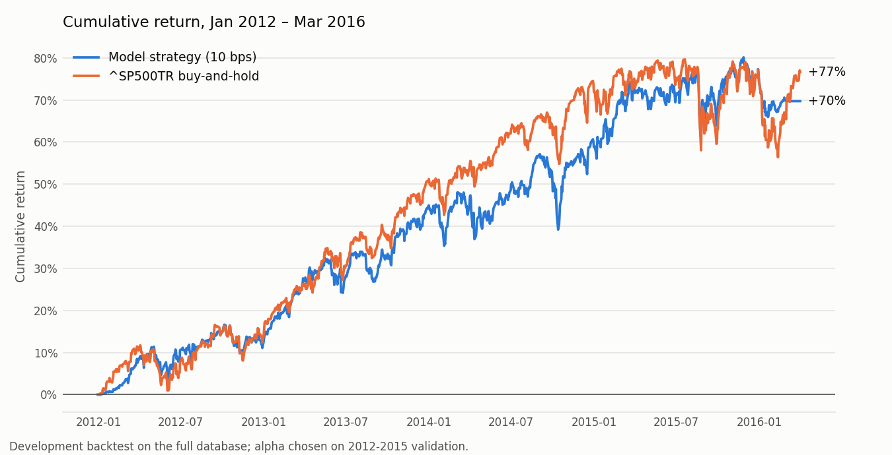
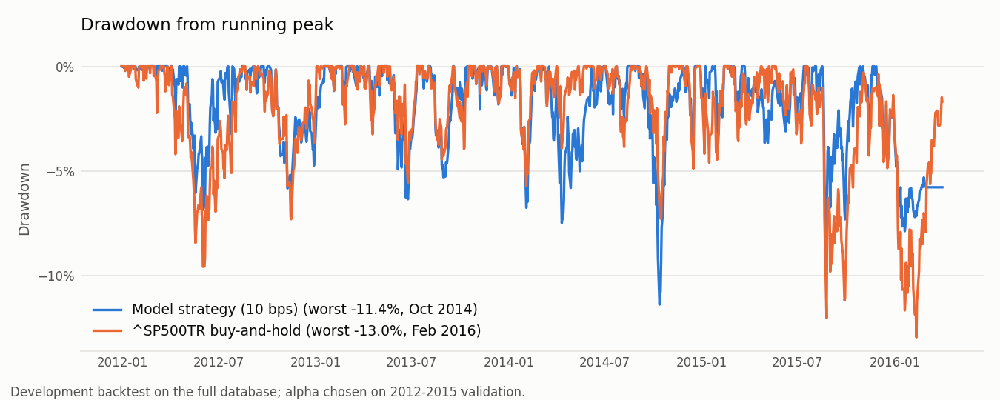
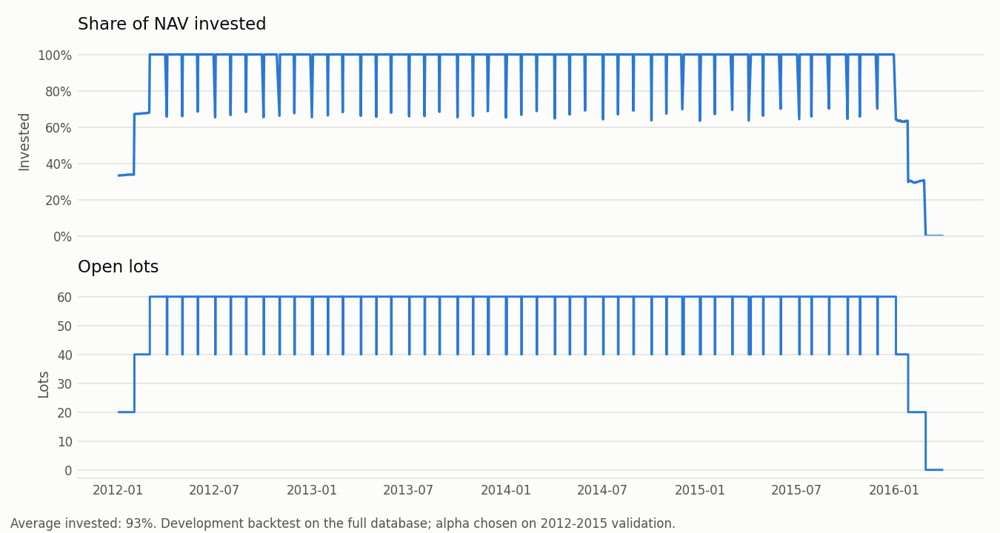

# Development results (full database, Jan 2010 – Mar 2016 only)

Generated by `python hw4.py dev`. No data after 2016-03-31 was loaded.

## Data

- Prices: 7,905,030 rows, 2,687 symbols; fundamentals: 145,265 rows.
- Loader warning: Quarantining 275 non-positive/non-finite adjusted prices.
- Loader warning: Quarantining 1 price rows not on the market calendar.
- Training/validation panel: 133,839 rows on 72 month-end signal dates, 1654–1977 eligible stocks per date (median 1861); 98.5% have a completed 90-day target.
- Price-sanity screen (a one-day move above x4 or below /4 in the last 63 sessions) removed 107 stock-dates across the 72 month-ends (max 4 on one date) that passed every other screen.
- Training targets are capped at each date's 1st/99th percentiles. Before capping, the largest 90-day return in the panel was +2,270%; the 99.9th percentile was +130%.
- Feature coverage (non-missing): mom_21 100%, mom_252_21 97%, vol_63 100%, drawdown_252 97%, operating_roa 100%, accruals_to_assets 100%, debt_to_assets 100%, log_cap 100%

## Walk-forward validation

The model is fitted at the first session of each year on month-end rows from 2010 whose targets had already ended, then scored on that year's month-ends. The alpha grid was fixed in `hw4.py` (RIDGE_ALPHAS) before any results were seen.

| alpha | mean rank IC | mean decile spread (90d) | share of dates with IC > 0 |
|---:|---:|---:|---:|
| 10 | 0.0428 | 2.27% | 79% |
| 1,000 | 0.0444 | 2.39% | 79% |
| 100,000 | 0.0599 | 3.14% | 68% |
| 10,000,000 | 0.0615 | 3.17% | 66% |

**Chosen alpha: 10,000,000** (highest mean rank IC).

| year | n_train | rank IC | decile spread |
|---:|---:|---:|---:|
| 2012 | 34,830 | 0.0694 | 4.33% |
| 2013 | 58,264 | -0.0356 | -3.72% |
| 2014 | 80,905 | 0.0995 | 4.05% |
| 2015 | 104,332 | 0.1127 | 8.01% |

## Feature weights (coefficient / sum of |coefficients|; features are percentile ranks)

With a large penalty only the relative sizes matter for ranking stocks. Positive means a higher rank predicts a higher 90-day market-relative return.

| feature | fit 2011-12-30 | fit 2012-01-03 | fit 2013-01-02 | fit 2014-01-02 | fit 2015-01-02 |
|---|---:|---:|---:|---:|---:|
| mom_21 | -0.3% | -0.3% | -3.3% | -1.7% | -5.3% |
| mom_252_21 | +8.7% | +8.7% | +12.1% | +22.4% | +15.2% |
| vol_63 | -20.7% | -20.7% | -15.8% | -5.3% | -11.3% |
| drawdown_252 | +13.7% | +13.7% | +9.4% | +9.2% | +8.5% |
| operating_roa | +35.2% | +35.2% | +28.6% | +37.8% | +32.7% |
| accruals_to_assets | -1.7% | -1.7% | +3.7% | +0.9% | +0.7% |
| debt_to_assets | +5.5% | +5.5% | +15.6% | +17.3% | +17.7% |
| log_cap | +14.3% | +14.3% | +11.6% | +5.5% | +8.5% |

## Development backtest, Jan 2012 – Mar 2016 (last entry Dec 31, 2015)

This period was also used to choose alpha, so it is not an out-of-sample result. After the last entry, the portfolio winds down to cash during the Jan–Mar 2016 buffer while the benchmark stays invested.

| Metric | Model strategy | ^SP500TR |
|---|---:|---:|
| start | 2011-12-30 | 2011-12-30 |
| end | 2016-03-31 | 2016-03-31 |
| final_value | $1,697,252 | $1,766,607 |
| total_return | 69.73% | 76.66% |
| CAGR | 13.25% | 14.32% |
| max_drawdown | -11.39% | -12.96% |
| annualized_volatility | 12.30% | 13.15% |
| Sharpe | 0.92 | 0.94 |

### Transaction-cost sensitivity

| cost per side | final value | CAGR | max drawdown | Sharpe | fees paid |
|---|---:|---:|---:|---:|---:|
| 10 bps | $1,697,252 | 13.25% | -11.39% | 0.92 | $45,013 |
| 5 bps | $1,724,634 | 13.68% | -11.36% | 0.95 | $22,704 |
| 20 bps | $1,643,786 | 12.40% | -11.46% | 0.85 | $88,469 |

### Accounting audit

| Check | Detail | Passed |
|---|---|:-:|
| NAV = cash + holdings, every day | max gap $2.33e-10 | ✅ |
| Cash never negative | min cash $0.00 | ✅ |
| Every BUY at that day's real adjusted close | 960 buys | ✅ |
| Every BUY's signal is the previous session | signal_date vs fill date | ✅ |
| No BUY after the last entry date | last buy 2015-12-01 | ✅ |
| Each day's buys fit in the previous close's cash | max spend/cash 1.000000 | ✅ |
| Every SELL at that day's real adjusted close | 960 sells | ✅ |
| Every SELL on/after its 90-day due date | calendar days held: 90–91 | ✅ |
| Every SELL on the first quoted session on/after due | no early or late exits | ✅ |
| Each lot sold at most once; buys − sells = open lots | 960 − 960 = 0 | ✅ |
| Open lots past due only if no quote since due | 0 open lots past due | ✅ |
| Sum of fill cash flows = final cash − initial cash | $697,251.96 | ✅ |
| Initial capital + realized + unrealized PnL = final NAV | final NAV $1,697,251.96 | ✅ |
| No date after the run end | last date 2016-03-31 | ✅ |
| Liquidity: every BUY had ≥60 prices in the 63 sessions to its signal | min count 63 | ✅ |
| Ramp-up: exactly 3 buy days, each the first session of a month | 2012-01-03, 2012-02-01, 2012-03-01 | ✅ |
| After ramp-up: every buy day follows a sale day | 45 reinvest days | ✅ |
| After ramp-up: spend ≤ the previous close's sale proceeds | max spend/proceeds 1.000000 | ✅ |
| No held position moved beyond x4 or /4 in one day (bad-print check) | largest one-day move while held: x1.41; 0 flagged | ✅ |
| Every BUY had a raw close ≥ $5 at its signal | min $7.70 | ✅ |

**20 of 20 checks pass.** Diagnostics: 0 stale marks, 0 freezes, 0 rejected orders, 0 delayed exits. Total fees $45,012.90. Average share of NAV invested: 92.6%.

## Plots

