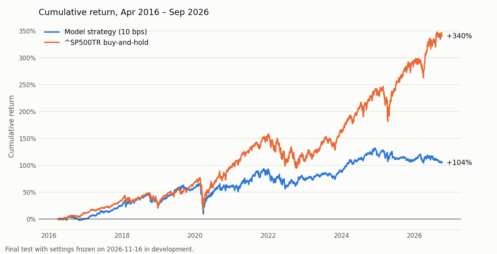
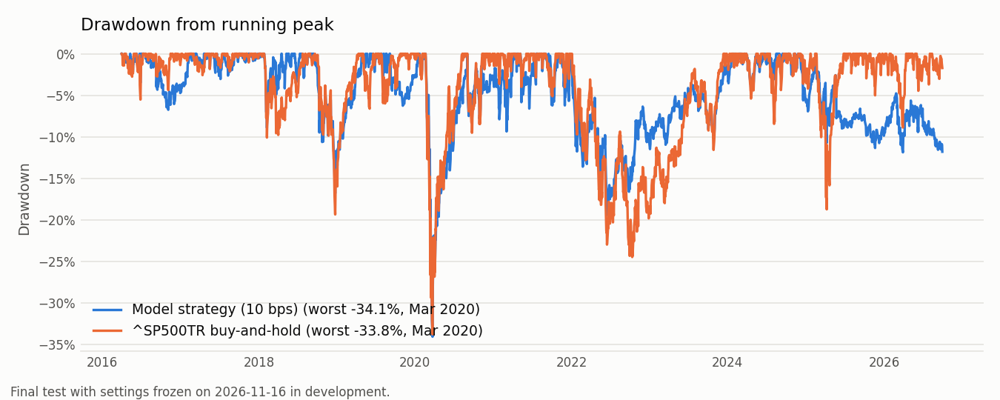
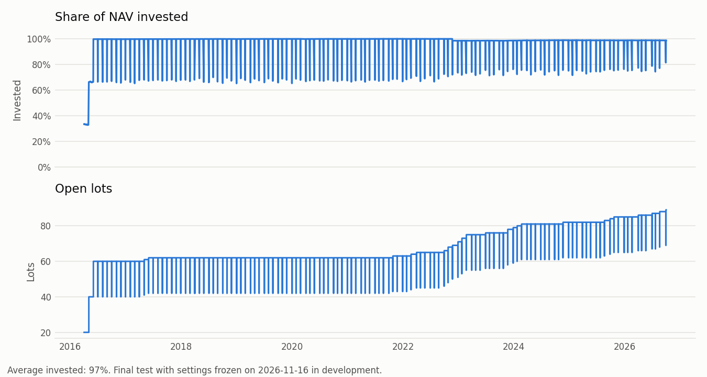

# Final test results, Apr 2016 – Sep 2026

Generated by `python hw4.py final` with the settings in `frozen_config.json` (alpha 10,000,000). Models refit at: 2016-03-31, 2017-01-03, 2018-01-02, 2019-01-02, 2020-01-02, 2021-01-04, 2022-01-03, 2023-01-03, 2024-01-02, 2025-01-02, 2026-01-02.

- Loader warning: Quarantining 275 non-positive/non-finite adjusted prices.
- Loader warning: Quarantining 28 price rows not on the market calendar.

## Strategy vs $1,000,000 in ^SP500TR at the first test close

| Metric | Model strategy | ^SP500TR |
|---|---:|---:|
| start | 2016-03-31 | 2016-03-31 |
| end | 2026-09-30 | 2026-09-30 |
| final_value | $2,043,242 | $4,402,747 |
| total_return | 104.32% | 340.27% |
| CAGR | 7.04% | 15.16% |
| max_drawdown | -34.09% | -33.79% |
| annualized_volatility | 14.84% | 17.82% |
| Sharpe | 0.40 | 0.77 |

**Did not beat the benchmark by $2,359,505 in final value (-8.12% CAGR).**

If every frozen (no-quote) position were worth $0, the final value would be $1,301,042.

### Transaction-cost sensitivity

| cost per side | final value | CAGR | max drawdown | Sharpe |
|---|---:|---:|---:|---:|
| 10 bps | $2,043,242 | 7.04% | -34.09% | 0.40 |
| 5 bps | $2,120,225 | 7.42% | -34.08% | 0.42 |
| 20 bps | $1,911,284 | 6.36% | -34.11% | 0.36 |

### Accounting audit

| Check | Detail | Passed |
|---|---|:-:|
| NAV = cash + holdings, every day | max gap $2.33e-10 | ✅ |
| Cash never negative | min cash $4,864.18 | ✅ |
| Every BUY at that day's real adjusted close | 2,539 buys | ✅ |
| Every BUY's signal is the previous session | signal_date vs fill date | ✅ |
| No BUY after the last entry date | last buy 2026-09-29 | ✅ |
| Each day's buys fit in the previous close's cash | max spend/cash 0.992447 | ✅ |
| Every SELL at that day's real adjusted close | 2,450 sells | ✅ |
| Every SELL on/after its 90-day due date | calendar days held: 90–91 | ✅ |
| Every SELL on the first quoted session on/after due | no early or late exits | ✅ |
| Each lot sold at most once; buys − sells = open lots | 2539 − 2450 = 89 | ✅ |
| Open lots past due only if no quote since due | 29 open lots past due | ✅ |
| Sum of fill cash flows = final cash − initial cash | $-970,063.49 | ✅ |
| Initial capital + realized + unrealized PnL = final NAV | final NAV $2,043,241.76 | ✅ |
| No date after the run end | last date 2026-09-30 | ✅ |
| Liquidity: every BUY had ≥60 prices in the 63 sessions to its signal | min count 63 | ✅ |
| Ramp-up: exactly 3 buy days, each the first session of a month | 2016-04-01, 2016-05-02, 2016-06-01 | ✅ |
| After ramp-up: every buy day follows a sale day | 124 reinvest days | ✅ |
| After ramp-up: spend ≤ the previous close's sale proceeds | max spend/proceeds 1.000000 | ✅ |
| No held position moved beyond x4 or /4 in one day (bad-print check) | largest one-day move while held: x14.90; 6 flagged | ❌ |
| Every BUY had a raw close ≥ $5 at its signal | min $5.36 | ✅ |

**19 of 20 checks pass.** Diagnostics: 85 stale marks, 17 freezes, 1 rejected orders, 29 delayed exits. Total fees $118,694.79. Average share of NAV invested: 97.1%.

## Plots

## Investigation of the failed audit check (added after the run, 2026-11-16)

The bad-print check flagged 6 positions. In every case the raw and the "adjusted" close fall by the same factor on the same day, so these are **stock splits missing from the adjusted prices**, not real losses:

| Stock | Lots | Date | Adjusted close before → after | Booked PnL |
|---|---:|---|---|---:|
| ORLY | 3 | 2025-05-23 | $1,364.79 → $91.62 (÷14.9) | −$76,665 |
| COKE | 1 | 2025-05-23 | $1,130.24 → $114.36 (÷9.9) | −$25,661 |
| KLAC | 2 | 2026-06-08 | $1,929.20 → $210.81 (÷9.2) | −$45,026 |

These 6 lots booked **−$147,352 of artificial losses**. Adding that back gives about $2.19M, still far below the benchmark's $4.40M.

**Frozen positions.** 17 stocks stopped trading while held. Most were takeovers or redemptions (LLTC 2017; SC, CDK, CHNG, SHLX, CLR, PBFX 2022; WWE, MMP 2023; TGI 2025; EA 2026; plus some preferreds and notes). The data has no deal proceeds, so these lots stay at their last price and their money is never reinvested. Frozen value grew to **$742,200 (36% of NAV) by the end** and averaged 11% of NAV over the test. If every frozen lot were worth $0, the final value would be $1,301,042. In reality most of these were cash or stock deals near the last price, so the frozen value is a reasonable mark. The larger cost is that this capital sat idle instead of being reinvested.

**Other diagnostics:** 85 stale marks, 29 delayed exits, and 1 order rejected for a missing price. The strategy was 97% invested on average (frozen lots included); 59% of its 2,450 sales made money.

Per the rules, nothing was changed or re-run after seeing these results.
