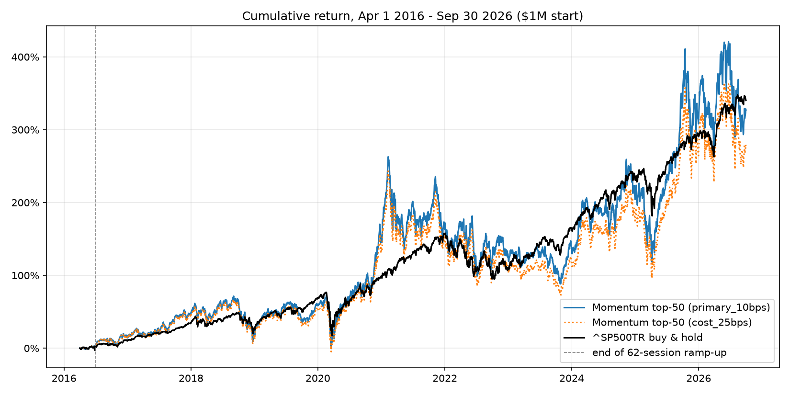

# HW4: Stock-Return Model, Momentum Strategy and Backtester

Anjali Sudhakar Bandewar, UCB MFE Python Pre-Program 2026

## Overview

This project builds point-in-time features and 90-day forward-return labels for a dated
top-2,000 U.S. stock universe, compares a Ridge regression and a HistGradientBoosting
model against a single 12-month momentum factor on 2010-2015 development data, and
backtests the chosen strategy on the final test period (2016-04-01 to 2026-09-30) against
`^SP500TR`.

**Result:** the strategy is a daily top-50 momentum portfolio held in 62 overlapping
90-day tranches. Under the primary (conservative) assumptions it finished at
**$4,266,784**, compared with **$4,402,747** for the S&P 500 total-return benchmark.

| | Final value | CAGR | Max drawdown | Sharpe (rf 2%) |
|---|---|---|---|---|
| Momentum top-50 (primary: 10 bps/side, unexecutable exits written off) | $4,266,784 | 14.82% | -48.1% | 0.52 |
| `^SP500TR` buy-and-hold | $4,402,747 | 15.17% | -33.8% | 0.77 |



Full backtest results, sensitivities, diagnostics, validation and limitations are in
**[backtest_findings.md](backtest_findings.md)**.

## Environment and setup

- Python 3.12.9, duckdb 2.0.0, pandas 3.1.0, numpy 2.5.4, scikit-learn 1.9.1,
  matplotlib 3.11.2 (developed on macOS).
- Install: `pip install duckdb pandas numpy scikit-learn matplotlib`.
- **Data:** download `equities_top2000.duckdb` (full homework database, bCourses) into
  `Homeworks/HW4/Anjali_Sudhakar_Bandewar/data/`. Snapshot used:
  `snapshot_sha256 = 5beb018f...f03f3d`, history through 2026-09-30. The database is opened
  **read-only** everywhere and is never modified. `data/*.duckdb` and `results/` are
  gitignored.

## Data sources

All data comes from `equities_top2000.duckdb`:

| Table | Used for |
|---|---|
| `prices` | Split/dividend-adjusted `adj_close` for returns, momentum, fills and valuation; raw `close` x `volume` for liquidity |
| `calendar` | Market sessions (next-session entry, 90-day exits, delay counts) |
| `universe_membership` | Dated quarterly top-2,000 membership (`effective_start` to `quarter_end`) |
| `fundamentals` | Quarterly statements with filing dates, for point-in-time ratios |
| `benchmark` | `^SP500TR` total-return index |

## Run order

Run from the **repository root** (paths are repo-relative):

```
mkdir -p Homeworks/HW4/Anjali_Sudhakar_Bandewar/results                          # 0. output folder (gitignored)
python Homeworks/HW4/Anjali_Sudhakar_Bandewar/src/build_price_features.py        # 1. price panel
python Homeworks/HW4/Anjali_Sudhakar_Bandewar/src/build_fundamental_features.py  # 2. + fundamentals
python Homeworks/HW4/Anjali_Sudhakar_Bandewar/src/build_training_labels.py       # 3. 90-day labels
python Homeworks/HW4/Anjali_Sudhakar_Bandewar/src/model_dataset.py               # 4. fold summary (optional)
python Homeworks/HW4/Anjali_Sudhakar_Bandewar/src/train_baselines.py             # 5. development models (~3 min)
python Homeworks/HW4/Anjali_Sudhakar_Bandewar/src/backtest.py                    # 6. final backtest (~75 s)
```

Each script prints its own validation checks. The `audit_*.py`, `explore_database.py`,
`inspect_*.py` and `investigate_anomalies.py` scripts are exploratory data-quality checks
and are not needed to reproduce the results.

## Methodology

### Features (`build_price_features.py`, `build_fundamental_features.py`)
- **Universe:** stocks are included only while they are members of the dated quarterly
  universe; original universe ranks are kept.
- **Momentum:** 1, 3, 6 and 12 months, computed as `adj_close / adj_close k positive-price
  rows earlier - 1` (k = 21, 63, 126, 252).
- **Fundamentals:** for each stock-date, the latest *eligible* quarterly record. It must
  satisfy `filing_date <= date`, `filing_date >= fiscal_date` and `fiscal_date <= date`,
  and be at most 548 days old. Ties are broken by the most recent fiscal date, then filing
  date. Every price observation is kept; if no eligible record exists, the fundamentals are
  left blank.
- **Ratios:** profit margin, EBITDA margin, debt/equity, asset turnover and FCF margin.
- **Excluded symbols** (`src/exclusions.py`), applied to every derived file:
  - **AAM:** ticker contamination.
  - **VBIV:** a zero-volume jump from $1.11 to $924.
  - **LCI:** a 16.9x stacked split/adjustment error.

### Labels (`build_training_labels.py`)
- **Feature dates:** 2010-01-01 to 2015-12-31. Exits may extend into 2016; there is no
  exit cutoff.
- **Entry:** the next session's close, which must have a positive price and positive
  volume. If it doesn't, the label is censored; entry is never delayed.
- **Exit:** maturity is entry + 90 calendar days, and the scheduled exit is the first
  session on or after maturity. The label exits at the first executable close within 5
  sessions of the scheduled exit; otherwise it is censored with a stated reason.
- **Flags:** single-day adjusted moves above 4x or below 0.25x are flagged
  (`extreme_move_flag`), not deleted.
- **Counts:** 2,988,813 labels, of which 2,936,176 are valid and 52,637 censored.

### Model development (`model_dataset.py`, `train_baselines.py`)
- **Features:** 11, fixed in advance: 4 momentum, universe rank, 5 ratios and fundamental
  age. `adj_close` levels and raw dollar fundamentals are excluded.
- **Target:** cross-sectional percentile rank of forward return, computed **within each
  fold's training data, after** keeping only labels with `actual_exit_date < fit_date`.
- **Splits:** expanding window. Fit dates are the first sessions of 2012, 2013 and 2014,
  which were used for tuning. **2015 is an untouched holdout**, scored once. Training uses
  every 5th session; validation uses every session. Validation labels exiting on or after
  2016-04-01 are dropped.
- **Pipelines:** fitted on each fold's training rows only. Ridge: clip, median-impute with
  missing indicators, scale. HistGradientBoosting: clip, no early stopping. The quantile
  clipper is adapted from `Lectures/modeling/course_data.py` (cited in code).

| Model | Mean rank IC 2012-14 | 2012 / 2013 / 2014 | 2015 holdout |
|---|---|---|---|
| Momentum 12m (no fitting) | **0.031** | 0.062 / 0.041 / -0.010 | 0.074 |
| HistGradientBoosting (lr 0.05, 15 leaves, 100 iters) | 0.023 | 0.062 / -0.033 / 0.041 | 0.070 |
| Ridge (alpha = 1) | 0.016 | 0.020 / -0.019 / 0.047 | 0.031 |

Momentum had the highest mean IC and decile spread on the tuning folds, so it was chosen
as the strategy signal **before** the test period was run.

### Backtest (`backtest.py`)
- **Selection:** at each close, rank eligible universe members by 12-month momentum, using
  data on or before that date only. Eligibility also requires a 63-session median dollar
  volume of at least $5M, trading on at least 57 of 63 sessions, and a trade on the signal
  day.
- **Sizing:** set aside `min(cash, NAV/62)` and split it equally across the top 50. Orders
  fill at the next close.
- **Exits:** hold 90 calendar days and sell at the first executable close within 5 sessions
  of the scheduled exit. Otherwise the position is **written off at $0** (primary case).
- **Prices:** fills require positive price **and** volume. Valuation uses the last positive
  `adj_close`. `adj_close` is a total-return series, so dividends are not credited
  separately.
- **Costs and cash:** 10 bps per side (0 and 25 bps sensitivities). Cash earns 0%.
  Long-only, no leverage, no data after 2026-09-30.
- **Ticker continuity:** two verified renames are mapped: GPS -> GAP and DWAC -> DJT.

## Outputs

Committed:
- `README.md`: this file.
- `backtest_findings.md`: backtest findings and limitations.
- `figures/cumulative_returns.png`: the chart.
- `src/`: all code.

Generated into `results/` (gitignored; recreate with the run order above):
- `price_feature_panel.parquet`, `combined_feature_panel.parquet`, `training_labels.parquet`
- `models/`: `folds.csv`, `tuning_results.csv`, `tuning_summary.csv`, `selected_by_year.csv`
- `backtest/`: `trades.csv`, `daily.csv`, `signals.csv`, `write_offs.csv`, `metrics.csv`,
  `metrics.json`, `cumulative_returns.png`

## Validation evidence

- **Features:** each derived panel was reconciled against the previous build minus the
  excluded symbols (0 differences).
- **Labels** (0 violations): entry after feature date, exit on or after maturity, exit
  delay of 5 sessions or less, no zero-volume fills, no duplicates, no feature dates after
  2015. An independent recalculation found 0 mismatches.
- **Model folds:** asserts confirm that training exits fall before the fit date and that
  validation exits fall before the test period.
- **Backtest:** 22 checks covering look-ahead, fills, mapped-ticker fills, sizing, cash,
  exact cash/NAV/P&L reconciliation and an AAPL hand check. See
  [backtest_findings.md](backtest_findings.md#validation-all-four-runs-pass).

## Findings

- **Development:** neither ML model beat plain 12-month momentum. Both failed in 2013,
  when the lowest-ranked stocks rallied.
- **Test period:** the strategy roughly matched the benchmark's return (14.8% vs 15.2%
  CAGR) with twice the volatility and a much deeper drawdown, so its risk-adjusted
  performance was worse.
- **Sensitivities:** the result is sensitive to costs (25 bps gives $3.78M) and to how
  delisted acquisition targets are treated (last-price carry gives $5.74M). Actual merger
  and delisting proceeds are not in the data, so beating the benchmark cannot be confirmed.

## Unsuccessful approaches

- Ridge and HistGradientBoosting on 11 price and fundamental features had lower and less
  stable rank IC than momentum alone. Ridge was insensitive to alpha, and deeper or longer
  boosting overfit.
- An exit-date cap at the end of the buffer was removed. It discarded valid late-2015
  labels, and removing the cap without a delay limit let in multi-year exits from reused
  tickers.

## Limitations

1. **Delisting and merger proceeds** are unavailable. Write-off and last-price carry are
   separate sensitivities, not bounds.
2. **Duplicate tickers:** the source repeats renamed companies' histories. 15 duplicate
   pairs were selected on the same day (1.19% of selections). Only two renames are mapped;
   COMM -> VISN and OAS -> CHRD are unverified candidates.
3. **Price-data errors:** these exist even in positive prices. Exclusions (AAM, VBIV, LCI)
   used hindsight; other unadjusted splits may remain.
4. **Single path:** one test path, flat transaction costs, 0% cash interest, and open
   positions valued without exit costs.

## Possible next steps

- Source corporate-action and delisting-proceeds data, and map verified renames
  systematically. This would remove duplicate issuers and resolve the write-offs.
- Add a per-issuer exposure cap, and volatility-scaled or sector-neutral weights, to
  reduce the 48% drawdown.
- Try cross-sectionally ranked features, volatility and short-term reversal, and a
  momentum-only Ridge as a model baseline.
- Backtest the HistGradientBoosting model with a predefined retraining rule.

## Code reuse and AI assistance

- **Course code:** `QuantileClipper` in `train_baselines.py` is adapted from
  `Lectures/modeling/course_data.py`. The next-session entry, the 90-day calendar holding
  period, the five-session exit delay and the stale-mark conventions follow
  `Lectures/modeling/README.md`.
- **AI assistance:** I used two AI tools.
  - **Claude Code** (Anthropic) was used for implementation and debugging: writing and
    fixing the feature, label, modeling and backtest scripts, running the data-quality and
    validation queries I requested, and drafting this README and `backtest_findings.md`
    for my review.
  - **ChatGPT** (OpenAI) was used for methodology review and interpretation: discussing
    look-ahead risks, label and exit rules, validation design, and how to read the
    results.
- **My role:** I made the methodology decisions (point-in-time rules, exclusions, label
  censoring, target definition, folds, liquidity threshold, write-off policy, costs and
  ticker mappings), reviewed outputs before accepting them, and am responsible for the
  submitted work. Ticker-rename evidence was checked against primary sources (company
  release, OCC memo, SEC 8-K).
