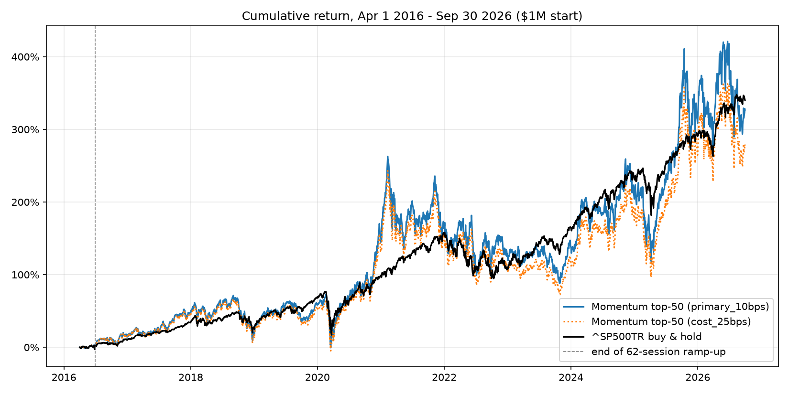

# HW4 Backtest: Findings and Limitations

Final test period: **2016-04-01 to 2026-09-30**. Code: `src/backtest.py`.
Outputs: `results/backtest/` (regenerated by the script; not committed).

## Strategy

- **Signal:** 12-month momentum (`adj_close / adj_close 252 positive-price rows earlier - 1`),
  the same definition as the development feature panel, computed from prices on or before
  each signal date. In development (2012-2014 walk-forward folds) this single factor had a
  higher mean rank IC (0.031) than Ridge (0.016) or HistGradientBoosting (0.023) on 11
  features, so it was chosen before the test period was run.
- **Universe:** dated quarterly top-2,000 membership (`effective_start` to `quarter_end`) on
  the entry date. Membership is fixed at `selection_date`, the session before
  `effective_start`, so it is known at the signal close. AAM and LCI are excluded
  (`src/exclusions.py`; confirmed price-data errors).
- **Liquidity screen (signal-date data only):** median close x volume over the trailing 63
  sessions >= $5M, traded on >= 57 of those 63 sessions, and traded on the signal date.
  Raw close and volume are both split-adjusted in the source, so their product is unaffected
  by later splits. No price-level filter is used: back-adjusted price levels would encode
  future reverse splits.
- **Portfolio:** long-only, no leverage, $1,000,000 start. Each close *t*, set aside
  `min(cash, NAV_t / 62)` and split it equally across the top 50 (62 = median sessions in 90
  calendar days). Orders fill at the next session's close. Each purchase is a separate
  90-calendar-day position, so the book is 62 overlapping daily tranches.
- **Exits:** scheduled exit = first session on/after entry + 90 days. Sell at the first
  executable close in that session or the next 5. If there is none, the position is
  **written off at $0** (primary case). The source has no delisting-proceeds data, and the
  course data guide forbids inferring a payout from a final price.
- **Prices:** trades use only *executable* closes (adj_close > 0 and volume > 0). Daily
  valuation uses the latest adj_close > 0 at any volume; such marks are never used as trade
  prices. No price after 2026-09-30 is read.
- **Costs:** 10 bps per side (commission + half-spread + impact for small orders in
  >= $5M/day names), included in each tranche's budget. Cash earns 0%. The benchmark
  (`^SP500TR`, $1M at the 2016-04-01 close) pays no costs.

## Results

| | Final value | CAGR | Max drawdown | Sharpe (rf 2%) | Ann. vol |
|---|---|---|---|---|---|
| **Momentum top-50, 10 bps (primary)** | **$4,266,784** | **14.82%** | **-48.1%** | **0.52** | 34.0% |
| Momentum top-50, 0 bps | $4,628,687 | 15.72% | -47.0% | 0.54 | 34.0% |
| Momentum top-50, 25 bps | $3,776,335 | 13.49% | -49.7% | 0.49 | 34.0% |
| Sensitivity: next valid exit / last-mark carry, 10 bps | $5,738,044 | 18.11% | -42.6% | 0.63 | 30.9% |
| **^SP500TR buy-and-hold** | **$4,402,747** | **15.17%** | **-33.8%** | **0.77** | 17.8% |



**Under the primary assumptions the strategy did not beat the benchmark.** It finished
$135,963 (-0.35 pp CAGR) behind, with about twice the volatility, a drawdown 14 points
deeper and a lower Sharpe ratio. Returns came in bursts (late 2020 to early 2021, late
2025) followed by sharp reversals, typical of momentum in speculative names.

- **Costs:** $186,062 total; turnover is about 7.7x NAV per year. Each extra 15 bps per side
  costs about 1.3 pp of CAGR. The strategy is behind the benchmark at 10 bps and only
  ahead at 0 bps.
- **Ramp-up and cash drag:** cash was 98.4% of NAV on day 1, averaged 49% over the first
  62 sessions, and was fully deployed by 2016-06-28. The ramp did not hurt here: the
  strategy returned +0.5% while the benchmark returned -1.2%. After the ramp, cash averages
  3.6% of NAV, mostly the next day's tranche awaiting execution. Measured from the ramp end,
  CAGR is 15.14% vs 15.69%, a gap similar to the full period's.
- **Open positions at the end:** 3,100 positions worth $4.12M are valued at the
  2026-09-30 close. Selling them at 10 bps would cost a further $4,116.

## Unexecutable exits (write-offs)

**1,499 positions in 47 stocks ($1.27M of cost) are written off.** At their last prices
they were worth $1.43M. Almost all are **acquisition targets**: momentum buys after a deal
announcement lifts the price, and the ticker stops trading at closing, before the 90-day
exit. Examples: Cidara, Longboard, CymaBay, ImmunoGen, Reata, Prometheus (RXDX), Rover,
At Home, Houghton Mifflin. There are 772 write-off dates, and the largest single-day loss
is 0.33% of NAV.

**Verified ticker continuity (implemented).** Two write-offs were ticker renames, not
delistings. Positions in the old ticker are now priced from the successor after the old
ticker's last row, scaled by the adj_close ratio on that date:

| Old -> new | Link date in data | Evidence | Scale |
|---|---|---|---|
| GPS -> GAP | 2024-09-18 (official change 2024-08-22) | [Gap Inc. release](https://www.gapinc.com/en-us/articles/2024/08/gap-inc-to-change-ticker-symbol-to-gap%E2%80%9D-on-august-): same CUSIP, no shareholder action; [OCC memo](https://boxexchange.com/assets/BOXOnnMemo206676.pdf). Source closes identical on all 6,217 overlapping dates. | 1.0075 (adj-factor difference only) |
| DWAC -> DJT | 2024-03-25 (DJT trading from 2024-03-26) | [SEC 8-K, CIK 1849635](https://www.sec.gov/Archives/edgar/data/1849635/000114036124016719/ef20025342_8k.htm): Digital World renamed Trump Media & Technology Group; Class A shares redesignated as the new common stock. Source rows identical on all 27 overlapping dates. | 1.0 |

This turned 72 write-offs (GPS 47, DWAC 25) into normal exits, adding $88,562 to final
value ($4,178,222 -> $4,266,784). No other mappings were assumed.

**Sensitivity: next valid exit / last-price carry.** Only 166 written-off positions ever
trade again (median 788 sessions late). The other 1,333 have no later price, so in this
sensitivity they stay open at their last mark ($1.34M at the end) and are never
reinvested. It is a valuation assumption, not an observed sale.

The two cases are **separate sensitivities, not bounds** on the true result. Actual
merger, tender or delisting proceeds are not in the database for these positions. Real
outcomes could be cash at a deal price, shares or other consideration in an acquirer
(which would then have its own later returns), or less than the last price if a deal
failed or the stock was delisted for distress. Proceeds would also have been reinvested.
So the true result could fall outside $4.27M to $5.74M, and **whether the strategy beat
the benchmark cannot be established from this data**. Under the stated primary
assumptions it did not.

**Possible further renames (not mapped).** The scan in "Duplicate tickers" below shows two
remaining written-off tickers whose full price history is repeated under another ticker
that keeps trading: **COMM -> VISN** (42 positions, $54.6k cost) and **OAS -> CHRD**
(26 positions, $21.5k cost). They may be renames or mergers with a renamed ticker, but
this has not been verified from a primary source, so they stay written off.

## Exposure and valuation diagnostics

- **Single-stock exposure:** there is no explicit cap; repeated daily buys plus price gains
  set the weights. The maximum was **6.5% in Axsome Therapeutics (AXSM) on 2019-12-20**.
  It was selected on 64 signal dates in the preceding 90 days, and its price ranged from
  about $17 to $101 over that window.
  Weight exceeded 5% on 32 days (AXSM in Dec 2019, FuelCell Energy (FCEL) around Nov 2020 to
  Jan 2021, and isolated days through 2024-09). This is drift from winners, not a sizing
  error: every tranche obeys `budget <= NAV/62` and `1/50` per name.
- **Duplicate tickers in the universe:** the source often repeats a renamed company's full
  price history under both its old and new ticker, and both can be universe members at
  once. A scan of the test period found 15 pairs with identical close and volume that were
  **both selected on the same signal date**: SQ/XYZ (379 dates), CHRD/OAS (272),
  COMM/VISN (194), CHK/EXE (170), CEIX/CNR (124), HAPN/LC (124), GAP/GPS (120),
  BALL/BLL (84), CLI/VRE (28), LANC/MZTI (26), TBK/TFIN (20), P/PSTG (12), HOUS/RLGY (9),
  VEC/VVX (3), FREY/TE (2).
  - **Impact:** 1,308 of 2,640 signal dates selected fewer than 50 distinct issuers (mean
    49.41, minimum 47). 1,567 of 132,000 selections (1.19%) were a second slot in the same
    issuer. Across the test period, 1,364 tickers were selected, which is 1,349 issuers after
    merging these pairs.
  - **Example:** the combined Gap (GPS+GAP) weight peaked at 3.9% on 2024-08-09.
  - Left unchanged, so as not to alter the strategy or universe. It modestly concentrates
    the book and slightly overstates diversification.
- **Stale valuation marks:** on 1,327 of 2,641 days, at least one open position was valued
  at a price more than 5 sessions old (mean 36 positions on such days, max 138). These are
  mainly acquisition targets between their last trade and their write-off date. NAV
  includes them at the last price until the write-off, then drops (largest single drop
  0.33% of NAV). The course backtester halts for investigation after 5 stale sessions; this
  backtester continues and records the incident.

## Price basis: `adj_close` as total return

`adj_close` is the vendor's split- and dividend-adjusted close, so the ratio of two
`adj_close` values is a total return. Checked on 6,439 ex-dividend days in the test period
(dividend yield > 0.5%), the one-day `adj_close` return matches price-plus-dividend
(median gap 0.00023) far better than price alone (median gap 0.00899). It is closer to
the total return on 90% of those days.

- **Execution and valuation both use `adj_close`:** positions are held as fractional
  adjusted-price units, so a fill at `adj_close` and a later mark at `adj_close` give the
  total return.
- **No double counting of dividends:** the `dividends` table is never read by the
  backtester and no dividend cash is credited.
- **Benchmark:** `^SP500TR` is itself a total-return index.
- **Caveat:** absolute `adj_close` levels are back-adjusted for later events, so they are
  not real historical trade prices. Only ratios are used (returns, momentum). The
  liquidity screen uses raw `close x volume`, which is unaffected by splits.

## Validation (all four runs pass)

Every check below is 0 in every run unless stated otherwise:

- **Timing:** entry on or before signal date; entry not on the next session; membership
  selected after the signal; prices or trades after 2026-09-30; exits before maturity;
  closed exits delayed more than 5 sessions.
- **Fills:** excluded symbols traded; fills on non-executable rows, including mapped fills
  checked against the successor's database row and scale ratio; successor prices used for
  an unmapped ticker or on/before the link date, or old-ticker prices after it. The fill
  check was tested with deliberately corrupted records: a 0.1% price error, the wrong
  ticker, a missing ratio and zero-volume fills were all detected.
- **Sizing and cash:** more than 50 orders a day; a day's budget above NAV/62; duplicate
  orders; fee mismatches; days with negative cash.
- **Independent recalculation:** momentum and liquidity recomputed for 300 sampled
  selections, 0 mismatches.
- **Reconciliation (all exact):** cash = $1M - purchases - entry fees + proceeds - exit
  fees; final NAV = cash + open positions; realized + unrealized - fees = NAV - $1M.
- **Hand check:** AAPL position, signal 2020-01-09. Budget $519.87 / 1.001 = $519.35
  invested plus a $0.52 fee; 6.9497 units at $74.73 (DB volume 140.9M); sold 2020-04-09 at
  $64.69 with no delay; net -$70.74.
- **Single stock above 5%:** 32 days (27 in the next-valid run). Expected, see Exposure.

## Limitations

1. **Delistings and corporate actions.** There is no delisting-proceeds or corporate-action
   table, so buyouts are written off (primary) or carried at the last price (sensitivity).
   Actual proceeds are unknown and could differ from both. Ticker histories are
   incomplete; only two verified renames are mapped (COMM -> VISN and OAS -> CHRD remain
   unverified candidates).
2. **Price-data quality.** Positive prices can still be wrong. AAM, VBIV and LCI were
   excluded after development-period investigation; AAM and LCI also appear in the test
   universe, so excluding them uses hindsight about data errors. Other unadjusted splits
   may remain (FBC was flagged in development).
3. **Universe construction.** Ranks use approximate capitalization (close x reported
   shares) and treat share classes and duplicate tickers as separate names (15 duplicate
   pairs co-selected, see Exposure).
4. **Costs and capacity.** A flat 10 bps ignores spread widening in stressed markets. Orders are tiny relative to the $5M/day screen, but results scale poorly
   with much larger capital.
5. **Model scope.** Only the momentum factor was tested out of sample. The 11-feature
   models did not beat it in development, and no HistGradientBoosting backtest was run.
6. **Statistical confidence.** One ~10.5-year path with overlapping positions and
   concentrated bursts. The 0.35 pp CAGR gap to the benchmark is small next to the
   strategy's ~34% annual volatility; no formal significance test was run.
7. **Conventions.** Cash earns 0%; open positions at the end are valued without exit
   costs; Sharpe uses 252-day annualisation of daily excess returns over a 2% annual rate.

## Reproducing

From the repository root, with `data/equities_top2000.duckdb` in place:

```
python Homeworks/HW4/Anjali_Sudhakar_Bandewar/src/build_price_features.py
python Homeworks/HW4/Anjali_Sudhakar_Bandewar/src/build_fundamental_features.py
python Homeworks/HW4/Anjali_Sudhakar_Bandewar/src/build_training_labels.py
python Homeworks/HW4/Anjali_Sudhakar_Bandewar/src/train_baselines.py   # development only
python Homeworks/HW4/Anjali_Sudhakar_Bandewar/src/backtest.py
```
