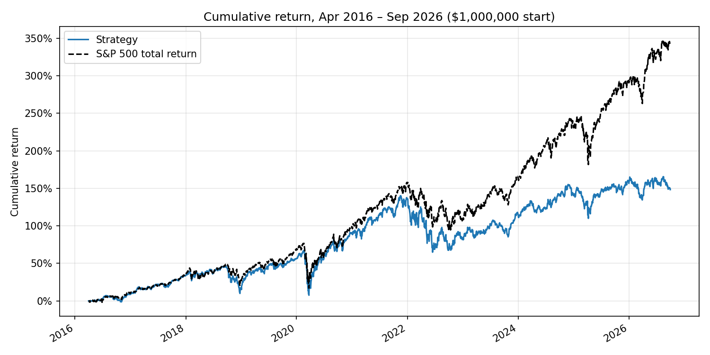

# HW4 – Stock prediction and trading strategy

Antoine Amiel

## Result

Final test: **April 1, 2016 – September 30, 2026**, $1,000,000, long only, 5 bps per side, cash earns 0%.

| | Strategy | S&P 500 TR (`^SP500TR`) |
|---|---:|---:|
| Final value (cash + open positions, Sep 30, 2026) | **$2,482,217** | **$4,402,747** |
| CAGR | 9.04% | 15.16% |
| Maximum drawdown | −35.7% | −33.8% |
| Sharpe ratio (daily, 2% annual risk-free) | 0.46 | 0.77 |
| Annualized volatility | 18.4% | 17.8% |

**The strategy did not beat the benchmark.** It trailed by 6.1 percentage points of CAGR and finished $1.92M below it. It stayed within about 8% of the benchmark's value through 2021, then fell behind from 2022 onward.



| Year | 2016* | 2017 | 2018 | 2019 | 2020 | 2021 | 2022 | 2023 | 2024 | 2025 | 2026* |
|---|---|---|---|---|---|---|---|---|---|---|---|
| Strategy | 8.6% | 22.7% | −11.8% | 32.9% | 22.2% | 23.4% | −22.3% | 18.8% | 10.8% | 6.5% | −3.2% |
| S&P 500 TR | 9.8% | 21.8% | −4.4% | 31.5% | 18.4% | 28.7% | −18.1% | 26.3% | 25.0% | 17.9% | 12.7% |

\* partial years. All numbers come from `results/final/`.

## How to run

From the repository root, run `uv sync --locked`, then put `equities_top2000.duckdb` from bCourses in `Lectures/modeling/data/`. Database files are not committed. Then, from this folder:

```bash
python tests/test_backtester.py              # accounting/timing unit tests (seconds)
python tests/check_against_course_reference.py  # labels/features vs course_data.py (needs equities_class.duckdb)
python run_development.py                    # model + strategy selection on 2010–2015 (~20 min)
python run_final_test.py                     # final test with results/chosen_config.json (~6 min)
python run_final_test.py --settle-stale      # optional sensitivity described below (~6 min)
```

Use the repository's `.venv` interpreter. The pipeline needs about 3 GB of RAM.

| Path | Content |
|---|---|
| `hw4/data.py` | Reads DuckDB into wide date × stock matrices and quarantines invalid / off-calendar prices |
| `hw4/features.py` | Causal features, dated eligibility, 90-day labels |
| `hw4/model.py` | Ridge / gradient-boosting models, folds, point-in-time quarterly refits, data-quality screen |
| `hw4/strategy.py` | Staggered-sleeve top-N strategy with a per-name cap |
| `hw4/backtester.py` | My backtester (ledger, daily loop, metrics, accounting checks) |
| `results/development/` | Fold validation and the 30 development backtests |
| `results/chosen_config.json` | Configuration frozen before the final test |
| `results/final/` | Final test: performance, daily NAV, every fill, open lots, events, fit audit, accounting checks |

## Data and look-ahead controls

- **Prices.** I use adjusted closes everywhere, so dividends are already in returns and are never added again. The 275 zero BHRB prices and the 28 off-calendar rows are quarantined, as in the course loader. Price gaps are never filled.
- **Universe.** A stock is a candidate on signal date *t* only if it is in the `universe_membership` list of the quarter of the entry date (*t*+1), with `selection_date ≤ t`. It must also have a quote at *t* and 63 complete daily returns. Inactive stocks are kept, and stocks that leave the list are held to normal maturity. The traded screen keeps `universe_rank ≤ 1000`, which is known at the time.
- **Fundamentals** are used from filing date + 1 day, only for filings dated after fiscal period end. A late old period never replaces a newer one, and values older than 550 days are blanked. This is the same rule as `course_data.financial_events`.
- **Labels.** The entry is the next session's close after the signal. The exit is the first quote on or after entry + 90 calendar days, at most 5 sessions late; otherwise the label is missing.
- **Training rows.** A model fitted after the close of a given date only uses rows whose label ended strictly before that date. `fit_audit.csv` shows the last training label end for every fit.
- **Learned preprocessing.** All features are same-date percentile ranks, which need no fitting. The only fitted preprocessing is the Ridge median imputer, which is fitted on training rows.
- **Cross-check.** On the class database, my eligible rows, labels and label end dates exactly match `course_data.prepare_panel()`. Momentum and volatility features agree to 1e-7, which is float32 rounding (`tests/check_against_course_reference.py`).

## Features

There are 28 features, all converted to same-date percentile ranks among eligible stocks:

- **Price-based:** 5-day reversal; 1-, 3- and 6-month momentum; 12–1 momentum; 63- and 252-day volatility; 252-day drawdown; maximum daily return over 21 days; 252-day beta and idiosyncratic volatility against the benchmark; and log median dollar volume over 63 days.
- **Statements (TTM where relevant):** gross margin, operating margin, ROA, ROE, accruals, FCF/assets, debt/assets, cash/assets, sales growth, asset growth, and filing age.
- **Valuation and size:** earnings, book and FCF yields on a capitalization proxy (quarterly `market_cap_proxy` moved with the price since its selection date), log size, and universe rank.

## Model and validation (development only)

- **Target:** the same-date percentile rank of the 90-day return. It is robust to the bad prints in the data and focuses the model on stock selection rather than market timing.
- **Validation:** expanding window from 2010, with yearly validation folds for 2012, 2013, 2014 and 2015. Each fold trains only on labels that ended before the first validation signal. Rows removed by the data screen are dropped. The table shows mean daily rank IC and the top-decile 90-day excess return (returns clipped to [−100%, +200%]).

| Model | IC top 500 | IC top 1000 | IC top 2000 | Top-decile excess, top 1000 |
|---|---:|---:|---:|---:|
| Ridge (α = 1000) | 0.036 | 0.034 | 0.035 | +0.15% |
| Gradient boosting (HGB) | 0.009 | 0.010 | 0.021 | −0.46% |
| 12–1 momentum alone | 0.063 | 0.042 | 0.042 | +0.08% |
| Low volatility alone | 0.052 | 0.055 | 0.068 | +0.65% |
| ROA alone | 0.000 | 0.006 | 0.016 | −0.07% |
| Earnings yield alone | −0.002 | 0.007 | 0.024 | +0.02% |

I then backtested 30 trading configurations on Jan 2012 – Dec 2015, with the same quarterly refits used in the final test (`results/development/dev_backtests.csv`). The benchmark over that period had a CAGR of 14.9% and a Sharpe ratio of 1.00.

| Configuration (model, screen, names per sleeve) | CAGR | Sharpe | Max DD | Price-incident PnL |
|---|---:|---:|---:|---:|
| **Ridge, top 1000, 30, equal weight (chosen)** | **14.7%** | **0.89** | −14.8% | 0 |
| Ridge, top 500, 100, equal weight | 13.6% | 0.92 | −11.8% | 0 |
| Ridge, top 500, 30, equal weight | 13.2% | 0.85 | −13.1% | 0 |
| HGB, best of 6 (top 500, 60) | 12.2% | 0.79 | −13.3% | −0.5% |
| Momentum, top 500, 60 | 14.5% | 0.79 | −13.7% | −2.5% |
| Momentum, top 1000, 30 | 24.8% | 0.70 | −23.6% | **+91.9%** |
| Momentum, top 2000, 60 | 24.4% | 0.87 | −25.4% | **+47.8%** |

I chose Ridge because it had the best development Sharpe ratio with every screen and portfolio size, while gradient boosting was worse everywhere. Among clean configurations, top 1000 with 30 names had the highest development CAGR, and its Sharpe ratio was within noise of the best. **No clean configuration beat the benchmark in development**, so a final-test loss was the expected outcome. The configuration was frozen in `results/chosen_config.json` before the final test was run once.

**The best-looking development results were fake.** Momentum on top 1000/2000 seemed to beat the benchmark by 5–10% a year. Almost all of that came from price "incidents" in held stocks, the largest being LCI. In December 2013, LCI's adjusted close jumps from $31 to $531 in one session (a ticker re-mapping in the source), and three lots booked +2,000%. I added two defences:

1. **A causal buy screen.** Stocks with a one-session move above +100% or below −50% during the previous 252 sessions are excluded.
2. **An incident log in the backtester.** It records any held-price move beyond those bounds, with its PnL impact.

## Trading strategy

- **Staggered sleeves.** Capital is split into 3 sleeves deployed 21 sessions apart (April 1, May 2 and June 1, 2016). When a sleeve's lots mature, the cash is reinvested at the next close into the current top 30 of the latest Ridge model. Average cash after ramp-up was 1.5%, with about 99 open lots on average.
- **Allocation.** Each buy has an equal, fee-inclusive budget (deployable cash / 30). No stock may exceed 5% of NAV across all its lots; names at the cap are skipped and the next ranked names are bought.
- **Model updates.** The model is refitted after the close of March 31, 2016, then at the first session of every quarter (42 fits, expanding window, fixed hyperparameters).

## Backtester and assumptions

The backtester is my own code; the separation of strategy, ledger and simulation follows the structure taught in Lecture 8. Each session runs in this order:

1. The strategy plans buys from information through the previous close: scores, cash and NAV at that close.
2. Mature lots are sold at today's close.
3. Planned buys are filled at today's close.
4. Everything is marked to market.

Rules and assumptions:

- **Lots.** Every purchase is a separate lot with its own 90-day maturity. Units are fractional adjusted-price units.
- **Cash.** Budgets must be covered by cash at the signal close, and the ledger refuses any purchase that is not covered, so cash cannot be spent twice.
- **Costs:** 5 bps per side, included in budgets. Total fees were $67,770. **Cash interest:** 0%.
- **Missing prices.**
  - A buy without a quote on the fill day is rejected (1 case).
  - A mature lot without a quote waits for the next quote.
  - Holdings are marked at their last observed price.
  - At the end, open lots are valued at their last observed price; no later price is used.
- **Benchmark:** $1,000,000 in `^SP500TR` at the April 1, 2016 close, on the same calendar.
- **Metrics:** CAGR uses calendar days / 365.25. Sharpe uses daily returns, 252 sessions and 2% annual converted to a daily rate.

## Evidence that the accounting and timing are right

**Unit tests (`tests/test_backtester.py`, 8 tests)**, each checkable by hand:
- a fee-inclusive buy is sold exactly 90 days later, and cash, PnL and NAV match manual arithmetic;
- the strategy is always called with signal date = previous session;
- a buy without a quote is rejected, and an exit without a quote is delayed to the next quoted session;
- an open lot is valued at its last mark through a quote gap;
- cash cannot be spent twice;
- price jumps are logged;
- the capped allocation adds up;
- every accounting identity holds on a random rolling book.

**Checks on the final run (`results/final/accounting_checks.csv`):**

| Check | Result |
|---|---|
| Cash rebuilt from fills vs ledger cash (max error) | $0.00 |
| NAV = cash + holdings (max error) | $0.00 |
| Final holdings rebuilt from open lots × last marks | $0.00 |
| Final NAV − $1M = realized + unrealized PnL | $0.00 |
| Every buy after its signal / every fill at that day's adjusted close | True / True |
| Every sale held ≥ 90 calendar days (max 91) | True |
| Sold lots + open lots = bought lots, each lot sold at most once | True |

**One lot traced by hand: CIM, lot 10.**
- Signal: March 31, 2016. Buy: April 1 at $15.38 with a $11,111.11 budget (sleeve 1: $333,333.33 / 30).
- Units = 11,111.11 / (15.38 × 1.0005) = 722.078, and the entry fee is $5.55.
- Maturity is April 1 + 90 days = June 30. The lot sells at $18.40: proceeds 13,286.23 − fee 6.64 = $13,279.59.
- PnL = 13,279.59 − 11,111.11 = **$2,168.48**, exactly the value in `fills.csv`. Both prices are the database's adjusted closes on those dates.

## Data gaps that affect the result

1. **Stocks that stopped quoting.** 37 open lots in 22 stocks had no quote on September 30, 2026. Most are acquired companies, for example MXIM (2021), PFPT (2021), CTXS (2022), SPLK (2024), ANSS (2025) and SQSP (2024). The database has no delisting or merger proceeds, so these lots stay at their last observed price and their capital is never reinvested. At the end they are $765k, or 31% of NAV.
   - **Lower bound:** if they are worth zero, the final value is **$1.72M**.
   - **Sensitivity run** (`--settle-stale`, assumption only): such lots are closed at their last observed price 10 sessions after the last quote, and the cash is reinvested. This is an assumption about deal proceeds, not an observed fill, so the headline result does not use it, and its output is not part of the submitted results.
2. **Price incidents in held stocks** (`price_incidents.csv`). There were 4 incidents, with a −$96.6k total impact; without these jumps the final value would be $2.58M. The largest is KLAC, which falls 89% in one session on June 8, 2026 ($1,929 → $211). That looks like an unadjusted split rather than a real loss.
3. **Ticker re-mappings, unadjusted splits and bad prints** also exist in the history (TIC, AAM, LCI, LVLT…). The causal screen avoids buying such stocks, but it cannot protect a stock bought before its incident.
4. **Rankings are approximate.** Universe ranks and the capitalization proxy can be distorted by split/unit inconsistencies (see the data guide). Fundamentals are latest vendor values, not original filing vintages.

## Findings, risks and next steps

- **Why the strategy lost.**
  - Equal weighting inside the largest 1,000 stocks has a strong mid-cap tilt against a cap-weighted index. From 2023 to 2026, the index was driven by its largest stocks and the strategy trailed by 7–16 points a year.
  - Long-only with no hedge, the portfolio carried full market risk. It fell more than the index in 2018 and 2022 (drawdown −35.7% vs −33.8%) with a lower Sharpe ratio.
  - The capital stuck in acquired stocks also dragged on returns.
- **Weak signal.** The model's development rank IC is about 0.035; after costs and a 30-name portfolio, that is too small to overcome these tilts. Gradient boosting did worse than Ridge, probably because the training signal is very noisy.
- **Ideas that failed:** gradient boosting, pure momentum (gains came from data errors), and capitalization weighting or 100-name portfolios (no development improvement).
- **What I would try next** (on development data first):
  1. A low-volatility tilt. It had the best development IC (0.055–0.068) but was not in my backtest grid.
  2. Weights that track the benchmark's sector and size exposure, so that only stock selection is active.
  3. A delisting/merger proceeds table to settle acquired stocks properly.
  4. A shorter fixed exit to recycle stale capital.
  5. Sample weights that downweight the 2010–2012 recovery period.

## Reused code and AI assistance

- `hw4/data.py` and `hw4/features.py` adapt the loading, quarantine, filing-availability and dated-membership rules of `Lectures/modeling/course_data.py`. The wide-matrix implementation is new.
- The class structure of the backtester follows Lecture 8's design, but the code is mine. No lecture strategy or backtester class is imported.
- This submission was written with the help of an AI assistant (Claude). I reviewed the design, the look-ahead rules, the accounting checks and the results, and I can explain every part of the code.
