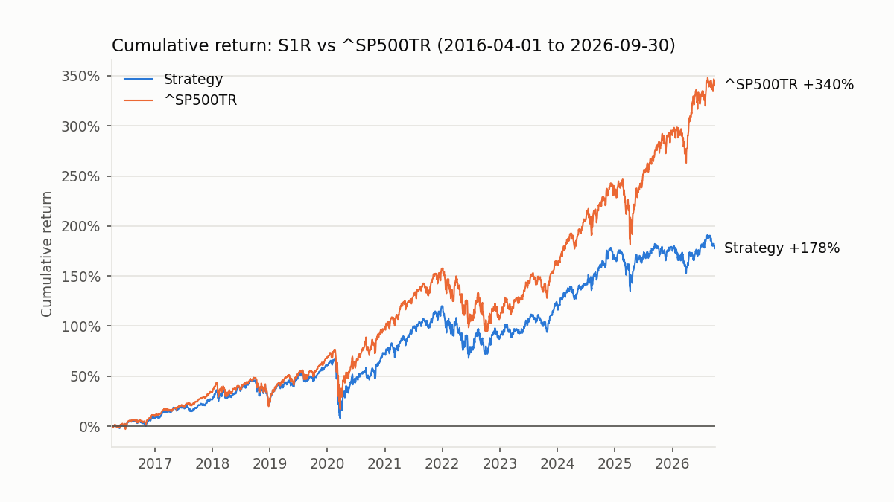

# HW4 — Stock-return model and backtester (Antonio Rivera)

**Question:** can a 90-day return model plus my own long-only backtester beat $1,000,000 held in `^SP500TR` from April 1, 2016 to September 30, 2026?

**Answer: no.** The frozen strategy grew $1,000,000 to **$2.78M** (10.2% CAGR); `^SP500TR` grew it to **$4.40M** (15.2% CAGR). I trailed by **$1.63M, or 4.95 percentage points a year**. The model's ranking signal *did* work out of sample (rank IC +0.038, positive in 65% of months), but the stock universe it picks from — about 2,000 mostly mid- and small-cap names — trailed the mega-cap-led S&P 500 by roughly the same 4–5 points a year. Even with zero trading costs the strategy ends at $3.00M.



| Final test, 2016-04-01 → 2026-09-30 | Strategy (S1R) | ^SP500TR |
|---|---:|---:|
| Final value (cash + open positions) | **$2,775,970** | **$4,402,747** |
| CAGR (elapsed days / 365.25) | 10.22% | 15.17% |
| Max drawdown | −35.4% (2020-02-19 → 2020-03-23) | −33.8% (same dates) |
| Sharpe (daily returns, 2% annual rf, √252) | 0.55 | 0.77 |
| Annualized volatility | 16.6% | 17.8% |
| Fees paid (10 bps per side) | $137,037 | — (buy and hold, no fee) |

Of the strategy's final value, **$653,385 (24%) sits in 378 lots of 61 stocks whose prices stopped before the end** (see §11). Marking them at zero instead of their last price gives $2,122,585 (7.4% CAGR). The true value is somewhere in that range; neither end beats the benchmark.

## 1. System overview

```
DuckDB (read-only, end date cut in SQL)
  │  hw4_data.py      loader + 90-day labels           (reuses Lectures/modeling/course_data.py, cited)
  │  hw4_features.py  extra features, plausibility bounds, value metrics, price block
  ▼
feature/label panel ── hw4_build_cache.py ──► outputs/panel_{dev,final}.parquet
  │  hw4_signal.py    one-feature IC study (dev only)
  │  hw4_model.py     chronological validation, 8 candidates, pre-registered pick
  │  hw4_walkforward.py  quarterly expanding refit → scores
  ▼
scores ── hw4_run.py ──► hw4_backtest.py
                           Strategy ─► BacktestEngine ─► OrderManager ─► PerformanceReport
```

| Period | Dates | Used for |
|---|---|---|
| Lookback only | before 2010 | Feature history (e.g. 252-day windows, 8 quarters for SUE) |
| Development | 2010-01-01 → 2015-12-31 | Signal study, model choice, strategy choice |
| Buffer | 2016-01-01 → 2016-03-31 | Lets 2015 labels finish before the first test fit |
| Final test | 2016-04-01 → 2026-09-30 | One run of the frozen model + strategy |

## 2. How to run

From the repository root, with the course environment (`uv sync --locked`) and both databases in `Lectures/modeling/data/`:

```bash
# tests (≈ 150 tests, ~10 s; class DB only)
uv run python -m unittest discover -s Homeworks/HW4/Antonio_Rivera -v

# 1. caches (outputs/ is gitignored)
uv run python Homeworks/HW4/Antonio_Rivera/hw4_build_cache.py dev     # top2000, data cut 2015-12-31 (~2 min, ~13 GB RAM)
uv run python Homeworks/HW4/Antonio_Rivera/hw4_build_cache.py final   # top2000 to 2026-09-30, 4 ticker batches (~1.5 min, ~11 GB)

# 2. development research
uv run python Homeworks/HW4/Antonio_Rivera/hw4_signal.py dev           # one-feature signal table
uv run python Homeworks/HW4/Antonio_Rivera/hw4_model.py dev            # 8-candidate validation grid
uv run python Homeworks/HW4/Antonio_Rivera/hw4_walkforward.py dev ridge F1_baseline 2012-01-01 2015-12-31
uv run python Homeworks/HW4/Antonio_Rivera/hw4_run.py dev Homeworks/HW4/Antonio_Rivera/outputs/scores_dev_ridge_F1_baseline.parquet S1R 2012-01-03 2015-12-31

# 3. final test (frozen choices)
uv run python Homeworks/HW4/Antonio_Rivera/hw4_walkforward.py final ridge F1_baseline 2016-04-01 2026-09-30
uv run python Homeworks/HW4/Antonio_Rivera/hw4_run.py final Homeworks/HW4/Antonio_Rivera/outputs/scores_final_ridge_F1_baseline.parquet S1R 2016-04-01 2026-09-30
```

Run commands with `uv run` (or activate the repo `.venv`); results land in `Homeworks/HW4/Antonio_Rivera/outputs/`. Small committed copies of the final results are in [`results/`](results/).

## 3. Target and timing

- Features use data through the close of signal day *t*. The entry is the **next session's close** (*t+1*).
- Target = adjusted close at the first quote on/after *entry + 90 calendar days*, divided by the entry close, minus 1. A missing exit quote may slip at most 5 sessions; otherwise the label is missing (never filled).
- Universe: `universe_membership` of the **quarter of the entry session**. Old rows keep their own historical membership.
- Financial data is usable from **filing date + 1 day**; invalid filing dates are excluded; a late-filed older quarter never replaces a newer one; values older than 550 days are blanked.
- Every fit uses only rows whose 90-day label had **ended before the fit date**. Clipping, imputation, and scaling live inside one sklearn pipeline fitted on training rows only.

## 4. Features

| Group | Features | Source |
|---|---|---|
| Course baseline (F1, **used by the final model**) | `momentum_21`, `momentum_63`, `momentum_252_21`, `volatility_63`, `drawdown_252`, `net_margin`, `operating_roa`, `debt_to_assets`, `cash_to_assets`, `fcf_to_assets`, `accruals_to_assets`, `filing_age_days`, sector | `course_data.py` (cited) |
| Mine: quality / investment | `gross_profitability`, `asset_growth` | `hw4_features.py` |
| Mine: earnings surprise | `sue` = (EPS − EPS a year earlier) / σ of the previous 8 changes | `hw4_features.py` |
| Mine: value | Book/market, TTM earnings, cash-flow, EBITDA/EV, sales yields → one `value_composite` (mean of same-date ranks) | `hw4_features.py` |
| Mine: risk | `beta_252`, `idio_vol_63`, `max_ret_21` (vs `^SP500TR`) | `hw4_features.py` |
| Mine: peer ranks | Same-date percentile of each feature among eligible names | `hw4_features.py` |

**Data-quality rules on features** (fixed bounds, chosen from accounting logic and feature values only — never from returns): quarterly gross profit / assets ∈ [−1, 2]; asset growth ∈ [−0.9, 9]; value ratios bounded on both sides, and if any value ratio fails, the stock's market cap is distrusted and all value metrics on that row are blanked (`mcap_suspect`). This catches split-basis errors such as BKNG (shares restated for a later 25:1 split, close not) and APDN/PEGY/BESS (close restated for reverse splits, shares not).

## 5. Model and validation

- **Validation:** expanding-window folds inside development — validate 2012, 2013, 2014, 2015, each trained from 2010 on rows whose labels ended before the fold's first signal (`course_data.date_folds`, cited). Metric: **mean daily Spearman rank IC** (the strategy only uses the ordering of stocks on a date).
- **Training target:** the per-date **percentile rank** of the 90-day return. Changed from the raw return after the data audit found absurd labels (e.g. AAM **+14,270,000%** in 90 days); the change was driven by the data defect, not by model results.
- **Candidates (8):** {Ridge α=100, HistGradientBoosting depth 3 / 200 iters} × {F1 baseline, F2 +A/B, F3 ranks only, F4 all new features}.
- **Selection rule (fixed before results):** highest mean IC; any simpler candidate within one standard error wins.

| Model | Features | Mean IC | SE | 2012 | 2013 | 2014 | 2015 |
|---|---|---:|---:|---:|---:|---:|---:|
| **Ridge** | **F1 baseline** ← selected | 0.025 | 0.024 | +0.048 | −0.047 | +0.048 | +0.053 |
| Ridge | F2 + A/B | 0.027 | 0.023 | +0.043 | −0.043 | +0.052 | +0.055 |
| Ridge | F3 ranks | 0.032 | 0.026 | +0.047 | −0.046 | +0.058 | +0.068 |
| Ridge | F4 all new | 0.033 | 0.026 | +0.036 | −0.041 | +0.068 | +0.068 |
| HGB | F1 baseline | 0.031 | 0.030 | +0.043 | −0.056 | +0.057 | +0.079 |
| HGB | F2 + A/B | 0.027 | 0.028 | +0.040 | −0.053 | +0.048 | +0.073 |
| HGB | F3 ranks | 0.029 | 0.025 | +0.045 | −0.044 | +0.053 | +0.061 |
| HGB | F4 all new | 0.033 | 0.029 | +0.037 | −0.049 | +0.056 | +0.089 |

Full per-fold results: [`results/validation_dev.csv`](results/validation_dev.csv). One-feature signal study: [`results/signal_table_dev.csv`](results/signal_table_dev.csv) — strongest single signals were `sue`, `fcf_to_assets`, `operating_roa`, `gross_profitability` (overlap-adjusted t ≈ 3–3.7), and *negative* for `idio_vol_63` and `max_ret_21` (high-risk "lottery" names underperform).

All eight candidates are within one SE of the best (HGB F4), so the rule selects the simplest: **Ridge F1**. Every model has a negative 2013 (a "junk rally" year).

- **Retraining in the test:** refit at the first session of every calendar quarter on all eligible rows since 2010 whose labels have ended (`hw4_walkforward.py`); each quarter is scored only by the model fitted at its start.

## 6. Trading strategy (frozen: S1R)

- **When:** a new cohort on the first session of every week (signal at that close, fills at the next close).
- **What:** the top 100 eligible names by model score that traded on ≥ 18 of the last 21 sessions and are not flagged `mcap_suspect`.
- **How much:** each cohort gets min(cash, NAV/12); 13 overlapping weekly cohorts ≈ fully invested. Inside a cohort, weights are **linear in rank** (best name 100 shares, 100th name 1 share). Cap: 5% of NAV per stock across all its lots. Leftover budget stays in cash.
- **Exit:** every lot is sold at the close on its maturity (entry + 90 calendar days), or at the next session with a quote.

Development comparison (top2000, 2012-01-03 → 2015-12-31, 10 bps per side):

| Variant | Final value | CAGR | Sharpe | Mean cash |
|---|---:|---:|---:|---:|
| S0 monthly top-20, equal weight | $1,658,801 | 13.5% | 1.02 | 18% |
| S1 weekly top-100, equal weight | $1,722,519 | 14.6% | 0.97 | 8% |
| **S1R weekly top-100, rank weight** | **$1,756,276** | **15.2%** | **1.02** | 8% |
| ^SP500TR | $1,743,113 | 14.9% | 1.00 | 0% |

## 7. Backtester (my own implementation)

`hw4_backtest.py` is written from scratch; I read `Lectures/modeling/backtest.py` for ideas only.

| Class | Role |
|---|---|
| `Strategy` / `TopNScoreStrategy` | Decides what, when, and how much to buy; default sell rule = maturity. Sees data only through a `MarketView` cut at the signal close (future access raises `LookAheadError`). |
| `OrderManager` | Executes buys/sells, owns cash and lots, charges `fee_bps`, records every fill, each lot's PnL, and the daily books (cash, NAV, realized and unrealized PnL). Checks every day that NAV = initial cash + realized + unrealized. |
| `BacktestEngine` | Session loop: mark → sell maturities → buy yesterday's orders → record → plan tomorrow's orders. Rejects overspending plans, early sales, and off-calendar data. |
| `PerformanceReport` | Final value, CAGR, max drawdown, Sharpe (2% rf), fees, turnover, cash usage, chart. |

**Assumptions:** fees 10 bps of notional per side (sensitivity below); fractional adjusted-price units (dividends are inside adjusted prices, never added again); cash earns 0%; a buy order whose stock has no quote at the fill close is cancelled; a held stock without a quote is marked at its last real close (flagged stale) and sold at its next quote; at the test end, open lots are valued at their last real close on or before 2026-09-30 (no later prices are ever loaded). The benchmark is bought at the first test close with no fee.

**Fee sensitivity** (same frozen strategy, final test; [`results/fee_sensitivity.csv`](results/fee_sensitivity.csv)):

| Fee per side | Final value | CAGR | Sharpe | Fees paid |
|---:|---:|---:|---:|---:|
| 0 bps | $2,996,003 | 11.0% | 0.60 | $0 |
| 5 bps | $2,883,857 | 10.6% | 0.57 | $70,100 |
| **10 bps (base)** | **$2,775,970** | **10.2%** | **0.55** | **$137,037** |
| 25 bps | $2,476,279 | 9.0% | 0.49 | $320,169 |
| ^SP500TR | $4,402,747 | 15.2% | 0.77 | — |

**Trading statistics (final test):** 44,601 lots closed and 1,438 open at the end; turnover 7.1× per year (the 90-day rule forces ~8×); lot win rate 57.8%; mean lot return +2.97% per ~90 days; mean cash 5.4% of NAV; 7 orders cancelled for lack of a quote; the 5 best lots made only 2.7% of realized PnL (no single bad print drives the result).

## 8. Evidence that accounting and timing are right

146 unit tests (`uv run python -m unittest discover -s Homeworks/HW4/Antonio_Rivera -v`), plus checks on the real runs.

| Check | Where | What it proves |
|---|---|---|
| One buy → one maturity sale, by hand | `test_hw4_backtest.py` | $100,100 at $100 → 1,000 units, $100 fee; sell at $110 → PnL $9,790 = 1,000×10 − 100 − 110 |
| Two lots in one ticker, different maturities | `test_hw4_backtest.py` | Each lot sold at its own maturity, own cost basis |
| Holiday maturity | `test_hw4_backtest.py` | Due on a holiday → sold at the next session |
| Missing quote at maturity / at the fill | `test_hw4_backtest.py` | Held and marked stale, then sold on next quote / order cancelled, cash kept |
| Fill at *t+1*, never at the signal close | `test_hw4_backtest.py` | Signal-day close 95, fill at next close 100 |
| Cash never negative; never spent twice | `test_hw4_backtest.py` | Random 400-step sequence; overspending plans rejected |
| Books balance | `OrderManager.record` (every day of every run) | NAV = initial cash + realized + unrealized PnL |
| No prices after the end | `test_hw4_backtest.py` | Setting every post-end price to $1M changes nothing |
| Strategy cannot peek | `test_hw4_backtest.py` | `view.at(tomorrow)` raises `LookAheadError` |
| Labels rebuilt independently from raw prices | `hw4_data.audit_label_timing` (every cache build) | Next-session entry, 90-day exit, first quote on/after maturity |
| Financial data only after filing + 1 day | `test_hw4_features.py` | Not usable on the filing date, usable the next day |
| Preprocessing fitted on training rows only | `test_hw4_model.py` | Clipper bounds and imputer medians equal training-row values |
| Walk-forward cannot see unfinished labels | `test_hw4_walkforward.py` | Poisoning every label ending after 2013-07-01 leaves earlier scores unchanged |
| Feature causality across builds | dev vs. final cache | 7.7M rows ≤ 2015: every feature and price identical in a build that stops at 2015 and one that runs to 2026 (only difference: 2015-12-31 eligibility, by design) |
| Batched build = one-shot build | `test_hw4_cache.py` | Row-for-row identical |

## 9. Data quality (top2000 audit)

Counts only, no returns: `uv run python -I Homeworks/HW4/Antonio_Rivera/data_audit.py Lectures/modeling/data/equities_top2000.duckdb`

| Issue | Size | Handling |
|---|---:|---|
| Price series ending during the test (inactive; no delisting-payout table) | 1,327 stocks | Held lots marked at last quote, flagged; see exposure below |
| Zero-volume days | 352,680 rows | Liquidity screen (≥ 18 of 21 sessions traded) |
| One-day moves > +100% | 2,958 days, 573 stocks | Rank target; winsorized evaluation; bad-print PnL check |
| 90-day labels > +1,000% | 872 rows, 30 stocks (dev) | Rank target |
| Quote gaps > 5 sessions | 1,670 gaps, 219 stocks | Labels censored; stale marks flagged |
| Universe members with implausible capitalization proxy | 48 stocks (e.g. BRK-A $1.37 quadrillion) | `mcap_suspect` names are never bought |
| Invalid filing dates | 23,664 filings | Excluded from all features |

## 10. Findings

**Why the strategy lost.** On the same monthly 90-day windows in the test period, the average eligible stock returned +2.7% while `^SP500TR` returned +3.8%; the universe beat the index in only 38% of cohorts. That ≈ 4–5 point annual gap matches the strategy's 4.95-point shortfall. Inside the universe, the model's picks did better than average (test-period rank IC +0.038, t_adj 2.1; positive in 8 of 11 years, negative in 2016, 2020, 2025). So the signal was real but far too small to overcome being in the wrong part of the market for a decade dominated by mega-caps.

**What worked**
- Quality and earnings-surprise signals (`sue`, `fcf_to_assets`, `operating_roa`, `gross_profitability`) carried information in development and the model kept working out of sample.
- Weekly cohorts fixed a cash-drag bug in my first strategy (monthly cohorts were planned two days before the previous cohort's money came back: 18% average cash → 8% in development, 5.4% in the test).
- Rank-weighting inside cohorts beat equal weighting in development (+$34k over 4 years).

**What did not work / unsuccessful ideas (every try is listed — this is multiple testing)**
- 30-stock class database for choosing anything: value signals flipped sign between 30 and 2,000 stocks.
- Adding my features to the model (F2–F4) or switching to boosting: all within one standard error of the baseline.
- Raw-return training target: broken by bad-print labels; replaced by per-date ranks.
- Monthly top-20 cohorts (S0) and equal-weight weekly top-100 (S1): both trailed the index in development.
- A correlation-break (pairs) feature was designed but postponed and never built.

**Next steps**
1. Match the benchmark's universe a priori (e.g. only `universe_rank ≤ 500`) or measure against an equal-weight universe index — the size gap mattered more than the model.
2. Use the signal's asymmetry: most of the edge was in *avoiding* high-volatility, low-quality names; an "exclude the bottom half" portfolio may capture more of it.
3. Find delisting outcomes (an external corporate-actions source) to value the 61 stranded stocks instead of bounding them.
4. Reduce fees: the 90-day rule forces ~8× turnover; skipping a sale when the same stock would be re-bought the next week would save fees if allowed.
5. Test my own features out of sample. F4 (baseline + SUE, value composite, beta, idiosyncratic volatility, MAX, gross profitability, asset growth) had the highest development IC (0.033 vs 0.025) but was within one standard error, so the pre-registered rule chose the simpler F1. I did not run F4 on the test period: after the frozen test it could only be a post-hoc comparison, and it must not replace the submitted result. A fresh evaluation period (or a new frozen run) is the honest way to test it.

## 11. Risks and limitations

- **Stranded positions.** 61 held stocks stopped trading (inactive; the data has no delisting proceeds). Their 378 lots, $653k at last price (24% of final NAV), could never be sold, and that money was not reinvested for up to several years. Reported range: $2.12M (zero recovery) to $2.78M (last price).
- **Risk taken.** Fully invested in ~1,300 small lots of mid/small caps: similar volatility to the index (16.6% vs 17.8%) but a deeper drawdown (−35.4% vs −33.8% in March 2020) and a large, persistent size/style bet against mega-caps.
- **Not point-in-time data.** Fundamentals are latest vendor values (restatements are not undone); share and price split bases can disagree; universe ranks use an approximate capitalization proxy.
- **Researcher degrees of freedom.** 24 single features, 8 models, and 3 strategy variants were compared on 2010–2015. Some plausibility bounds were set after looking at feature values (never returns). The test-period result is a single run of frozen choices.
- **Execution.** Fills at the exact close with a flat 10 bps cost; no market impact or capacity limits; cash earns nothing (a 2% cash rate would add a little to the strategy only).
- **Short and regime-dependent evaluation.** Development was 4 years and every model failed in 2013; the test contains three negative-signal years.

## 12. AI use

See [AI_USE.md](AI_USE.md) for a running log of what I asked, what the AI produced, and what I changed.
