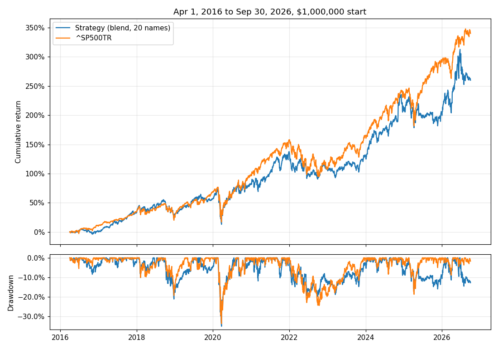

# HW4: Arav Shanghavi

Buy the 20 best-ranked large caps each month, hold each for 90 days, and see if that beats the S&P 500 total-return index from April 2016 to September 2026.

**Result: it did not.** $1,000,000 grew to **$3.60M (12.98% CAGR)**. Putting the same $1M into `^SP500TR` would have ended at **$4.40M (15.17% CAGR)**. That's 2.19 points a year behind, with a slightly deeper drawdown and a lower Sharpe.

| | Strategy | `^SP500TR` |
|---|---:|---:|
| Ending value on Sep 30, 2026 (cash plus holdings) | $3,598,855 | $4,402,747 |
| CAGR | 12.98% | 15.17% |
| Maximum drawdown | −35.17% | −33.79% |
| Sharpe ratio (daily returns, 2% rf) | 0.62 | 0.77 |
| Volatility | 19.5% | 17.8% |



## How to run

Copy `equities_top2000.duckdb` from bCourses into `Lectures/modeling/data/`, then run these from the top of the repo:

```bash
uv sync --locked
.venv/Scripts/python Homeworks/HW4/Arav_Shanghavi/data_prep.py          # builds the panel, ~5 min, cached in outputs/
.venv/Scripts/python Homeworks/HW4/Arav_Shanghavi/run_research.py       # development, writes results/frozen_choice.json
.venv/Scripts/python Homeworks/HW4/Arav_Shanghavi/run_final.py          # the one final test
.venv/Scripts/python Homeworks/HW4/Arav_Shanghavi/check_accounting.py   # hand case + audit of the final run
```

On Mac or Linux use `.venv/bin/python`. Add `--class` to `data_prep.py` to try it on the small class database first.

| File | What it does |
|---|---|
| `data_prep.py` | Loads prices in ticker batches, builds weekly features and 90-day labels, applies quarterly membership |
| `signal_model.py` | Ranks factors within each date, makes the momentum, blend and Ridge scores |
| `portfolio_sim.py` | My backtester: lots, tranches, cash, fills, daily value, metrics |
| `run_research.py` | Compares scores on 2013 to 2015 and freezes the winner |
| `run_final.py` | Runs the frozen choice on the test period, writes everything in `results/` |
| `check_accounting.py` | Hand-worked cases and checks on the final run |

## Data and universe

- **Candidates:** each quarter's `universe_membership`, matched to the quarter of the entry date, keeping only ranks 1 to 500. Stocks that later disappear stay in. If a held stock drops out of the top 500, I keep it until its 90 days are up.
- **Removed by name:** three bond-like listings that sit inside the top 500 (TBC and GOM notes, DDT trust preferred). The full list is saved to `outputs/` when the panel is built.
- **Price-error screen:** a stock can't be bought if any quote in the last 252 sessions was more than 5× or less than 1/5 of the quote before it. It only looks backward. The data has some absurd jumps from unit and split errors, and I'd rather skip a stock than trade on them.
- **Also needed to buy:** 63 complete daily returns and a 12-1 momentum value.

That leaves about 490 tradable stocks on each weekly signal date.

## Features

Every feature is turned into a percentile rank among that date's tradable stocks, so it is comparable across years and no outlier can dominate. A stock missing a value is parked at 0.5, the middle.

| Feature | Direction | Idea |
|---|---|---|
| 12-1 momentum (252 to 21 sessions back) | higher | Winners keep winning for a while |
| 6-month momentum | higher | Same idea, shorter |
| 63-day volatility | lower | Calm stocks |
| Distance from 252-day high | closer is better | Stocks near their highs |
| Operating ROA | higher | Profitable per dollar of assets |
| Net margin | higher | Profitable per dollar of sales |

Financial ratios count only from the filing date + 1 day and go blank 550 days after fiscal period end.

## Model and validation

**Target:** the return from the next session's close to the first close on or after 90 calendar days, minus that date's average across tradable stocks. This is "how much better than peers", the thing a top-20 pick needs.

I compared three scores on the development period:
- **momentum:** 12-1 momentum rank alone
- **blend:** the plain average of the six ranks, no fitting
- **ridge:** Ridge regression on the six ranks, α of 1, 10, 100 or 1000

**Walk-forward:** Ridge was fitted at the first signal of 2013, 2014 and 2015. Each fit used only rows from 2010 on whose 90-day outcome had already finished before the fit date, then scored that year. Each score was then run through the same backtester at 20 and 30 names, from Jan 2013 to Dec 2015.

| Score | Names | Rank IC | CAGR | Sharpe | Max DD |
|---|---:|---:|---:|---:|---:|
| **blend** | **20** | **0.057** | **16.70%** | **1.01** | **−11.4%** |
| blend | 30 | 0.057 | 15.79% | 0.98 | −10.8% |
| ridge α=1000 | 30 | 0.012 | 15.02% | 0.88 | −11.6% |
| ridge α=10 | 30 | 0.014 | 13.89% | 0.82 | −11.9% |
| momentum | 30 | 0.052 | 12.09% | 0.59 | −16.2% |
| `^SP500TR` | | | 14.20% | 0.95 | |

All 16 rows are in `results/development.csv`. The rule was set before looking: **highest development Sharpe wins.** That was the blend with 20 names, written to `results/frozen_choice.json` before the test ran.

Why the blend and not Ridge? Ridge's rank IC was about a quarter of the blend's. With a signal this weak, learned weights mostly fit noise from a few years. Equal weights can't overfit. The blend has nothing to refit, so there's no retraining in the test period.

## Trading rules and assumptions

- **Signals:** at the close of the last session of each week. Buys happen at the **next session's close**, so no decision uses the price it fills at.
- **Three tranches,** each starting with $333,333. Tranche 1 buys on the first test day (Apr 1, 2016), tranche 2 about 30 days later, tranche 3 about 60 days later. A tranche buys again at the first signal after all its lots have come due. So the portfolio refreshes about monthly and nearly all money stays invested. Average cash after the first three months was 0.3%.
- **Each buy:** a tranche splits its cash equally across the top 20, so each name gets 5% of that tranche. A name with no quote on the buy day is skipped and its share stays as cash (this happened once).
- **Holding:** a lot comes up for sale 90 calendar days after purchase and goes at that day's close. If the stock didn't trade that day, it goes at the first close after.
- **Costs:** 5 basis points on every buy and sale, included in the purchase budget. Cash earns nothing.
- **Prices:** every price is an adjusted close. Those already fold dividends in, so I don't credit dividends a second time.
- **Bought-out stocks:** if a held stock has no quote for 10 straight sessions, its lots close at the last quote on that 10th session. Five holdings hit this, 15 lots in all: LLTC (2017), ALXN (2021), CERN (2022), CLR (2022), EA (2026). All five were acquisitions or take-privates, and each last quote sits within a few cents of the deal value. For the stock-and-cash deals (LLTC, ALXN), the last quote is my estimate of what the package was worth.
- **End of test:** open lots are valued at the Sep 30, 2026 close. No later price is loaded.

## Checking the accounting and timing

`check_accounting.py` prints these, and the output is saved in `results/accounting_checks.txt`.

**A hand-worked market:** two stocks, $1,000, 10 bps fees. Every buy, sale and the final cash of $1,047.90 match numbers worked out on paper. It includes a stock with a missing quote on its due date that sells the next session, and a silent stock that closes under the delisting rule.

**The final run:**
- cash is never negative
- NAV = cash + holdings every day
- replaying every fill from $1M reproduces the daily cash column
- each lot closes once
- no normal sale happens before its due date
- every due date is entry + 90 days
- every buy is after its signal
- nothing fills after Sep 30, 2026
- no normal sale is more than 7 days late

**One real trade by hand:**
1. KLAC, signal Mar 31, 2016, bought Apr 1 at $62.36. Budget $16,666.67, so units = 16,666.67 / 1.0005 / 62.36 = 267.1318.
2. Due Jun 30, 2016, sold Jun 30 at $63.00. Proceeds = 267.1318 × 63.00 × 0.9995 = $16,820.89.

Both prices match the database closes.

**Timing:**
- each feature row's entry date is the session after its signal
- every financial filing used was available by the signal date
- I hand-checked one AAPL row's two momentum features and its label against raw prices

**Benchmark:** computed separately from the raw `^SP500TR` series. Final $4,402,746.78, CAGR 15.17%, max drawdown −33.79%.

## What happened, by year

| Year | Strategy | `^SP500TR` | Difference |
|---|---:|---:|---:|
| 2016 (from Apr) | 0.1% | 9.8% | −9.7 |
| 2017 | 32.1% | 21.8% | +10.3 |
| 2018 | −1.1% | −4.4% | +3.2 |
| 2019 | 19.8% | 31.5% | −11.7 |
| 2020 | 17.1% | 18.4% | −1.3 |
| 2021 | 29.0% | 28.7% | +0.3 |
| 2022 | −11.9% | −18.1% | +6.3 |
| 2023 | 11.0% | 26.3% | −15.3 |
| 2024 | 32.7% | 25.0% | +7.7 |
| 2025 | −2.5% | 17.9% | −20.4 |
| 2026 (to Sep) | 20.2% | 12.7% | +7.4 |

It held its own in down years (2018, 2022) and in broad rallies (2017, 2024). It lost badly in 2019, 2023 and 2025, years when a handful of the largest companies carried the index. An equal-weight 20-stock book of "steady, profitable, trending" names usually doesn't own enough of those few giants, and missing them in three years cost more than the good years made back. The slow start in 2016 is partly the ramp: two of the three tranches sat in cash for their first 30 and 60 days.

## Risks taken

- **Concentration:** 20 names per tranche, about 60 stocks across the book, 5% of a tranche each. Over the test it bought 350 different stocks, and technology was a quarter of all buys. There's no sector cap.
- **Volatility:** 19.5% against 17.8% for the index. It's riskier than the benchmark and earned less, which is why the Sharpe is lower.
- **Correlated factors:** the March 2020 crash hit it as hard as the index (both about −35%). Momentum and low volatility gave no shelter there.

## Limitations

- **Short development window:** 2013 to 2015 is three calm, rising years. A choice made on them may not hold in other markets. Picking by Sharpe on three years is a weak test.
- **Data:** the data is a recorded-date reconstruction, not true point-in-time data (see `Lectures/modeling/README.md`). The fundamentals are whatever the vendor holds today for each period, so later restatements sneak in a little. Market caps behind the top-500 cut are approximate. There are no delisting proceeds, so the 5 buyouts above are valued from their last quotes.
- **Fixed costs:** 5 bps per trade, no slippage and no market impact. That's fair for large caps at this size, but it's an assumption.
- **Ramp:** the three-tranche start leaves cash idle for the first two months.

## What didn't work

- **Ridge** lost to the unfitted blend at every α tested. Its weights shifted year to year and its rank IC was about 0.013.
- **Momentum alone** had decent rank IC but the worst drawdown in development, and the lowest Sharpe of the three.
- **First final run:** it left 15 bought-out lots unsold, holding $500k of dead money, some of it from 2017 on. I added the 10-session delisting rule to close them. The strategy choice did not change; I reran development with the fix and got the same table. That first run's numbers are in `results/metrics_first_run_no_delisting_rule.csv` ($3.28M, 11.98% CAGR).

## What I'd try next

- Weight picks partly by market cap, or cap the underweight in the largest 20 names. The main gap is not owning the mega caps.
- Add a sector cap so one sector can't take over a tranche.
- A longer development window. The data goes back to 2000 for training, and using 2005 to 2012 too would test the choice across 2008.
- Test 30 and 40 names in development with a cost of 25 bps, to see how stable the choice is.

## Code reused

Called unchanged from `Lectures/modeling/course_data.py`: `load_data`, `load_membership`, `price_features`, `financial_events`, `join_financials`, `apply_membership`, `make_labels`. The backtester (`portfolio_sim.py`), the extra features, the percentile scoring and all the checks were written for this homework. I read `Lectures/modeling/backtest.py` for reference only and don't import it.

AI assistance (Claude) was used to help write and review code and this README. I checked the results and can explain the timing, the accounting and every rule above.
