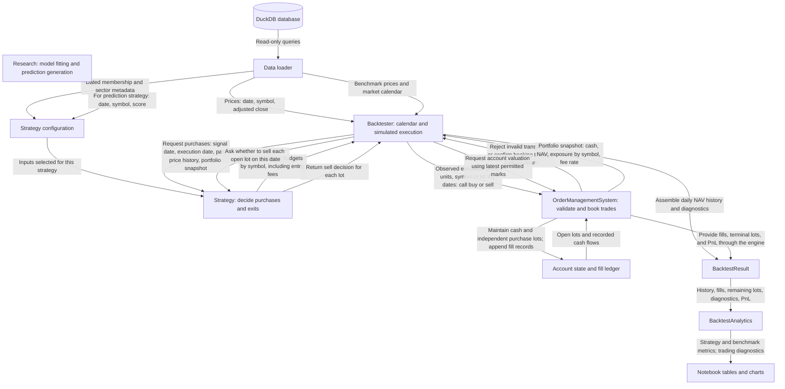
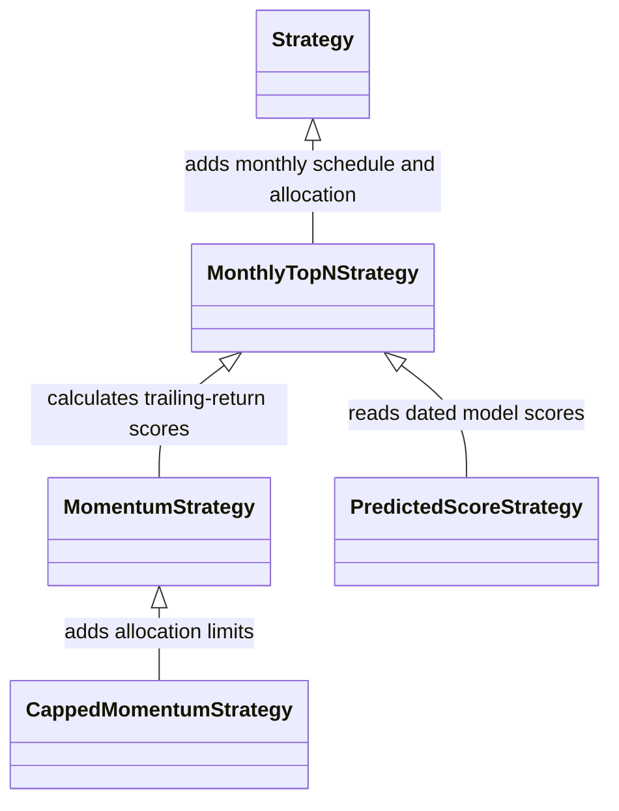
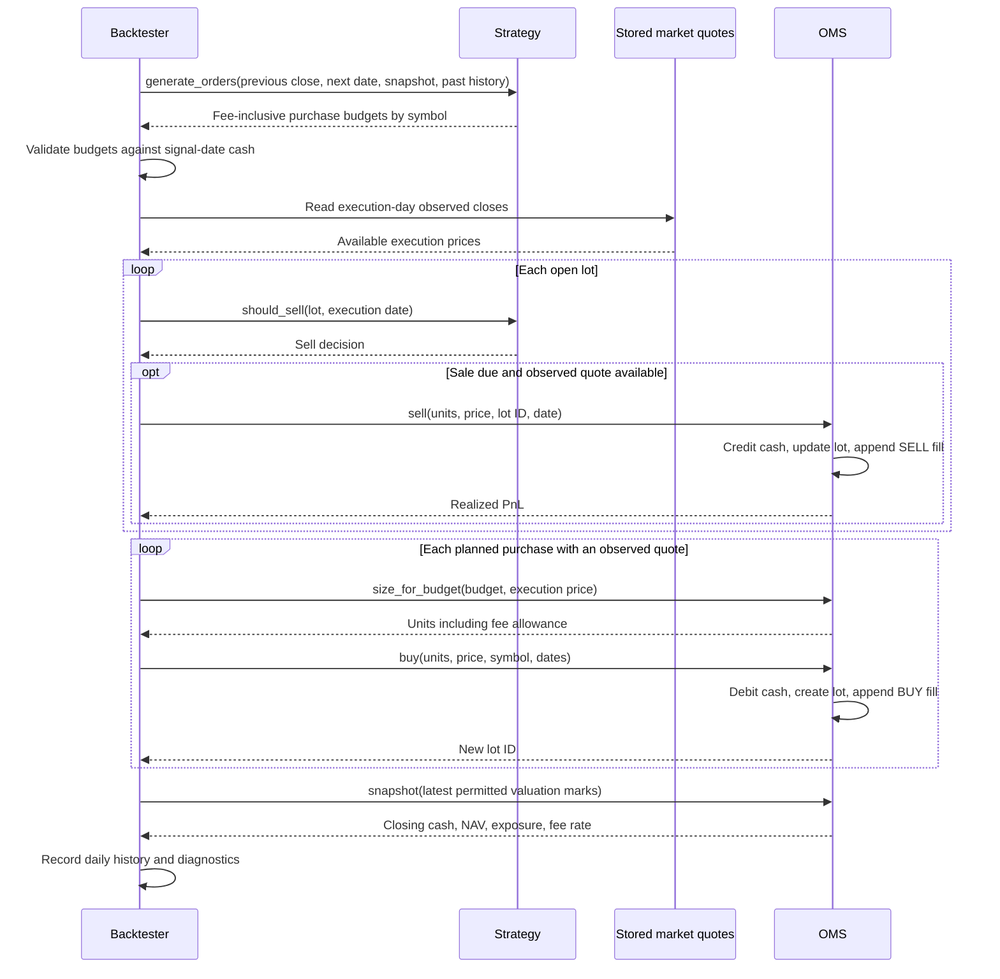

# Backtester specification — first pass

Status: description of the lecture design for review. This file does not approve an HW4 implementation or introduce new interfaces. We will discuss changes in a second pass before building version 1.

## 1. Reference and boundaries

The backtesting example is in **Lecture 8**, building on Lecture 7's modeling work:

- `Lectures/Lecture 8/1_backtesting.ipynb`: explanation, demonstrations, accounting checks, and exercises.
- `Lectures/Lecture 8/2_research_workflow.ipynb`: connection between research predictions and strategy experiments.
- `Lectures/modeling/backtest.py`: the actual classes imported by the notebooks.
- `Lectures/modeling/course_data.py`: data loading, preprocessing, labeling, and modeling helpers.

Our rule remains: use the backtester as a structural reference and implement our own engine. Lecture data-loading code may be reused with attribution. Our existing `data_loading.py` is the shared loading entry point for research and backtesting.

## 2. Current module structure

The lecture keeps strategy classes, accounting, simulation, results, and analytics together in `backtest.py`. They are separate responsibilities inside one module, rather than separate Python files. The notebooks orchestrate experiments; they do not contain the implementation being executed.

The research model is outside the backtester. It can produce dated predictions in advance, which enter the engine through `PredictedScoreStrategy`. The engine does not train models itself.

## 3. Class relationships

The first diagram shows the lecture engine's data flow. Each arrow points from the supplier of information to its recipient. Requests and returned data have separate arrows.



The execution arrow is a **simulated booking instruction**, not a broker acknowledgment. The backtester selects an observed execution-day price and calls the OMS. The OMS validates the instruction, updates the account, and records the fill. No transaction exists in the account until that booking succeeds. The diagram's OMS-to-result arrow describes data provenance: the backtester assembles the result from OMS records; the OMS does not construct the result itself.

The second diagram shows inheritance only. A solid arrow with a hollow triangle points from a specialized class to its parent; it does not represent market data or order flow.



### One session: requests, decisions, and booking



This sequence depicts successful bookings. Invalid OMS instructions raise an error; missing entry quotes are rejected by the backtester without a fill. The engine also checks missing held prices before executing trades, as detailed in section 7. The proposed refit phase in section 11 is a future extension and is not part of this lecture sequence.

`HeldPriceGapError` is an exception used by the backtester. `capped_budgets` is an allocation helper function, not a class.

## 4. Data objects

| Object | Contents | Implication |
|---|---|---|
| `Lot` | Lot ID, symbol, units, signal and entry dates, entry price and fee, maturity date | Each purchase has an independent cost basis and maturity. Several lots can own the same symbol. |
| `PortfolioSnapshot` | Cash, NAV, market value aggregated by symbol, fee rate | Strategy sees a planning view rather than the mutable account. Risk review receives a separate engine-owned snapshot, never the strategy's planning copy. It sees symbol exposure, not individual lots, when generating buys. |
| `BacktestResult` | Daily history, fill ledger, remaining lots, diagnostics, PnL reconciliation | Analysis can run after simulation without changing accounting. Results support inspection and saving. |
| `MarketData` / `MarketView` | Verbatim loader output plus calendar-aligned price, raw-volume, membership, and forward-filled financial panels | Research and the engine share one data source. Views stop at the signal close; a filing becomes visible at `filing_date + 1 day` and persists until the next filing. |

These use frozen dataclasses. Assignment to their fields is blocked, but contained objects are still mutable: pandas frames, and the `holdings` mapping inside `Portfolio`. The lecture creates detached planning data and copies price histories; frozen does not mean deeply immutable. The engine therefore treats the strategy's planning context as untrusted and rebuilds the portfolio snapshot and freezes the allowed universe before risk review and order submission.

## 5. Strategy hierarchy and interfaces

### `Strategy`

The abstract base class stores `holding_days`, defaulting to 90. Subclasses must implement:

```python
generate_orders(signal_date, execution_date, portfolio, history)
```

- `history`: adjusted-close DataFrame, dates as rows and symbols as columns, ending at the signal close.
- `portfolio`: account snapshot from that close.
- `execution_date`: known next market session; its prices are not supplied.
- Return value: pandas Series indexed by unique symbols, containing nonnegative **dollar purchase budgets including entry fees**. An empty Series means no purchases.

Despite its name, the method does not return quantities, broker orders, target weights, or sell orders. Combined budgets must fit signal-date cash.

`should_sell(lot, date)` defaults to selling on or after maturity. It can be overridden in the lecture design. That flexibility does not override HW4's required 90-calendar-day holding period.

### `MonthlyTopNStrategy`

This abstract subclass combines three decisions:

1. Schedule: buy on the first market session of a new month, identified by comparing signal and execution months.
2. Ranking: ask `score_stocks(signal_date, execution_date, history)` for a Series of finite scores indexed by symbol.
3. Allocation: call `allocate_budgets(scores, portfolio)`.

Default allocation selects the highest `top_n` scores, breaking ties by symbol. It divides `min(cash, NAV × cohort_fraction)` equally among selected names. The default cohort fraction is one-third.

Implications: scoring can change while scheduling and allocation remain the same. A cohort is a conceptual group of purchases, not a separate account object. Starting midway through a month does not trigger an immediate entry.

### Concrete strategy examples

| Class | What changes | Dependencies and implications |
|---|---|---|
| `MomentumStrategy` | Computes scores from trailing returns | Receives quarterly membership at construction. Requires a complete lookback window and membership in the execution quarter, selected by the signal date. Defaults to 63-session momentum. |
| `PredictedScoreStrategy` | Reads research scores rather than calculating momentum | Accepts `date`, `symbol`, `score` rows and retrieves exactly the signal date's scores. Missing date means no scores. It does not fit models, check label maturity, or enforce universe membership itself. |
| `CappedMomentumStrategy` | Replaces allocation | Inherits momentum and monthly scheduling; uses `capped_budgets` with sector metadata to constrain additional purchases. |

The research side is responsible for making prediction scores available without future information and filtering the eligible universe. A valid score table shape alone does not establish those properties.

`capped_budgets` accounts for existing exposure and each purchase already planned in the same decision. Limits are measured using signal-close NAV and holdings. They can be exceeded later through market moves; the helper does not force early sales or redistribute every unused dollar.

## 6. `OrderManagementSystem`: account state and accounting

The OMS owns initial capital, current cash, open lots, fill records, cumulative fees, and realized PnL. It receives fill prices from the backtester; it does not read the database or choose trades.

| Method | Responsibility |
|---|---|
| `size_for_budget(budget, price)` | Convert a fee-inclusive budget into fractional units: `budget / (price × (1 + fee_rate))`. |
| `buy(size, price, ...)` | Validate a purchase, debit notional plus fee, create a lot, and record a fill. Reject insufficient cash. |
| `sell(size, price, ...)` | Sell some or all of a specified lot, credit proceeds minus fee, and recognize PnL including the allocated entry fee. |
| `snapshot(marks)` | Value open lots and return cash, NAV, and aggregate symbol exposure. |
| `pnl(marks)` | Report realized and unrealized PnL and reconcile them with NAV minus initial capital. |

The OMS permits partial sales; the lecture simulation sells entire lots at maturity. The OMS checks that sales do not precede entry, but maturity enforcement belongs to strategy/simulation logic.

Accounting uses fractional adjusted-price units. Dividends are not credited again. Fees are charged on entry and exit, defaulting to five basis points per side. Idle cash earns zero. Open-position PnL includes the entry fee already paid, but not a hypothetical future exit fee.

## 7. `Backtester`: simulation and information timing

Construction receives prices, benchmark, a `Strategy` instance, an optional fresh OMS, and a stale-mark limit. It validates price keys and values, pivots adjusted closes into a wide table, and uses benchmark dates as the market calendar.

`market_history(signal_date)` returns a separate copy through that signal close. Earlier data supplies warm-up history. Missing market-session prices remain missing.

`run_backtest(start, end)` follows this sequence on every market session:

1. Use the previous session as the signal date and the previous account snapshot as the planning state.
2. Request and validate buy budgets before exposing execution-day prices to the strategy.
3. Read today's observed quotes and refresh valuation marks.
4. Check missing prices for existing holdings.
5. Sell mature lots that have an observed quote; book sale cash immediately.
6. Execute previously planned purchases at observed adjusted closes. Reject purchases lacking a quote.
7. Record closing cash, holdings, NAV, open-lot count, fees, traded notional, and stale marks.

**Cash implication:** sales happen before purchases, but planned budgets use yesterday's cash. Today's sale proceeds cannot enlarge those already submitted budgets; they become available for later decisions.

The run requires one preceding signal session and can be executed only once per backtester. Each comparison needs fresh account and strategy state.

### Missing data and terminal positions

- Missing entry quote: reject the buy, record a diagnostic, retain the cash.
- Missing held quote: use the last observed mark for valuation, flag it, and stop with `HeldPriceGapError` after the configured limit (five market sessions by default).
- Missing quote at maturity: wait for an observed quote; do not trade at a carried valuation mark. The held-price limit can stop the run before a delayed exit becomes possible.
- Universe removal: affects entry eligibility in the strategy; it does not liquidate an existing lot.
- End of test: value remaining open lots using permitted marks; do not force a sale or consult future prices.

The initial history row records starting capital on the preceding session. This includes first-day trading fees in portfolio returns and drawdown. The benchmark buys at the first test close and remains invested.

## 8. `BacktestAnalytics`: performance and diagnostics

This class reads a `BacktestResult`. It does not place trades or modify account state.

- `performance(nav, annual_rf=0.02)`: final value, total return, calendar-time CAGR, maximum drawdown, annualized daily volatility, and Sharpe ratio.
- `summary(...)`: apply those calculations to strategy and benchmark NAV on the same history index.
- `diagnostics()`: average cash fraction, total fees, gross traded value relative to average NAV, terminal open lots, and stale marks.

Sharpe uses daily simple returns, the compounded daily equivalent of a 2% annual risk-free rate, and 252 sessions for annualization. It is undefined when volatility is effectively zero. Trade-level 90-day returns cannot replace daily portfolio NAV for these metrics.

## 9. What this means for our research interface

The existing prediction interface is a dated score table, not an imported fitted-model class. Research owns feature construction, fit dates, preprocessing, label maturity, and prediction generation. A strategy turns the resulting scores into budgets. The OMS and simulator do not need to know which model produced the scores.

Our earlier idea of importable research classes is therefore a possible extension, not something already provided by the lecture framework. We have not yet chosen between precomputed predictions, live calls to research components during simulation, or a combination.

## 10. Second-pass discussion — decisions still open

Before implementation, review:

- Which responsibilities stay together and which become separate modules?
- How do research models, features, and predictions reach a strategy, and who enforces their availability dates?
- Should scheduling, ranking, allocation, and fixed HW4 exit rules remain inside the strategy hierarchy?
- What information does a strategy need beyond price history and aggregate exposure?
- What are our execution, cash-availability, missing-price, and terminal-valuation policies?
- Which accounting and timing checks will demonstrate that version 1 is trustworthy?

These are review questions, not approved design changes. The next pass will turn the agreed answers into the version 1 specification.

## 11. Proposed extension: strategy refitting with an enforced data cutoff

Status: requested direction for the next design pass. Method signatures below are provisional; no implementation is approved yet.

### Intent

The engine advances through market sessions sequentially. At a decision point, a strategy may request a model refit before generating its next orders. During refitting, the engine supplies only information already released to the strategy by that decision point. Refitting must not expose the engine's full stored dataset or advance the market clock.

The strategy owns its fitted model and fitting logic. The engine owns the clock, data-access restrictions, refit state transitions, and audit records. A strategy requests refitting through a hook; it does not directly change engine state or receive unrestricted access to the engine.

### Proposed lifecycle and methods

```text
Advance to next execution session
    -> release history through the preceding signal close
    -> ask strategy whether refitting is due
    -> if requested: REFITTING -> validate fit outcome
    -> GENERATING_ORDERS -> EXECUTING -> RECORDING
```

| Proposed strategy method | Responsibility |
|---|---|
| `needs_refit(context)` | Return whether the fixed fitting schedule requires a fit at this signal date. It sees only the current permitted context. |
| `refit(fit_data, context)` | Fit preprocessing and model parameters using the restricted historical data. Return fit metadata; retain the successfully fitted model as strategy state. |
| `generate_orders(...)` | Use the currently fitted model and permitted decision data to generate orders after any scheduled refit completes. |

`context` identifies the signal cutoff, next execution date, and previous successful model version/fit date. Knowing the next session's date does not reveal its prices. `fit_data` represents the historical data that the engine permits the strategy to use; the exact container and module boundaries remain to be specified.

`REFITTING` is a controlled, synchronous engine phase. During it, execution is paused, the cutoff stays fixed, and no orders or fills occur. Once fitting succeeds, the engine resumes order generation for the same decision point. If it fails, the proposed default is to stop and report the failure; silently using a partially fitted model is not acceptable.

### Data-access rules

1. **Released history only.** Every input must have been available and released by the signal cutoff, including any warm-up history explicitly released before the first trade. Refitting cannot read the next execution close, future rows, or data that will be released later.
2. **Availability time governs access.** A historical fiscal date alone does not make a financial observation usable. Its publication/availability date must be at or before the cutoff, with the same conservative publication lag used by research. Universe membership likewise needs a known selection date.
3. **Training targets must have matured.** A feature row dated before the cutoff is not automatically a valid training example. All prices needed to calculate its target, including any delayed 90-day exit, must already have been observed and released. Proposed conservative rule: `label_end < signal_date`; rows with missing or unfinished targets are excluded from supervised fitting.
4. **Feature values must respect their own decision dates.** Reconstruct each historical training row using information available at that row's date. Fitting at today's cutoff does not allow today's fundamentals or future membership to be inserted into older feature rows.
5. **Separate training and prediction views.** Target values and label-audit fields such as future exit prices must not enter the predictor feature matrix. Rows without completed labels may still be eligible for current predictions and trading.
6. **Fit all learned preprocessing on training rows.** Imputation, scaling, clipping, feature selection, and model fitting use the same permitted training window. Prediction data must not update those fitted transformations.
7. **Protect source data.** Supply detached data or a restricted accessor that checks the fixed cutoff. No reference to the full data store, full precomputed labels, or future score tables should be available through the fitting context.

These restrictions must cover the complete strategy lifecycle, including construction and order generation. A restricted `refit` argument cannot prevent look-ahead if the strategy already holds the full future dataset or loads it independently. Under the proposed contract, research components consume engine-provided data; they must not bypass that boundary with file or database reads during a run. This is an application design constraint, not a security sandbox for arbitrary Python code.

### Model state and reproducibility

- The strategy records whether it has a fitted model. A strategy requiring predictions must complete an initial historical fit before its first model-dependent trade, or explicitly remain in cash until a scheduled fit succeeds.
- A new fit replaces the active model only after successful completion. Record a model version so each decision can be linked to the fit used.
- Retraining schedule, training-window policy, hyperparameters, and any tuning procedure are chosen during development. Refitting during the final period may use newly matured outcomes under that fixed procedure; it must not use future final-period performance to revise the procedure.
- Audit each fit: signal cutoff, model version, training-row count and date range, latest label-end date, data-availability bound, settings/random seed where relevant, and success/failure status.
- State history should identify entry into and exit from `REFITTING` without implying that simulated market time passed during computation.

### Checks required before trusting this extension

- Altering data after the cutoff must leave the current fit, predictions, and orders unchanged, given the same seed and configuration.
- A target that ends after the permitted boundary must be unavailable to that fit, then become eligible only after its outcome has matured under the chosen rule.
- A financial filing released after a cutoff must be absent from both fitting and prediction at that cutoff, even if its fiscal date is earlier.
- Refitting must leave account cash, lots, fills, and market time unchanged; only permitted strategy/model state and fit audit records change.
- The same inputs and fitting settings must produce reproducible decisions; failed fits must not activate partial model state.

### Remaining decisions

We still need to choose the exact `fit_data` schema, training-window configuration, initial-fit behavior, fitting schedule, and relationship between importable research classes and the strategy. We also need to assess limitations of the supplied financial dataset: availability filtering cannot recover original historical values if the source contains later restatements without historical vintages. Those limitations must be documented rather than treated as solved by the engine cutoff.

## 12. Agreed execution convention: next market session's close

Status: agreed direction for our HW4 implementation. This specifies our behavior; sections 2–8 describe the lecture reference. The remaining architectural proposals still require review.

A purchase decided using information through signal session `t` is scheduled to fill at the **next market session's adjusted close**, not the next calendar day. The benchmark calendar determines that session, accounting for weekends and market holidays.

The backtester releases history through `t` for the decision. Once that decision is complete and the simulation advances, it supplies the execution session's observed adjusted close and its quote date to the OMS. The OMS books the fill using that supplied price and the order's fee-inclusive budget. It must not determine quantity using the signal-day price or treat order acceptance as a completed transaction.

### Required order and quote information

| Record | Required information for execution validation |
|---|---|
| Purchase order | Order ID, symbol, signal date, scheduled execution date, fee-inclusive dollar budget, status |
| Execution quote | Symbol, quote date, observed adjusted close |
| Recorded fill | Order ID, lot ID, symbol, signal date, execution date, price, units, notional, fee, cash change |

The order and quote must remain separate records until validated. This makes the date and symbol agreement explicit and auditable.

### Assertions and validation before booking

The engine and OMS must check the following conditions. Use explicit exceptions for invalid inputs at runtime; use assertion statements in accounting and timing checks to demonstrate that successful runs obey these rules.

- The order's scheduled execution date is exactly the first benchmark session strictly after its signal date.
- The signal date precedes the fill date, and all decision inputs have availability dates no later than the signal cutoff.
- The supplied quote's symbol matches the order's symbol.
- The quote date equals both the scheduled execution date and the engine's current session. A carried-forward mark is never an execution quote.
- The execution price is finite and strictly positive; the budget is finite and positive for an executable order.
- The order is pending and has not already been filled or cancelled. A completed order cannot debit cash twice.
- Units are calculated from the supplied execution price: `units = budget / (price * (1 + fee_rate))`.
- Notional plus entry fee fits the order budget and available/reserved cash under the chosen OMS cash model, within a documented numerical tolerance. Booking replaces any reservation with an actual debit; it must not debit reserved cash a second time.
- After booking, cash remains nonnegative and the fill reconciles: `notional = units * price`, `fee = notional * fee_rate`, and `cash_change = -(notional + fee)`.

If the next-session quote is missing, reject the purchase and leave its budget in cash (releasing any reservation). Do not use the previous close or silently defer the order to a later session. If the next market session falls outside the simulation period, do not execute the purchase.

These entry rules do not change the mandatory exit rule: hold each lot for 90 calendar days, then sell at an observed close on or after maturity, subject to the documented market-calendar and missing-price policies. Any delayed exit must be visible in the audit records.

### Checks to demonstrate the convention

Check a normal next-session entry, a Friday or holiday signal, mismatched order/quote dates and symbols, an invalid price, a missing next-session quote, duplicate execution, and a signal at the simulation boundary. Changing the execution-day price must leave the previously generated order budget unchanged while changing the filled quantity. Changing prices after execution must leave both the decision and its fill unchanged.

## 13. Version 1 implementation map

The implementation is in `backtesting/`, with contracts in `contracts.py`, order accounting in `oms.py`, and orchestration/results in `engine.py`. `Backtesting.ipynb` demonstrates development use; `strategies/demo.py` illustrates the strategy interface. The lecture descriptions above remain references rather than descriptions of these new classes.

- `Strategy.propose_buys(context)` returns symbol-to-budget mappings. The engine routes them into `OMS.submit_buy`, which creates IDs and reserves cash. Strategies never receive future quotes or direct account references.
- Orders, lots, and fills carry a stable `strategy_id`. A maturity sale retains its lot's strategy ID and records `trigger="maturity"`; the engine enforces the holding period. V1 runs one strategy per account, not multiple strategies sharing capital.
- `needs_refit(context)` and `refit(FitData, context)` implement the refit lifecycle. `refit_settings()` supplies settings/seeds for the fit audit. A successful fit replaces `engine.strategy` with the fitted copy. Failure stops the run and leaves the original active model unchanged.
- Research supplies a point-in-time training panel with explicit feature names. V1 passes an expanding window of mature observations to fitting, separating features/target/audit data. Any narrower training selection belongs to research and must be documented.
- `BacktestResult` contains history, orders, fills, terminal lots, diagnostics, refit and phase logs, and PnL. `performance()` delegates to `BacktestAnalytics` in `backtesting/analytics.py`, which computes the required metrics, annualized alpha, beta, historical daily VaR at 95% and 99%, and volatility for both portfolios. It also provides benchmark outperformance and cumulative-return plotting. See `Analysis.md` for conventions.

The current simulation assumes immediate cash availability from booked sales, while purchase reservations use signal-date cash. It does not support partial fills, discretionary early exits, intraday prices, borrowing, or simultaneous multi-strategy allocation. Missing entry quotes expire purchases rather than reschedule them. Held quote gaps use the agreed bounded stale-mark policy. Historical source vintages and training feature provenance remain research responsibilities.

## 14. Implemented extension: synchronized shadow portfolios

`backtesting/portfolio.py` now provides `ShadowPortfolioBacktester`, `ShadowSpec`, `PortfolioStrategy`, and a `PortfolioOptimizer` interface with equal-weight, minimum-variance, and equal-risk-contribution implementations. The ERC optimizer validates the solved risk contributions and raises `PortfolioOptimizationError` with solver diagnostics instead of returning a non-converged allocation. Individual OMS accounts remain single-strategy; the main OMS belongs to the portfolio adapter and records merged orders. Component budgets have a separate proposal-contribution audit, not separate realized PnL accounts.

The engine exposes a prepare/advance barrier. All shadow refits, component decisions, and main allocation decisions finish through the same signal close before execution prices are read. Published shadow NAVs are detached and append-only. Model versions link orders/lots/fills to historical fit audits, and training labels must mature before each fit cutoff. Optional earlier shadow start supplies genuine walk-forward history without retrospectively fitting models over past returns.

See `Portfolio.md` for public interfaces, purchase-budget scaling, warm-up behavior, optimization conventions, failure behavior, and remaining data-provenance limitations. The original single-strategy restrictions above describe v1; the coordinator adds multiple independent shadow accounts without forcing early exits or introducing shared component cash accounts.

## 15. Independent audit corrections

The independent audit and follow-up checks are recorded in `audits/README.md` (relative to the submission root). Run coverage is now validated by default, and every result exposes requested/effective dates. Explicit partial runs warn; warnings-as-errors leave initialization uncommitted. Incremental methods deliberately reject access before `begin()`.

The OMS validates finite derived amounts before committing transactions and sizes representable full-budget quantities conservatively. Fees above 10,000 bps are unsupported. Benchmark normalization, shadow-return publication, allocation arithmetic, and analytics validate derived results as well as inputs. Numeric failure does not produce a successful fill or completed report. Default execution, information cutoffs, fixed holding periods, and the required verbatim loading functions remain as specified.

## 16. Risk management extension

`RiskManager` in `backtesting/risk.py` composes abstract `RiskPolicy` implementations and reviews merged stock budgets between strategy/portfolio proposals and OMS reservation. `DrawdownGate`, `VolatilityTarget`, and `SingleNameCap` run in that order, followed by available-cash scaling. Context contains completed signal-close main-account history, portfolio exposure and fees; no future execution quotes are supplied.

Every step can only reduce proposed budgets. Policy state and audit commit together after validation; input histories and policy contexts are detached, and the engine supplies its own account snapshot rather than the strategy's planning copy. The engine returns risk audit rows with the original strategy/model provenance. Optional component controls are independently copied per shadow. Main controls do not otherwise alter shadow history.

All caps use pre-trade signal NAV and constrain new purchases, not forced early sales or future price-driven weights. Drawdown state can latch or use an explicit recovery threshold; activation and release include exact equality within floating-point tolerance. Volatility scaling uses realized main-account returns, explicit warm-up, and no leverage; it is not projected covariance targeting. See `Risk.md` for precise behavior, usage, and the distinction between component proposals, risk approvals, and actual fills.
