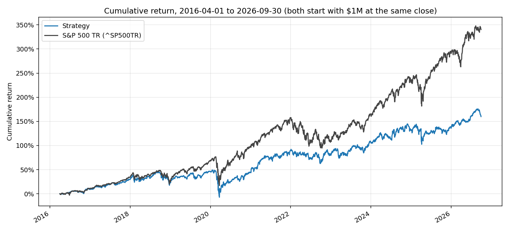

# hw4 - dev rao

90-day stock return model + my own backtester, compared with $1M in ^SP500TR.

**short answer: no, it did not beat the benchmark.** from the 2016-04-01 close to 2026-09-30 the strategy ended at **$2.60M** vs **$4.40M** for SPX TR. CAGR 9.5% vs 15.2%, so it lagged by about **5.6 points a year** ($1.80M less at the end). more on why below. i ran the final test once, with a config i froze and committed before touching any 2016+ outcome.



| | strategy (10 bps/side) | S&P 500 TR |
|---|---:|---:|
| final value (cash + open lots, 2026-09-30) | $2,599,316 | $4,402,747 |
| CAGR (actual days / 365.25) | 9.52% | 15.16% |
| max drawdown | -37.8% | -33.8% |
| sharpe (daily, 2% rf, 252) | 0.51 | 0.77 |
| volatility | 16.6% | 17.8% |
| beta / tracking error / info ratio | 0.80 / 9.3% / -0.57 | |
| avg cash / turnover / total fees | 7.3% / 3.8x per yr / $135k | |

calendar years (strategy minus benchmark): 2016 -1.0, 2017 -2.9, 2018 +0.6, 2019 -14.3, 2020 -19.4, 2021 +2.4, 2022 +13.9, 2023 -12.0, 2024 -13.2, 2025 -16.3, 2026 (to sep) -2.4. full table in `results/calendar_year_returns.csv`.

sensitivities (post-hoc, same run, not the headline):

| variant | final value | CAGR |
|---|---:|---:|
| 0 bps costs | $2.81M | 10.3% |
| 25 bps costs | $2.31M | 8.3% |
| 0% recovery on the 38 forced-exit lots | $1.60M | 4.6% |
| cash earns 2%/yr (flat assumption, there's no T-bill series in the db) | $2.64M | 9.7% |

## how to run

from `Homeworks/HW4/dev_rao/`, with both dbs in `Lectures/modeling/data/`. everything generated goes to `outputs/` (gitignored). small csv/png results go to `results/`.

| step | command | time on my laptop |
|---|---|---|
| 0. tests | `uv run --with pytest python -m pytest tests -q` | <1 s |
| 1. features/labels (wiring check) | `uv run python build_data.py --db class` | ~2 s |
| 1. features/labels (real) | `uv run python build_data.py --db top2000` | ~2 min |
| 2. validation | `uv run python run_validation.py --db top2000` | ~9 min |
| 3. strategy grid (dev only) | `uv run python run_strategy_dev.py --db top2000` | ~30 s |
| 4. freeze | `uv run python freeze_config.py --model composite --top-n 25 --cadence monthly --universe all --refit "none: ..."` (exact text is in frozen_config.json) | ~5 s |
| 4b. dry run of the test script on 2013-2015 | `uv run python run_final_test.py --dry-run-dev` | ~5 s |
| 5. final test (once) | `uv run python run_final_test.py` | ~15 s |
| 6. post-hoc diagnostics | `uv run python run_posthoc.py` | ~1 min |
| 7. notebook | open `01_research.ipynb` (reads saved outputs, ~20 s) | |

notes: `pytest.exe` is blocked by app control on my windows machine, so i run it as `python -m pytest`. pytest isn't a repo dependency, `--with` pulls it just for that command. no other deps added. no parquet (pyarrow isn't installed), intermediate tables live in `outputs/cache_top2000.duckdb`. `run_final_test.py` writes `outputs/final_test_ran.json` and refuses to run again without `--rerun-reason`. it never got re-run.

## files

```
hw4/config.py        all constants (dates, screens, costs)
hw4/data.py          read-only db access + quarantine rules (adapted from course_data.load_data)
hw4/labels.py        90-day labels (adapted from course_data.make_labels)
hw4/features.py      price/liquidity/fundamental features, membership, cross-sectional ranks
hw4/model.py         ridge/HGB pipelines, composite, targets, purged training mask, metrics
hw4/backtester.py    my backtester: Lot, Ledger, TopNCohortStrategy, Backtester, reconcile()
hw4/analytics.py     CAGR, sharpe, drawdown, beta, TE, IR, calendar years
build_data.py, run_validation.py, run_strategy_dev.py, freeze_config.py, run_final_test.py, run_posthoc.py
tests/test_backtester.py
01_research.ipynb    exploration, validation, final results, lot traced by hand
frozen_config.json   the frozen config (committed before the test)
results/             small csvs + charts
```

## data notes (and what the data can't tell us)

- market calendar = the `calendar` table (checked equal to benchmark dates). each stock is reindexed to it with no filling.
- quarantine: the loader drops non-positive adj prices (BHRB's 275 zero rows) and off-calendar rows (28). i load from 2007-01-01 for lookback, so BHRB's rows (2000-01) and 1 of the 28 off-calendar rows are before my window anyway. 27 were dropped in-window.
- **`close`, `volume`, `shares_outstanding` are split-adjusted to today's basis** (NVDA "close" was $0.46 in 2010, volume 800M/day). so close*volume is real dollar volume, and close*shares is a consistent cap proxy when the vendor bases agree. but a "$5 raw price" screen would depend on future splits (it would have dropped NVDA 2010-2016), so i didn't use one.
- `universe_rank` is junk at the very top: 2016-Q2 ranks 1-3 are TMBR, IVR, KDNY with cap proxies in the trillions. 32 symbols have close > $100k or cap proxy > $5T somewhere (`outputs/audit_implausible_caps_top2000.csv`: APDN, TMBR, IVR, KDNY, INPX, NFLX in 2025, BRK-A legit). i only use cap through same-date ranks, so these don't blow anything up, but it's why the "liquid universe" option ranks by dollar volume instead of universe_rank.
- `CSC` has an adjusted close frozen at $10.04 for its whole 2012-2017 history. frozen series look like zero-vol stocks, which my low-risk theme likes. impact: 4 test lots + 1 MPLXP lot = 0.1% of capital in the test, but 24 lots / 2.7% in the 2013-2015 dev backtest. i found this after the test.
- financials are latest vendor values per fiscal period, not original vintages. filing dates limit the join but can't undo restatements.
- the db has no delisting proceeds. inactive != delisted (renames/reorgs too). 38 lots hit my "no quote for > 5 sessions" rule. i checked them by hand and almost all are cash acquisitions/take-privates (CERN/Oracle, SAFM, MMP/ONEOK, PDCE/Chevron, UNVR, VRTV, HIBB, UFS, SC, AEL, EA take-private), plus PSTH (SPAC liquidation, cash back), CHK (merger, ticker change) and MEG (ticker reused). those notes are from public news, not the db, and a few are marked unverified (`results/forced_exits_classified.csv`). so "exit at last close" is a reasonable proxy and the 0% case is a very pessimistic bound.
- sectors are snapshot labels, share classes count separately, cap ranking is approximate. this is recorded-date data, not certified point-in-time. dated membership reduces survivorship bias but i can't claim it's gone.

## timing rules (and where they're enforced)

- signal after the close on t (last session of each week, plus 2016-03-31), entry at the next session's close, exit at the first quote on/after entry + 90 calendar days, max 5 sessions late or the label is missing. `labels.py` asserts entry > signal and exit >= entry + 90.
- membership: join by the quarter of the **next-session entry**, require selection_date <= signal date (assert in `features.apply_membership`). membership only controls training rows and new buys. the backtester keeps marking and exits normally after a stock leaves.
- financials usable from filing_date + 1 day, nonpositive filing lags dropped (23,664 rows), features blanked if the fiscal period is > 550 days old, a late old filing never replaces a newer one, ttm only from 4 consecutive quarters all filed by that date (`features.fundamental_events`, assert available_date <= signal in the join).
- every fit trains only on rows with label_end < fit date (`model.purged_train_mask` + assert in `fit_predict`). same in validation and would be same in test refits.
- all learned preprocessing (clip, impute, scale) is inside the sklearn Pipeline, fit on training rows. the demean target's winsor cutoffs come from training rows only.
- no filtering on future info: is_active, delisting fields, future coverage are never used.
- the notebook (section 2) re-checks all of these on the whole panel.

## eligibility (decided before modeling, past data only)

dated universe member + >= 252 sessions of price history + 63-day median dollar volume >= $5M. that's ~900 names/week in 2010 growing to ~1,800 in 2025.

## features

computed on daily series per stock, then sampled on weekly signal dates. every numeric feature becomes a percentile rank within that date's eligible stocks (NaN stays NaN).

price / technical (adjusted close):
- `mom_21`, `mom_63`, `mom_126`: 21/63/126-session return
- `mom_12_1`: return from t-252 to t-21 (skip last month)
- `rev_5`: 5-session return (short-term reversal)
- `vol_21`, `vol_63`, `vol_252`: annualized std of daily returns
- `beta_252`: 252d beta vs ^SP500TR daily returns
- `ivol_63`: residual vol after removing 63d beta exposure, annualized
- `dd_252`: price / 252d high - 1
- `px_ma200`: price / 200d MA - 1; `ma50_ma200`: 50d MA / 200d MA - 1
- `max_ret_21`: max daily return in 21d (lottery); `skew_63`: 63d return skew

liquidity / size:
- `log_dv_63`: log 63d median dollar volume (close*volume)
- `amihud_63`: 63d mean of |ret| / dollar volume
- `log_mcap`: log(close * latest available shares)
- `turnover_63`: 63d median volume / shares

fundamentals (filing-dated, ttm = sum of last 4 known consecutive quarters):
- value: `ey` ttm net income / cap, `bm` equity / cap, `sp` ttm revenue / cap, `fcfy` ttm fcf / cap
- quality: `roa` ttm NI / assets, `roe` ttm NI / equity (equity > 0), `gp_a` ttm gross profit / assets, `op_margin` ttm op income / ttm revenue, `accruals_a` (ttm NI - ttm OCF) / assets, `debt_a`, `cash_a`
- growth / investment: `rev_yoy` revenue vs same quarter a year earlier, `ni_chg_a` (NI - NI a year earlier) / assets, `asset_growth` yoy, `share_iss` yoy change in shares
- `filing_age_days`: days since the info became available

cross-sectional extras: sector-relative `ey`, `bm`, `sp`, `mom_12_1`, `roa` (value minus sector median on that date), `sector_mom_126` (sector median 126d momentum), sector one-hot, and two regime features (`mkt_mom_63`, `mkt_vol_21`), same for every stock on a date.

coverage: price features ~100%, fundamentals 88-98% of eligible rows (`outputs/audit_feature_coverage_top2000.csv`, also in the notebook).

## models and validation

validation: expanding walk-forward, purged. for each year in 2013, 2014, 2015: fit on weekly signals from 2010-01-01 with label_end < first signal of that year, predict that year's weekly signals. metrics: weekly spearman rank IC (plus newey-west t with 13 lags, since 90-day labels on weekly signals overlap ~12 weeks), decile spread vs the universe mean, decile monotonicity, top-25 hit rate and mean return. selection rule, set before looking: highest mean fold IC among models with IC > 0 in every fold, simpler model if within 0.002.

what i tried:
1. **ridge** in a pipeline like `course_data.make_pipeline` (clip 1/99, median impute + missing flags, scale, sector one-hot), alpha in {1, 10, 100, 1000}. why: tons of noisy, correlated rank features, and shrinkage keeps it from chasing noise. it's the honest linear baseline.
2. **HistGradientBoostingRegressor**: lr 0.05, max_iter {200, 400}, leaves {15, 31}, min_samples_leaf {500, 2000}, l2 1.0, no early stopping. why: handles NaN natively and can pick up interactions (momentum x vol, value x quality, regime x factor). big leaves because 90-day returns are super noisy.
3. targets: (a) date rank of the forward return - 0.5, (b) date-demeaned return winsorized at train 1/99%, and later (c) rank of the **beta-residual** return (return minus beta_252 x benchmark return over the same window). evaluation always uses the raw forward return.
4. **fixed-sign composite** (added after round 1, see below): equal-weight average of 5 themes, each the mean of signed ranks, signs from published papers, nothing fitted:
   - value + : ey, bm, sp, fcfy (fama-french, lakonishok-shleifer-vishny)
   - quality + : gp_a, roe, roa, and accruals - (novy-marx, sloan)
   - investment - : asset_growth, share_iss (cooper-gulen-schill, pontiff-woodgate)
   - momentum + : mom_12_1, sector_mom_126, ni_chg_a (jegadeesh-titman, moskowitz-grinblatt, bernard-thomas)
   - low risk - : ivol_63, max_ret_21 (ang et al., bali-cakici-whitelaw)
5. ensembles: rank-average of best ridge + best HGB, and composite + best ML model.

results (mean of 3 folds, full table `results/cv_summary.csv`, chart `results/cv_ic_by_fold.png`):

| model | mean IC | IC by fold 2013 / 14 / 15 | NW t | top-decile excess (90d) | decile monotonicity |
|---|---:|---|---:|---:|---:|
| **composite** | **0.062** | 0.012 / 0.061 / 0.114 | 1.58 | +0.67% | 0.66 |
| composite + ridge_resid | 0.054 | -0.042 / ... | 1.22 | +0.59% | 0.43 |
| ridge a=1000, resid target | 0.026 | -0.081 / 0.055 / 0.103 | 0.89 | -0.20% | 0.28 |
| ridge + hgb ensemble | 0.019 | min -0.055 | 0.83 | -0.16% | 0.26 |
| best HGB (200 it, 31 leaves, 2000 min, demean) | 0.008 | -0.010 / ... | 0.22 | -0.61% | 0.05 |
| ridge a=1000, rank target | -0.014 | -0.056 / 0.001 / 0.014 | -0.24 | -0.80% | -0.26 |

why the fitted models failed: i checked labels by hand first (they're right), then looked at single-factor ICs per year in 2010-2015 (notebook section 4). vol/beta flip sign nearly every year (+0.08 in 2013, -0.15 in 2015) and momentum was negative in 2010-2012 then positive after. a model fit on just 3 years of a momentum-reversal, risk-on/risk-off market learns "buy losers / buy high vol" and gets burned in 2013. fundamentals were steadier. so the composite won under the rule.

**caveat i want to be upfront about:** i built the composite after seeing round 1 fail and after looking at 2010-2015 factor ICs. i picked themes and signs from the literature (book-to-market stays in even though its dev IC was negative), but its validation IC is still optimistic. the 2016-2026 test is the only clean number.

refits: the composite has no fitted parameters, so there's nothing to retrain. the quarterly refit code path (expanding window, label_end < fit date) is in `run_final_test.py` for fitted models. ridge/HGB fits took 1-7 s on 136k-253k rows, so compute wouldn't have been a problem.

## strategy (picked on 2013-2015, then frozen)

each scheduled signal date, buy the top N scored eligible names. cohort budget = min(cash + value of lots maturing next session, NAV x cohort fraction), equal weight, max 5% of NAV per name (summed across lots), max 30% per sector. a capped name passes its budget to the next one down.

grid (12 runs, 10 bps, same start date for all): N in {10, 25, 50} x weekly (1/13) vs monthly (1/3) x all eligible vs 1000 most liquid. `results/strategy_dev_grid_composite.csv`. **all 12 trailed SPX TR in development too** (bench 14.2% CAGR, sharpe 0.95). best was **N=25, monthly, all**: CAGR 12.7%, sharpe 0.93, excess -1.6%/yr, beta 0.84. it was best on both sharpe and excess, and it's the simpler option (fewer trades, no extra filter), so that's the frozen choice. monthly cohorts leave ~11% cash on average because a lot matures a couple of days after that month's buy. i noticed it but kept the grid small rather than tune it.

## backtester (written from scratch, `hw4/backtester.py`)

- `Lot` (frozen dataclass): symbol, sector, signal/entry/due dates, entry price, units, entry fee.
- `Ledger`: cash, open lots, fills log, closed lots with realized pnl, fees. `buy` asserts fill date > signal date and refuses to spend more than cash.
- `TopNCohortStrategy`: only gets a snapshot after the signal close (cash, NAV, exposures, value of lots due next session) and returns fee-inclusive budgets.
- `Backtester`: daily loop. order each day: (1) stale positions beyond 5 sessions get exited, (2) due lots with a quote sell at today's close, (3) yesterday's planned buys fill at today's close, each capped at the actual cash (logged when reduced), rejected if no quote (logged), (4) mark everything, (5) if it's a signal date, plan tomorrow's buys.
- `reconcile()` runs after every backtest and raises if anything is off.

assumptions:
- fractional units of the adjusted close = total-return exposure, so dividends aren't added again.
- costs 10 bps per side (commission + half-spread guess for liquid top-2000 names), entry fee included in the budget: units = budget / (price x 1.001). sensitivity at 0 and 25 bps.
- cash earns 0%. separately labeled 2% sensitivity.
- missing prices: carry the last close up to 5 sessions (flagged stale). no quote for > 5 sessions (or at maturity and then > 5 sessions): base case exit at the last observed close, flagged. worst case 0% recovery. never invented fills.
- open lots on 2026-09-30 are valued at that close (no exit fee charged, about 0.1% of the book). no later prices used.
- first row is the initial capital on 2016-03-31, so entry fees hit the first return and the drawdown. benchmark buys at the same 2016-04-01 close.

## accounting and timing evidence

- `tests/test_backtester.py`, 9 tests, all pass:
  1. one buy + one sale: budget $100,100 at $100 -> exactly 1,000 units, $100 fee, cash $899,900. sale at $110 -> $110 fee, pnl $9,790, final cash $1,009,790.
  2. entry mon 2020-01-06 -> due sun 04-05, mon 04-06 made a holiday -> sells tue 04-07.
  3. two $60k orders with $100k cash -> second is cut to $40k, cash ends at 0, logged.
  4. maturity cash ($99,800.20 after fees) funds a same-day buy, which gets capped at exactly that.
  5. a 3-session gap is carried stale; quotes stop -> stale for 5 sessions, forced exit on the 6th, with 100% and 0% recovery cash checked to the cent.
  6. 30-stock random run: cash rebuilt from fills == ledger cash daily, NAV - capital == realized + unrealized, fees match, no fill on/before its signal, maturity lots held >= 90 days.
  7. a fill on the signal date raises; fills use the next session's price.
  plus: buy rejected without a quote, name cap passes budget down.
- one lot by hand (notebook section 8): lot 3, KLAC, signal 2016-03-31 (close $62.16, not used). budget 1,000,000 / 3 / 25 = $13,333.33. entry 2016-04-01 at $62.36 -> units 13,333.33 / (62.36 x 1.001) = 213.5987, fee $13.32. due 2016-04-01 + 90 = 2016-06-30 (thu), sold at $63.00, fee $13.46, proceeds $13,443.26, pnl **+$109.93**. matches the ledger exactly.
- one label by hand: AAPL signal thu 2013-03-28 -> good friday -> entry mon 04-01 at 13.03 -> due sun 06-30 -> exit mon 07-01 at 12.51 -> -3.99%.
- full-run reconciliation (notebook section 9): max cash diff 0, max NAV vs pnl diff 0, fees match, min cash 0, 0 fills on/before signal, 0 maturity lots under 90 days. 23 buys reduced to available cash, 1 rejected for no quote, 38 forced exits, 108 days with at least one stale mark.
- `--dry-run-dev` ran the exact final-test code on 2013-2015 before the real run, so the real run couldn't crash halfway.

## why we lost (evidence, all post-hoc)

1. **random picks lose by the same amount.** same rules, costs and caps but 25 random eligible names (20 seeds): mean CAGR 9.7% (range 7.2-12.8%), mean final $2.67M. our 9.5% sits at the 45th percentile. so the ~5.5 pt/yr gap vs SPX is basically equal-weighting mid/large caps vs a cap-weighted index driven by mega-cap tech. our picks didn't add return, though the drawdown was smaller than random (-37.8% vs -42.8% avg) and sharpe a bit higher (0.51 vs 0.46).
2. **what we held:** cost-weighted ranks of purchases vs 0.5 for the eligible universe: vol 0.24, beta 0.34, earnings yield 0.73, roe 0.72, gross profitability 0.66, momentum 0.66, asset growth 0.26, issuance 0.18, size 0.61. so: low beta, value-ish, quality, low investment, and only mildly large within a ~1,800-name universe (way smaller than what drives SPX). tech 12.9% of purchases vs 15.2% of eligible rows, and far below a cap-weighted index. healthcare and real estate under, staples/materials/energy over.
3. **years line up with the tilt:** we lost the most in 2019, 2020, 2023-2025 (mega-cap growth, and the 2020 junk rally where our picks trailed the rest of the universe by 5.9 pts) and won in 2022 (+13.9 pts, value/low-vol year), 2021 and 2018. beta of 0.80 in a market that went up ~4.4x costs a lot by itself.
4. **positive IC, but no top-tail edge.** test mean IC 0.033 (NW t 1.73, positive 56% of weeks; 2021 +0.20, 2022 +0.13, 2020 -0.11). median excess and hit rate do rise from the worst decile to the best (-3.3% -> -0.5%, 44.8% -> 48.3%), so the score does sort stocks. but the worst decile has the highest *mean* return because junk has fat right tails. a long-only top-25 book earns the mean, so the ranking skill didn't turn into returns.

## risks taken

concentrated (25 names per cohort, ~52 names held on average), equity beta ~0.8 with no hedge, 9% tracking error vs the benchmark, factor bets on value/quality/low-vol that can lag for years (and did), and acquisition-exit risk (38 lots, ~$0.96M of cumulative cost, where we assume the last close was realized).

## limitations

- composite designed after seeing dev factor ICs, so its validation IC is optimistic (see above).
- recorded-date data, not certified point-in-time. restated financials, approximate cap ranking, snapshot sectors, no delisting proceeds.
- frozen price series (CSC) slipped through. a zero-return-days screen would catch it.
- forced-exit pricing at the last close is an assumption. the 0% bound is extreme but shows how much it could matter ($2.60M -> $1.60M).
- costs are a flat 10 bps. no market impact model, though trades are small vs the $5M+ daily volume screen.
- the dev grid used float32 composite scores and the test used float64, so ties can order differently. the dry run reproduced the chosen dev config within 0.4% of final value.
- one test path, one universe. 10 years of a pretty unusual market.

## unsuccessful ideas

- ridge/HGB on rank or demeaned targets: negative IC in 2013, about zero after. 3 years of training data from one regime isn't enough.
- beta-residual target: big help for ridge in 2014-2015 (IC 0.05-0.10) but still -0.08 in 2013, failed the all-folds rule.
- HGB never beat ridge here. more flexibility just fit more noise.
- weekly cohorts: better cash usage (4% vs 11%) but lower dev sharpe than monthly.
- the liquid-1000 universe didn't help in dev (slightly worse every time).

## what i'd try next

- the real gap is weighting/universe, so i'd try cap- or sqrt-cap-weighted holdings, or tilt the benchmark itself (e.g., start from SPX-like weights and overweight high composite scores) instead of equal-weight top-N.
- screen out frozen/stale price series (share of zero-return days) before ranking.
- train ML on more history (pre-2010 data, if the rules allowed it), or train on residual returns with more regularization, and use it as a small add-on to the composite instead of on its own.
- fix the monthly cash drag (let the next cohort use maturity cash, or move to weekly cohorts with the composite).
- optimise for the right tail: the score sorts medians well, so maybe exclude the worst decile from a broad portfolio instead of picking the top 25.

## decision log

1. split-adjusted `close` found -> no raw price screen, dollar volume only (split-invariant).
2. universe_rank junk at top -> "liquid" option uses dollar volume rank.
3. weekly signals (last session of week) + 2016-03-31 so the first test entry is the 2016-04-01 close.
4. eligibility: member + 252 sessions + $5M median dollar volume.
5. round 1 validation (ridge/HGB x rank/demean): all ~0 or negative. checked labels by hand, then factor ICs -> regime story.
6. added beta-residual target + fixed-sign composite + composite ensemble. composite won under the pre-set rule.
7. strategy grid aligned to the same start date for both cadences (first version had different windows, so sharpes weren't comparable). picked N=25 monthly all.
8. no refits (nothing to fit).
9. froze config, dry-ran the test code on 2013-2015, then ran the test once.
10. post-hoc: forced exits checked (mostly acquisitions), random-pick null, deciles, exposures, frozen price audit.

## citations

adapted from `Lectures/modeling/course_data.py` (also cited in the docstrings):
- `load_data`, `load_membership` -> `hw4/data.py` (read-only sql, symbol batches, quarantine of bad/off-calendar prices)
- `price_features` -> `features.price_features_for_symbol` (reindex to calendar, no filling)
- `financial_events`, `join_financials` -> `features.fundamental_events` / `join_fundamentals` (filing + 1 day, nonpositive lags dropped, 550-day staleness, late old filings don't replace newer ones), extended to ttm/yoy at the filing-event level
- `apply_membership` -> `features.apply_membership`
- `make_labels` -> `labels.labels_for_symbol`
- `date_folds` -> `model.purged_train_mask`
- `QuantileClipper`, `make_pipeline` -> `model.py`

the backtester is my own. i read `backtest.py` and the lecture 8 notebooks for the conventions (fee-inclusive budgets, initial-capital row, 5-session stale rule) but didn't import or copy its classes. factor sign references are listed in the composite section and in `model.py`.
