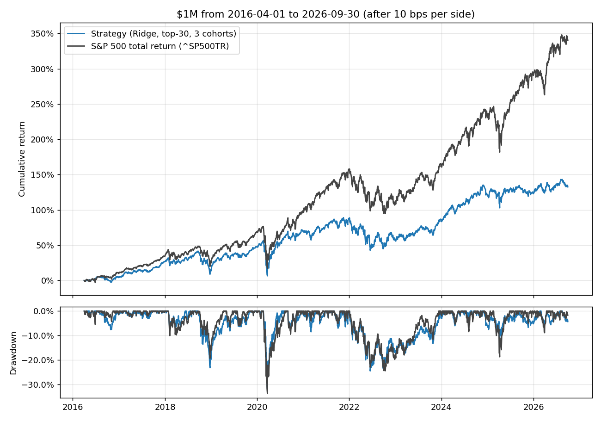

# HW4: Stock-return model, cohort strategy and backtester (Dhruv Chopra)

**Result:** The strategy did **not** beat the S&P 500 total-return index over the final test (Apr 1, 2016 – Sep 30, 2026).

| $1M from 2016-03-31 | Final value | CAGR | Max drawdown | Sharpe |
|---|---:|---:|---:|---:|
| **Strategy (Ridge, top 30, 3 cohorts)** | **$2,325,731** | **8.37%** | −31.9% | 0.46 |
| S&P 500 TR | $4,402,747 | 15.16% | −33.8% | 0.77 |

In development (2012–2015) the same design beat the index: 19.2% vs 14.9% CAGR, Sharpe 1.21 vs 1.00. That edge did not survive out of sample (§6).



## How to run

From the repository root:

```bash
uv sync --locked                 # Python 3.13 works. On 3.15 rpds-py has no wheel: use `uv sync --locked --python 3.13`
# Put equities_top2000.duckdb (bCourses) in Lectures/modeling/data/
cd Homeworks/HW4/Dhruv_Chopra
../../../.venv/bin/python -m unittest test_backtester -v   # 37 accounting/timing/look-ahead/feature tests, no database (~5 s)
../../../.venv/bin/python run_development.py               # v1 model and portfolio choice, 2010-2015 (~2 min)
../../../.venv/bin/python run_ideas.py                     # my feature hypotheses, 2010-2015 (~20 min per run)
../../../.venv/bin/python run_ideas.py --group health --group long_mom --base skew_180 \
    --weighting equal --weighting rank --weighting inverse_vol    # (~11 min)
../../../.venv/bin/python run_allocation.py                # weighting x portfolio size grid, 2012-2015 (~25 min)
../../../.venv/bin/python run_allocation.py --redistribute # same, with the name-cap fix (~10 min)
../../../.venv/bin/python run_cutoff.py                    # raw-score cash cutoff (rejected), 2012-2015 (~4 min)
../../../.venv/bin/python run_agreement.py                 # feature-agreement cash cutoff (adopted), 2012-2015 (~4 min)
../../../.venv/bin/python run_sector.py                    # best k per sector (not adopted), 2012-2015 (~5 min)
../../../.venv/bin/python run_correlation.py               # correlation-capped selection (not adopted), 2012-2015 (~5 min)
../../../.venv/bin/python run_ideas.py --group moments --base skew_180 --weighting equal --weighting rank
../../../.venv/bin/python run_ideas.py --group resid_sq --base skew_180 --weighting equal --weighting rank
../../../.venv/bin/python run_rotation.py                  # industry rotation (not adopted), 2012-2015 (~5 min)
../../../.venv/bin/python run_final.py                     # the submitted, frozen configuration on the final test (~5 min)
../../../.venv/bin/python run_final.py --variant v2        # the post-test variant (see §6)
```

Small result tables and the chart are written to `results/` (committed). The full fill, daily and event logs are written to `outputs/`, which is git-ignored.

| File | Contents |
|---|---|
| `data.py` | Reads DuckDB into date × symbol arrays, builds the dated membership mask, runs **price repairs**, flags **duplicate tickers**, and computes daily close location and early month-end prices |
| `features.py` | Causal features (v1's 20 plus every tested hypothesis) and the 90-calendar-day label |
| `model.py` | Within-date rank transform, weekly training panel, purged walk-forward fits, quarterly refit schedule, per-feature contributions and agreement |
| `strategy.py` | Three-cohort top-N strategy: weighting, name/sector caps, cap redistribution, cash cutoffs; also the tested-but-unused sector-neutral and correlation-capped selection |
| `backtester.py` | My own ledger and daily backtest loop, plus performance metrics |
| `pipeline.py` | Shared setup and the frozen configurations (`V1_CONFIG`, `CHOSEN`) |
| `run_*.py` | Development experiments (above) and the final run with its accounting checks |
| `test_backtester.py` | Accounting, timing and feature cases small enough to check by hand |

## 1. Data and the repairs it needed

The final experiment uses `equities_top2000.duckdb` (SHA-256 matches `manifest.json`). Dated quarterly membership decides which stocks are eligible. A signal at the close of *t* uses the membership list for the quarter containing the entry session *t+1*, following the lecture convention. Stocks that leave the list are never force-sold.

Auditing extreme labels showed that the adjusted prices contain errors large enough to dominate any backtest. For example, AAM's 2011 data gives a 90-day "return" of +13.9 million %. NFLX shows −90% on 2025-10-03 because its 10:1 split was never back-adjusted.

`data.clean_prices` repairs these **point-in-time**: whether a quote on day *d* is kept depends only on raw data up to *d*. A move of 1.8× or more is **unconfirmed** on the day it appears. It is treated as no quote (no fill, no mark, no feature) until later quotes resolve it, and the result applies only from the resolving quote onward. While a move is unconfirmed, a held stock is marked at its last trusted price, a buy is rejected, and an exit waits.

| Problem | Example | Rule | Count (2008–2026) |
|---|---|---|---|
| Zero-volume quotes, sometimes from a different security | AAM, TIC alternate $0.41 and $19,800 prints | No trade means no quote | 201,282 quotes |
| Spikes that revert | AAM, TIC, GCT, CLOV | A later quote returns within 30% of the last trusted price: the unconfirmed quotes stay dropped | 888 |
| Splits never back-adjusted | NFLX ÷10, ORLY ÷15, FAST ÷2, LCID ×10 (reverse) | The new level holds within 25% for 2 more quotes, the move is within 6% of an integer split ratio, and split-day volume moved the opposite way (judged against the *prior* 20-day median). Earlier prices are then rescaled, as a vendor does for a split. | 379 |
| Genuine large moves | ARRY −46% (2021), MDXG −59% (2018) | Confirmed the same way but not split-shaped: accepted as real, with no rescaling | 1,201 |
| Large moves that never settle | volatile micro-caps (BMNR, QUBT) | Accepted after 5 unresolved quotes | 827 |
| Adjustment-factor breaks | KDP 2018-07-10: adj_close ×6.9 while close ×1.1 | Same-day check: use the close-to-close return for that day | 141 |

Rescaling earlier prices by a constant never changes a return measured entirely before the event. `test_cleaning_is_prefix_invariant` cleans every prefix of a synthetic history containing a crash-and-recovery, a split, a spike, a genuine crash, an oscillating series and a factor break. For every prefix it checks the same quote mask and the same returns as cleaning the full history. The lecture loader's quarantine of off-calendar rows (27 in my window) is also applied.

**Duplicate tickers.** 105 companies appear under two tickers with the same price history, mostly an old and a new ticker after a rename (DISCA/WBD, AXL/DCH, SQ/XYZ, ANTM/ELV, CREE/WOLF, JCOM/ZD). Often both were universe members at the same time, for up to 15 years. `data.duplicate_copies` handles this **point in time**:
- **When two tickers are one company:** at session *t*, their daily returns over the past 63 sessions match within 0.02 pp + 3% of the return, on at least 95% of the days either moved more than 0.3%.
- **Which copy is kept:** the ticker with the earlier first quote. That choice never flips, so the strategy can't end up holding both.
- **What happens to the other:** it isn't eligible on that date, so it's neither trained on nor bought.

201,284 stock-days were dropped. Share classes with similar but not near-identical returns are not merged (UA/UAA, CWEN/CWEN-A; see §8).

**Price-level features are deliberately excluded.** Prices *and* reported share counts in this database are restated for later splits: AAPL's 2012 close shows $22.17, not about $620, and its 2013 shares show 25.2B. So a split leaves no trace on its date, and price × shares quantities mix in later corporate actions. I use dollar volume (close × volume) for size and liquidity.

## 2. Features, target and model

**v1 features** (20, all known at the signal close):

- **Price features:** returns over 5, 21, 63 and 126 sessions; 12-1 month momentum; 63-day volatility; maximum daily return over 21 sessions; drawdown from the 252-day high; log of 63-day average dollar volume.
- **Financial features:** These use the latest quarterly filing, available from filing date + 1 day. A late filing for an old period never replaces a newer one, and values more than 550 days past fiscal period end are blanked. Every field comes from the *same* current filing (`test_newer_filing_with_missing_field_is_not_backfilled`). They are gross profit/assets, operating ROA, ROE, net margin, debt/assets, cash/assets, FCF/assets, accruals/assets, year-over-year revenue growth, year-over-year asset growth, and filing age.

**v2 adds one feature:** `skew_180`, the bias-adjusted skewness of the previous 180 daily returns (§3b).

**Target:** gross return from the next session's close to the first quoted close on or after entry + 90 calendar days (at most 5 sessions late). Missing outcomes stay missing.

**Transform:** each feature and the target are converted to a percentile rank within each date. This makes 2010 and 2026 comparable, needs no learned scaler, and matches what the strategy needs: ordering stocks on the same day.

**Model:** Ridge regression (α = 10) on the centred ranks plus a missing-value indicator per feature. Gradient boosting was clearly worse in validation. Because Ridge is linear, each stock's score splits exactly into one contribution per feature, which v2's agreement cutoff uses.

**Training data:** weekly cross-sections (every 5th session) of eligible members from January 2010. Each fit uses only rows whose exit quote is strictly before the fit session (`model.usable_training_rows`, with an assert in `fit`). The model is refit at the first signal of each quarter.

## 3. Validation of v1 (development only, 2010–2015)

Expanding, purged walk-forward. For each of 2012–2015, the model is fit at the year's first signal using finished labels, then scores every week of that year. Tradeable stocks only (≥ $10M average daily dollar volume):

| Score | Rank IC | Top-30 minus universe, 90-day return | 2012 | 2013 | 2014 | 2015 |
|---|---:|---:|---:|---:|---:|---:|
| **Ridge (chosen)** | **0.041** | **+2.1%** | +1.6% | −0.0% | +3.2% | +3.6% |
| Gradient boosting | 0.020 | +0.3% | +0.9% | −1.3% | +0.5% | +1.0% |
| 12-1 momentum only | 0.038 | −0.2% | +2.8% | +4.8% | −4.9% | −3.5% |

**v1 development backtests** (2012-01-03 to 2015-12-31): Ridge top 20 / 30 / 50 gave Sharpe ratios of 1.25 / 1.21 / 1.21. I picked the middle option, top 30 (19.2% CAGR, −11.2% max drawdown), rather than the best in-sample number. The S&P 500 TR returned 14.9% (Sharpe 1.00).

## 3b. My own hypotheses (development only, 2010–2015)

These studies were done **after** the final test above, on 2010–2015 data only.

### Where the ideas came from

Before this course I researched intraday return skewness on 98 S&P 100 stocks over two years (my `skewness_signal` project). There I found that the skew of a day's 5-minute returns predicted the next day, going **long high skew**. That research taught me rules I reused here:
- write the expected sign down before running anything;
- choose settings from a plateau of neighbouring values, not the single best cell;
- compare against placebo signals;
- check that results survive dropping the best few names;
- make decisions on training data only.

It also taught me that 98 names over 2 years is too few stocks to confirm a signal. The HW4 database has about 2,000 stocks over 2008–2026, so it is a better test of my long-high-skew prior, though at a daily and 90-day horizon rather than intraday.

### How each idea was tested (`run_ideas.py`)

These hypothesis tables were run before the duplicate-ticker fix (§7). That fix changed less than 2% of eligible stock-days and moved v1's development result by 0.1 pp, so the verdicts don't depend on it. The portfolio-construction numbers below were rerun after the fix.

1. **Single feature:** rank IC with the expected sign written down first, and its t-statistic. Weekly samples overlap about 13 weeks of each 90-day label, so the t-statistic is adjusted for that.
2. **Placebo:** compare against 100 random-noise features with the same persistence. "Beats placebo" means |IC| is above their 95th percentile (about 0.008–0.016 depending on the window).
3. **Robustness:** top-30 excess return with and without the 5 and 10 names that contributed most, and the share of 200 random half-universes where the IC has the expected sign.
4. **Neighbouring settings:** other window lengths or thresholds next to the chosen one.
5. **In the model:** walk-forward Ridge with the feature added to v1, and a development backtest.

### Results

| Hypothesis | Expected | What happened (2012–2015 IC unless noted) | Verdict |
|---|---|---|---|
| **Skew of daily returns** (my prior) | long high skew | Holds only at long windows: 42d −0.009, 63d −0.003, 126d +0.007, **180d +0.023 (t 1.12)**, 252d +0.022. The 180d and 252d windows beat placebo and hold in 100% of half-universes, so they form a plateau. The top-30 edge is small and needs the best 5 names. Added to v1: rank IC 0.043, top-30 excess 1.97% vs 2.06%, backtest 20.5% vs 19.1% CAGR. | **`skew_180` adopted** |
| Kurtosis, close location, distance from 20-day high | reversal for distance-to-high | Kurtosis: no signal. Close location: weak, no plateau. Distance from the high was **momentum, not the reversal I expected**, and it flips sign by year. | rejected |
| **Dividends** (company health) | payers, raises + | Only `div_change_yoy` beats placebo (0.014, t 0.81). Over 90 days: omissions −0.9%, cuts −0.45%, steady payers +0.2%. The direction is right but weak, and `div_payer` flips by year (−0.07 in 2013, +0.06 in 2015). Added to the model: worse (top-30 1.44%, 18.1% CAGR). | rejected |
| **Share offerings / buybacks** | issuance −, buybacks + | **The strongest ranking signals found**: buybacks/assets 0.037 (t 2.39), net issuance 0.034 (t 2.08), both right-signed in nearly every year. Big issuers −0.7% over 90 days, buyers +0.5%. But they don't improve the top 30 (1.55%, 18.5% CAGR). | rejected for the portfolio |
| **Stock splits** | — | **Cannot be tested:** prices and share counts are restated for later splits, so a split is invisible on its date. The `dividends` table's ratio covers only 389 stocks. | untestable |
| **Market / industry / stock-specific split** (rolling 252-day regression on `^SP500TR` and leave-one-out industry returns) | residual and industry momentum + | Stock-specific momentum: ≈0. Industry momentum: wrong sign (reversal). Stock-specific volatility: right sign (0.024–0.030 across windows) but swings −0.15 to +0.11 by year, so a regime bet. Added to the model: worse (top-30 1.42%, 17.6% CAGR). | rejected |
| **Balance-sheet health** (operating margin, cash vs long-term debt, net cash, current ratio, interest coverage, short-term debt share) | healthier + | **The opposite of my prior.** Less liquid, more indebted firms did better: current ratio −0.037 (t −1.76), cash/long-term debt −0.021, net cash −0.017. Operating margin and interest coverage ≈0. This matches v1's positive debt and negative cash weights: in 2012–2015, low rates rewarded leveraged firms. I did not flip the signs to fit. | rejected |
| **Long-term momentum** (my 1-year average daily return; 2-, 3- and 5-year reversal from month-end prices back to 2004) | + / reversal | `avg_ret_252` has the highest single IC found (0.039, t 1.11) but is a peak: 126d 0.003, 504d 0.016. Long-horizon reversal is right-signed but below placebo. Added to the model: worse (top-30 0.89%). | rejected |

Later tests (all on 2012–2015, added to v1 + `skew_180`):

| Hypothesis | What happened | Verdict |
|---|---|---|
| **The four moments of the past year's returns** (mean, volatility, skew, kurtosis) | Low volatility ranks well at every window (IC 0.035–0.042) but flips by year (+0.11 in 2013, −0.16 in 2015). Kurtosis: no signal. Added together: top-30 excess 1.46% vs 1.97%, CAGR 19.3% vs 20.5%. The new features largely duplicate existing ones and get offsetting weights (`vol_252` +, `vol_63` −; `skew_252` −, `skew_180` +). | rejected |
| **Squared residual returns** after removing the market and the stock's sector (21 / 63 / 252-day means, and a recent-to-year "spike" ratio) | Levels: IC ≈ 0.03 across windows, but sign flips by year. **The spike ratio is the steadiest new signal found** (IC 0.018, t 1.14, right-signed in all of 2012–2015) but small. In the model: top-30 excess 1.53%, CAGR 19.4%. | rejected |
| **Best k stocks per sector** (sector-neutral selection, k = 1, 2, 3, 5) | Best 1 per sector is worse (19.7% / 1.21 / −12.6% with rank weights): 11 names, and weak sectors' best names get as much money as strong ones. Best 2 per sector is +0.6 pp over top 30, a bump rather than a plateau. Drawdowns unchanged. | rejected |
| **Add a stock only if its past-year correlation with the current portfolio is below k** (k = 0.4–0.8) | k ≥ 0.7 barely binds (picks already average about 0.55). k ≤ 0.5 reaches the 136th–243rd ranked names and leaves slots in cash: CAGR 16.7% / 11.4%, and drawdowns get *worse* (−12.4% / −15.2%), because low-correlation stocks still fell with the market in sell-offs. | rejected |
| **Industry rotation:** buy the top 10 stocks (by model score or by own momentum) of the industry with the best past ~90-day return | Your exact rule: 8.4% CAGR, Sharpe 0.42, max drawdown −21%. The best industry beat the universe over the next 90 days only 45–60% of the time. 10 stocks in one industry gave 17–24% volatility. One cell (126-session momentum) reached 21.5% CAGR, but its neighbours were 11–14%, so it's a spike. | rejected |
| **Country information** | Not available: `universe.country` is "US" for all 3,849 stocks, and reported currency is missing for 95% of filings. | untestable |

Adding *everything* together was the worst result (top-30 excess 0.73%, 14.6% CAGR, below the index in development). **The recurring lesson:** several features rank the whole universe better (IC goes up), but they don't improve *which 30 stocks come out on top*. A 30-stock portfolio only uses the top of the ranking.

### Portfolio construction (`run_allocation.py`, `run_agreement.py`, `run_cutoff.py`)

The spec leaves sizing open ("You decide how many stocks to buy, how much to allocate"). All of the following are development backtests of v1 + `skew_180`, 2012–2015.

- **Number of stocks:** top 30 beat top 50 and top 100 for every weighting and feature set.
- **Weighting:** linear rank weights (the best name gets about 2× the average) beat equal weights in all 9 cells of the first grid. That first grid hid a bug: rank weights hit the 5%-per-name cap, so about 16% of the money sat in cash. Once capped money is redistributed to the other picks, the edge shrinks to +1 pp CAGR (21.5% vs 20.5%). Inverse-volatility weights cut drawdowns by about 1.5–2 pp.
- **Cash when the signal is weak, version 1: a raw-score cutoff. Rejected.** It looked excellent (Sharpe 1.32 → 1.64), but 95% of its variation came from the quarterly refits. Predicted scores shrink as the training sample grows, so it was fully invested in 2012–2013 and mostly in cash in 2014–2015. Its apparent market timing was that drift lining up with the market's path.
- **Cash when the signal is weak, version 2: feature agreement. Adopted.** For each pick, agreement = positive feature contributions ÷ absolute contributions. 1 means every feature agrees; 0.5 means a tug-of-war. As a ratio, it doesn't drift with refits: only 7% of its variation is between quarters, with no trend. Within the top 30, high-agreement picks beat low-agreement picks by 1.4 pp per 90 days (2.34% vs 0.98%), though only on 54% of dates (t 0.98). With the 25th-percentile cutoff (0.732, frozen before the duplicate fix; 0.729 after it), the slots of picks below it stay in cash:

| v1 + `skew_180`, top 30, cap redistribution | CAGR | Sharpe | Max drawdown | Average cash |
|---|---:|---:|---:|---:|
| Rank weights, no cutoff | 21.6% | 1.36 | −11.3% | 3.5% |
| **Rank weights + agreement cutoff (v2)** | **19.8%** | **1.59** | **−7.1%** | 27% |
| Inverse-vol weights, no cutoff | 19.5% | 1.34 | −9.0% | 3.5% |
| S&P 500 TR | 14.9% | 1.00 | −12.0% | — |

I chose the cutoff version because it was the best risk-adjusted result. The filter clearly kept better stocks than holding the same cash at random would have (about 14.3% CAGR, from 19.9% equal-weight × 72% invested). I knew it gave up return, and that 27% cash would cost more in a strong bull market.

## 4. Trading strategy (submitted, `pipeline.CHOSEN`)

- **Three staggered 90-day cohorts.** Cohort 1 buys with ⅓ of NAV on the first test day, cohort 2 about 20 sessions later, cohort 3 about 20 sessions after that. Afterwards, each maturing cohort's proceeds fund the next cohort. At most one cohort is formed every 20 sessions, and only if idle cash is at least 2% of NAV.
- **Selection:** the 30 highest-scoring tradeable stocks (dated member, 63 complete daily returns, ≥ $10M of 63-day average dollar volume, not a duplicate ticker), with at most 8 (25%) from one snapshot sector.
- **Weights:** equal within the cohort; no single stock above 5% of NAV.
- **Model updates:** refit at the first signal of each quarter (43 fits in the test).

## 5. Backtester and assumptions

The backtester was written for this homework. Its structure (strategy / ledger / daily loop / analytics) follows Lecture 8's `backtest.py`. On each session *d*:

1. The strategy plans using data through the close of *t = d−1*. It sees the portfolio valued at *t* and returns fee-inclusive budgets whose total is at most the cash at *t*. Exceeding that raises an error.
2. At the close of *d*, lots that are due are sold, then planned buys are filled. Sales cannot fund the same day's buys, so the same cash is never spent twice.
3. All lots are marked at their latest quote, and NAV = cash + Σ units × mark.

| Assumption | Choice |
|---|---|
| Capital and leverage | $1,000,000; long only; no borrowing |
| Fills | Adjusted close of the entry session (fractional adjusted-price units, so dividends are already included and never added again) |
| Holding period | Sell at the first quoted close on or after entry + 90 calendar days |
| Transaction costs | 10 bps per side on notional. No market impact. |
| Cash interest | 0%. The database has no T-bill series. The 2% rate is used only as the Sharpe hurdle. This matters more for v2, which held 27% cash. |
| No quote on the entry day | Buy rejected; the budget stays in cash |
| No quote on a holding | Carry the last quote and count it as stale |
| Stock stops quoting before maturity (takeovers) | No delisting-proceeds table exists, so **no sale is invented**. The lot stays at its last trade price and its capital is never reinvested. |
| Ticker reappears after more than 21 sessions without quotes | Treated as a different security; the lot is frozen at its last trusted price (TE, 2016→2020) |
| Benchmark | $1M in `^SP500TR` at the first test close (2016-04-01). All series start at $1M on 2016-03-31, so the strategies' first entry fees count. |
| Metrics | CAGR uses actual days / 365.25. Sharpe = √252 × mean(daily return − 2%-equivalent daily rate) / standard deviation. Max drawdown is on daily NAV. |

## 6. Final test results (Apr 1, 2016 – Sep 30, 2026)

| | **Strategy** | **S&P 500 TR** |
|---|---:|---:|
| Final value (cash + open positions) | **$2,325,731** | **$4,402,747** |
| CAGR | 8.37% | 15.16% |
| Maximum drawdown | −31.9% | −33.8% |
| Sharpe (2% risk-free rate) | 0.46 | 0.77 |
| Annualised volatility | 15.9% | 17.8% |

**The strategy did not beat the benchmark.** It finished 47% lower, or 6.8 percentage points of CAGR. Its daily returns have a 0.90 correlation with the index and a beta of about 0.8.

**Calendar-year returns.** 2016 and 2026 are partial years. The strategy beat the index only in 2022.

| | 2016 | 2017 | 2018 | 2019 | 2020 | 2021 | 2022 | 2023 | 2024 | 2025 | 2026 |
|---|---|---|---|---|---|---|---|---|---|---|---|
| Strategy | 4.0% | 21.6% | −8.7% | 27.5% | 15.7% | 10.3% | −15.9% | 18.2% | 18.4% | 0.9% | 4.4% |
| S&P 500 TR | 9.8% | 21.8% | −4.4% | 31.5% | 18.4% | 28.7% | −18.1% | 26.3% | 25.0% | 17.9% | 12.8% |

**Activity:** 127 cohorts, 3,809 buys of 621 distinct stocks, $129k of fees, an average of 62 names held, and 2.4% average cash.

### Why it lost

`results/final_oos_prediction_diagnostics.csv` scores every test week with the same Ridge model, refit each January. This analysis came after the run and was used for no choice.

| Mean 90-day return, weekly signals 2016–2026 | |
|---|---:|
| Model's top 30 tradeable stocks | 2.44% |
| Equal-weighted tradeable universe | 3.38% |
| S&P 500 TR | 3.87% |
| Rank IC (0.041 in development) | 0.014 |

1. **The model's edge mostly disappeared.** Its top 30 lagged its own universe by about 1% per 90 days. The worst years were 2016 and 2020, rebounds led by low-quality, high-volatility stocks: the opposite of the model's tilt toward profitable, low-volatility stocks near their highs.
2. **The universe itself lagged the index.** An equal-weighted top-2,000 list is mostly mid caps, while 2016–2026 was led by a handful of mega-cap technology stocks.
3. **Capital stuck in takeover targets.** 19 lots ($375k at their last prices, 16% of final NAV) are past maturity with no further quotes, for example deals like Slack and Splunk. In reality that cash would have come back at deal close. **If those lots were worth $0, the final value would be about $1.95M.**
4. **Smaller drags:** lower risk than the index (volatility 15.9% vs 17.8%) and about 0.8% a year in costs.

**Post-test variant.** After this final run, I continued researching on 2010–2015 data only (§3b). The variant that research pointed to (v2: + `skew_180`, rank weights, feature-agreement cutoff; development Sharpe 1.59) was also run once on the test period: **$1,817,743, 5.86% CAGR**. It did worse than the submission and is not the submission (`results/v2_check_*`, `run_final.py --variant v2`).

## 7. Evidence that the accounting and timing are right

**Unit tests** (`test_backtester.py`, 37 cases, all pass) cover:

- **Ledger arithmetic by hand:** a $10,000 budget at $10 with 10 bps buys 999.000999 units; cash, fee and PnL are checked to the cent.
- **Cash and timing:**
  - the same cash can't be spent twice;
  - a signal must come before its fill, and fills happen at the next close;
  - a 90-day exit that falls on a Sunday sells on the Monday;
  - a missing exit quote waits for the next quote;
  - a buy with no quote is rejected, not invented;
  - the strategy sees NAV only as of the signal close;
  - a reused ticker after a long gap is frozen, not sold;
  - the model's label equals a backtest lot's realised return.
- **Price repairs:** split and spike repairs, and a genuine crash accepted without rescaling.
- **Look-ahead:**
  - cleaning each prefix of a price history gives the same quotes and returns as cleaning the full history;
  - the skew, distance-to-high, close-location, decomposition and long-momentum features don't change when later data is removed.
- **Financial timing:** a newer filing with a missing field makes the feature missing; the older value is not reused.
- **Duplicate tickers:** a second ticker with the same price history is flagged point in time; the older ticker is kept; flags don't change when later data is removed.
- **Training panel:** each feature column is stored only once.
- **New features, checked by hand:**
  - rolling skew and kurtosis match `scipy.stats`;
  - close location;
  - dividend TTM sums, the data-hole rule, omissions and initiations;
  - issuance and buybacks;
  - balance-sheet ratios;
  - the leave-one-out industry average;
  - the rolling regression matches least squares;
  - month-end momentum uses only completed months.
- **Portfolio construction, checked by hand:**
  - equal, rank and inverse-vol weights;
  - capped money is redistributed, not left as cash;
  - per-feature contributions sum exactly to the model's score, and agreement is computed from them;
  - slots that fail a cutoff stay in cash;
  - sector-neutral picks, the correlation cap and industry rotation.
- **Metrics:** CAGR and drawdown arithmetic.

**Checks on the full final run** (`results/final_accounting_checks.csv`, all True; `run_final.py` stops if any fails):

- Cash reconciles (initial + Σ fill cash flows = final cash) and is never negative.
- Final NAV = cash + open lots at their marks.
- Realised + unrealised PnL = NAV − $1M.
- Every fill price equals that day's adjusted close.
- Every buy's signal date is the previous session.
- No exit happens before 90 days, and each exit is at the first quote on or after maturity.
- Each lot is closed exactly once or is still open.
- No price after 2026-09-30 is used.
- Daily NAV, recomputed from the fill log and raw prices on 25 sample dates, matches to 1e-9.

**Hand trace** (the first lot, `results/final_first_cohort_fills.csv`): CSC is bought on 2016-04-01 with a budget of $333,333.33 / 30 = $11,111.11 at $10.04. That gives units = 11,111.11 / (10.04 × 1.001) = 1,105.5788, notional $11,100.01 and fee $11.10. 90 days later is 2016-06-30, a session, so the lot sells that day at $10.04. Proceeds are $11,088.91 and PnL is −$22.20, exactly the two fees.

**Mistakes the audit and review caught** (everything was rerun after each fix):

- **Ticker reuse:** a takeover target's ticker (TE) was reused in 2020, and the backtester "sold" a 2016 lot 1,261 days late at the new company's price. I added the quote-gap freeze and a test.
- **NAV check precision:** an early NAV recheck failed by about $0.20. The bug was in the check itself: NumPy 2 keeps `python float × float32` in float32.
- **Look-ahead in price cleaning** (found by an adversarial code review): the first repair rules used *later* quotes to decide about *earlier* ones. They were rewritten as the point-in-time "unconfirmed move" logic, and a prefix-invariance test was added.
- **Stale financial fields** (same review): filling each financial column forward separately let an older filing's value survive a newer filing in which that field was missing. Features now come from one filing at a time. These two fixes moved v1 from $2.237M to $2.280M.
- **Cash hidden in a weighting test:** rank weighting first looked much better (22.5% vs 19.1% CAGR). It turned out to hold 16% cash because of the per-name cap. I added cap redistribution and reran.
- **Duplicate tickers** (found while measuring residual correlations between stocks): 105 companies appear under two tickers with the same prices, often both in the universe at once. The post-test v2 variant held both copies of the same company 12 times (DISCA/WBD, JCOM/ZD, CHK/EXE), doubling the exposure and getting around the 5% per-stock cap. After the point-in-time fix (§1):
  - v1 development: 19.1% → 19.2% CAGR;
  - v2 development: 20.0% → 19.8%;
  - final test: $2.280M → $2.326M.

  The frozen configurations were not changed. One overlap remains: the UA/UAA share classes in 2019 (§8).
- **Duplicate panel columns:** `avg_ret_252` and `skew_252` belong to two feature groups, so they were stored twice in the training panel, which crashed one study. The panel now keeps each column once, with a test. No reported result used the duplicated columns.
- **A cash rule that only tracked model refits:** the raw-score cutoff's apparent market timing was the score scale shrinking over time. I diagnosed it and rejected it (§3b).

## 8. Limitations

- **Test-set reuse.** The research in §3b came after the final result was known. It used 2010–2015 data only, and its one resulting variant was run on the test period once and reported in §6. It is not the submission.
- **Multiple testing.** About 150 feature and portfolio configurations were compared on one 4-year development period. The Sharpe standard error over 4 years is about 0.5, so most development differences were within noise.
- **Data:**
  - Membership, financials and prices are reconstructed research data, not point-in-time feeds; financials are the latest restated values.
  - Sectors and industries are snapshot labels.
  - There is no issuer table, so share classes of one company with different returns are not merged (UA/UAA was held together once, in 2019; GOOG/GOOGL and CWEN/CWEN-A are separate tickers).
  - There are no delisting proceeds and no T-bill series (cash earns 0%).
  - About 8% of dividend-paying quarters have a blank dividend field; my rule fills a single blank and treats two blanks in a row as an omission.
  - The 2-, 3- and 5-year momentum features use month-end prices before October 2008 that haven't been through the price repairs.
- **My price repairs are heuristics.** About 3,400 corrections were made by rule; a corporate-actions table would replace them.
- **Execution:** close-price fills with a flat 10 bps cost and no market impact, fractional units, and a nominal-dollar liquidity screen that loosens over time.

## 9. What I would try next

- **Benchmark-aware construction:** overweight high scores within a core S&P-like portfolio instead of an equal- or rank-weighted top 30. Most of the shortfall came from the universe and from cash, not only from stock picks.
- **Use the ranking signals in sizing, not selection.** Buybacks and net issuance ranked the whole universe best (t ≈ 2.1–2.4) but never changed the top 30. A long tilt across the whole universe could use them.
- **A cash rule that can actually time markets,** such as a trend filter, tested on a period with real drawdowns. 2012–2015 had almost none, so my development data couldn't judge one.
- **Exclude pending deals:** low-volatility names near their highs are often announced takeover targets that lock up capital.
- **Better corporate-action data:** deal proceeds, rename mapping (ANTM→ELV), and a split table, which would also make split events testable.

## Code reuse and AI assistance

- **Adapted from lecture code** (`Lectures/modeling/course_data.py`): the feature definitions (momentum, volatility, drawdown), the filing date + 1 day availability rule, the latest-fiscal-period and 550-day staleness rules, next-session entry with first-quote-on-or-after-maturity labels, quarantine of off-calendar and invalid prices, and the membership timing convention. They were rewritten to run on whole date × symbol arrays.
- **The backtester's design** (strategy / ledger / loop / analytics, fee-inclusive budgets, adjusted-price units) follows Lecture 8's `backtest.py`.
- **AI assistance:** Claude Code (an AI coding assistant) wrote the code in this folder, ran the experiments and drafted this README. An adversarial review by Codex found the two look-ahead bugs listed in §7.
  - **The ideas tested in §3b were mine:** return skewness and the 180-day window, dividends as a health signal, splits, offerings, the market/industry/stock-specific split, operating margin and cash vs debt, 1-year average returns, and holding cash when the signal is weak.
  - **So were the research rules:** state the sign first, plateau rather than best cell, placebo tests, development data only.
  - **I made the decisions:** which configuration to freeze, including the agreement cutoff.
  - **Claude proposed the specific definitions** (e.g. TTM sums, the dividend data-hole rule, the agreement ratio), the portfolio-construction grid, and the diagnostics that rejected the raw-score cutoff.
  - All numbers come from running the scripts in this folder.
