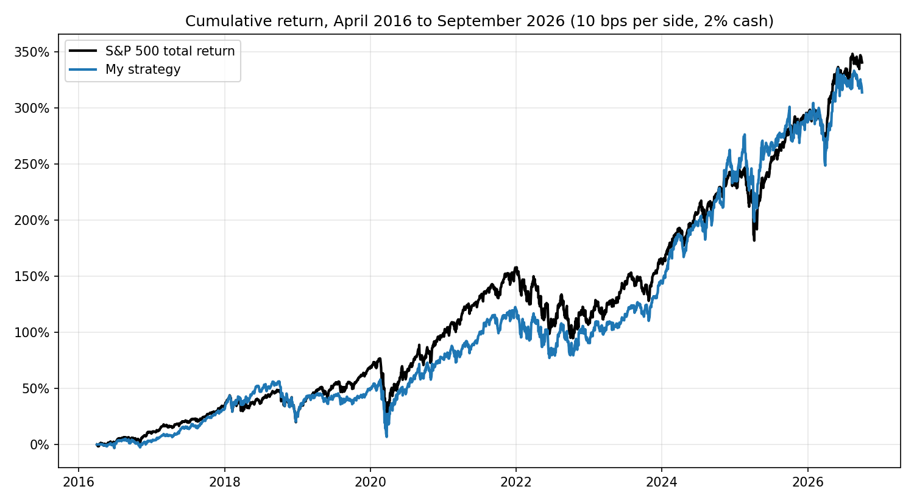

# HW4 writeup

My final strategy ended at $4.14 million against $4.40 million for $1,000,000 in the S&P 500 total return index. It did not beat the index, but it stayed close and had a slightly shallower drawdown. Most of what I did before getting there did not work, so a good part of this writeup is about that.

## The idea I started with

My thesis was that momentum is a good source of return but pure momentum is risky because of crashes. I wanted to find the momentum stocks that hold up, either by picking low volatility or high quality names, or by mixing in a lower risk piece so the portfolio keeps most of the return with less volatility.

## Data and cleaning

I used the lecture helpers in `Lectures/modeling/course_data.py` for loading data, price features, joining financials from the day after the filing date, the dated top 2000 membership and the 90 day labels. I added a few things.

- Some tickers flip between two scales. One stock jumped between $0.57 and $23,000 within days. I drop prices that jump more than 4 times away from recent history and then come back. That removed 2,236 prices across 120 tickers. They become gaps and I never fill them.
- Stocks under $2 are not tradable. This also removes unadjusted reverse splits.
- The size ranking behind the top 2000 list is unreliable because of share count errors. A few junk tickers show up with absurd market caps. I used trailing dollar volume as my measure of size instead.

## What I tried and what I learned

I looked at the 2016 to 2026 test results while deciding which direction to take, so I want to be upfront that the test window is not clean. Here is what I saw. Early runs assumed cash earns nothing and later ones used 2%.

| Idea | CAGR | Sharpe | Max drawdown |
|---|---|---|---|
| S&P 500 total return | 15.2% | 0.77 | -33.8% |
| 100 random stocks from the universe, equal weight | 9.6% | 0.47 | -38.9% |
| Random feature model with ridge Markowitz weights, from the CKMS paper | 9.3% | 0.52 | -35.9% |
| Boosted trees with momentum crash features and a volatility overlay | 2.9% | 0.13 | -30.8% |
| Momentum stocks with minimum variance weights and a ridge score | 9.8% | 0.47 | -36.0% |
| Large liquid stocks with a ridge tilt, weighted by dollar volume | 19.0% | 0.72 | -47.1% |
| Minimum variance on the 100 most traded stocks | 7.8% | 0.47 | -29.0% |

A few things stood out.

The random stocks result was the turning point. A random pick earned about the same as my fancy models, so the models were adding almost nothing. The index is cap weighted and dominated by mega caps, while my universe is mostly small and mid caps. Equal weighting that universe lands around 10% a year in this period. I should have run that check first.

Raw momentum did not do what I hoped. In the development window, momentum was slightly negative after adjusting for sector (t statistic of -1.4). My momentum minimum variance versions did not beat the index either.

The big winner at 19% only looked good because I checked it on a calm slice. Over all of 2011 to 2015 its Sharpe was 0.47 and its drawdown was 33%. Its 47% drawdown in the test included a 41% loss in 2022. That taught me to validate on a longer window, so I switched to 2011 to 2015.

The minimum variance portfolio looked great in development (Sharpe 0.83) and gave a steady 13.7% volatility in the test against 17.8% for the index. But it gave up too much return, because defensive stocks lagged the mega cap rally in 2023 and 2025.

The learned models also failed out of sample. In development, elastic net and boosted trees had negative rank correlation with future returns, and a simple fixed score beat both.

## How I got to the final model

The final model is the result of a discussion I had with ChatGPT about the paper Empirical Asset Pricing via Machine Learning by Gu, Kelly, and Xiu (2020). I adapted it to the homework. The idea is to predict which stocks will beat their sector, then use an optimizer to hold those stocks while staying close to the benchmark. Staying close to the benchmark is how I got my version of the lower risk piece in the thesis.

Some changes were needed to fit the assignment. The database has no S&P 500 constituent list, so I measure tracking error against the index return series itself. The sector labels are current snapshots. Share counts are too noisy to build earnings yield or book to market, so I have no value factors. I left out the turnover penalty because every purchase is held 90 days anyway.

I picked the model and risk setting using a rule I fixed before looking. It was the best Sharpe on 2011 to 2015 among the alpha models, as long as tracking error was 6% or less.

## The final strategy

Each week, at the close, I do this.

1. I take the 300 most traded stocks by trailing dollar volume.
2. I z score the characteristics within each sector. Those are momentum, a one month reversal, volatility, drawdown, profitability, leverage, cash flow, accruals, beta, residual momentum, path smoothness and size.
3. My score is momentum plus operating profitability plus free cash flow minus volatility. I picked these four signs before fitting anything, and the score has no fitted parameters.
4. I turn the score into an expected relative return using a cautious rank correlation of 0.03 and each stock's 90 day volatility.
5. A risk model with 5 PCA factors and stock specific variance estimates tracking error against the index. I solve for the weights that maximize expected return minus a penalty on tracking error. The portfolio is long only and fully invested, each stock is at most 5% and beta stays within 0.05 of 1. That gives about 27 holdings in a typical week, and about 14 of them sit at the 5% cap.

Fama-MacBeth regressions gave me a readable check on which characteristics carry a premium. After shrinking, free cash flow (t statistic 3.5), residual momentum (2.6) and accruals (2.2) stood out, and size had a negative effect (-2.4). The full table is in `results/fm_premia.csv`.

## How the backtest works

I wrote my own backtester in `backtest.py`. I start with $1,000,000 and never borrow. Signals are made at the close and filled at the next session's close. Each purchase is held 90 calendar days and sold at that day's close, or the next session with a quote if the market is closed or the stock has no price. Each weekly purchase uses one thirteenth of current equity, so about 13 purchases overlap at any time. I charge 10 bps per side and idle cash earns 2%. A stock with no quote within 5 sessions after maturity is sold at its last close and counted as a stale exit. That happened twice in my final run. I use adjusted prices and do not add dividends again.

## Results

All numbers are for April 1, 2016 to September 30, 2026.

| | Final value | CAGR | Max drawdown | Sharpe | Volatility | Active return | Tracking error |
|---|---|---|---|---|---|---|---|
| S&P 500 total return | $4,402,747 | 15.17% | -33.8% | 0.77 | 17.8% | | |
| My strategy | $4,136,223 | 14.48% | -32.4% | 0.72 | 18.5% | -0.68% | 7.1% |
| My strategy with no costs | $4,480,561 | 15.36% | -32.3% | 0.76 | 18.5% | +0.19% | 7.1% |
| Tracker with no alpha | $3,449,538 | 12.52% | -31.1% | 0.69 | 16.0% | -2.65% | 4.4% |
| Fama-MacBeth score | $4,367,846 | 15.08% | -32.2% | 0.74 | 18.9% | -0.09% | 7.9% |
| Elastic net score | $4,115,647 | 14.43% | -34.2% | 0.69 | 19.4% | -0.74% | 8.8% |
| Boosted trees score | $3,553,191 | 12.84% | -37.3% | 0.60 | 20.3% | -2.33% | 9.3% |

I did not beat the benchmark. I finished about $267,000 behind, with a lower Sharpe ratio (0.72 against 0.77) and about 0.7 points less return per year. The drawdown was a bit shallower and 2022 was much milder (-12.7% against -18.1%). Without costs I was slightly ahead, so trading costs of about 0.9 points a year explain the gap. The tracker with no alpha earned 12.5%, so the score added about 2 points a year. I missed the 3% to 5% tracking error I was aiming for. It was 5.4% in development and 7.1% in the test. The main weak spots were 2016 and 2019, when the index did much better than I did.

In development (2011 to 2015) the same setting earned 14.6% against 12.4% for the index, with a Sharpe of 0.80 against 0.70. The test was not as kind.

Yearly returns are in `results/yearly_returns.csv` and the full tables are in `results/`.

## How I checked the backtest

- `test_backtest.py` has cases I worked out by hand. They cover one trade with and without costs, spending the same cash twice, a gap at maturity, a stock that stops trading, unequal weights and cash interest. All pass.
- The first day of the final run spent $76,948 including costs, and one thirteenth of $1,000,000 is $76,923.
- Holding periods in the final run were 90 to 92 calendar days over 13,765 closed positions.
- Purchases are always filled after the signal date. Models only train on outcomes that were already finished at each refit, and the code stops if that is ever false.
- 100 random stocks through the backtester earned 9.6%. The 90 day labels imply about 13.6% a year for those picks before any friction. I put the gap of about 4 points down to costs (about 0.8), volatility drag (about 2) and idle cash while the tranches fill. I did not pin down the last point or so.

These checks are saved in `results/accounting_checks.txt`.

## Limits

- The test window is not clean, as I explained above. The final settings came from a rule on 2011 to 2015, but I picked which ideas to try after seeing 2016 to 2026.
- Five years of development data is short and has no real crash.
- There is no delisting recovery data, so a stock that stops trading is valued at its last close.
- Sector labels are current snapshots, there are no value factors, and the tracking error target was missed.

## What I would try next

I would try to fix the share counts so I can add value factors, rebalance less often to cut costs, and tune the tracking error target more carefully. I would also want a longer development window that includes a crash.

## Reused code and help

I reused the lecture helpers in `Lectures/modeling/course_data.py` for data loading, price features, the financial join, membership and labels. I wrote the backtester, price cleaning, extra features and the strategy for this homework.

I used an AI coding assistant (Claude Code) to help write and run the code for these ideas and to help draft this writeup. I set the thesis, chose which ideas to try and decided which strategy to submit. The last model came out of my discussion with ChatGPT about the Gu, Kelly, and Xiu paper, as described above.
