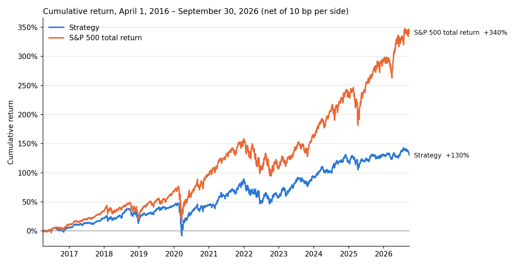

# HW4: Stock prediction and trading strategy (Farshid Gilak)

**Result:** the strategy **did not beat** the S&P 500 total-return index. From April 1, 2016 to September 30, 2026, \$1,000,000 grew to **\$2,296,805 (8.24% CAGR)**. The same amount in `^SP500TR` grew to **\$4,402,747 (15.16% CAGR)**. The shortfall is \$2,105,942, or 6.92 percentage points of CAGR.

| Metric (Apr 1, 2016 – Sep 30, 2026)       |    Strategy |  `^SP500TR` |   Difference |
| ----------------------------------------- | ----------: | ----------: | -----------: |
| Final value (cash + open positions)       | \$2,296,805 | \$4,402,747 | −\$2,105,942 |
| Total return                              |      129.7% |      340.3% |    −210.6 pp |
| CAGR                                      |       8.24% |      15.16% |     −6.92 pp |
| Maximum drawdown                          |     −37.86% |     −33.79% |     −4.07 pp |
| Annualized volatility                     |      15.28% |      17.82% |     −2.54 pp |
| Sharpe ratio (daily, 2% annual risk-free) |        0.47 |        0.77 |        −0.31 |

## How to run

1. From the repository root, run `uv sync --locked`. Download `equities_top2000.duckdb` from bCourses into `Lectures/modeling/data/`.
2. Open [hw4.ipynb](hw4.ipynb) with the repository's `.venv` kernel and choose **Run All**. A full run takes about 8 minutes on a 10-core laptop and is deterministic. It writes `cumulative_returns.png` to this folder. Nothing else is saved, and the database is opened read-only.

| File                               | Contents                                                                                                                     |
| ---------------------------------- | ---------------------------------------------------------------------------------------------------------------------------- |
| [hw4.ipynb](hw4.ipynb)             | The whole experiment, with outputs: data audit, backtester hand-checks, development selection, final test, accounting checks |
| [hw4_data.py](hw4_data.py)         | Loading, causal features, dated membership, 90-day labels                                                                    |
| [hw4_model.py](hw4_model.py)       | Model pipelines, training target, walk-forward fitting, prediction metrics                                                   |
| [hw4_backtest.py](hw4_backtest.py) | Ledger (cash, lots, fills, fees), strategy, daily backtester, performance metrics                                            |

## Features

Signals are made after the close on the **first session of each week**, plus March 31, 2016, so that the first entry is at the first test close. A stock is eligible on a signal date if it has a quote that day, has 63 complete trailing daily returns, and is a member of the quarterly universe of the _entry_ quarter, selected on or before the signal close.

- **Price:** 1-, 3- and 6-month momentum; 12-1 month momentum; 63-day volatility; distance from the 252-day high; 252-day beta to `^SP500TR`; largest daily return over 21 sessions.
- **Financial statements:** used only from filing date + 1 day. Filings with a non-positive lag are dropped, a late older period never replaces a newer one, and values are blanked 550 days after fiscal end. Features: trailing-twelve-month gross profit / assets, ROA, net margin, accruals; debt / assets, cash / assets; year-over-year growth in assets, quarterly sales, and shares outstanding (net issuance); plus filing age (days since the latest filing became available).
- **Value and size:** earnings, book, sales, and free-cash-flow yields, and log market cap (signal-date close × latest known shares). I checked that `close` and `shares_outstanding` are on the same split-adjusted basis. `volume` is not, so I don't use dollar volume.
- **Sector:** the snapshot sector, one-hot encoded.

Each numeric feature is converted to its percentile rank among that date's eligible members. This uses only same-date information and neutralizes the extreme vendor values in the data. For example, AAM has a recorded 90-day return of +14,000,000% while ranked #1 by market cap.

## Model and validation

**Target.** I predict the 90-day holding return from the next-session entry close to the first quoted close on or after 90 calendar days, expressed as its **percentile among the same date's members**. I tried the raw excess return over the cross-sectional mean (winsorized on the training rows) and it performed much worse. It is dominated by a handful of extreme outcomes.

**Validation.** I used a chronological walk-forward inside development that matches the test procedure. The first model is fit after the close on December 31, 2012, and the model is refit at the first signal of every quarter through 2015. Each fit uses an expanding window of signals since January 1, 2010, and only labels that ended **strictly before** the fit date. This is asserted for every fit and shown in the fit-audit tables. Each model scores signals until the next refit. Labels for 2015 signals complete in the buffer, and development uses no price after March 31, 2016. I chose the model by the highest mean weekly rank IC over 2013–2015:

| Candidate (walk-forward, 2013–2015)     | Mean rank IC | IC 2013 | IC 2014 | IC 2015 |
| --------------------------------------- | -----------: | ------: | ------: | ------: |
| Ridge α=1e2, rank target                |        0.036 |  −0.021 |   0.044 |   0.084 |
| Ridge α=1e4, rank target                |        0.038 |  −0.018 |   0.047 |   0.086 |
| Ridge α=1e6, rank target                |        0.051 |  −0.027 |   0.082 |   0.096 |
| **Ridge α=1e7, rank target (chosen)**   |    **0.058** |  −0.035 |   0.094 |   0.115 |
| Ridge α=1e4, excess-return target       |        0.001 |   0.015 |  −0.028 |   0.015 |
| Gradient boosting, rank target          |        0.010 |  −0.015 |   0.008 |   0.035 |
| Gradient boosting, excess-return target |       −0.002 |  −0.012 |   0.003 |   0.003 |
| 12-1 momentum (no fitting)              |        0.033 |   0.041 |  −0.014 |   0.072 |

**Why Ridge.** The signal is weak and its sign changes by regime. For example, volatility and beta predicted positively in 2013 and negatively in 2014–15. Gradient boosting fit these unstable patterns and did worse out of sample. Heavily shrunk Ridge did best, because it weights features roughly by their average historical relationship with returns, which is more stable. Its largest positive weights are on distance from the 52-week high, sales and free-cash-flow yields, gross profitability, and sales growth. Its largest negative weights are on volatility, recent maximum daily return, and net share issuance. In other words, it is a quality, value, and low-risk tilt with some trend-following. Retraining in the test follows the same rule, refitting quarterly as new outcomes complete.

## Trading strategy and backtester

My backtester ([hw4_backtest.py](hw4_backtest.py)) keeps every purchase as a separate lot and tracks cash, fills, fees, realized and unrealized PnL, and daily NAV.

- **Timing.** On each session, the strategy sees the portfolio and scores from the _previous_ close and returns fee-inclusive dollar budgets. The backtester then observes that session's closes, sells matured lots, and fills purchases at the close. Budgets may not exceed cash at the previous close, so the same cash is never spent twice.
- **Entries.** Every week, the strategy buys the top 25 predicted names, equal-weighted. During a 13-week ramp-up, each entry spends cash / (entries left in the ramp), which builds 13 equal cohorts. After that, each entry spends all available cash, mostly the proceeds of lots that just matured. A Tuesday lot matures on a Monday (90 days = 12 weeks + 6 days), so its cash is available for the next signal. Average cash was 2.7% of NAV (1.7% after the ramp-up).
- **Exits.** Each lot is sold at the close on its 90-calendar-day maturity, or at the next quoted session if the market is closed or the stock has no quote that day.
- **Limits and screens.** No more than 5% of NAV in one stock and 30% in one snapshot sector; a name blocked by a cap is replaced by the next-ranked one. Candidates must be in the dated top-2000 universe. A candidate is skipped if its price moved more than 4× in one session during the past year (a causal price-sanity screen; 0.24% of rows fail it). When a stock leaves the universe, its existing lots are kept to maturity.
- **Choices tuned on development only.** Names per entry, N ∈ {25, 50, 100}, and a size screen on universe rank ≤ {500, 1000, 2000}, chosen by the highest Sharpe ratio in the 2013–2015 development backtest. The chosen setting, N = 25 with all 2,000 members, had a development Sharpe of 0.97 vs 0.95 for the S&P 500 TR, and a CAGR of 13.6% vs 14.2%.

**Assumptions.**

- _Transaction costs:_ 10 bp of traded value on every purchase and sale.
- _Cash interest:_ none; idle cash earns 0%, and the 2% rate is used only as the Sharpe hurdle.
- _Units:_ fractional adjusted-price units, so dividends are already in returns and are not added again.
- _Benchmark:_ \$1,000,000 in `^SP500TR` at the April 1, 2016 close, with no costs.
- _Metrics:_ both series start from \$1,000,000 at the March 31, 2016 close. CAGR uses calendar days / 365.25; the Sharpe ratio uses daily returns annualized by √252.
- _Missing prices:_ a held stock without a quote keeps its last close as its mark and is flagged as stale. If a stock's price history ends, which happens to many acquired or delisted names, there are no delisting proceeds in the data. I don't invent a sale: the lot stays open at its last close and its capital is never reinvested.

## Evidence that the accounting and timing are correct

1. **Hand-calculated toy market** (notebook, section 2). Exact checks on unit and fee arithmetic, a weekend maturity sold the next session, a missing exit quote sold the following day, a rejected purchase when no quote exists, a refused order larger than available cash, and final cash of 998,942.06 matching the hand calculation.
2. **Checks on the final run** (section 7), all passing:
   - Cash rebuilt from the fills matches the daily cash series.
   - Cash is never negative.
   - Final NAV = cash + open lots at their final marks = initial capital + realized + unrealized PnL.
   - Fees equal 10 bp of traded value.
   - Every buy's signal is the previous session; it was scored by a model fit on or before that signal; it was a universe member of its entry quarter, selected before the signal; and it passed both screens.
   - Every fill price equals that day's adjusted close in the database.
   - Every sale is at the first quoted close on or after maturity, and none before 90 days.
3. **One lot traced against raw DuckDB prices**: VZ, bought April 1, 2016 and sold June 30, 2016, with PnL recomputed by hand.
4. **Fit audit**: for all 42 test fits, the last training label ended before the fit date.

There were 8,471 purchases, 8,140 sales, and 331 lots still open at the end.

## Findings

**Why it underperformed.**

1. **Frozen capital in stocks whose price history ended.** At the end, 110 lots in 27 stocks (\$805,763, or 35% of final NAV) are held at last closes from up to four years earlier. The frozen share rose from 2–3% before 2022 to 23% in 2023 and 35% in 2026, while the market rallied. That explains much of the gap from 2023 on. There are three causes:
   - Real acquisitions or take-privates (DCP, UNVR, VRTV, MMP, PDCE, SAFM, PGTI, JWN, BECN).
   - A ticker change the dataset doesn't link: ANTM's history stops in 2022 but continues as ELV.
   - **Exchange-traded notes, preferreds, and equity units labeled as stocks** (ENBA, TBC, SBBA, BDXB, FITBP, MPLXP, DTP), which were redeemed. The model favored them because they look cheap and very low-risk on the parent company's financials.

   If these lots recovered nothing, the final value would be \$1,491,042 (3.88% CAGR). Real proceeds were probably close to the last prices, so the economic result likely lies above this lower bound. But it is unknowable from this data, which is the main data gap preventing a fully reliable result.

2. **Factor timing.** The model's quality, value, and low-volatility tilt had a test rank IC of 0.031 overall. It worked well in 2021–2023 (IC 0.17, 0.12, 0.06; the strategy beat the index in 2018, 2021, and 2022). It failed in 2020 (IC −0.14), when the market was led by high-volatility growth stocks: the strategy returned 1.1% vs 18.4%.
3. **Breadth versus a cap-weighted index.** Equal-weighting 25 names per week from the top 2,000 tilts toward mid-caps. Over this period the S&P 500 was driven by a few mega-caps that the strategy rarely held at scale.

**Risks taken.**

- Drawdown was deeper than the index's (−37.9% vs −33.8%, in March 2020), despite lower volatility.
- The portfolio held about 224 open lots on average, with exposure to a single sector of up to 30%.
- Turnover was 6.9× NAV per year. Results are moderately sensitive to costs: CAGR is 9.02% at 0 bp, 8.63% at 5 bp, and 7.09% at 25 bp per side.

**Limitations.**

- _KDP data error:_ the vendor applied the \$103.75 Dr Pepper Snapple merger special dividend to KDP's adjusted history (adjusted close +592% in one day vs raw close +11%). A lot bought in April 2018 booked +689%, overstating the strategy by about \$49,000 (4.9% of initial capital) before compounding. I report it rather than altering the frozen result. Other gains are spread out: the top 10 of 577 stocks contribute \$443k of the \$1.30M PnL.
- _Survivorship and labeling:_ the universe is a recorded-date reconstruction, not certified point-in-time data. Delisting coverage and ticker mappings are incomplete, and sectors are snapshot labels.
- _Training sample:_ training uses only rows with completed labels, so stocks that disappear within 90 days are under-represented.
- _Short and favorable development window:_ the 2013–2015 window was short, and α was picked at the edge of the grid.
- _Costs and execution:_ costs are a flat estimate, all fills are at the close, and there is no market-impact model.

**Unsuccessful ideas (development).**

- Gradient boosting, with either target.
- Excess-return targets.
- Fixed cohorts of NAV/13: these left about 10% of NAV idle and were replaced by the ramp-then-reinvest rule.

**What I would try next** (on development data, before any new test):

1. Exclude non-common instruments (preferreds, notes, units) using security type or name patterns, and map ticker changes.
2. Add a dated delisting-recovery assumption, clearly labeled as an assumption.
3. Add a market-cap-weighted or mega-cap-inclusive allocation, or a benchmark-relative risk model, to reduce the size bet.
4. Make the factor tilts regime-aware.
5. Use a longer validation window within development (e.g., start the walk-forward in 2011) so model selection rests on more than three years.

## Reused code and AI assistance

- `hw4_data.py` adapts these functions from [Lectures/modeling/course_data.py](../../../Lectures/modeling/course_data.py), vectorized for the full database:
  - the price quarantine (`load_data`);
  - calendar reindexing without filling (`price_features`);
  - financial availability rules (`financial_events`);
  - next-session membership (`apply_membership`);
  - next-session labels (`make_labels`).
- The backtester is my own implementation. Its structure (strategy / order book / daily loop / analytics, fee-inclusive budgets, adjusted-price units) follows [Lectures/modeling/backtest.py](../../../Lectures/modeling/backtest.py), and the cap allocation adapts its `capped_budgets` function.
- The walk-forward and fit-audit pattern follows [Lectures/Lecture 8/2_research_workflow.ipynb](../../../Lectures/Lecture%208/2_research_workflow.ipynb).
- **AI assistance:** this submission was developed with the assistance of Claude Code, which helped me write and debug the code, run experiments, and prepare this file.
