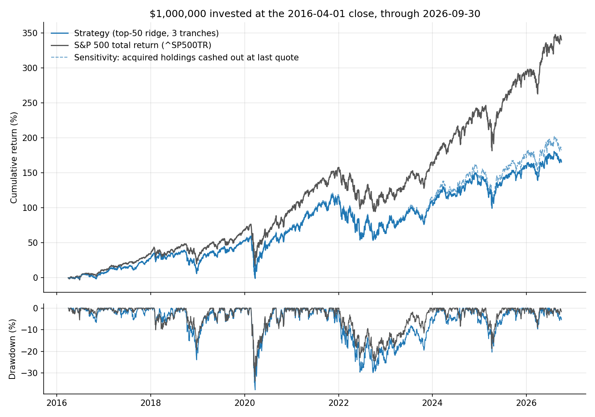

# HW4 — Stock-return model, trading strategy and backtester

Guillaume Estepa

**Result: the strategy did not beat the S&P 500 total-return index.**
$1,000,000 grew to **$2.66M** (9.8% a year) against **$4.40M** (15.2% a year)
for `^SP500TR` over 2016-04-01 → 2026-09-30, with a deeper drawdown and a
lower Sharpe ratio. Details, checks and an honest post-mortem are below.

## How to run

From the repository root, with `equities_top2000.duckdb` (and optionally
`equities_class.duckdb`, used by one test) in `Lectures/modeling/data/`:

```bash
uv sync --locked
uv run python Homeworks/HW4/Guillaume_Estepa/run_development.py   # ~1 min, 2010-2015 only
uv run python Homeworks/HW4/Guillaume_Estepa/run_final.py         # ~1 min, final test
uv run --with pytest pytest -q Homeworks/HW4/Guillaume_Estepa     # 13 accounting/timing tests
```

`run_development.py` writes `results/chosen_config.json`; `run_final.py`
only reads it. Everything in `results/` is regenerated by these two scripts.

| File | Role |
|---|---|
| `data.py` | Read DuckDB into dates × symbols tables, cut at a given end date |
| `features.py` | Features, eligibility screens, 90-day labels |
| `model.py` | Candidate models and the walk-forward fitting loop |
| `strategy.py` | Decision calendar and top-N tranche rule |
| `backtester.py` | My backtester (fills, cash, lots, daily value) and its audit |
| `metrics.py` | CAGR, drawdown, Sharpe, benchmark, rank IC |
| `test_backtester.py` | Hand-checkable tests |

## What I built

**Timing.** Features are computed after the close of day *t*. The purchase
is made at the close of *t+1*. The target is the adjusted-price return from
that entry to the first quoted close on/after entry + 90 calendar days — the
same rule the backtester uses to sell.

**Universe and screens** (all known at *t*): member of the quarterly
`universe_membership` list for the quarter of the entry day; quoted at *t*;
one year of price history; no one-day move above +100% or below −50% in the
past year (guard against penny stocks and bad prices). For buying only, the
stock must also be among the 1,000 most liquid members (63-day median of
close × volume, which I checked is consistent across splits). Existing
positions are kept when a stock leaves the universe.

**Features (24).** Price: 1/3/6-month and 12-1-month momentum, 63-day
volatility, 1-year beta, largest daily gain in a month, distance from the
52-week high, gap to the 200-day average, dollar volume, volume trend.
Fundamentals (usable from filing date + 1 day, blanked after 550 days): net
margin, operating ROA, gross profitability, debt/assets, cash/assets,
FCF/assets, accruals, revenue and asset growth, earnings yield, FCF yield,
book-to-market, filing age. Every feature is turned into a same-date
percentile rank, so no scaler or imputer has to be fitted.

**Model.** Ridge regression predicting the stock's 90-day return expressed as
a same-date percentile rank. I compared four candidates on validation: ridge
or gradient-boosted trees, each predicting either the relative return
(winsorised on training data) or its rank. Ridge on ranks had the best
validation rank IC; the trees overfitted the few years of data available.

**Validation (2010–2015 only).** Walk-forward: fit at the start of 2012,
2013, 2014 and 2015 on outcomes that had already ended, predict the following
year. The development script loads no data after 2015-12-31.

| Model | Mean validation rank IC | Share of dates with IC > 0 |
|---|---:|---:|
| ridge, rank target (**chosen**) | 0.034 | 67% |
| trees, rank target | 0.024 | 63% |
| ridge, return target | 0.019 | 62% |
| trees, return target | 0.005 | 51% |

Selection rule, fixed before the test: best IC picks the model, then best
validation Sharpe picks the portfolio from N ∈ {25, 50, 100} and liquidity
∈ {500, 1000, 2000}. Chosen: **50 stocks, top-1,000 liquidity**. On
2012–2015 it made 18.0% a year (Sharpe 1.12, drawdown −13%) against 14.9%
(Sharpe 1.00, drawdown −12%) for the benchmark. Full grids are in
`results/development_*.csv`.

**Trading rule.** Three sleeves started 21 sessions apart, one third of the
capital each. A sleeve buys the 50 highest predictions in equal dollar
amounts (at most 30% of names from one sector), holds 90 calendar days, and
reinvests its proceeds the session after they are sold. A name can sit in
all three sleeves, so the largest position is about 2% at cost.

**Retraining.** Fitted at the 2016-03-31 close, then at the first signal of
each calendar year, always on outcomes completed before the fit date
(`results/fit_log.csv`; asserted in code).

**Assumptions.** 10 bp cost on every buy and sell; cash earns nothing;
fractional units of adjusted close, so dividends are never added again; no
quote on entry day → order cancelled; no quote at maturity → lot stays open
at its last observed price and is sold at the next real quote. No fill is
ever invented in the reported result.

## Results

Strategy and benchmark both start with $1,000,000 and invest at the
2016-04-01 close; values on 2026-09-30 include cash and open positions.

| | Strategy | `^SP500TR` | Difference |
|---|---:|---:|---:|
| Final value | $2,655,939 | $4,402,747 | −$1,746,807 |
| CAGR | 9.75% | 15.16% | −5.41 pts |
| Maximum drawdown | −37.8% | −33.8% | −4.0 pts |
| Sharpe (daily returns, 2% risk-free) | 0.47 | 0.77 | −0.30 |



The strategy lagged in 9 of 11 calendar years (`results/yearly_returns.csv`).

## Why it lost

- **The signal is real but small.** Out-of-sample rank IC averaged 0.025
  (0.034 in validation) and was negative in 2016, 2020 and 2025. The model
  ended up as a quality / low-volatility / near-52-week-high tilt.
- **Equal weight versus a cap-weighted index.** The portfolio holds about 150
  equal positions drawn from the 1,000 most liquid stocks. Over this decade
  the index was driven by a handful of very large companies; an equal-weight
  mid-cap-heavy book could not keep up even with a positive IC. This is the
  main risk I took: size and concentration exposure different from the
  benchmark, plus up to 30% in one sector.
- **Validation was too short.** Four years, one market regime. The 3-point
  edge seen in 2012–2015 was within noise.

## Data problems that affect the result

I kept the reported number exactly as the frozen rules produced it. These
issues are in it:

- **Acquired companies never pay out.** Price histories end at the takeover
  and there is no proceeds table. 42 matured lots (MXIM, SPLK, ANSS, EA, …)
  could never be sold and sit at their last price: **$562k, 21% of the final
  value**, earning nothing. Almost all of this builds up after 2021.
  *Sensitivity only:* assuming those lots pay their last quoted price in cash
  10 sessions after quotes stop gives $2.82M (CAGR 10.4%, Sharpe 0.49). The
  conclusion does not change.
- **Unadjusted splits.** NFLX (2025), BKNG and KLAC (2026) drop ~90% in one
  day in `adj_close`. Six lots held through them show a false loss of about
  $82k in total.
- **Ticker reuse.** Two TE lots from 2016 lost quotes at the takeover and
  were "sold" in 2020 at −65% when the ticker reappeared.
- **Frozen prices.** CSC shows the same price all of 2016; the model liked
  its zero volatility and bought it three times for a 0% return.

Other limits: sector labels and financials are today's vendor snapshot, not
point-in-time; no market impact beyond 10 bp; one test run of one strategy.

## Evidence the backtest is right

- `test_backtester.py`: 13 tests with numbers worked by hand — units and
  cash with and without costs, weekend maturity rolling to Monday, sale
  proceeds only reusable the next session, overspending rejected, missing
  quotes at entry and at maturity, open positions valued at the end, prices
  after the end ignored.
- Look-ahead test: features built with data to 2014 are identical to the
  same rows built with data to 2015.
- `results/audit.json`, recomputed from the trade list on every run: cash
  never negative, cash and portfolio value rebuilt independently and matching
  every day, units conserved, every buy filled the session after its signal,
  every hold ≥ 90 days, every sale on the first quote on/after maturity.
- One lot by hand: FDS, signal 2016-03-31, bought 2016-04-01 at 139.99 with a
  $6,666.67 budget → 6,666.67 / (139.99 × 1.001) = 47.5749 units; sold
  2016-06-30 (day 90) at 148.41 → 47.5749 × 148.41 × 0.999 = $7,053.53.
  Matches `results/lots.csv` and the `prices` table.

## What did not work, and what I would try next

- Gradient-boosted trees and a raw-return target were worse than a plain
  ridge on ranks in validation.
- Next: weight positions by size or blend with the index to control tracking
  error; add screens for frozen prices and one-day ±80% jumps that reverse
  nothing (likely splits); a longer validation history using pre-2010 data;
  a real corporate-actions source for takeovers.

## Reused code and AI assistance

- Quarantine rules in `data.py` and the filing-date logic in
  `features.py::fundamental_events` are adapted from
  `Lectures/modeling/course_data.py` (`load_data`, `financial_events`,
  `join_financials`). The backtester, strategy and metrics are my own and do
  not use `Lectures/modeling/backtest.py`.
- I used an AI coding assistant (Claude Code) to help write and test the
  code and draft this write-up; I reviewed the design, results and checks.
