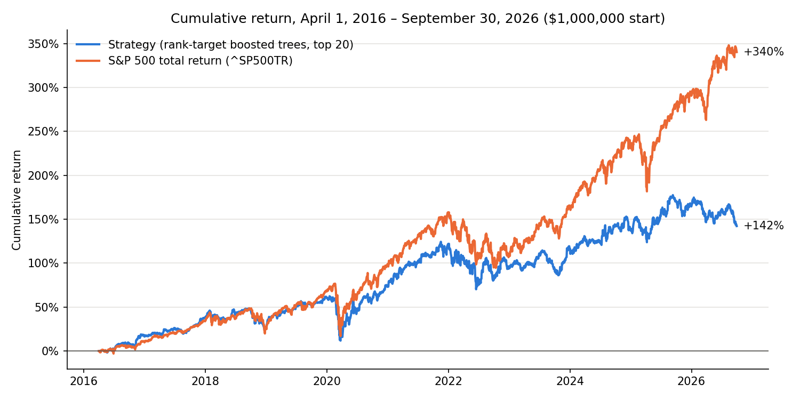

# Homework 4 — Stock Prediction and Backtesting

This project trains a stock-ranking model on 2010–2015 data and evaluates one
frozen trading strategy from April 2016 through September 2026.

## Files

- `01_model_research.ipynb`: chronological validation and model selection.
- `02_final_backtest.ipynb`: final test, benchmark comparison, and findings.
- `backtester.py`: strategy, accounting, simulation, and analytics classes.
- `test_backtester.py`: small hand-checkable accounting tests.

## How to run

From the repository root, place `equities_top2000.duckdb` in
`Lectures/modeling/data/`, then run:

```bash
uv sync --locked
uv run python Homeworks/HW4/Hiba_Lina_Ben_Khaddah/test_backtester.py
```

Open the two notebooks with the project environment and run them in numerical
order.

## Method

The model is a histogram gradient-boosting regressor using the Lecture 7
pipeline and a within-date rank target. It is fitted once using completed
development-period outcomes. At each month-end, the strategy ranks eligible
stocks and buys the top 20 at the next close. Each cohort receives the smaller
of one-third of NAV or available cash, and every lot is held for 90 calendar
days. Trading costs are 5 basis points per side.

The backtester follows the Lecture 8 separation between strategy decisions,
order management, daily simulation, and analytics. It never invents a fill
when a price is missing.

## Final results

| Metric | Strategy | S&P 500 total return |
|---|---:|---:|
| Final value | $2.42M | $4.40M |
| CAGR | 8.8% | 15.2% |
| Sharpe ratio | 0.49 | 0.77 |
| Maximum drawdown | -31.2% | -33.8% |



The strategy did not beat the benchmark. Its ranking signal was positive but
weak, cash averaged 19.5% of NAV, and unresolved holdings limited the
reliability of the final value. The notebooks report the accounting checks,
transaction-cost sensitivity, and data limitations.

## Reused code and AI assistance

Data preparation and modeling helpers were reused from
`Lectures/modeling/course_data.py`. The backtester is a simplified independent
implementation of the Lecture 8 design.

ChatGPT and Claude assisted with explanations, code review, debugging, and
editing. I reviewed the implementation, ran the tests and notebooks, and made
the final modeling and trading decisions.
