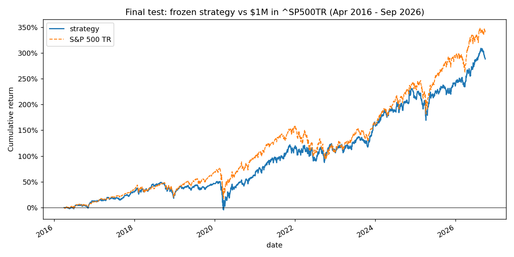
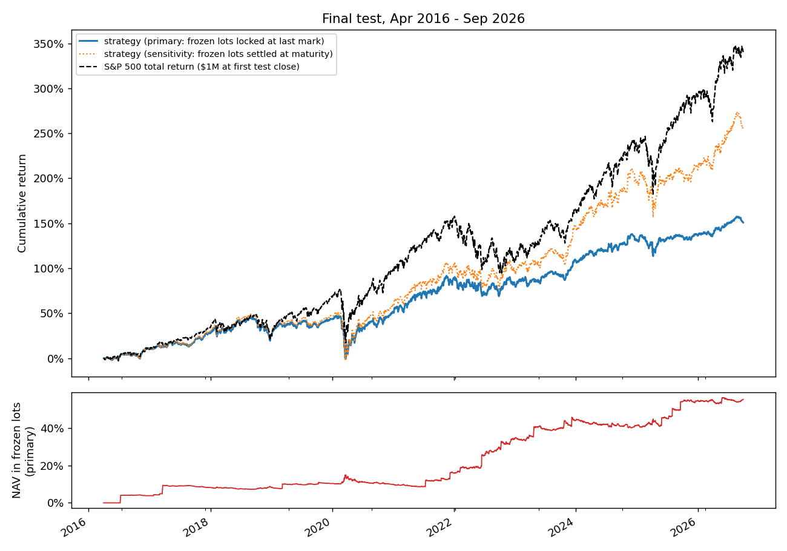

# HW4: Stock-return model, strategy, and backtester (Ian Kwon)

> **Result.** On the final test (April 2016 to September 2026) the submitted strategy turned
> $1,000,000 into **$3,883,635** against **$4,402,747** for the S&P 500 total return index: it did
> **not** beat the benchmark (CAGR 13.8% vs 15.2%, Sharpe 0.70 vs 0.77, maximum drawdown -36.6% vs
> -33.8%).  Details are under [Submitted strategy](#submitted-strategy).  The section
> [Demonstration run](#demonstration-run-pipeline-shakedown-not-the-submitted-strategy) reports an
> earlier pipeline shakedown that is **not** the submitted strategy.

This submission is organized as a small reusable research framework (`quantlab/`)
rather than a one-off script.  Data/feature construction, model research, and
backtesting/evaluation are separate layers; the backtester knows nothing about
models, so a new feature, model, or sizing rule plugs in without touching it.

## How to run

From the repository root (Windows paths shown; macOS/Linux identical with `/`):

```bash
uv sync --locked                                  # course environment (papermill, sklearn, duckdb ...)
# put equities_top2000.duckdb from bCourses in Lectures/modeling/data/  (git-ignored; checksum verified)
cd Homeworks/HW4/Ian_Kwon
../../../.venv/Scripts/python -m unittest discover tests      # 60 tests: accounting, timing, leakage, holdout
../../../.venv/Scripts/python scripts/data_quality_report.py  # research-period data-quality evidence -> results/
../../../.venv/Scripts/python scripts/run_study.py experiments/research          # the whole research study (~5 min)
../../../.venv/Scripts/python scripts/run_research.py experiments/<plan>.json   # or one plan; Papermill, development data only
../../../.venv/Scripts/python scripts/freeze_strategy.py outputs/experiments/<id>/config.json --rationale "..."
../../../.venv/Scripts/python scripts/run_final.py            # the holdout run -> results/
../../../.venv/Scripts/python scripts/plot_final.py           # supplementary chart from saved outputs
```

* A plan is a JSON list of `{"name", "hypothesis", "overrides"}`; the overrides replace keys of
  `quantlab.experiment.DEFAULT_CONFIG` (features, model, target, refit schedule, strategy, sizing).
  `experiments/research/` holds the plans behind the submitted strategy; `experiments/demo/`
  holds the demonstration's.
* `scripts/run_study.py` runs the pre-registered study in one go: random-portfolio baselines, the
  single-feature IC table, every alpha candidate and portfolio variant as its own Papermill
  notebook, and the selection rules of `experiments/research/PLAN.md` applied in code.  Small
  result tables go to `results/research/`.
* Research runs write executed notebooks, configs, summaries, tables and charts to
  `outputs/experiments/<experiment_id>/` and append to `outputs/experiments/registry.csv`
  (git-ignored, regenerated by the commands above).
* The final run writes the required comparison, chart, audit and sensitivity tables to
  `results/` (committed) and per-trade/per-day tables to `outputs/final/` (git-ignored).
* Papermill uses the `python3` kernel, which launches the first `python` on `PATH`; the
  scripts put this venv first on `PATH` so notebooks run in the course environment.
* Runtime on a 16 GB laptop: tests ~1 min; one research experiment ~30 s (boosted trees
  ~3 min); the final run ~3 min.

## Layout

| Path | Role |
|---|---|
| `quantlab/protocol.py` | Hash-locked period boundaries; research/final modes; final-run authorization and log |
| `quantlab/data.py` | Read-only DuckDB access, checksum vs manifest, SQL-level date cap per mode |
| `quantlab/integrity.py` | Price-break classification: bad prints, unadjusted splits, level shifts, unclassified |
| `quantlab/features.py` | Feature registry (meaning, rationale, availability, missing/extreme handling) and causal features |
| `quantlab/labels.py` | 90-calendar-day targets aligned with next-session entry and first quoted exit |
| `quantlab/panel.py` | Signal-date x member panel: membership, eligibility, financial as-of join, peer stats, ranks |
| `quantlab/leakage.py` | Prefix-invariance harness (future data must not change past features) |
| `quantlab/scoring.py` | Purged chronological folds and walk-forward refits with maturity assertions |
| `quantlab/models.py` | Model registry: Ridge, Ridge with penalty tuned inside the training rows, gradient boosting, fixed theory-signed composite, mean |
| `quantlab/portfolio.py` | Schedule, ScoreBook (alpha with timing metadata), selector, sizer, budget, name/sector caps |
| `quantlab/backtest.py` | Model-agnostic daily engine and OMS (lots, cash, fees, stale/frozen marks) |
| `quantlab/audit.py` | Independent accounting/timing audit recomputed from the fill ledger and prices |
| `quantlab/metrics.py` | CAGR, drawdown, Sharpe (2% hurdle), benchmark NAV, rank IC, diagnostics |
| `quantlab/experiment.py` | Config -> research run / final run -> summaries, registry, charts |
| `notebooks/` | Papermill templates: `research_experiment.ipynb`, `final_evaluation.ipynb` |
| `scripts/` | Study runner, experiment launcher, freeze, final run, data-quality report, charts |
| `experiments/research/` | Pre-registered plan, candidates and selection rules of the submitted strategy |
| `experiments/demo/` | Plans and selection rules of the demonstration run (examples) |
| `tests/` | `unittest` suites (pytest is not in the course lockfile; `pytest` also runs them) |
| `config/` | Frozen submitted strategy + SHA-256 lock |
| `results/` | Final-test outputs of the submitted strategy, data-quality evidence, the final-run log, `research/` (study tables), `demo_run/` (demonstration outputs) |

## Information timing

| Item | When it is used | Rule |
|---|---|---|
| Prices for features | after the close of signal date t | windows end at t; gaps stay missing (never filled) |
| Entry | close of the next market session after t | budgets fixed at the close of t |
| Exit | first quoted close on/after entry + 90 calendar days | holiday/missing quote -> next quoted session |
| Target / `label_end` | known at the exit close | a fit at F trains only on `date < F` and `label_end < F` |
| Financial statement | `filing_date + 1` calendar day | filing dates have no time of day; placeholders: `fiscal_date + 120` |
| Restated values | (cannot be fixed) | vendor keeps latest values per fiscal period (documented limitation) |
| Membership | quarter of the **entry** date | `selection_date <= t` asserted |
| Sector-relative stats | same signal date | median over the full eligible cross-section of that date |
| Integrity classification | up to 5 quotes after a break | stocks with a break in the last 6 sessions are ineligible, so no decision uses an unknowable classification |

Checks in code: `ScoreBook` rejects scores whose `fit_date > date` or whose training
targets ended at/after the fit; `assert_matured` runs at every fit; `PointInTimeView`
gives strategies a read-only array that ends at the signal close; the panel asserts
statement availability and membership timing; the prefix-invariance test rebuilds
the panel with everything after a cutoff removed and requires identical model inputs
(and it does catch a deliberately leaked feature: a first version of the harness
truncated instead of masking and missed a 5-session look-ahead, which the test exposed).

## Holdout protection (code, not instructions)

* `protocol.PROTOCOL` holds the dates; its SHA-256 is hard-coded and checked at import.
* Research mode caps every SQL query at 2016-03-31; research scoring refuses signals after
  2015-12-31.  Research notebooks cannot obtain test prices at all.
* Final-mode loads need a `FinalAuthorization`, which only `authorize_final` creates, only for
  a config whose hash matches `config/FROZEN.lock`.  Each final run is appended to
  `results/final_runs.jsonl`; running a *different* strategy afterwards is refused unless
  re-selection is explicitly acknowledged and recorded.
* **Disclosure: the holdout was used more than once.**  The demonstration strategy below was
  evaluated on the holdout on 2026-11-13 (two logged runs of one config), before the research
  for the submitted strategy.  The submitted strategy's final run therefore had to pass
  `--acknowledge-reselection`, and `results/final_runs.jsonl` records it that way.  The
  submitted strategy was selected by rules written down before its experiments ran and applied
  to development data only (`experiments/research/PLAN.md`).  Those rules happened to select
  the same seven-feature composite the demonstration had used, so I knew before the final run
  that this signal had lagged the benchmark in the test period with a different portfolio
  rule.  I kept the rule's choice instead of switching to a candidate I had not seen fail,
  because switching for that reason would have been selecting on the test period.

## Data quality: what was found and what was decided

Every decision below keeps the raw data and records the evidence
(`results/data_quality_research.md`, generated).  Decisions marked *(my choice)* were
put to me with the evidence and chosen explicitly.

1. **Unadjusted splits** *(my choice: strict repair + bounds)*.  `adj_close` is not split-adjusted for
   many splits, especially 2024-26 (NFLX 2025-10-03 x0.099, ORLY x0.067, BKNG x0.040, KLAC, CRWD,
   CVNA, TSCO, IBKR).  Reported shares cannot confirm them (vendor back-adjusts fundamentals:
   share ratio ~1.0 across each break).  Rule: a non-reverting one-day break within 2.5% of a
   standard ratio 1/k or k **and** event-day dollar volume <= 3x its 20-day median is repaired.
   Calibrated on research data only: known splits (ALXN, BLL, CERN, COG, SJI, SWM, UFS, LVLT)
   have 0.7-2.0x; genuine crashes at split-like ratios (MGI 2008-01-15, AVEO 2013-05-02, CPE,
   VSTM, CYRX) have 4.4-383x.  A first price-level rule was rejected because `close` is on the
   vendor's current split basis (old prices are not contemporaneous).
2. **Bad prints / interleaved tickers.**  A break undone within 5 quotes is quarantined (NaN,
   never filled): e.g. AAM alternating $0.19 / $26,000.
3. **Level shifts.**  A non-reverting x5+ move on normal dollar volume (LCI 2013-12-13 x16.9 at
   1.9x volume) cannot be an economic return; it is neutralized and the stock is ineligible for
   a year.  This also catches reverse splits outside the ratio tolerance (FBC 2010, IO 2016).
4. **Residual ambiguity kept, not forced.**  FBC 2012-10-11 (x10.76, a 1-for-10 reverse split) has
   3.7x volume; genuine x5+ crashes go as low as 3.1x (CLSN 2013, EIGR 2015), so no threshold
   separates them.  It stays "unclassified": features/targets enter models as ranks (bounded
   influence) and backtests can be re-run with all breaks neutralized as a bound.
5. **Held stock stops quoting** *(my choice: freeze at last mark)*.  After 5 stale sessions a lot is
   frozen at its last mark with cash locked; no exit fill is invented.  Bounds: last mark (reported)
   vs written to zero.  Refinement: if quotes return only after >126 sessions the lot stays frozen
   (ticker reuse: SFD's 2013 cash buyout at ~$34, then a new Smithfield listing in 2025).
   **Revised for the submitted strategy** *(my choice, made before its research and final run)*:
   the demonstration run showed "freeze" locks up a large share of capital in acquired companies
   over ten years, so the submitted strategy uses `on_long_gap="settle_at_maturity"`: a lot still
   frozen at its 90-day maturity is cashed out at its last observed mark, labelled as a stale-mark
   fill.  This approximates a cash buyout at the last traded price; it does invent a fill, so the
   final run also reports the "freeze" result and the zero-recovery bound.
6. **Placeholder filing dates** *(my choice: impute +120 days, flagged)*.  23,661 statements have
   `filing_date == fiscal_date`.  Valid lags: median 38, p99 107 days, so `fiscal_date + 120`
   is conservative; rows carry `availability_imputed`.
7. **Extreme values are not winsorized.**  Models see same-date percentile ranks, which bound
   influence without altering data; raw values stay for auditing.  YELL's -96% 2011 targets
   (debt-for-equity restructuring) are real and kept.
8. **Investability screen at the signal close** (allowed: information available at the time):
   quote at t, >= 57 of 63 daily returns, median dollar volume >= $1M, no recent/unresolved
   integrity incident.  Stocks are never removed for future disappearance.
9. **Counts.**  Research period (2007-2016): 61 splits repaired, 18 level shifts, 936 bad prints,
   1,080 unclassified breaks.  Test period (same rules, applied by the demonstration's final run):
   128 splits, 57 level shifts, 585 bad prints, 1,861 unclassified.
10. **Sectors** are the database's current snapshot labels (no history available); all 3,849 have
    one.  Sector peer statistics need >= 10 eligible peers, else missing (imputed with indicator).

**Limitations the code cannot repair.**  The vendor's financials are latest values, not original
vintages (restatements); sectors are snapshot labels; the universe reconstruction is approximate
(capitalization proxy errors); there are no delisting proceeds; the integrity classifier misreads
some events (ORLY's real 15:1 split on 2025-05-23 traded 12x normal dollar volume and stays
unrepaired; FBC 2012); no market impact is modelled beyond a per-side fee; overlapping 90-day
labels make IC t-statistics optimistic.

## Evidence the backtester's accounting and timing were checked

* 60 unit tests (`tests/`): hand-computed round trips (constant price: cost = B x 0.001/1.0005
  exactly), a known return path, holiday maturities, two lots of one ticker, missing entry quotes,
  stale/frozen/resumed/terminal marks, settlement at maturity, cash that cannot be spent twice, a
  look-ahead invariance test (perturbing future prices leaves past fills identical), a tampered
  ledger detected by the audit, prefix invariance of all features on real data, and a deliberately
  leaked feature that must be caught.
* An independent audit runs after every backtest and must pass before results are written.  It
  recomputes cash from the fill ledger, re-marks holdings from raw prices, and checks every buy at
  signal+1 session, every sale at the first quoted close on/after maturity, fees, lot integrity
  and PnL reconciliation (17 checks; the demonstration runs passed 17/17 in all 10 development
  backtests and in the ten-year holdout run).  The submitted strategy's research backtests (8
  experiments and 20 random baselines) all passed, and its final run passed 19 of 19: two more
  checks apply once stale-mark settlements occur (settled at the last observed quote, and only
  at or after maturity).
* Each walk-forward fit records its last training label, which must precede the fit date.

## Submitted strategy

Frozen config: `config/frozen_strategy.json` (experiment `P1_top50__R1-f06421a6`).  All
research used development data only; the plan, hypotheses and selection rules were written
before the experiments ran (`experiments/research/PLAN.md`) and applied by
`scripts/run_study.py`.  Study tables: `results/research/STUDY_SUMMARY.md`.

### Target

The 90-calendar-day adjusted-price return from the close of the session after the signal to
the first quoted close on or after maturity, the same trade the backtester executes.

### Features and rationale

Seven features, each converted to a same-date percentile rank across all eligible stocks.
Signs follow the published direction of each anomaly and were fixed before any result.

| Feature | Sign | Meaning | Why it might predict returns |
|---|---|---|---|
| `gross_profitability` | + | quarterly gross profit / total assets | profitable firms earn higher returns (Novy-Marx) |
| `operating_roa` | + | quarterly operating income / total assets | quality |
| `accruals_to_assets` | - | (net income - operating cash flow) / total assets | earnings not backed by cash tend to reverse (Sloan) |
| `book_to_market` | + | total equity / market-cap proxy | value |
| `vol_63` | - | annualized 63-session volatility | low-volatility anomaly |
| `mom_252_21` | + | return from 12 months ago to 1 month ago | momentum |
| `ret_21` | - | last month's return | short-term reversal |

Prices are known at the signal close; statements enter one day after their filing date.
`results/feature_registry.csv` documents timing and missing-value handling for all 29
registered features, including five added for this study (year-over-year ROA change, revenue
growth, asset growth, net share issuance, trailing earnings yield).

### Model

A fixed composite: the signed average of the seven ranks, with a missing input counted as the
median.  Nothing is fitted, so there is nothing to overfit.  It was chosen over fitted models
by rule, not by preference (next section).

### Chronological validation (2012 to 2015 signals, walk-forward)

Candidates were compared in order of complexity, one change per step.  A more complex
candidate replaces the incumbent only if its rank IC is positive in at least 3 of 4 years and
the paired per-date IC difference is above zero at the 5th percentile of a 13-week block
bootstrap.

| Candidate | Rank IC | Years IC > 0 | Dev. CAGR | Sharpe | Outcome |
|---|---|---|---|---|---|
| R1 fixed composite, 7 features | 0.051 | 3 of 4 | 14.4% | 0.99 | **selected** |
| R2 fixed composite + 5 new features | 0.054 | 4 of 4 | 16.4% | 1.14 | gain within noise |
| R3 Ridge on the same 12 features | 0.036 | 3 of 4 | 16.5% | 1.10 | worse IC |
| R4 Ridge on 21 features | 0.032 | 3 of 4 | 19.0% | 1.28 | worse IC |
| R5 Ridge, penalty tuned in training rows | 0.032 | 3 of 4 | 19.2% | 1.30 | worse IC |

S&P 500 over the same window: CAGR 14.9%, Sharpe 1.00, maximum drawdown -12.0%.  The selected
composite's IC by year was 0.032, -0.013, 0.064, 0.120.

Two baselines put these numbers in context.  Twenty portfolios of 30 randomly chosen eligible
stocks averaged a 12.2% CAGR (standard deviation 0.8 points), 2.75 points *below* the S&P 500:
in this window the equal-weighted universe was a headwind before any stock selection.  Every
candidate added 2.3 to 7.0 points over the random average.

### Trading strategy and position sizing

* After each week's last close, score every eligible stock (member of the entry quarter's
  universe, quoted, at least 57 of the last 63 daily returns, median dollar volume of at least
  $1M, no price-integrity flag).
* Buy the 50 highest scores at the next session's close, equal weight, using one of 13
  overlapping weekly cohorts' share of capital.  Caps: 5% of portfolio value per name, 30% per
  sector.
* Hold each lot at least 90 calendar days and sell at the first quoted close on or after
  maturity.  Fees are 5 bps of traded value on each side.  A lot whose stock has stopped quoting
  is settled at its last mark at maturity.

Portfolio variants were tested against a top-30 equal-weight base, one change each.  A variant
had to beat the base by more than the random-portfolio standard deviation (0.80 points of CAGR)
with a drawdown no worse than the benchmark's.  Top 50 passed with the largest gain (+0.95
points; CAGR 15.4%, Sharpe 1.06, maximum drawdown -9.0%).  Inverse-volatility weights also
passed (+0.80) and top 100 did not (+0.58).

### Final test: April 2016 to September 2026 (one run, never used for selection)

| | Strategy | S&P 500 TR |
|---|---|---|
| Final value of $1,000,000 | $3,883,635 | $4,402,747 |
| CAGR | 13.79% | 15.16% |
| Maximum drawdown | -36.59% | -33.79% |
| Annualized volatility | 17.94% | 17.82% |
| Sharpe ratio (2% hurdle) | 0.70 | 0.77 |

**The strategy did not beat the benchmark**: it finished $519,112 behind.  Beta to the
benchmark was 0.87, tracking error 9.5%, information ratio -0.12.  The independent audit
passed 19 of 19 checks.



Sensitivity of the final value (`results/sensitivity.csv`):

| Variant | Final value | CAGR |
|---|---|---|
| Primary (repaired prices, 5 bps, settle at maturity) | $3,883,635 | 13.79% |
| Frozen lots written to zero | $3,860,477 | 13.73% |
| Prices as delivered (no split repair) | $3,967,662 | 14.03% |
| All price breaks neutralized | $3,877,765 | 13.78% |
| Delisted holdings frozen instead of settled | $3,382,709 | 12.31% |
| Fees 0 bps | $4,035,992 | 14.21% |
| Fees 25 bps | $3,329,598 | 12.14% |

No variant reaches the benchmark, so the conclusion does not depend on the data-repair or
accounting choices.

### Findings

* **The ranking signal persisted but was too weak to pay for a long-only tilt.**  Test-period
  rank IC averaged 0.036 (0.051 in development).  It was negative in 2016, 2020 and 2025 and
  strongest in 2021 to 2023 (`results/test_prediction_metrics_by_year.csv`).
* **Development results overstated the edge.**  The development backtest led the S&P 500 by
  0.5 points a year; the test trailed by 1.4.  A four-year window is short, and the random
  baselines show that candidates differed by amounts not far above selection noise.
* **Likely cause, not tested.**  In development the equal-weighted universe already lagged the
  cap-weighted index by 2.75 points a year.  I expect the same headwind in the test period,
  where the index was led by very large companies, but I did not run random baselines on the
  holdout because that would be another use of it.
* **Delisting accounting matters more than price repair.**  Freezing instead of settling
  acquired holdings costs 1.5 points of CAGR; every price-repair variant moves it by less
  than 0.3.

### What did not work

* Fitted weights: Ridge had a lower rank IC than fixed signs with the same features (0.036 vs
  0.054), and tuning its penalty inside the training rows changed nothing (the chosen penalty
  jumped between 1 and 10,000 from refit to refit).  Ridge's top-30 portfolios did earn more in
  development, but the rule was written on IC and I did not change it afterwards.
* The five new features raised IC from 0.051 to 0.054, within noise.  Net share issuance
  (IC -0.034) and ROA change (+0.020) had the same sign in all six development years and are
  the ones I would study further.
* Several textbook signs did not hold in 2010 to 2015: book-to-market was slightly negative and
  asset growth, one-month reversal and accruals were near zero
  (`results/research/feature_ic_by_year.csv`).  They stayed in the composite because signs were
  fixed in advance.
* Holding 100 names instead of 30 gave no gain beyond noise.
* Gradient-boosted trees ranked worst in the demonstration's development experiments and were
  not re-tested.

### Limitations

* The holdout had been used before by the demonstration run (see the disclosure under
  [Holdout protection](#holdout-protection-code-not-instructions)).
* Two ideas raised only after seeing the demonstration's test results (controlling beta,
  restricting to the largest 1,000 names) were deliberately left untested.
* Fees are a flat 5 bps with fills at the close; there is no market-impact or spread model.

## Demonstration run (pipeline shakedown, not the submitted strategy)

To exercise the whole pipeline once, the AI assistant ran a set of experiments under rules it
wrote itself (`experiments/demo/`), froze the result, and ran the final evaluation.  I did not
choose these features, rules, or this strategy.  It is kept as a worked example of the workflow
and because it exposed an accounting issue (acquisitions, below).  All outputs are in
`results/demo_run/`.

**Target and validation used.**  Target: the 90-calendar-day adjusted-price return from the
next-session entry to the first quoted exit; fitted models learn its same-date percentile rank.
Annual folds 2012-2015, each fitted once at the fold's first signal on rows whose targets had
completed (expanding window from 2010); metric: mean same-date Spearman rank IC.  Every candidate
also ran a 2012-2015 development backtest with quarterly walk-forward refits.

**Stage A: one change at a time** (weekly cohorts, top 30, equal weight; S&P 500 TR over the same
development backtest: CAGR 14.9%, Sharpe 1.00).

| Experiment | Mean IC | IC by year 2012/13/14/15 | Dev CAGR | Dev Sharpe |
|---|---:|---|---:|---:|
| A1 12-1 momentum (fixed) | 0.038 | .070 / .040 / -.027 / .070 | 11.8% | 0.54 |
| A2 sector-relative momentum (fixed) | 0.037 | .064 / .027 / -.003 / .062 | 11.8% | 0.53 |
| A3 Ridge, price features | 0.028 | .042 / -.039 / -.016 / .126 | 16.6% | 1.09 |
| A4 Ridge, + fundamentals, size, liquidity | 0.030 | .046 / -.053 / .054 / .071 | 21.7% | 1.47 |
| A5 Ridge, + sector-relative features | 0.026 | .032 / -.051 / .064 / .058 | 16.6% | 1.21 |
| A6 Gradient boosting, A5 features | 0.014 | .027 / -.049 / .031 / .048 | 14.6% | 0.89 |
| **A7 Theory-signed composite (nothing fitted)** | **0.051** | .032 / -.013 / .064 / .120 | 14.4% | 0.99 |

The demonstration's rule (best mean IC among candidates positive in 3 of 4 years) picked A7:
equal-weighted ranks of gross profitability, operating ROA, low accruals, book-to-market, low
volatility, 12-1 momentum and 1-month reversal.  A4 had the best development backtest; the rule
ranked on IC instead.  In these runs sector-relative features (A1 vs A2, A4 vs A5) and gradient
boosting (A5 vs A6) did not raise IC, and fundamentals helped slightly (A3 vs A4).

**Stage B on A7** (adopt a variant only if development Sharpe improves by > 0.10 with no worse
drawdown): top 50 (+0.07, no), **inverse-volatility sizing (+0.12, yes)**, monthly cohorts (+0.05, no).

**Demonstration strategy.**  A7 score; after the last close of each week buy the top 30 eligible
stocks at the next close; cohort budget min(cash, NAV/13); weights proportional to 1/63-day
volatility; 5% name cap and 30% sector cap; sell at the first quoted close on/after 90 calendar
days; 5 bps per side; cash earns 0%.  Recorded as `results/demo_run/demo_frozen_strategy.json`.

**Demonstration holdout result (Apr 2016 - Sep 2026): did not beat the benchmark.**

| | Demonstration strategy | S&P 500 TR |
|---|---:|---:|
| Final value | $2,507,700 | $4,402,747 |
| CAGR | 9.15% | 15.16% |
| Maximum drawdown | -32.5% | -33.8% |
| Sharpe (daily, 2% annual rf) | 0.56 | 0.77 |

| Sensitivity (same scores, one assumption changed) | Final value | CAGR | Sharpe |
|---|---:|---:|---:|
| Primary (repaired prices, frozen lots locked at last mark, 5 bps) | $2.51M | 9.2% | 0.56 |
| Frozen lots settled at maturity at last mark (cash recycled) | $3.54M | 12.8% | 0.68 |
| Frozen lots written to zero (lower bound) | $1.12M | 1.1% | 0.05 |
| Prices as delivered (no split/level-shift repair) | $2.64M | 9.7% | 0.60 |
| All price breaks neutralized | $2.51M | 9.2% | 0.56 |
| Fees 0 bps / 25 bps per side | $2.59M / $2.21M | 9.5% / 7.8% | 0.58 / 0.48 |



**What the demonstration revealed about the infrastructure.**
* *Acquisitions dominate the delisting policy.*  Under "freeze at last mark, cash locked", 171 lots
  in 44 symbols were frozen at the end, worth $1.39M (55% of NAV): mostly cash takeovers (Skechers,
  Veritiv, Nordstrom, Cerner, Change Healthcare, Domtar, National Instruments, Linear Technology)
  plus ticker changes (ANTM to ELV, JCOM to ZD).  Settling those lots at maturity at the last mark
  lifts the result to $3.54M.  This is why the delisting policy is an open decision above.
* *Price repairs barely moved the result* ($2.51M repaired vs $2.51M with every break neutralized;
  24 integrity incidents fell inside held lots, `integrity_events_touching_held_lots.csv`).
* *The run log works as designed:* the settlement sensitivity was added by re-running the same
  frozen config; both runs are in `results/final_runs.jsonl` and the primary numbers reproduced exactly.

## Code reuse and AI assistance

* Adapted from course code (cited in docstrings): read-only loading and quarantine
  (`course_data.load_data`), financial availability/ratios (`financial_events`), membership by
  entry quarter (`apply_membership`), label convention (`make_labels`), maturity-purged folds
  (`date_folds`), fee-inclusive sizing, lot accounting and analytics conventions (`backtest.py`),
  capped budgets (`capped_budgets`).  The backtester, audit, integrity classifier, holdout
  protocol, experiment pipeline and tests are new.
* Built with Claude Code (Anthropic).  I set the goals and architecture requirements and made the
  data decisions marked above (split repair, delisting treatment, filing-date imputation) from
  the evidence presented.  The AI assistant wrote the code and tests and, on its own initiative,
  designed and ran the demonstration experiments and the demonstration holdout evaluation.
  For the submitted strategy the assistant drafted the research plan and selection rules, I
  approved them before the batch ran, and I chose to freeze the rule's outcome after reviewing
  the results.
