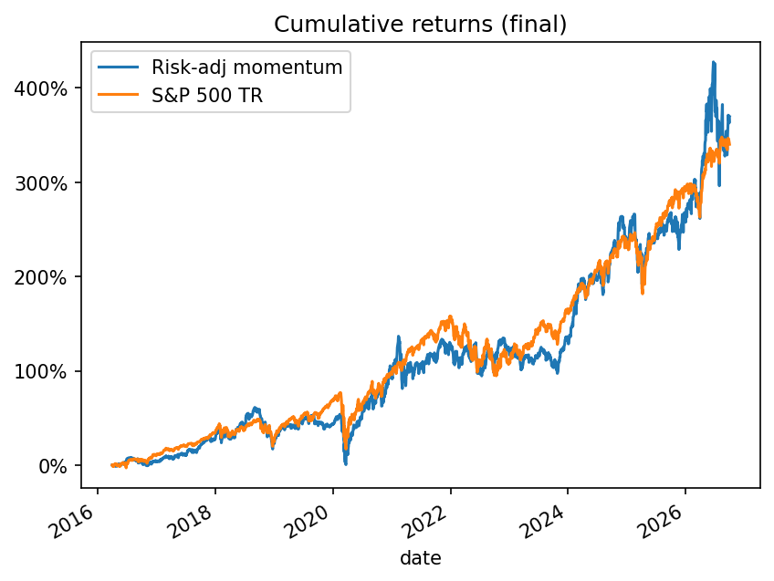

# HW4: Risk-adjusted momentum among large caps

**Result:** over the final test (2016-04-01 to 2026-09-30), the strategy ends at
$4,697,043 against $4,402,747 for `^SP500TR`: **+$294,296 and +0.71 pp of CAGR**.
It beats the benchmark on return but not on risk: its Sharpe ratio is lower and
its maximum drawdown is deeper.

## How to run

From the repository root, with `equities_top2000.duckdb` in `Lectures/modeling/data/`:

```bash
uv sync --locked
.venv/bin/python Homeworks/HW4/Ibrahim_GUIRO/backtest_riskadj_momentum.py
```

The script runs the development period and the final test in a few seconds,
prints the metrics and accounting checks, and saves the metrics, chart, daily
NAV, fills, open positions and data incidents to `results_riskadj_momentum/`.

## Strategy

**Signal.** After the close on day `t`, each candidate is scored by
12-1 momentum divided by its recent volatility:

```
score = (P[t-21] / P[t-252] - 1) / std(daily returns, last 63 sessions)
```

Winners of the past year tend to keep outperforming for a few months; skipping
the last month avoids short-term reversal, and dividing by volatility favours
steady trends over erratic ones. The model is this single-factor ranking (the
expected 90-day return is assumed monotone in the score). It has no fitted
parameters, so there is nothing to overfit or retrain.

**Universe.** Dated members of the entry quarter with `universe_rank <= 500`,
at least 240 quotes in the last 252 sessions, and no daily move above 50% in the
past year (a bad-price screen using past data only). Notes, warrants and SPACs
are excluded, and only the best-ranked symbol per issuer is kept, because the
capitalization proxy lets some of these instruments into the top 500.

**Portfolio.** Capital is split into 3 sleeves starting 21 sessions apart. When
a sleeve has cash, it buys the top 30 names at the next close, equal weight. Each
lot is held 90 calendar days and sold at the close on maturity (or the next
observed close). Proceeds are reinvested by the same sleeve at the next close,
so the portfolio stays about 97% invested and no cash is spent twice.

**Assumptions.** 10 bps cost per purchase and per sale; adjusted prices (so
dividends are not added again); zero interest on cash; a missing entry quote
skips that name; held stocks without a quote keep their last close and are
flagged as stale after 5 sessions.

## Validation

I chose the strategy on the development period only (entries 2010–2015, outcomes
completed by 2015-12-31), by comparing the average 90-day return of each monthly
top-N cohort with the S&P 500 TR over the same 90 days. Risk-adjusted momentum on
the largest stocks was the only signal positive in all six years. Plain
momentum, low volatility, 52-week high and combined scores were weaker or
unstable.

Average 90-day excess return over the S&P 500 TR, development period:

| Universe \ Names | 10 | 20 | 30 | 50 |
|---|---:|---:|---:|---:|
| Top 300 | +0.7% | +0.7% | +0.7% | +0.6% |
| Top 400 | +1.1% | +1.0% | +0.9% | +0.7% |
| Top 500 | +1.1% | +1.3% | +0.9% | +1.0% |
| Top 750 | +0.8% | +0.7% | +1.2% | +1.3% |

I picked top 500 / 30 names, a central point of this stable region rather than
the best cell.

## Performance

| | Dev: Strategy | Dev: S&P 500 TR | **Test: Strategy** | **Test: S&P 500 TR** |
|---|---:|---:|---:|---:|
| Final value | $2,329,093 | $2,046,854 | **$4,697,043** | **$4,402,747** |
| CAGR | 15.17% | 12.71% | **15.88%** | **15.17%** |
| Max drawdown | −22.70% | −18.64% | **−37.68%** | **−33.79%** |
| Sharpe (rf 2%) | 0.73 | 0.71 | **0.67** | **0.77** |



The strategy holds about 30 trending large caps, so it is much more concentrated
than the index, and its excess return swings widely from year to year:

| Year | 2016* | 2017 | 2018 | 2019 | 2020 | 2021 | 2022 | 2023 | 2024 | 2025 | 2026* |
|---|---:|---:|---:|---:|---:|---:|---:|---:|---:|---:|---:|
| Excess (pp) | −6.4 | +0.8 | +3.7 | −17.4 | +15.1 | −9.7 | +15.2 | −20.3 | +16.6 | −10.5 | +18.6 |

\*Partial years.

Momentum lags when market leadership changes abruptly (2019, 2021, 2023). The
strategy was ahead of the benchmark on only 28% of test days, and at the end of
2025 it was behind ($3.58M vs. $3.91M). The whole lead comes from January to
September 2026, when its semiconductor and hardware holdings rallied. With an end
date a few months earlier, it would have lost. The +0.71 pp edge is therefore
small relative to this noise and not a statistically reliable outperformance.

## Accounting and timing checks

The script checks both periods automatically:

- Initial capital plus all cash flows in `fills.csv` equals the final cash, and
  final cash plus open lots equals the final NAV.
- Cash never goes negative, and no lot is sold before 90 calendar days.
- Hand check: F bought 2010-01-05 at 6.05 and sold 2010-04-05 at 7.05, giving
  7.05 × 0.999 / (6.05 × 1.001) − 1 = +16.30% after fees. TSN bought 2016-04-04
  and sold 2016-07-05, the first session after the July 3 maturity.
- Signals use closes through `t`, fills use the `t+1` close, membership uses the
  fill date's quarter, and no price after 2026-09-30 is used.

## Limitations

- **Acquisitions:** there are no takeover proceeds in the data. Lots in acquired
  companies (CERN, SGEN, SPLK, DFS…) stay at their last quote and their cash
  never returns. This reached 17% of NAV by the end, which slows the strategy
  rather than inflating it.
- **Universe quality:** the capitalization proxy is approximate, and a few
  non-common listings (EXEEW, PCGU) passed the filter.
- **Costs:** a flat cost assumption, with no market impact.
- **Test reuse:** I ran exploratory versions of earlier strategies on the test
  period before choosing this one, which weakens the out-of-sample claim. The
  instrument filter was also added after seeing bad test holdings; it is applied
  to both periods.

## Unsuccessful ideas and next steps

| Earlier idea (top 20 of 2,000) | Test CAGR | Main problem |
|---|---:|---|
| Ridge on 21/63-day returns and volatility | 2.7% | Small-cap tilt; bad prices |
| Huber on momentum and volatility ranks | 5.7% | 39% of NAV at stale prices |
| 12-1 momentum with isotonic calibration | 5.6% | Small caps; 18% idle cash |
| Value (EBIT/EV) + quality (gross profit/assets) | 3.7% | Value lagged after 2016; −58% drawdown |

Two problems were common to all four: picking from 2,000 stocks tilted the
portfolio towards small caps, which lagged the mega caps after 2016, and buying
only once a month left sale proceeds idle. Next I would try a sector cap, a
market-trend filter to limit drawdowns, and a quality factor blended with
momentum.

## References and AI assistance

Data and timing conventions follow `Lectures/modeling/README.md`. No lecture
code is copied.
I used an AI coding assistant (Claude) to diagnose my earlier strategies, run
the development-period comparison of signals, and write the final backtester
and this README. I reviewed the code and the results and can explain every step.
