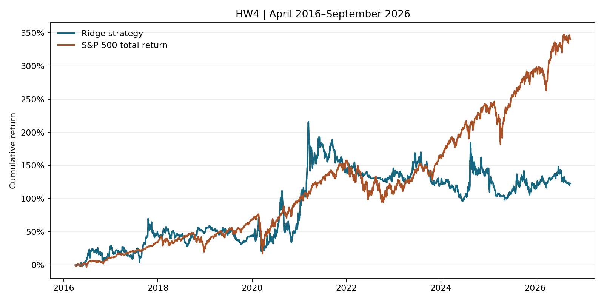

# HW4 — Jefferson Li

From the course root, run `uv sync --locked` and place both bCourses databases in `Lectures/modeling/data/`. Run the [class notebook](01_baseline_model.ipynb) with the course `.venv` kernel.

```bash
uv run --locked python Homeworks/HW4/Jefferson_Li/run_final.py
```

## Approach

Ridge uses 63-session momentum and volatility. The 2013 and 2014 validation fits use completed earlier trades. The final fit uses 2010–2015 signals with exits before April 1, 2016.

Each month, buy the top-scored eligible stock at the next close with up to $250,000. Sell from 90 calendar days after entry. Market fills share a daily cap of 5% of reported dollar volume per ticker. Unfilled buy amounts expire. Partial exits continue on later sessions. Fees are 0.10% per side and cash earns zero. Missing marks carry for up to five sessions.

## Results

April 1, 2016 to September 30, 2026, starting at $1 million. Sharpe uses a 2% annual risk-free rate.

| Metric | Ridge | S&P 500 total return |
|---|---:|---:|
| Final value ($) | 2,230,831 | 4,402,747 |
| Cumulative return | +123.08% | +340.27% |
| CAGR | 7.94% | 15.17% |
| Max drawdown | -37.87% | -33.79% |
| Sharpe | 0.345 | 0.773 |



The original $6.53M result assumed full fills on low- and zero-volume COEP days. Both source price columns alternate between roughly $10 and $201 in March 2022, consistent with mixed adjustment. The documented 1-for-20 reverse split occurred in December 2024. The 5% cap was added after reviewing the test. It limits the effect of these quotes while retaining the original rankings. Reported turnover is a proxy for capacity. [Split filing](https://www.sec.gov/Archives/edgar/data/1759186/000168316825000839/coeptis_s1a1.htm)

The ledger reconciles timing, cash, and positions across 2,640 sessions. Documented events use [TPTX cash terms](https://www.sec.gov/Archives/edgar/data/1595893/000114036122029961/brhc10040812_8k.htm), [GLYC successor quotes](https://www.nasdaqtrader.com/TraderNews.aspx?id=ECA2025-303), and [CIFRW warrant redemption](https://www.nasdaqtrader.com/TraderNews.aspx?id=ECA2025-700). Cash events settle on their effective dates.

The [Lecture 7/8 helpers](../../../Lectures/modeling/course_data.py) supply data, features, and labels.