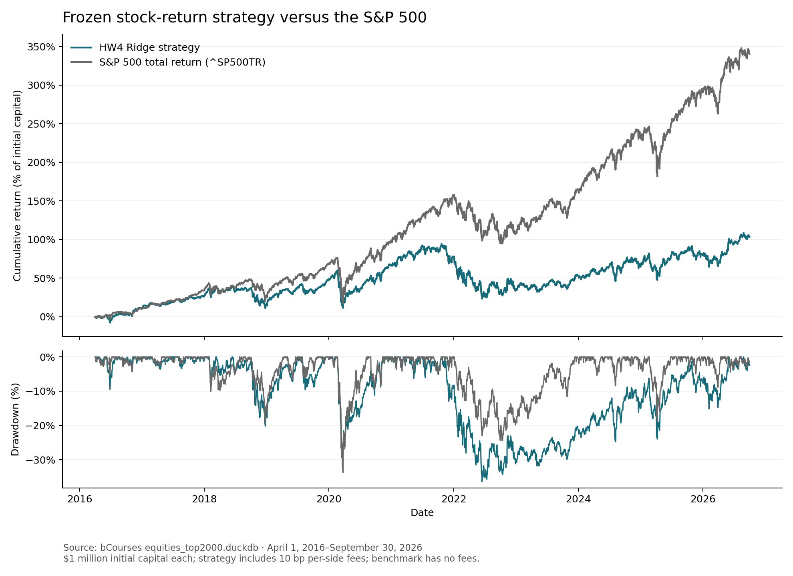

# HW4 research findings — Jing Jian

## Final result

The frozen strategy **underperformed** the S&P 500 total-return benchmark over
April 1, 2016–September 30, 2026. The final wealth difference (strategy minus
benchmark) was **-$2,366,282.17**, or
**-8.16 percentage points of CAGR**.
These are historical simulation results, not evidence of future profitability.

Both portfolios began with $1,000,000. The benchmark bought `^SP500TR` at the
first test close and held through the same final date. Strategy terminal wealth
includes cash and unsold positions; it does not assume a final liquidation.

**Strategy:**

- Final value: **$2,036,464.60**.
- CAGR: **7.01%**.
- Maximum drawdown: **-36.44%**.
- Daily-return Sharpe ratio: **0.356**.

**S&P 500 total-return benchmark:**

- Final value: **$4,402,746.78**.
- CAGR: **15.17%**.
- Maximum drawdown: **-33.79%**.
- Daily-return Sharpe ratio: **0.773**.

See `results/final_summary.json` for unrounded metrics and
`results/daily_portfolio.csv` for the daily curves.

## Hypothesis and final strategy

The hypothesis was that trailing trends and measured risk could rank stocks by
their subsequent 90-calendar-day returns. The final model is Ridge regression
with alpha 100, using 21- and 63-session momentum, momentum from 252 to 21
sessions ago, 63-session annualized volatility, and 252-session drawdown.

Each first-of-month entry uses predictions from the preceding session's close.
The first test purchase is on April 1, 2016, using March 31 features. Eligible
stocks must belong to that entry quarter's top-200 historical capitalization
proxy ranks, have raw close between $5 and $10,000, have 252 complete trailing
daily returns, have 63-session annualized volatility at most 60%, and have no
absolute daily return above 25% in the preceding 63 sessions. These are dated
screens, not screens for future survival. They reduce exposure to extreme data
and volatile names but cannot certify economic price accuracy.

Buy up to 20 names with the highest positive predictions. A positive prediction
is not a guarantee that the return exceeds costs. Split the purchase budget
equally; total spending including fees is capped at the smaller of prior-close
cash or one third of prior-close portfolio value. This spreads entry cohorts
across roughly three months, but does not guarantee equal exposure. Repeated
buys are independent lots and can increase aggregate exposure to a ticker.
There is no explicit sector or total single-name cap.

Each lot is sold at the first supplied market session on/after its 90-calendar-
day maturity. Entry-universe departures do not force liquidation. Purchases use
fractional adjusted-price units, with no extra dividends. Costs are 10 basis
points on each side's notional, cash interest is zero, and leverage is prohibited.
Budgets decided before a session cannot be enlarged using that close's prices
or sales. A missing entry is cancelled without redistributing its budget.

## Development and strategy selection

The classroom prototype first confirmed the code path on 30 stocks. It is not
used as final performance evidence. Full-universe development then compared
four deliberately limited candidates on January 2, 2013–December 31, 2015:

- `price_top10`: CAGR 9.53%, maximum drawdown -19.02%, Sharpe 0.529.
- `price_top20`: CAGR 11.58%, maximum drawdown -14.23%, Sharpe 0.720.
- `price_financial_top10`: CAGR 6.24%, maximum drawdown -16.39%, Sharpe 0.368.
- `price_financial_top20`: CAGR 8.38%, maximum drawdown -15.07%, Sharpe 0.548.

The price-plus-financial versions added profitability, leverage, cash-flow and
accrual ratios plus filing age. They used publication-aware joins, not fiscal
period-end availability. The price-only top-20 candidate had the highest
development Sharpe, so financial features and top-10 portfolios were rejected
for the final run. None of the four beat the development benchmark's CAGR.
The wider portfolio was consistent with a diversification benefit in this
sample; the experiment does not establish that benefit universally.

Development fits used monthly signal rows from 2010 onward, and only outcomes
completed strictly before the first validation signal. Whole dates remain
together; there is no random train/test split. Feature clipping at training
1%/99% quantiles, median imputation, missing indicators, and standardization
were learned inside the training pipeline. Training targets were also clipped
at their training-only 1%/99% quantiles to reduce extreme source-price influence.
Validation returns and actual trades were not clipped. Target availability is
used to select training examples, never to determine investment eligibility.

The saved `results/frozen_strategy.json` was written before final evaluation
and records source-code and database hashes. The final model was fitted once
using 13,334 eligible pre-2016 monthly training signals.
Its latest training signal was **2015-11-30**, and its
latest training outcome completed on **2016-02-29**,
strictly before the **2016-03-31** initial signal. The
January–March 2016 buffer lets eligible old labels mature; it was not used for
hyperparameter tuning. No post-2015 signal was used for training and no
final-period outcome was constructed as a model target. No retraining or
strategy changes were made after examining final returns.

## Accounting and timing evidence

Twenty unit tests in `test_backtester.py` and `test_research.py` check fees,
cash conservation, trade timing, overlapping lots, weekend maturity, terminal
open positions, missing-price policies, matrix/long-data equivalence, and
invariance of fitted predictions to unavailable or future targets, and mandatory
stock-conversion accounting in adjusted units, reserved cash settlements, and
old/new ticker mapping. Their captured output is `results/test_results.txt`.

The actual final run also passed these independent ledger checks:

- Daily NAV equals cash plus marked holdings, with nonnegative cash every day.
- Initial cash minus purchase spending plus net sale proceeds reconciles to
  terminal cash of **$708,760.90**.
- **40** terminal lots sum to
  **$1,327,703.71**; these positions are included in NAV.
- All **2420** buys follow their signal dates; all
  **2379** sales occur at least 90 calendar days after entry.
- Total transaction fees were **$99,297.17**.
- There were **0** cancelled entry orders and
  **1** stale held-lot/session marks.
- **3** held lots underwent documented
  mandatory share/unit conversions, retaining their original maturities.
- Reserved cash-settlement lots: **1**;
  releases at original maturity: **1**.
  Held-lot or entry-order ticker mappings: **3**.
- Every voluntary sale and cash release occurred on its exact original maturity
  session. Daily cash flows and total lot counts reconcile independently.

The engine stops on any missing maturity exit or held gap longer than five
sessions; it never fabricates a recovery or deletes a problematic holding.
Successful completion establishes that those stop conditions were not reached
for this portfolio; it does not establish that all database histories are clean.
Full trade logs can be regenerated under ignored `outputs/full/`.

### Missing histories and the execution-only amendment

The initial final run stopped on February 22, 2022 because XLNX quotes had
ceased. This was not resolved by excluding XLNX or changing the strategy. AMD's
[February 14, 2022 filing](https://ir.amd.com/financial-information/sec-filings/content/0000002488-22-000031/amd-20220214.htm)
documents a mandatory exchange of 1.7234 AMD shares per XLNX share; AMD's
[annual filing](https://www.sec.gov/Archives/edgar/data/2488/000000248823000047/amd-20221231.htm)
confirms that completion preceded the market open. The supplied XLNX history
ends February 11, while AMD quotes continue in the database.

The accounting amendment converts held adjusted units to actual-share
equivalents using the last XLNX adjusted/raw price factor, applies the official
exchange ratio, and converts to AMD adjusted units using its effective-date
factor. The successor holdings retain each lot's entry date and maturity.
This is a mandatory corporate action, not an invented quoted fill. No merger
transaction fee is charged. Fractional successor shares are retained under the
existing fractional-unit approximation; actual cash-in-lieu mechanics are not
modeled.

Three additional issues were resolved with documented terms:

- **VMW, November 22, 2023:** The default for non-electing holders was
  $142.50 per actual share, as stated in the
  [Broadcom announcement](https://www.broadcom.com/company/news/financial-releases/61501)
  and [OCC notice](https://infomemo.theocc.com/infomemos?number=53611).
  No active election is assumed. The cash entitlement replaces the security
  at completion but remains reserved, without interest, until the lot's original
  maturity; no early reinvestment or merger fee is modeled. Processing delays
  beyond that maturity are not modeled. Reserved entitlements are included in
  marked assets, not available cash.
- **AESC, February 15, 2024:** AES corporate equity units converted to 3.8859
  AES common shares per unit, with preferred collateral satisfying the purchase
  contract. The [AES filing](https://www.sec.gov/Archives/edgar/data/874761/000087476124000054/aes-20240630.htm)
  supports the terms. The adjusted-unit conversion preserves maturity and does
  not add contract payments a second time.
- **SQ, January 21, 2025:** Block changed its ticker to XYZ with the same
  underlying shares, according to the
  [company announcement](https://investors.block.xyz/investor-news/news-details/2025/Block-Announces-Ticker-Symbol-Change-to-XYZ-To-Report-Fourth-Quarter-Results/default.aspx).
  Existing positions and later old-symbol orders are mapped to XYZ. Historical
  model rows, scores, and universe rankings remain unchanged.

The original and amended runs produced byte-identical prediction files. No
stock was removed because it later disappeared. The dataset nevertheless has
overlapping issuer aliases and does not reliably distinguish corporate units
from ordinary shares. This execution mapping does not reconstruct a deduplicated
historical security master; duplicated issuer exposure remains a limitation.

`corporate_actions.json` records sources and terms;
`results/corporate_action_basis.json` records the observed price factors; and
`results/corporate_action_ledger.csv` records affected lots. The original frozen
specification is preserved. `results/execution_amendment.json` records old/new
code hashes and the failed attempts. These post-test implementation corrections
changed execution accounting only, without retuning features, model, screening,
allocation, costs, or selection rules. Such a documented correction does not
make the source database a complete corporate-action feed.

## Interpretation, risks, and limitations

The outcome reflects the complete combination of ranking, top-200 restriction,
monthly entry, cash constraints, 90-day forced exits, and fees. It does not
isolate the model's causal contribution. Average daily available cash was
**21.3% of NAV**. Uninvested cash earns zero and creates a different
market exposure from the fully invested benchmark. A single fixed linear model
over more than ten years is also vulnerable to changing relationships.

The development audit found 1,240
pre-2016 quarterly membership rows with selection closes above $10,000 and
181 with reported shares above
20 billion. These are investigation flags, not proof of incorrect data or
automatic share-count exclusions. Examples and large price jumps are retained
in `results/development_ranking_flags.csv` and `results/development_price_flags.csv`.
The screens are applied at signal time; rankings are not silently reconstructed
using invented corrections.

The course loader quarantines nonpositive/nonfinite adjusted prices and rows
outside the supplied market calendar, leaving missing prices unfilled. The
delivered manifest documents 275 invalid adjusted-price rows and 28 off-calendar
rows in the full database. The model uses the supplied quarterly membership
including inactive securities; it does not filter on current active status.

This is availability-aware vendor data, not certified point-in-time data.
Restatements, inconsistent split/share bases, incomplete delisted histories,
undated security metadata, and missing delisting proceeds remain unresolved
source limitations. The final price-only predictor avoids financial predictor
restatements, but historical membership still depends on reported shares and
static security scope. It is not valid to call these results fully
survivorship-free. Historical raw-price and adjusted-price anomalies can escape
the trailing screens, and excluding a stock after a bad observation cannot
undo an earlier held-position loss or gain.

Execution at observed closes with fractional adjusted units and fixed fees is
an approximation. There is no market-impact, spread, tax, financing, or
capacity model, and liquidity has not been independently validated. The
benchmark has no transaction costs. These assumptions limit implementability.

The four-way development comparison uses one three-year validation window;
selection can overfit it. Future research could use multiple purged chronological
folds, predetermined periodic refits, and aggregate ticker/sector limits. Such
ideas have not been tested on the final period here and must not be presented
as improvements supported by these final results.

## Attribution

See README.md for run instructions and attribution to
`Lectures/modeling/course_data.py` and the course data guide. The trading engine
is an independent implementation. Codex generated the implementation, tests,
experiment execution, report, and chart with Jing Jian's direction. The student
should review, understand, and accurately describe that assistance when submitting.
