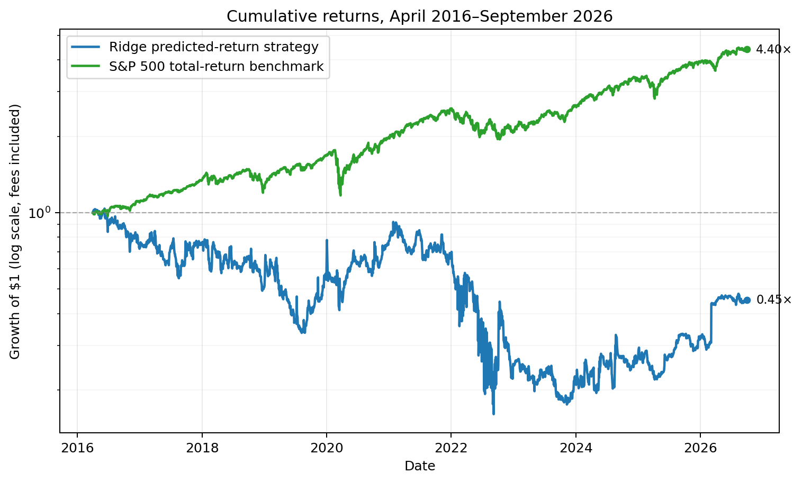

# HW4: Ridge Return Forecast and Backtest

## Research question

Does a model trained to forecast 90-calendar-day stock returns help select stocks? This analysis compares a Ridge strategy with the 63-session momentum baseline from Lecture 8 and the S&P 500 total-return benchmark.

## Run instructions

From the repository root, place `equities_top2000.duckdb` in `Lectures/modeling/data/`, then run:

```bash
uv sync --locked
uv run python Homeworks/HW4/Josie_Wu/hw4.py
```

The code reads the database read-only and creates detailed tables and a chart under `Homeworks/HW4/Josie_Wu/results/`. The database is not included in this submission.

## Method

At each month-end close, the Ridge model uses five features available through that date: 21-session momentum, 63-session momentum, 252-to-21-session momentum, 63-session annualized volatility, and drawdown from the trailing 252-session high. It predicts the adjusted-price return from the next market session's close through the first market session on or after 90 calendar days.

Ridge `alpha` values 1, 10, 100, and 1,000 were compared using chronological annual validation folds for 2013, 2014, and 2015. Each fold uses only training targets that had matured before the fit date. Quantile clipping, median imputation, and scaling are fitted on training data only. Mean validation RMSE selected `alpha=1,000`. The final model was fitted after the March 31, 2016 close using already matured labels, then held fixed during the final test.

Both the Ridge strategy and the lecture's 63-session momentum baseline use the same portfolio rules: rank the point-in-time quarterly members, buy the top three at the next market session's close, allocate up to one-third of current NAV to each monthly cohort, and split that budget equally among the selected stocks. The budget is capped by available cash. Positions are long-only, there is no borrowing, and each side costs 5 basis points. Cash earns no interest. Adjusted prices include dividends.

## Results

Development comparison (2013–2015):

| Strategy | Final value | CAGR | Maximum drawdown | Sharpe (2% risk-free) |
|---|---:|---:|---:|---:|
| Ridge prediction | $2,706,850 | 39.40% | -38.92% | 0.761 |
| 63-session momentum | $3,427,071 | 50.81% | -30.41% | 0.667 |

Final test comparison (April 1, 2016–September 30, 2026):

| Portfolio | Final value | CAGR | Maximum drawdown | Sharpe (2% risk-free) |
|---|---:|---:|---:|---:|
| Ridge predicted-return strategy | $452,836 | -7.27% | -84.53% | 0.339 |
| 63-session momentum baseline | $1,057,517 | 0.53% | -71.23% | 0.131 |
| S&P 500 total-return benchmark | $4,400,545 | 15.16% | -33.79% | 0.772 |

Neither strategy beat the benchmark. Ridge ended about $3.95 million below it; momentum ended about $3.34 million below it. Beating the benchmark is a bonus, not a pass requirement.

### Cumulative returns



The chart uses a logarithmic vertical axis so equal vertical distances represent equal percentage changes. The endpoint labels show each portfolio's growth multiple from $1. The 63-session momentum results remain in the comparison table above.

## Backtest checks and limitations

The cash ledger and timing checks passed for both strategies: buy signals precede fills; sales occur on the scheduled maturity market session; cash never becomes negative; cash reconciles to the fill ledger; no short or borrowed positions are created; daily NAV equals cash plus marked holdings; and the test ends by September 30, 2026. These checks verify bookkeeping and timing, not the quality of missing market data.

Some selected stocks have no quote on their scheduled exit date and no later quote. The backtest does not invent a sale; these lots remain open and are marked at their last available adjusted close. At the test end, stale marks over five calendar days affected 4 of 10 Ridge lots ($204,402) and 11 of 15 momentum lots ($862,518). These values are not reliable liquidation proceeds, so the reported performance is an estimate. The development label audit also found 459 returns above 100%, 45 above 300%, and five below -90%; observed outcomes were retained and only training targets were clipped using training-only quantiles.

Earlier draft iterations inspected the final-test period, so it is not a fully untouched holdout. A follow-up should verify the affected corporate-action and delisting histories, then evaluate the finalized strategy on a new unseen period.

## Course references and assistance

The monthly schedule, top-three selection, one-third cohort budget, 90-day holding period, and 63-session momentum baseline follow Lecture 8's `1_backtesting.ipynb` and `2_research_workflow.ipynb`. Ridge preprocessing reuses `QuantileClipper` from `Lectures/modeling/course_data.py`. The submitted `hw4.py` contains the feature construction, chronological model validation, cash ledger, and backtest simulation. The report presents the model comparison, benchmark shortfall, and data limitations. **AI assistance:** Codex helped with parts of the coding, debugging, and report editing.
