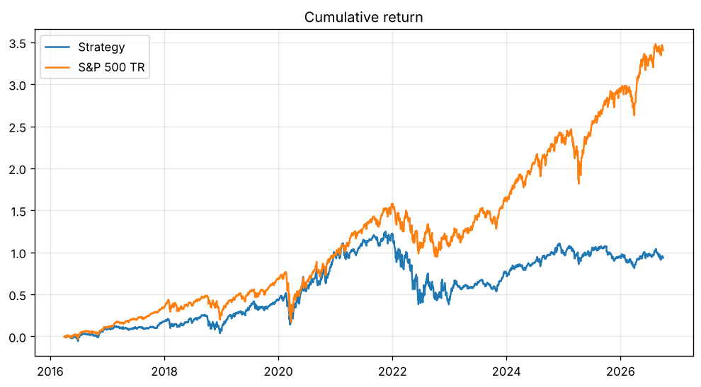

# HW4 - Leonardo Martini

## How to run

Put `equities_top2000.duckdb` (from bCourses) in `Lectures/modeling/data/`, then from the repository root:

```bash
uv run python Homeworks/HW4/Leonardo_Martini/hw4.py
```

To test quickly on the small class database:

```bash
uv run python Homeworks/HW4/Leonardo_Martini/hw4.py --db Lectures/modeling/data/equities_class.duckdb --out Homeworks/HW4/Leonardo_Martini/results_class
```

Everything is saved in `results/`: `RESULTS.md` (tables, checks and chart), `summary.csv`, `cumulative_returns.png`, `daily_nav.csv`, `trades.csv`, `validation.csv` and the last fitted model `model.joblib` (used in HW5).

## Approach

**Data and features.** I reused the course helpers in `Lectures/modeling/course_data.py` for loading, features, financial joins, quarterly membership and labels. The features are the course ones: momentum (21, 63 and 252-21 days), 63-day volatility, 252-day drawdown, six ratios from the quarterly reports (margin, ROA, debt, cash, free cash flow, accruals), filing age and sector. Financial data is used only from the day after the filing date. To keep memory small I build the panel in batches of stocks and only on month-end sessions.

**Target.** The 90-calendar-day return from the next session's close (the entry) to the first close on or after day 90 (the exit), as in `make_labels`.

**Model and validation.** The model does not learn the raw return but its rank inside each month (0 = worst stock, 1 = best), because the raw 90-day returns contain huge outliers from bad data (the maximum is above +100,000%) and with them the validation R2 was around -3,900. I compared a Ridge regression and a gradient boosting model (both inside the course pipeline: clipping, median imputation, scaling, sector one-hot). Validation is chronological on 2014 and 2015: each fold trains only on outcomes that ended before the first validation signal. I chose the model with the higher mean daily rank IC, because for the strategy the ranking of stocks matters more than the exact return. Boosting won by a very small margin (0.073 vs 0.072).

**Retraining.** Chosen during development: the model is refit at the first test signal and then once a year, each time on all eligible rows since 2010 whose 90-day outcome has already ended.

**Strategy.** At every month-end close I score the stocks that are in the universe for the next session's quarter. I only buy among the 1,000 largest stocks of the quarter with a close of at least $5 (to avoid very small and illiquid names, where the data is also less reliable). I buy the top 20 at the next close, equal weight. Each month I invest at most one third of NAV (and never more than the available cash), so about three monthly cohorts are open at the same time. Each lot is sold at the close on its 90-day maturity date, or at the next available close.

## Backtester and assumptions

The backtester (`Backtester` in `hw4.py`) is my own. Each day it: (1) sells matured lots and adds the cash, (2) fills the orders decided at the previous close, (3) values cash plus open positions. The order budget is fixed at the signal close, so the same cash is never spent twice; a buy that needs more cash than available raises an error.

- Starting capital $1,000,000, long only, no leverage.
- Costs: 5 bps on every buy and every sale (included in the budget).
- Adjusted close prices for everything, so dividends are not added again.
- Cash earns 0%.
- Missing prices: if a stock has no price on the entry day, the order is skipped (no invented fill). A held stock without a price is valued at its last price; the number of these cases is reported. Lots past maturity that never trade again stay open at their last price.
- The benchmark is $1,000,000 in `^SP500TR` at the first test close (2016-04-01). Sharpe uses daily returns and a 2% annual risk-free rate.

## Accounting checks

The script checks that cash is never negative, that the cash rebuilt from the trade list equals the book cash, that every sale happens on or after the 90-day maturity, and that every buy is filled the session after its signal. It also prints one complete lot (units, prices, fees, return) that can be checked by hand against `trades.csv`. The results are in `results/RESULTS.md`.

## Results

Test period: 2016-04-01 to 2026-09-30.

| | Strategy | S&P 500 TR |
|---|---|---|
| Final value | $1,938,411 | $4,402,747 |
| CAGR | 6.51% | 15.17% |
| Max drawdown | -38.66% | -33.79% |
| Sharpe | 0.33 | 0.77 |



The strategy did not beat the benchmark: it ended about $2.46 million below it. It followed the index until 2021 but lost much more in 2022 and never recovered. Reasons I see:

- The signal is weak: the validation rank IC is only about 0.07, and in the test it was not enough to beat a market where a few very large stocks drove most of the return.
- The portfolio holds about 60 mid and large caps with equal weights, so it is less exposed to the largest technology stocks than the index.
- On average about 19% of the portfolio was in cash (earning 0%), because each month I invest at most one third of NAV.
- Higher risk: a deeper drawdown than the index with a lower return.

More details (validation table and all checks) are in `results/RESULTS.md`.

## Limitations and next steps

- Honest note: my first version trained on the raw returns. I also ran it on the test period, and it was much worse (CAGR about 1%). Looking at the validation numbers (R2 around -3,900) I saw the outlier problem and switched to the rank target and the size and price filter. So the final choices were not completely fixed before seeing a test result.

- The data is not a certified point-in-time database: financials are latest vendor values, there are no delisting proceeds, and some stocks stop trading while I hold them (I keep their last price, which can be too optimistic).
- Holding 20 stocks per cohort is more concentrated than the index, so the risk is higher.
- In validation the Ridge model had a better top-20 return than boosting (2.9% vs 0.7% on average), even if its IC was almost the same. Choosing the model with the top-20 return could be better for a strategy that only buys 20 stocks.
- Next I would try sector limits, investing all the cash, a volatility-weighted allocation and more features (for example value ratios).

## Use of AI

I used Claude (an AI assistant) to help me write and debug the code and this README. I checked the results and I can explain every step.
