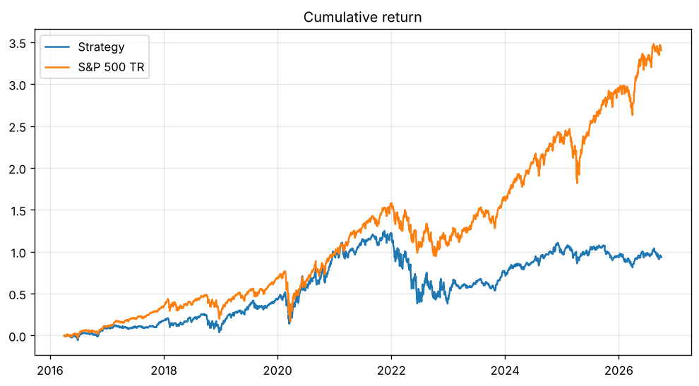

# Results

Test period: 2016-04-01 to 2026-09-30. Model: boosting.

|  | Strategy | S&P 500 TR |
|---|---|---|
| Final value | $1,938,411 | $4,402,747 |
| CAGR | 6.51% | 15.17% |
| Max drawdown | -38.66% | -33.79% |
| Sharpe | 0.33 | 0.77 |

Did not beat the benchmark by $-2,464,336.

Open lots at the end: 56 (of which 16 past maturity with no new price, valued at their last price).

## Validation (2014 and 2015)

| model | year | rank_IC | top20_return | all_stocks_return |
|---|---|---|---|---|
| ridge | 2014.0 | 0.0566 | 0.0571 | 0.0329 |
| ridge | 2015.0 | 0.0885 | 0.0005 | -0.0196 |
| boosting | 2014.0 | 0.0548 | 0.0364 | 0.0329 |
| boosting | 2015.0 | 0.0906 | -0.0222 | -0.0196 |

## Accounting checks

- Cash never negative: True (min -0.00)
- Buys: 2,439, sales: 2,383, skipped orders (no price): 1
- Final cash from the trade list: 541,888.38 vs book 541,888.38
- All sales on or after maturity (90 days): True
- Max delay after maturity: 2 calendar days
- Example lot REGN: bought 41.1063 units at 405.2500 on 2016-04-01 (cost 16,666.67 with fee), sold at 349.2300 on 2016-06-30 for 14,348.38. Return -13.91%; price check: 405.2500 and 349.2300
- Every buy is filled the session after its signal: True
- Days with a held price older than 5 sessions: 1300

