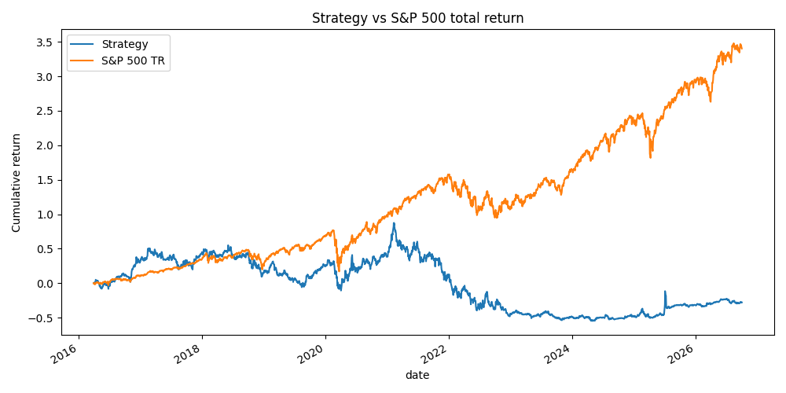

# HW 4 — Louis Maurice

## Run

1. Put `equities_top2000.duckdb` (bCourses) in `Lectures/modeling/data/`.
2. From the repository root run `uv sync --locked`. Then, from this folder:

```bash
python test_backtester.py   # hand-checked accounting tests
python hw4.py               # full experiment (~2 min); writes results/ and outputs/
```

## Code reused

- `Lectures/modeling/course_data.py`: data loading, price features, filing-date
  financial features, quarterly membership, 90-day labels, date folds, the
  clip → impute → scale → Ridge pipeline, and prediction metrics.
- `Lectures/Lecture 8/2_research_workflow.ipynb`: `GridSearchCV` alpha search over
  date folds and the quarterly refit loop.
- `backtester.py` is written for this assignment.
- AI-assisted work: the code and write-up were produced with an AI coding assistant.

## Approach

- **Features:** the course set: 21/63-day momentum, 12-1 momentum, 63-day volatility,
  252-day drawdown, six financial ratios available from filing date + 1 day, filing age, and sector.
- **Target:** return from the next session's close to the first close on or after 90 calendar days.
  Training targets are clipped at their own 1%/99% quantiles (see Findings).
- **Model:** Ridge (course pipeline). It is linear and regularized, and it is fast on about 2,000 stocks.
- **Validation (development only):** month-end signals 2010–2015.
  - **Model:** validation years are 2013, 2014 and 2015, each trained only on labels that ended
    before that year's first signal. Alpha ∈ {1, 100, 1000} is chosen by mean RMSE; result: 1000.
  - **Strategy:** a 2014–2015 backtest with quarterly refits compares 10, 20 and 50 names.
    Best Sharpe: **10 names** (`results/development_backtest.csv`).

| 2014–2015 | top 10 | top 20 | top 50 | S&P 500 TR |
|---|---|---|---|---|
| CAGR | 19.7% | 6.1% | 0.7% | 7.8% |
| Max drawdown | −37.9% | −31.6% | −26.8% | −12.0% |
| Sharpe | 0.56 | 0.27 | 0.03 | 0.48 |

- **Retraining:** refit at every quarter-end from 2016-03-31, using only labels completed before the fit
  date (expanding window from 2010).
- **Strategy:** on the first session of each month, buy the 10 highest predicted returns among that
  quarter's universe members. The budget is min(cash, NAV/3), split equally and including fees.
  Each lot is held 90 calendar days and sold at the first available close on or after maturity.

## Assumptions

- Fees: 5 bps per side. Cash earns 0%. Adjusted closes are used throughout (no dividends added).
- Buy with no quote at the fill close: skipped and logged (1 case).
- Held stock with no quote: valued at its last observed close and counted in `stale_lots`. It is
  sold only when a quote appears. No delisting proceeds are invented, so lots that stop trading stay
  open at their last mark (`outputs/open_lots.csv`).

## Accounting checks

- `test_backtester.py`: buy and sell amounts computed by hand, fee inside the budget,
  a delayed exit when the maturity date has no quote, and a stale mark.
- `hw4.py` `check_accounting` runs on every backtest: cash rebuilt from fills matches daily cash;
  NAV = cash + holdings; every buy is filled after its signal date, at the first session of a month;
  every sale is on or after its due date; no price after 2026-09-30. All checks pass.
- At every refit, an assert checks that the last training label ended before the first scored signal.

## Results (test: 2016-04-01 to 2026-09-30)

| | Strategy | S&P 500 TR |
|---|---|---|
| Final value | $721,605 | $4,402,747 |
| CAGR | −3.1% | 15.2% |
| Max drawdown | −75.9% | −33.8% |
| Sharpe (2% rf) | −0.01 | 0.77 |



**The strategy did not beat the benchmark.** It finished $3.68M below it, and its CAGR was about 18 points a year lower.

## Findings and limitations

- **No predictive signal out of sample.** Test mean daily rank IC is 0.007 and R² is −0.003. The good
  2014–2015 development result for 10 names did not persist. With so few names it was mostly luck
  and concentration.
- **Risk taken:** 10 equally weighted names per month, about 30 open lots, no sector or volatility limits. The model
  tends to pick volatile stocks (most bought: BESS, UPST, MARA, RIOT, AMC, AFRM, CVNA). The strategy
  kept up with the index until 2021, then lost about 60% in 2021–2022 when speculative growth stocks crashed.
- **Broken prices in the data.** The first run trained on raw targets: validation RMSE was about 11,
  because a few split or price errors create impossible returns (AAM +106,847×, VBIV +816×). Those rows
  dominated Ridge's squared loss. Training targets are now clipped at the training 1%/99% quantiles.
  The fix came from the development diagnostic, not the test returns. The test was run once
  before and once after the fix, and both runs lose badly (final value $832k before the fix).
- **Stale positions.** 32 open lots (≈ $389k, over half of the final NAV) have no price after some
  date. Most look like acquisitions (ECOL, PING, BTRS, VVNT, TA), where the last price is a fair proxy
  for the payout, but the database has no delisting proceeds. If these lots were worth zero, the final
  value would be $332,694. They also lock up cash, which reduces later investment. One spike in mid-2025
  also suggests a remaining bad price.
- **Data limitations (data guide):** the universe is reconstructed, not certified point-in-time;
  financials are latest vendor values, not original filings; the capitalization ranking is approximate.
  Stocks that stop trading have no 90-day label, so they are missing from training.

**Next things to try (chosen in development, not on the test):**
- rank-based targets or a rank-IC selection metric instead of RMSE
- more names plus sector and volatility caps
- a liquidity or price filter at entry
- an explicit rule for positions that stop trading
- a nonlinear model (e.g. HistGradientBoosting)
