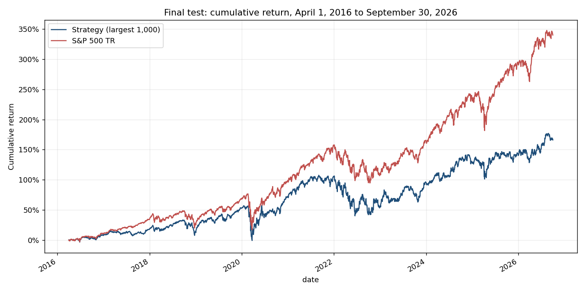

# HW4: Stock-return model and trading strategy

**Author:** Mauricio Gutierrez · **Branch:** `hw_4_Mauricio_Gutierrez`

I built a ridge model that predicts each stock's 90-calendar-day return, my own backtester, and a long-only strategy that buys the top-ranked stocks. This file gives the result first, then how to run the code, then how I got there.

## Result

**The strategy did not beat the S&P 500 total-return index.** Final test: April 1, 2016 to September 30, 2026, $1,000,000 in each portfolio.

| Metric | Strategy | S&P 500 total return |
|---|---:|---:|
| Final value, cash plus open positions | $2,661,011 | $4,402,747 |
| Total return | 166.1% | 340.3% |
| Annualized compounded return (CAGR) | 9.77% | 15.17% |
| Maximum drawdown | -36.8% | -33.8% |
| Sharpe ratio, daily returns, 2% risk-free rate | 0.47 | 0.77 |
| Annualized volatility | 19.8% | 17.8% |

The strategy finished $1,741,735 below the benchmark. Its final value is $47,846 in cash plus $2,613,166 in 90 open lots valued at the September 30, 2026 close.



The full report, with the checks and the analysis, is in [07_final_test_report.ipynb](07_final_test_report.ipynb). The final test was run once, after every setting was fixed on development data.

## The strategy

```text
Cleaned data -> Features -> Ridge forecast of the 90-day return
                                        |
                                        v
              Candidates: largest 1,000, minus the most volatile 20%
                                        |
                                        v
                 Top 30 forecasts -> inverse-volatility weights
                                        |
                                        v
              Buy at the next close -> hold 90 days -> sell -> reinvest
```

| Part | Setting |
|---|---|
| Model | Ridge regression, alpha 100. Predicts the adjusted-price return from the entry close to the exit close 90 calendar days later |
| Price features | 21-, 63- and 252-minus-21-session momentum, 63-session volatility, 252-session drawdown |
| Financial features | Net margin, operating return on assets, debt to assets, cash to assets, each ranked within sector on the date; age of the latest filing |
| Training | First fit on April 1, 2016, then every January 1. A fit uses only targets whose holding period ended before the fit date |
| Learned preprocessing | Clipping, median imputation and scaling are fitted on training rows only. Training targets are clipped at the 1st and 99th percentiles of each fit's training rows |
| Candidates | Members of the entry quarter's universe, limited to the 1,000 largest by the quarterly size rank. The most volatile 20% on the signal date are excluded |
| Decision | After any close with at least 5% of portfolio value in cash and at least 21 sessions since the previous decision |
| Entry | At the next session's close. Features use the signal close, so the fill price is unknown when the decision is made |
| Budget | The smaller of available cash and one third of portfolio value |
| Allocation | 30 stocks, weighted by inverse 63-session volatility. A stock may not exceed 30% and a sector 50% of portfolio value, counting open positions |
| Exit | 90 calendar days after entry, at that close, or the next session's if the market is closed |
| Costs | 0.10% of trade value on entry and on exit. This is my assumption, not a broker's fee. No slippage; fractional shares; cash earns 0% |
| Dividends | Adjusted prices are used throughout, so dividends are not added again |

**Missing and suspect prices.** No fill is invented.

- An order with no entry quote is cancelled and its cash is kept.
- A held stock with no quote is valued at its last accepted close. It is sold at the first quote on or after maturity. If none appears within 10 sessions after maturity, the lot is closed at that last close and flagged.
- A one-day price ratio below 0.2 or above 5 (a fall of more than 80% or a rise of more than 400%) is treated as a data error. Such rows are dropped from training, and such quotes count as missing in the backtest. Ordinary large moves are kept.

## How to run

Run everything from the repository root with the course environment (`uv sync --locked`, kernel `.venv`). Place `equities_class.duckdb` and `equities_top2000.duckdb` from bCourses in `Lectures/modeling/data/`. Generated files go to `outputs/`, which Git ignores.

**To reproduce the final result** (about 10 minutes, about 7 GB of memory):

1. Run all cells of `01_data_preparation.ipynb`. It cleans the class database, which the full cleaner uses as a consistency check.
2. Clean the full database, then run the final test:

```text
.venv/Scripts/python.exe Homeworks/HW4/Mauricio_Gutierrez/clean_full_database.py
.venv/Scripts/python.exe Homeworks/HW4/Mauricio_Gutierrez/run_final_test.py
```

3. Run all cells of `07_final_test_report.ipynb`. It reads `outputs/final_test/`; its saved output can be read without running anything.

`run_final_test.py` saves each stage, so a rerun continues where it stopped. These three steps need nothing from the development chain below.

**To reproduce the development work** that chose the strategy (optional):

| Step | Run | Data |
|---|---|---|
| 1 | `02_ridge_model.ipynb`, then `03_backtesting.ipynb` | Class |
| 2 | `04_feature_and_allocation_tests.ipynb`, `04b_feature_experiment.ipynb`, `05_monthly_retraining.ipynb` | Class |
| 3 | `06_full_data_development.ipynb` | Full, 2010-2015 |
| 4 | `run_suspect_rule.py`, then `run_portfolio_round.py` | Full, 2010-2015 |

Each step reads files saved by the one before it. Notebook 06 was run twice: first without the target clip and the volatility screen, archived as "before fix", then with them. Its before/after comparison is skipped when that archive is absent. When the development forecasts are present, `run_final_test.py` also refits 2015 and checks that it reproduces them before fitting anything on the test period.

**Tests (65, no database needed):**

```text
.venv/Scripts/python.exe -m unittest discover -s Homeworks/HW4/Mauricio_Gutierrez -p "test_*.py"
```

## Files

| File | Purpose |
|---|---|
| `07_final_test_report.ipynb` | **Start here.** Final metrics, chart, accounting and timing checks, findings |
| `run_final_test.py` | Fixed settings; features, annual fits and backtests for the final test |
| `strategy_backtest.py` | My backtester: strategy interface, order planning, daily execution, lot accounting, metrics, reconciliation |
| `feature_engineering.py` | Features, dated universe membership, 90-day targets, ridge pipeline, validation helpers |
| `data_cleaning.py`, `clean_full_database.py` | Cleaning rules and the batch runner for the full database |
| `01_data_preparation.ipynb` | Explains and applies the cleaning rules on the class data |
| `02_ridge_model.ipynb`, `03_backtesting.ipynb` | First model and first backtest on the class data |
| `04_…`, `04b_…`, `05_…` notebooks | Class-data experiments: allocation, feature sets, retraining frequency |
| `06_full_data_development.ipynb`, `run_full_data_development.py` | Full-data development runs and the notebook's runner |
| `run_suspect_rule.py`, `run_portfolio_round.py` | Last development rounds: suspect-price rule; stocks, schedule and size filter |
| `test_*.py` | Synthetic tests for timing, features, cash, limits, schedules and missing prices |
| `results/` | Final-test tables and charts copied from `outputs/` so they are visible on GitHub |

## Evaluation design

| Period | Dates | Use |
|---|---|---|
| Development | January 1, 2010 to December 31, 2015 | Build features, validate, choose every setting |
| Buffer | January 1 to March 31, 2016 | Lets the last development targets finish |
| Final test | April 1, 2016 to September 30, 2026 | One run of the fixed strategy |

Within development I refitted before each of 2013, 2014 and 2015 and evaluated on that year. The development code refuses to read data after December 31, 2015. Candidates come from the dated `universe_membership` table, so stocks that later disappeared stay eligible while they were members.

## Evidence that accounting and timing are correct

- **A purchase checked by hand** (notebook 07, section 3). First lot: ALGT, decided April 1, 2016, bought April 4 at 155.03. Cash spent $8,723.30 = shares $8,714.59 + fee $8.71. Due July 3 (a Sunday), sold July 5 at 129.81 for $7,289.62 after the fee.
- **The ledger recomputed from the trade log:** daily cash equals $1,000,000 plus all trade cash flows; cash is never negative; portfolio value equals cash plus holdings every day; every lot is sold at most once; the final value equals cash plus open lots.
- **Timing:** every entry is the session after its signal; every sale is the first session on or after 90 calendar days, unless the lot was waiting for a quote; no trade or valuation is dated after September 30, 2026; every fit's last training outcome is before its fit date.
- **No look-ahead in features:** with data running to 2026, the code reproduced all 499,587 forecasts for 2015 that were first made with data ending in 2015, to 16 decimal places.
- **65 synthetic tests** cover fees, budgets, limits, maturities, missing quotes, the cash schedule and the suspect-price rule. Several change future prices and check that earlier decisions do not change.
- **Data gaps in the final test:** no order was cancelled; 151 lot-sessions were valued at a last accepted close; 3 lots were closed by the no-quote rule. If those 3 were worth zero, the final value would be $2,582,853.

## Data cleaning

I adapted the cleaning approach from my HW2 submission: same audit structure, label normalization, duplicate and invalid-value checks, quarantine reasons and row accounting. I removed the HW2 repairs that use later prices (round-trip repair, spike detection with future neighbours, forward-filling) because they would leak future information into signals.

| Rule | Treatment |
|---|---|
| Invalid prices, impossible OHLC, off-calendar dates | Quarantined |
| Financial reports with an invalid filing date | Quarantined |
| Usable financial reports | Available from the filing date plus one calendar day |
| Missing prices and volumes | Left missing; never filled |
| Large moves and return outliers | Flagged using past data only, and kept |

| Full database | Kept | Quarantined |
|---|---:|---:|
| Price rows | 15,839,202 | 586 |
| Financial reports | 260,524 | 23,674 |

There are 167,600 missing sessions inside observed histories, concentrated in 415 stocks, and 1,335 stocks whose history ends before September 30, 2026. Market capitalization is missing in 96% of the financial reports. The source database is opened read-only and its checksum is unchanged.

## How I got here

All numbers below are development results on 2013-2015, where the benchmark returned 48.8% with a Sharpe of 0.95 and a maximum drawdown of -12.0%.

**Class data (30 stocks).**

| Experiment | Total return | Sharpe | Maximum drawdown | Outcome |
|---|---:|---:|---:|---|
| Baseline: lecture price features, top 5, equal weights, monthly | 25.0% | 0.33 | -29.4% | Starting point |
| A: top 10, inverse-volatility weights | 34.3% | 0.71 | -11.1% | Kept the allocation |
| B: momentum, two volatilities, index-relative momentum, beta | 15.8% | 0.29 | -16.2% | Rejected |
| C: B with per-date ranks and index-relative target | 22.7% | 0.45 | -15.2% | Rejected |
| D: lecture price features plus four financial ratios | 28.9% | 0.61 | -10.1% | Carried to full data |
| Added 21-session volatility and 14-session RSI (top 5, equal) | 32.3% | 0.39 | -29.9% | Rejected: rank IC unchanged |
| Monthly instead of annual refits | 24.6% | 0.33 | -29.1% | Kept annual |

With 30 stocks the feature sets could not be told apart: rank IC changed sign from year to year in every run.

**Full data.**

| Step | What happened |
|---|---|
| First run of A and D | Invalid. Price errors such as AAM (0.19 to 27,400 and back, giving 90-day "returns" of +142,707) dominated the fit. Forecasts reached +7,100% |
| Target clip and volatility screen | Forecasts returned to a plausible range (-10% to +14%). D: 18.8%, Sharpe 0.35 |
| Suspect-price rule | Dropped about 5,000 training rows per fit. Coefficients and rank IC did not change materially, so the clip had already contained the errors |
| Stocks and schedule | 10 or 30 stocks, monthly or cash schedule. The calendar-month schedule left 18% of the portfolio idle; the cash schedule cut that to 6%. Selected 30 stocks with the cash schedule: 27.4%, Sharpe 0.52 |
| Size filter | My idea was to trade only the largest 10% (200 stocks) to avoid tiny, unreliable companies. I compared the largest 1,000, 500 and 200: Sharpe 1.00, 0.90 and 0.75. Selected the largest 1,000 |

Each choice between variants used a rule written before the run: highest Sharpe, and within 0.05 of it, the smaller maximum drawdown.

## Findings

**The model does not rank stocks.** Rank IC, the per-date correlation between forecast order and realized order, averaged about zero in development and -0.006 across the eleven final-test fits, positive in 5 of them. Sorting stocks into ten groups by forecast showed no steady spread between the top and bottom groups. What improved the strategy were its risk rules: more names, inverse-volatility weights, the volatility screen, the size filter and less idle cash.

**The development result did not carry over.** On 2013-2015 the final strategy had a Sharpe of 1.00 against 0.95 for the index. On the final test it had 0.47 against 0.77. Part of the reason is that the cutoff was the best of three I tried.

**The benchmark was hard to match in this decade.** The index is weighted by company size and its largest members led the market. My portfolio weights 30 stocks by inverse volatility and holds little of them. The declared sensitivity runs show this:

| Candidates | Final value | CAGR | Sharpe |
|---|---:|---:|---:|
| Largest 1,000 (reported result) | $2,661,011 | 9.8% | 0.47 |
| Largest 500 | $3,092,494 | 11.4% | 0.58 |
| Largest 200 | $3,389,605 | 12.3% | 0.67 |
| All 2,000 | $1,869,155 | 6.1% | 0.29 |
| S&P 500 total return | $4,402,747 | 15.2% | 0.77 |

The stricter the size filter, the closer to the index. My original 10% idea would have done best, but I had selected the largest 1,000 in development, so that is the result I report. The strategy was ahead of the benchmark in 2 of 11 calendar years.

**Risks taken.** A 90-day holding rule with no stop, no hedge against market falls, exposure to mid-sized companies, and about $138,000 in fees from reinvesting every 90 days.

**Limitations.**

- Sector labels are a current snapshot, not a history. The size rank is a proxy and contains errors.
- Financial data is a restated vendor snapshot and may differ from what was known at the time.
- The suspect-price rule also removes a genuine one-day move beyond its bounds, and keeps a stock unquoted until its price returns within them. It rejected 48,746 daily quotes in the test window, about 0.5%.
- Fees are assumed; there is no market impact, and shares are fractional.

**What I would try next.**

- Test each feature alone with decile sorts, and keep only those with a consistent effect.
- Model the tails directly, with indicator features for the extreme groups or a non-linear model, because the strategy only trades the top of the ranking.
- Predict the return relative to the index.
- Add value features once market capitalization can be verified; a price-to-sales feature was excluded for that reason.
- Hold more names or weight by size to reduce the gap to a size-weighted benchmark.

## Sources and assistance

- [HW4 assignment](../../../Lectures/Lecture%208/hw4.md) and the [modeling data guide](../../../Lectures/modeling/README.md).
- [Lectures/modeling/course_data.py](../../../Lectures/modeling/course_data.py): the five price features, dated membership, 90-day labels, quantile clipping, prediction metrics, and the financial functions `financial_events` and `join_financials` are adapted from it, with attribution in `feature_engineering.py`.
- [Lectures/modeling/backtest.py](../../../Lectures/modeling/backtest.py) and the [Lecture 8 backtesting notebook](../../../Lectures/Lecture%208/1_backtesting.ipynb): I followed the separation of strategy, execution and analysis, and the standard formulas for CAGR, drawdown and Sharpe. The backtester itself is my own implementation and does not import the lecture one.
- My HW2 data-cleaning notebook, for the cleaning structure.
- [TradingView RSI calculation](https://www.tradingview.com/support/solutions/43000502338-relative-strength-index-rsi/) for the RSI definition used in notebook 04b.
- [Fidelity research glossary](https://scs.fidelity.com/webcontent/ap010098-etf-content/17.02/help/research/learn_er_glossary_3.shtml) for the price-to-sales definition.

**AI assistance.** I used AI tools in this work. I discussed the strategy rules with ChatGPT, and Codex and Claude Code helped me implement, test and document the code. I reviewed the results at each step and made the design decisions.
