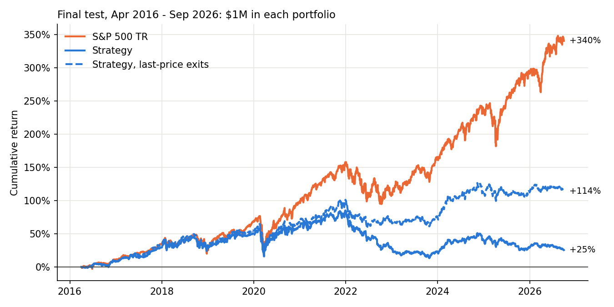

# HW4: Stock Prediction and Trading Strategy (Min Jin)

A monthly long-only strategy: rank stocks with a fixed-weight factor score, buy the top 30, hold each purchase
for 90 calendar days, and compare with \$1,000,000 in `^SP500TR` using my own backtester.

Result: the strategy **did not** beat the benchmark. \$1M grew to **\$1.25M** against **\$4.40M** for the S&P 500 TR.

## Files

| File | What it does |
|---|---|
| `data.py` | Loads `equities_top2000.duckdb` with the course helpers; experiment dates and settings |
| `features.py` | Builds the monthly feature panel and 90-day targets (`outputs/panel.parquet`) |
| `model.py` | Investability screen, candidate models, chronological validation, walk-forward scoring |
| `backtester.py` | Daily backtester, accounting audit, benchmark and performance metrics |
| `1_data_and_features.ipynb` | Coverage, missing values, look-ahead checks, one label recomputed from SQL |
| `2_model_validation.ipynb` | Data errors, folds, candidate comparison, frozen model choice |
| `3_backtest_checks.ipynb` | Toy market checked by hand, 2012–2015 dry run audit, one real trade recomputed from SQL |
| `4_final_test.ipynb` | Final test 2016–2026, metrics, chart, sensitivity, findings |
| `cumulative_return.png` | Cumulative-return chart from Notebook 4 |

## How to run

1. From the repo root, build the environment: `uv sync --locked`.
2. Put the course database at `Lectures/modeling/data/equities_top2000.duckdb`.
3. Build the feature panel (about 1 minute): `cd Homeworks/HW4/Min_Jin && ../../../.venv/bin/python features.py`. Notebook 1 also builds it if it is missing.
4. Open the notebooks with the `.venv` kernel (Python 3.12) and run them in order, 1 → 4.

## Method

**Data and timing.** One row per stock in that quarter's top 2000 list, at each month-end close (signal date).
The trade fills at the **next session's close**. The target is the return from that entry to the first close on or after entry + 90 calendar days (waiting at most 5 sessions), using adjusted closes. Financials are used only from the filing date + 1 day. Universe membership is applied by the quarter of the entry date.

**Features.** The course price and financial features (momentum, volatility, drawdown from the 1-year high, margins, ROA, leverage, cash, free cash flow, accruals, filing age), plus `momentum_126`, `log_dollar_volume_63` and `log_universe_rank`. Same-date percentile ranks of every feature are added for the rank-based models.

**Investability screen**: raw close ≥ \$5 and median 63-day dollar volume ≥ \$1M. It removes most vendor errors (for example AAM's +10 million % "return").

**Validation.** Development period 2010–2015 only. Expanding-window folds with one validation year each (2012–2015), training only on rows whose 90-day outcome finished before the first validation signal. Models are ranked by rank IC (same-date Spearman correlation between score and realized return), top-30 excess return and top-minus-bottom decile return.

**Model.** Seven candidates were compared: the course Ridge baseline, Ridge and boosted trees on raw or rank features with a raw or excess target, Ridge on five factor ranks, and a fixed-weight factor score. Only the **factor score** had a positive mean rank IC (+0.062, positive in 3 of 4 years). It averages five signed same-date ranks with equal weights:

| Signal | Direction |
|---|---|
| `operating_roa` | higher is better |
| `fcf_to_assets` | higher is better |
| `drawdown_252` (closeness to the 1-year high) | higher is better |
| `momentum_252_21` (12-month momentum, skipping the last month) | higher is better |
| `volatility_63` | lower is better |

Nothing is fitted, so there is no retraining in the test. `walk_forward` still records a yearly fit date to show that no future outcome is used.

**Trading strategy and assumptions.**

| Rule | Implementation |
|---|---|
| Capital | \$1,000,000, long only, no borrowing |
| Picks | Top 30 by factor score each month-end, equal dollar amounts |
| Batch size | `min(cash, 1/3 × portfolio value)` per month, so about 3 batches are open at once |
| Exit | 90 calendar days after entry at the close, or the next session with a quote |
| Costs | 10 bps (0.1%) of the traded amount on every buy and sell |
| Cash | Earns no interest |
| Prices | Adjusted closes; dividends are not added again |
| No quote on entry day | Purchase skipped, cash kept |
| No quote while holding | Valued at its last close |
| No quote within 5 sessions after maturity | Written off at \$0. Selling at the last price is a sensitivity check |
| Test end | Open positions valued at their last close on or before Sep 30, 2026 |

## Results (Apr 1, 2016 – Sep 30, 2026)

| | Final value | Total return | CAGR | Max drawdown | Sharpe (2% rf) |
|---|---|---|---|---|---|
| **Strategy (write-off at \$0)** | **\$1,253,095** | 25.4% | 2.18% | −38.8% | 0.08 |
| Strategy, last-price exits (sensitivity) | \$2,138,048 | 113.9% | 7.51% | −26.7% | 0.47 |
| **S&P 500 TR** | **\$4,402,747** | 340.3% | 15.17% | −33.8% | 0.77 |

The strategy is behind the benchmark by about **\$3.15M** (13.0 percentage points of CAGR), with a deeper drawdown. It roughly kept pace through 2018 (and beat the index in 2018), but then lagged in every calendar year from 2019 to 2026.

## Accounting and timing checks

- **Look-ahead (Notebook 1):** `check_timing` asserts on every panel row for these checks: next-session entry, financials filed before the signal, universe list already published, exit ≥ 90 days after entry, and no exit after Sep 30, 2026. One AAPL label is recomputed from raw SQL and matches.
- **Validation folds (Notebook 2):** asserts that each fold's last training outcome finished before its first validation signal.
- **Toy market (Notebook 3):** every fill, fee, share count, daily value, the weekend maturity, the \$0 write-off and the last-price alternative match hand calculations.
- **Full audit (Notebooks 3 and 4):** `check_accounting` recomputes 10 rules from the raw price table and ledger on every row, including value = cash + positions, cash never negative, a cash reconciliation, next-session fills, ≥ 90-day holds, exits at the first quote after maturity, and no trade after the end date. All pass for the 2012–2015 dry run and the final test.
- **One real trade (Notebook 3):** the first FUN purchase recomputed from SQL matches the backtester.

## Findings

- **Write-offs were the largest cost.** 55 lots in 32 stocks lost their quotes, mostly cash takeovers (e.g. Alexion, Cerner). The database has no payout records, so they are written off at \$0. Selling at the last price instead almost doubles the final value, but it is still far below the index.
- **Stock selection was roughly neutral.** The test rank IC stayed positive (+0.045, close to development), but the top 30 earned about the same 90-day return as the average screened stock. The average stock trailed the cap-weighted index, which was driven by mega cap technology.
- **Cash drag.** A batch bought at the start of a month matures about 90 days later, often just after the next month-end signal, so the cash waits a month and some months are skipped. About 21% of the portfolio was in cash on average.
- **Risk.** Volatility was lower than the index (13.5% vs 17.8%), but the drawdown was deeper because of the 2022 losses and write-offs.

**Unsuccessful ideas.** Every fitted model (Ridge and boosted trees, raw or rank features, raw or excess target) had a negative mean rank IC in validation. Ridge on the same five factor signals scored −0.049: signal strength flips between years (for example volatility in 2013 vs 2014–15), so fitted weights chase the last years.

**What I would try next**:
- Use corporate action data to value takeovers at their deal price instead of \$0.
- Reinvest sale proceeds at the next session, or stagger entries, to remove the cash drag.
- Compare against an equal-weighted benchmark, or add a size/sector tilt toward the index.

## Limitations
- The five factor signals were chosen after looking at 2010–2015 results, so the validation IC is optimistic.
- No takeover or delisting payouts in the data, so those stocks are written off at $0.
- Some vendor price errors remain after the screen (e.g. LCI, where the bad price appears after the buy).
- Tickers are treated as permanent IDs, although real tickers can be reused.

## Reused code and AI assistance

- **Course code** (`Lectures/modeling/course_data.py`, unchanged): `load_data`, `load_membership`, `price_features`, `financial_events`, `join_financials`, `apply_membership`, `make_labels`, `PRICE_FEATURES`, `FINANCIAL_FEATURES`, `date_folds`, `make_pipeline`, `prediction_metrics`. The candidate and refit loops follow Lecture 7 notebook 3 and Lecture 8 notebook 2. The backtester follows the ideas in `Lectures/modeling/backtest.py`, but no code was copied.
- **AI assistance:** I used Claude Code to help plan the project, debug code (features, models, backtester, notebooks), commenting the code, and draft this README. I wrote the code, edited the comments, and checked the results against the hand calculations above.