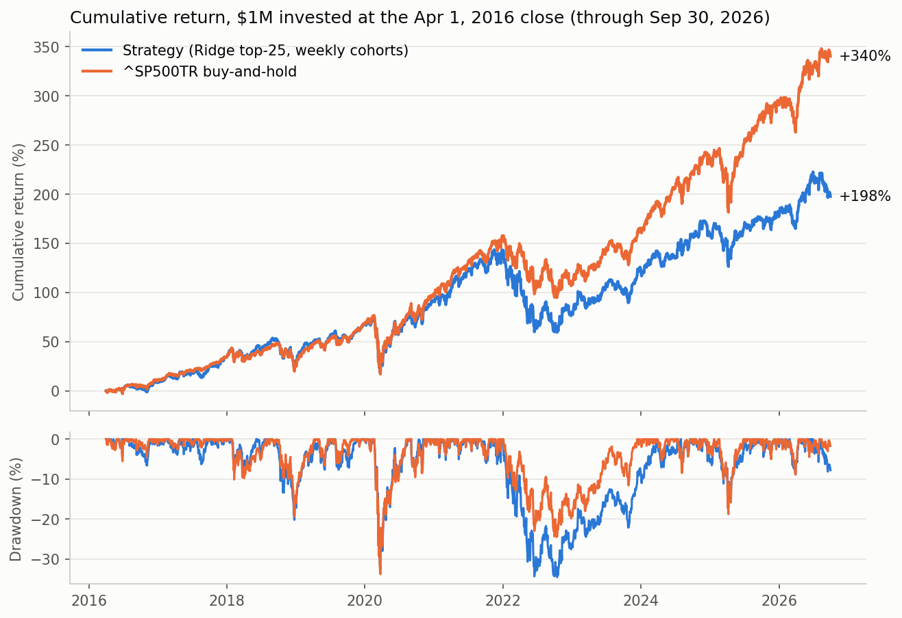

# HW4: Stock-return model, trading strategy and backtester (Nirmit Ghughu)

**Result: the strategy did not beat the benchmark.** From the Apr 1, 2016 close to Sep 30, 2026, $1M grew to **$2.98M** (CAGR 10.9%). The same $1M in `^SP500TR` grew to **$4.40M** (CAGR 15.2%), so the strategy fell short by **4.2 percentage points per year** and **$1.43M** in final value.

| Final test, Apr 1 2016 – Sep 30 2026 | Strategy | ^SP500TR | Difference |
|---|---:|---:|---:|
| Final value (cash + open positions) | $2,976,783 | $4,402,747 | −$1,425,963 |
| CAGR | 10.95% | 15.17% | −4.21 pp |
| Maximum drawdown | −34.6% | −33.8% | −0.8 pp |
| Sharpe (daily, 2% rf) | 0.54 | 0.77 | −0.23 |
| Annualized volatility | 18.7% | 17.8% | +0.9 pp |
| Beta to ^SP500TR | 0.96 | 1 | |



The chosen model did have some out-of-sample skill: weekly rank IC was +0.024 and the top decile beat the average by +0.6% per 90 days. Within its own universe it outperformed: the same rules with **random** picks earned 9.2% CAGR, against 10.9% for the model. The universe itself is what lost: an equal-weight book of mid- and small-cap US stocks fell well behind a cap-weighted index dominated by a few mega-caps, mainly in 2022 and 2024–26 (see [Findings](#findings)).

## How to run

```bash
uv sync --locked                         # from the repo root; uses the course .venv
# put equities_top2000.duckdb (bCourses) in Lectures/modeling/data/
cd Homeworks/HW4/Nirmit_Ghughu
python test_backtester.py                # hand-checked accounting tests (~1 s)
python run_development.py                # model/strategy selection on 2010-2015 (~1 min)
python run_final.py                      # frozen strategy on the final test (~1 min)
```

On an 8 GB MacBook the full database runs in about a minute per script. The `results/` folder holds small CSVs and the chart. Full ledgers (every fill, daily NAV, all predictions) go to `outputs/`, which Git ignores.

| File | Purpose |
|---|---|
| [data.py](data.py) | Load DuckDB into wide date × symbol price matrices; features; labels; membership; fundamentals |
| [model.py](model.py) | Per-date rank preprocessing, Ridge/HGB models, walk-forward quarterly refits, IC metrics |
| [backtester.py](backtester.py) | `Account` (cash, lots, fills), `TopNStrategy`, `Backtester` daily loop, `performance` |
| [test_backtester.py](test_backtester.py) | Accounting/timing tests with hand-computed answers |
| [run_development.py](run_development.py) | Development experiment; writes `results/dev_*.csv` |
| [run_final.py](run_final.py) | Final test, audits, sensitivity runs, chart |

## 1. Data and timing

- **Universe:** quarterly `universe_membership`, keyed on the quarter of the *entry* session. Stocks that later went inactive are included. A stock that leaves the list is never force-sold; it just stops being bought.
- **Signal timing:** signals are computed after the close of the **last session of each week**. The fill is the **next session's close**, and the label uses that same entry and the first quoted close on or after **entry + 90 calendar days** (at most 5 sessions late).
- **Prices** are reindexed to the market calendar without filling gaps. Following the data guide, 27 off-calendar rows were quarantined; the 275 zero-price BHRB rows are from before my 2008 load start.
- **Fundamentals** are used only from **filing date + 1 day**. Late filings for old fiscal periods are ignored, and ratios go blank once the fiscal period is more than 550 days old.
- **Data windows:** development code reads the database with `end='2015-12-31'`, so it cannot see later data. Price history before 2010 is used only for lookbacks; training rows start in 2010.

## 2. Features

All features are computed at the signal close.

| Group | Features |
|---|---|
| Price | 5/21/63/126-session returns, 12-1 momentum, 63-day volatility, max daily return in 21 days, 252-day drawdown, 252-day beta to ^SP500TR, log 63-day average dollar volume |
| Fundamentals | gross profit/assets, operating income/assets, net margin, debt/assets, cash/assets, FCF/assets, accruals/assets, YoY asset growth, earnings yield and book-to-market (using the quarter's selection-date capitalization proxy), days since filing |
| Other | log capitalization proxy; sector (snapshot label, used as a category) |

**Preprocessing:** every numeric feature is replaced by its **percentile rank within the same date**. This needs no fitted state, so it can't leak. It also tames the raw data's bad ticks: some stocks have 5-day "returns" of +130,000%.

**Tradable screen** (uses information up to the signal close only):
- quoted on the signal date, with 63 complete daily returns;
- price ≥ $5 and average daily dollar volume ≥ $5M;
- no one-day move above 75% in the last 63 sessions (a likely data error or corporate action).

## 3. Model and validation

- **Target:** the 90-day holding return. I compared training on the raw return (winsorized at the training sample's 1%/99%) against its **within-date percentile rank**. The strategy only needs to rank stocks on each date, and the rank target removes market-wide moves that no cross-sectional model can predict.
- **Walk-forward validation:** inside development, I refit quarterly from 2012-Q1 to 2015-Q4 on an expanding window that starts in 2010. Each fit uses only rows whose outcome had **finished before the fit date** (`label_end < fit_date`, checked with an assert at every fit), which builds in about a 90-day purge. To limit label overlap, training uses every other week.
- **Out-of-sample checks:** predictions were scored by weekly rank IC, and also by running the full backtester over 2012–2015.

| Candidate (dev 2012–15, out of sample) | Rank IC | Backtest CAGR (N=25) | Sharpe | Max DD |
|---|---:|---:|---:|---:|
| **Ridge, all features, rank target (chosen)** | 0.010 | **18.3%** | **1.13** | −14.0% |
| Ridge, all features, raw target | 0.004 | 17.3% | 0.99 | −16.2% |
| Ridge, "core" slow features, rank target | 0.000 | 18.2% | 1.10 | −15.3% |
| Gradient boosting (HGB), rank target | 0.010 | 11.1% | 0.65 | −17.2% |
| HGB, raw target | 0.004 | 11.4% | 0.57 | −21.7% |
| HGB, core features | −0.008 | 10.6% | 0.59 | −18.5% |
| 12-1 momentum, no model | 0.037 | 18.8% | 0.70 | −29.5% |
| Blend: ridge-core + momentum | 0.024 | 13.4% | 0.73 | −19.4% |
| ^SP500TR | | 14.9% | 1.00 | |

Full tables, including N = 10/25/50: [dev_prediction_metrics.csv](results/dev_prediction_metrics.csv) and [dev_backtests.csv](results/dev_backtests.csv).

**Choice rule** (applied before the final test): take the highest development Sharpe among candidates that also beat the benchmark's CAGR, and prefer more names when results are close. N=10 had a Sharpe of 1.14 against 1.13 for N=25, a gap within noise, so I took N=25 for diversification. **Chosen: Ridge (α=1000) on rank features with a rank target, top 25, refit quarterly.**

**Why Ridge:** with a signal-to-noise ratio this low (IC around 0.01–0.04), a heavily shrunk linear model is more robust than a flexible one. Gradient boosting overfit the noisy targets in every variant I tried.

## 4. Strategy and backtester

My own code, in [backtester.py](backtester.py).

- **Entries:** each weekly signal, buy the top 25 tradable names by predicted score at the next close. The week's budget is `min(cash, NAV/12)`, split equally across the names and inclusive of fees. With 90-day holds about 13 weekly cohorts overlap, so this keeps the book nearly fully invested (cash averaged 7.8% of NAV) while staggering maturities.
- **Limits:** one name ≤ 5% of NAV and one sector ≤ 30% of NAV, checked against existing holdings plus planned buys. The month-end maxima were 4.6% and 30.4%; the cap applies at purchase, so price drift can push slightly past it.
- **Exits:** each purchase is a separate lot, sold at the first close on or after its 90-calendar-day maturity when the stock has a quote. Without a quote, the lot waits.
- **Costs and units:** 10 bps per side, no interest on cash, long only, no leverage. Positions are held in **adjusted-price units**, so dividends are inside the return and never added again.
- **Daily order of operations:** plan using the *previous* close's cash and holdings, then sell matured lots, then buy, then mark to market. Sales only add cash, so budgets set at the previous close can't overspend. A buy with no quote on the fill day is cancelled. **No fill is ever invented.**

## 5. Evidence that accounting and timing are right

**Hand-computed tests** ([test_backtester.py](test_backtester.py), all passing):
- a $10,000 round trip with fees worked out by hand;
- maturities that fall on a weekend or on a missing quote;
- a cancelled buy;
- an attempt to spend the same cash twice;
- a full-ledger reconciliation (initial cash + Σ cash changes = final cash; NAV = cash + units × close; PnL = realized + unrealized);
- metric formulas.

**Checks on the final run** ([accounting_checks.csv](results/accounting_checks.csv)):

| Check | Result |
|---|---|
| Ledger, NAV identity, PnL = realized + unrealized | all True |
| Cash never negative | True |
| Every buy decided at the previous session, filled at that day's adjusted close | True |
| Every sale at the first quoted close on/after entry + 90 days | True (holding period 90–92 days) |
| Fills | 13,650 buys / 13,250 sells / 400 open lots at Sep 30, 2026, valued at that day's close |
| Fees paid | $137,673 |

**Look-ahead audit** ([timing_audit.csv](results/timing_audit.csv)): I rebuilt the panel from a database cut off at 2015-12-31 and again at 2020-06-30. On every shared row, all features and the tradable flag match the full-data panel **exactly** (max difference 0.0, identical missing pattern). The only extra rows are the cut date itself, which can't be a signal in the shortened file because it has no next session. Separately, every one of the 42 test fits satisfies `max(label_end) < fit_date` ([model_fits.csv](results/model_fits.csv)).

## 6. Data gaps that affect the result

**Stocks whose quotes stop (75 open lots, 20 symbols, $448k at the end).**
- Most are takeovers or renames: Splunk, Squarespace, Nordstrom, Beacon Roofing, Six Flags, Realogy.
- The database has no delisting-proceeds table, so these lots are never sold. They stay marked at their last price and the capital can't be reused.
- Sensitivities: settling them at the last close moves CAGR from 10.9% to **11.2%**; writing them to $0 moves it to **9.2%**.

**Splits the vendor didn't adjust.** Some "adjusted" prices drop by about 1/k in one day and stay there: KLAC −89% on 2026-06-08 (10:1), PIPR −75% (4:1), FAST, APH, and others ([held_price_jumps.csv](results/held_price_jumps.csv)).
- Lots held across these events lost about $79k in total, most of it from the missing adjustment.
- As the data guide asks, I did **not** silently correct prices. Removing those lots' PnL (an approximation) moves CAGR from 10.9% to **11.2%**.

**Sensitivities** ([sensitivity.csv](results/sensitivity.csv)). None of these changes the conclusion:

| Variant | Final value | CAGR | Max DD | Sharpe |
|---|---:|---:|---:|---:|
| Chosen strategy (10 bps) | $2.98M | 10.9% | −34.6% | 0.54 |
| Fees 0 / 25 bps | $3.20M / $2.65M | 11.7% / 9.7% | | 0.58 / 0.48 |
| Stuck lots settled at last close | $3.06M | 11.2% | −36.5% | 0.54 |
| Stuck lots written to $0 | $2.53M | 9.2% | | 0.45 |
| Split-hit lots' PnL removed (approx.) | $3.06M | 11.2% | | 0.56 |
| Random 25 names, same rules (mean of 5 seeds) | $2.53M | 9.2% | −39.0% | 0.46 |
| 12-1 momentum, same rules (not chosen) | $6.44M | 19.4% | −46.2% | 0.65 |
| ^SP500TR | $4.40M | 15.2% | −33.8% | 0.77 |

## Findings

1. **The model added about 1.7%/yr over random picks from the same universe, but the universe lost about 6%/yr to the S&P 500.** The strategy holds about 300–400 roughly equal-weight lots across mid- and small-caps, while ^SP500TR is cap-weighted and its 2023–26 gains came mostly from a few mega-caps. The strategy kept pace through 2021, lost 8 pp in 2022, and then lost about 10 pp a year in 2024 and 2025 ([yearly_returns.csv](results/yearly_returns.csv)). The development period (2012–15) didn't show this size gap, which is why the development backtest looked good (18.3% vs 14.9%).
2. **Risk taken:** beta was about 0.96, with slightly higher volatility than the index. Max drawdown matched the benchmark's in the 2020 crash but was larger in 2022 (−34.6% vs −24% for the index that year), because unprofitable, higher-volatility mid-caps fell hardest.
3. **Prediction skill is real but unstable:** rank IC was positive in 7 of 11 test years (mean 0.024), but negative in 2016, 2020 and 2025 (and about zero in 2022), consistent with factor-regime shifts.
4. **Unsuccessful ideas:**
   - Gradient boosting did worse than Ridge in every variant.
   - Dropping the short-horizon momentum features ("core") didn't help.
   - Blending the model with momentum hurt in development.
5. **Momentum:** the momentum-only baseline beat the index in the test (19.4% CAGR) but with a −46% drawdown and lower Sharpe. I report it only as a comparison: switching to it after seeing test results would be selection on the test set.

## Limitations

- Survivorship and corporate actions: some issues remain (see section 6). Membership is a recorded-date reconstruction, not a certified point-in-time feed.
- Financial data is the latest vendor version of each record, not the version available at the time, so restatements can leak in slightly.
- Sectors are current snapshot labels.
- Costs are a flat 10 bps. There is no market-impact or liquidity model beyond the $5M dollar-volume screen, and cash earns no interest. Interest on the ~8% average cash would have added roughly 0.1–0.2%/yr.
- Equal weighting makes the result sensitive to the size factor. No size or sector neutrality is imposed relative to the benchmark.

## What I would try next

- Make the portfolio **benchmark-aware**: constrain size and sector exposure relative to the S&P 500, or weight by capitalization proxy, so that what's left is stock selection rather than a size bet.
- Restrict to the top ~500 names by the capitalization proxy, which is closer to the benchmark.
- Clean up corporate actions properly (verified split factors, delisting returns) instead of only flagging them.
- Use rolling instead of expanding training windows, and pick the IC horizon and refit frequency inside development.

## Reused code and AI assistance

- **Lecture code:** data-handling ideas are adapted from `Lectures/modeling/course_data.py`: next-session entry and the 90-day label, membership joined on the entry quarter, filing date + 1 availability, and the "latest fiscal period wins" rule. I rewrote them in vectorized, wide-matrix form. The separation of strategy, account and loop, fee-inclusive budgets and adjusted-price units follow the Lecture 8 design in `Lectures/modeling/backtest.py`; the backtester code itself is new.
- **AI assistance:** this submission was developed with an AI coding assistant (Claude Code). At my request it wrote the code, ran the experiments and drafted this README; I reviewed the work before submitting.
