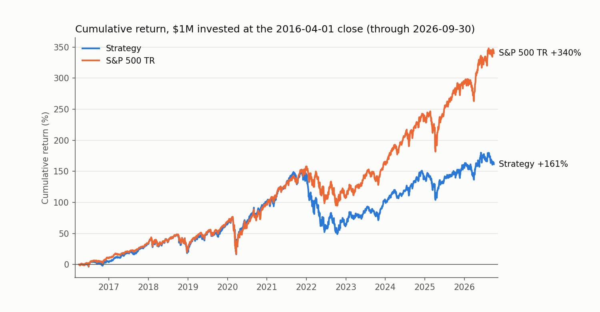

# HW4 — Stock prediction and trading strategy (Oscar Sallusti)

**Result: the strategy did not beat the S&P 500 total-return index.** $1,000,000
grew to **$2.61M (9.6% CAGR)** versus **$4.40M (15.2% CAGR)** for `^SP500TR`
between the 2016-04-01 and 2026-09-30 closes, a shortfall of 5.6 percentage
points a year. A no-model equal-weight portfolio of the same 500 largest stocks
earned almost exactly the same as the strategy (9.5%), so the gap comes mostly
from equal-weighting large caps in a decade dominated by the very largest
companies; the model's stock selection added roughly nothing.



| 2016-04-01 → 2026-09-30 | Strategy | S&P 500 TR |
|---|---:|---:|
| Final value (cash + open positions) | **$2,614,280** | **$4,402,747** |
| CAGR | 9.58% | 15.16% |
| Maximum drawdown | −41.1% | −33.8% |
| Sharpe (daily, 2% risk-free) | 0.48 | 0.77 |
| Volatility (annualised) | 18.6% | 17.8% |
| Final value if stuck positions are worth $0 (see §6) | $2,318,599 | — |

Calendar-year returns (`results/yearly_returns.csv`; 2016 and 2026 are partial):

| | 2016 | 2017 | 2018 | 2019 | 2020 | 2021 | 2022 | 2023 | 2024 | 2025 | 2026 |
|---|---|---|---|---|---|---|---|---|---|---|---|
| Strategy | 3.5% | 28.2% | −6.5% | 32.6% | 23.0% | 20.8% | −32.8% | 24.4% | 16.1% | 7.6% | 2.4% |
| S&P 500 TR | 9.8% | 21.8% | −4.4% | 31.5% | 18.4% | 28.7% | −18.1% | 26.3% | 25.0% | 17.9% | 12.7% |
| Excess | −6.2 | +6.3 | −2.1 | +1.2 | +4.6 | −7.9 | −14.7 | −1.9 | −8.9 | −10.3 | −10.3 |

## How to run

From the repository root, with both databases in `Lectures/modeling/data/`:

```bash
uv sync --locked
uv run --with pytest pytest Homeworks/HW4/Oscar_Sallusti/tests -q   # 16 tests, ~2 s
.venv/bin/python Homeworks/HW4/Oscar_Sallusti/develop.py            # development study, ~1 min
.venv/bin/python Homeworks/HW4/Oscar_Sallusti/final_test.py         # final test, ~1 min, ~3 GB RAM
.venv/bin/python Homeworks/HW4/Oscar_Sallusti/diagnostics.py        # post-test equal-weight check
```

`develop.py` loads data only through 2016-03-31. `final_test.py` writes the small
result files in `results/` (committed) and the full trade log and daily history
to `outputs/` (ignored by Git, like the databases).

| File | What it does |
|---|---|
| `backtester.py` | My backtester: lots, cash, fills, daily NAV, data-gap policy, metrics, independent accounting check |
| `features.py` | Point-in-time features, eligibility screens, 90-day labels |
| `model.py` | Ridge / gradient boosting, walk-forward fitting, prediction diagnostics |
| `strategy.py` | Top-score tranche strategy with concentration limits |
| `config.py` | The settings locked before the final test |
| `develop.py`, `final_test.py`, `diagnostics.py` | The three experiments |
| `tests/` | Hand-checked accounting tests and look-ahead tests |

## 1. Data and universe

- Candidates on signal date *t* are members of `universe_membership` for the
  quarter of the **entry** session *t+1* (as in the data guide), and among
  those, the **500 largest by that quarter's capitalisation rank**. Stocks that
  leave the universe are never force-sold; they mature normally.
- Eligibility screens, all known at *t*'s close and applied to training and
  trading alike: a usable quote at *t*, 63 trailing daily returns, ≥ $1M
  trailing 63-day average dollar volume, and no daily move above +300% or
  below −75% in the trailing year.
- **Quote quarantine.** I drop non-positive adjusted prices and off-calendar
  rows (the data guide's policy) and also **zero-volume rows**. Without this the
  2012 average 90-day return across the universe came out at +253%: e.g. `AAM`
  alternates real ~$24,000 closes with $0.19 zero-volume prints, and `TIC`
  mixes ~$8,000 closes with $0.96 prints. A day with no volume has no trade, so
  it is treated as a missing quote, never as a fill.
- I do not drop stocks because they later disappear; inactive names stay in.

## 2. Features and target

One row per (weekly signal date, eligible stock): every 5th market session, on a
grid containing 2016-03-31 so the first test fill is at the first test close.

- **Price/volume (12):** 1-month return (reversal), 3-month return, 6-1 and
  12-1 month momentum, 63- and 252-day volatility, max daily return over 21 days,
  distance from the 252-day high, 252-day beta and idiosyncratic volatility
  versus `^SP500TR`, log dollar volume, log Amihud illiquidity.
- **Fundamentals (14):** log market cap, earnings yield, book-to-market,
  sales-to-price, cash-flow-to-price, gross profit / assets, ROE, YoY asset
  growth, YoY sales growth, YoY earnings change / price, accruals / assets,
  debt / assets, YoY share issuance, filing age. TTM sums need four consecutive
  quarters. A quarterly report is used from **filing date + 1 day**; invalid
  filing lags are excluded; a late filing of an old period never replaces a newer
  one; values older than 550 days from fiscal end are blanked; earlier quarters
  used in YoY comparisons must also have been public by then.
  Market cap = split-adjusted close × reported shares (same split basis, but see
  the data guide's caveats).
- Plus the (snapshot) **sector**.
- Every feature is converted to its **percentile rank among that date's
  eligible stocks**. That makes features comparable across years and needs no
  learned scaling.
- **Target:** the percentile rank, within the date, of the return from the
  **close of t+1** (entry) to the first quote on/after entry + 90 calendar days
  (at most 5 sessions late, else missing). This is exactly the trade the
  backtester makes.

## 3. Model and validation

- **Models compared:** Ridge regression (α = 10) and scikit-learn's
  `HistGradientBoostingRegressor` (two regularised settings), plus two no-fit
  baselines: 12-1 momentum and "largest market cap first".
- **Why Ridge won:** in development the trees were worse than Ridge in almost
  every configuration. With a weak, noisy signal, the simpler linear model
  overfits less.
- **Validation:** expanding-window walk-forward inside development. I fit at the
  first signal of 2012, 2013, 2014 and 2015 and predict that year. Each fit uses
  rows from 2010 onward **whose 90-day exit close is before the fit date**, so
  roughly the last 90 days before each fit are purged. No data after 2016-03-31
  is loaded.
- **Test-period retraining (chosen in development):** refit once a year on the
  first signal date on or after March 31, expanding window, same purge rule
  (`results/refits.csv`: 11 fits, 0.47M → 1.42M training rows).

Development prediction quality (mean same-date Spearman rank IC; all eligible stocks / top 500):

| Model | 2012 | 2013 | 2014 | 2015 | All, top 500 |
|---|---|---|---|---|---|
| Momentum 12-1 | 0.069 | 0.038 | −0.023 | 0.065 | 0.056 |
| Ridge | 0.070 | −0.044 | 0.030 | 0.070 | 0.029 |
| Gradient boosting | 0.055 | −0.059 | 0.003 | 0.049 | −0.008 |

## 4. Trading strategy

- On each weekly signal date, buy the 50 highest-scoring candidates, equal
  dollar budget each, filled at the next session's close.
- **Ramp-in:** 1/3 of capital on the first date, up to 2/3 after 4 signals,
  then everything. Because each lot is held 90 days this gives three staggered
  tranches, and maturing cash is reinvested at the next weekly signal.
- **Limits:** at most 30% of a date's names from one sector; no stock above 5%
  of NAV across its open lots; skip a date if investable cash is below 1% of
  NAV.
- **Assumptions:** 10 bp cost per side (commission + spread, included in each
  purchase budget). Idle cash earns 0% (average cash weight 5.1%). Adjusted
  closes and fractional units are used throughout, so dividends are already
  inside returns and are not added again.

**Strategy selection (development, 2012-01 to 2015-12, `results/dev_strategy_grid.csv`).**
I tried 5 models × {20, 50 names} × {top-500, top-1000, liquid ≥$10M} universes = 30 backtests.

| Development 2012–2015 | CAGR | Sharpe | Max DD | Excess per year (2012–2015, pts) |
|---|---|---|---|---|
| S&P 500 TR | 14.9% | 1.00 | −12.0% | — |
| **Ridge, 50 names, top 500 (chosen)** | 15.4% | 1.04 | −12.6% | +1.4, 0.0, −0.2, +0.6 |
| Ridge, 20 names, top 500 | 15.6% | 1.01 | −13.7% | +0.8, +0.8, −0.1, +1.0 |
| Largest 50, no model | 15.4% | 1.07 | −11.8% | −4.1, +3.1, −1.1, +4.0 |
| Best gradient boosting | 13.8% | 0.87 | −14.3% | +0.7, −0.2, −0.2, −4.4 |
| Momentum, 20 names, top 1000 | 32.7% | 0.86 | −23.3% | +2.2, +114, +1.7, −8.1 |

Selection rule: the highest development Sharpe among settings that never trailed
the index by more than 1 point in a calendar year. I wrote the rule **after**
seeing the grid, so it is a judgment call, but it used only development data.
The momentum result rests on one 2013 rally in small, volatile names, so I
treated it as luck rather than skill. The settings were then frozen in
`config.py` and the final test was run once.

## 5. Accounting and timing checks

**Hand-checked unit tests** (`tests/test_backtester.py`):
- A $1,000 buy at $10, sold at $11 with 10 bp fees, returns exactly
  1000 × 1.1 × 0.999 / 1.001 = **$1,097.80**, and daily NAV is checked day by day.
- A lot due on a Saturday sells Monday. 2016-04-01 + 90 days sells on 2016-06-30.
- A missing fill-day quote cancels the order and cash is unchanged.
- Orders larger than cash are rejected. Cash from a sale is reusable the next day.
- A quote gap on the due date sells at the next quote. A stock that stops
  trading stays open at its last mark (no invented sale).
- Open positions are valued on the last day. CAGR, drawdown and Sharpe are
  checked against hand calculations.

**Look-ahead tests** (`tests/test_features.py`, class database):
- Rebuilding the panel with data cut off at 2013-06-28 gives identical features
  for every earlier row.
- 40 sampled labels match raw database prices.
- A 2010-03-31 signal uses the Q2 universe.
- 60 sampled rows use the newest report public by filing date + 1.
- Training rows always have completed outcomes.

**Final run** (`results/accounting_checks.csv`), using an independent rebuild of
cash and holdings from the 12,130 fills:

| Check | Result |
|---|---|
| Max cash error | $2×10⁻⁸ (rounding) |
| Max holdings-value error | $4×10⁻⁹ |
| Minimum cash | $0.00 (never negative) |
| Buys not filled on the session after their signal | 0 |
| Sales before the 90-day due date | 0 |
| Cancelled orders (no quote at fill) | 0 |
| Total fees | $140,849 |
| Sales on the first session on/after the 90-day due date | 5,980 of 5,980 (held 90–92 calendar days) |
| First fill / last price used | 2016-04-01 close / 2026-09-30 close (nothing later is loaded) |
| Maximum holdings ÷ NAV (no leverage) | 1.00 |

Timing of training targets: every fit uses only rows whose exit close is before
the fit date, and the within-date target rank is recomputed on those rows
alone, so no target depends on an outcome that is still in the future. I also
checked that no training row at any of the 11 test refits had a same-date peer
whose exit came later. Making the rule explicit left every development and test
number unchanged.

Benchmark alignment: both portfolios hold $1,000,000 in cash at the 2016-03-31
close and invest at the 2016-04-01 close. Measuring the benchmark from
2016-04-01 instead gives the same final value and a CAGR of 15.17% instead of
15.16%.

`results/hand_checked_lots.csv` re-derives five random lots straight from the
database (entry price, units from the budget, due date, exit date, exit price,
cash returned). All match to the cent; e.g. AMZN bought 2016-05-27 at $35.61
with a $6,647.45 budget → 186.4871 units, due 2016-08-25, sold that day at
$37.96 for $7,071.97 after fees.

## 6. Data gaps that limit the result

- **Acquired / renamed stocks.** Twelve holdings stopped trading while held:
  Maxim, Linear Technology, Splunk, Cerner, Kellanova, Hologic, EA, Exact
  Sciences, NiSource, Paramount (VIACP), plus Anthem → Elevance (ANTM) and
  FleetCor → Corpay (FLT). The database has no merger proceeds or ticker
  mapping, so I do **not** invent an exit. Those lots stay open at their last
  price and their cash is never recycled. By the end this is **$296k (9% of
  NAV)**. In reality most of these were cash take-overs near the last price, so
  the true value is probably close to my mark. But that capital would have been
  reinvested, so the dead money is a modest drag on my result. Counting it at
  $0 gives $2.32M.
- The ranking prefers low-volatility stocks with steady recent gains, which is
  what an announced takeover target looks like. Several of the lots above were
  bought after a deal was public, which a real strategy should screen out.
- **Implausible capitalisation ranks (audit).** For every purchase I compared
  the quarter's capitalisation proxy with the stock's trailing dollar volume.
  Three names traded less than 2% of their "market cap" a year, which points to
  a wrong proxy: `AVGOP` (a Broadcom preferred share ranked #1 at a $3.9
  trillion proxy, apparently using the common share count), `HYZN` (Hyzon
  Motors at $107B) and `NIMC` (a NiSource preferred share at $46B). They entered
  the top-500 candidate list only because of the bad proxy, and received
  $97.5k of purchases in total (0.14% of the $70.9M bought over ten years). Excluding them would
  barely change the result. A point-in-time turnover screen would catch them.
- The rest of the data guide's caveats apply: capitalisation ranks are
  approximate, sectors are today's labels, financials are latest vendor values
  (restatements), and delisted coverage is incomplete. These are not
  survivorship-free returns.

## 7. Why it lost, risks, and limitations

- **Equal weight vs cap weight.** The equal-weight top-500 diagnostic
  (`diagnostics.py`, run after the test and not used for any decision) earned
  9.5% CAGR, ending at $2.59M. The S&P 500 is cap-weighted, and from 2021 on
  the largest few companies drove most of its return, which an equal-weight
  portfolio of 50 names out of 500 largely misses. My strategy finished $24k
  ahead of that diagnostic: the model added about 0.1 point a year.
- **The signal was weak.** The test-period rank IC averaged 0.03, positive in
  7 of 11 years. The model's top 30 names beat the average top-500 stock by
  about 0.9% per 90 days before costs, but that did not survive the sector
  limits, turnover and timing at the portfolio level.
- **2022 was the worst year** (−32.8% vs −18.1%). 54% of that year's
  purchases were Technology (30%, at the sector cap) and Consumer Cyclical (24%),
  the sectors hit hardest by the 2022 rate-driven selloff. The 30% sector cap
  did not stop a large growth tilt.
- **Risks taken:** higher drawdown than the index (−41% vs −34%), sector and
  factor tilts away from mega-caps, and concentration (50 names per purchase
  date; on average 81 stocks held across 149 open lots).
- **Limitations:** only 2010–2015 for training and validation (four
  validation years, one regime); a strategy rule chosen from a 30-setting grid
  (some selection bias); costs are a flat 10 bp; cash earns nothing.

## 8. Unsuccessful ideas and what I would try next

- *Tried and dropped:* gradient-boosted trees (two settings): worse than
  Ridge. Momentum alone: unstable and driven by tiny stocks. Liquidity-only
  universes: higher volatility, no better.
- **Weight positions by market cap, or rank within cap-weighted sectors**, so
  the portfolio is an index tilt rather than an equal-weight bet. This is the
  main source of the shortfall.
- Train on 2000–2009 as well (the brief says earlier data is for lookbacks, so
  I trained on 2010+ only). More regimes should help the model.
- Predict excess return over the benchmark, and evaluate on value-weighted
  top-decile returns, which is closer to what beats the S&P 500.
- Screen out announced takeover targets (a sharp drop in volatility after a
  jump) and map renamed tickers, so cash is not trapped.
- Earn a T-bill rate on idle cash.

## Code reuse and AI assistance

- **Reused or adapted:** from `Lectures/modeling/course_data.py`, the data
  guide's quarantine rules, filing-date availability rule, the "late old filing
  does not replace newer period" rule, the 550-day stale blanking, and the
  next-session-entry / first-quote-after-90-days label convention. These are
  cited in the code. The backtester is my own; it follows the lecture's
  conventions (adjusted-price units, fee inside the budget, next-close fills)
  but no code from `backtest.py`.
- **AI assistance:** this submission was drafted with Claude Code (Anthropic).
  It proposed the approach and wrote the code, tests and this README. I asked
  for a full first draft, approved the plan, approved locking the configuration
  in `config.py` before the final test, and reviewed the code and results.
