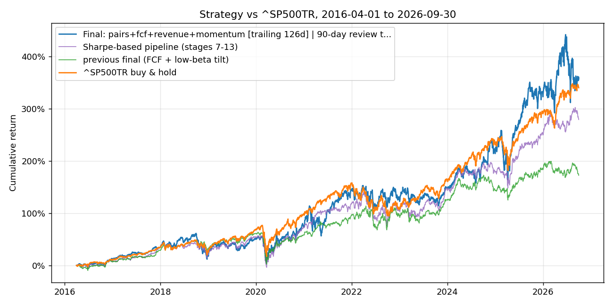
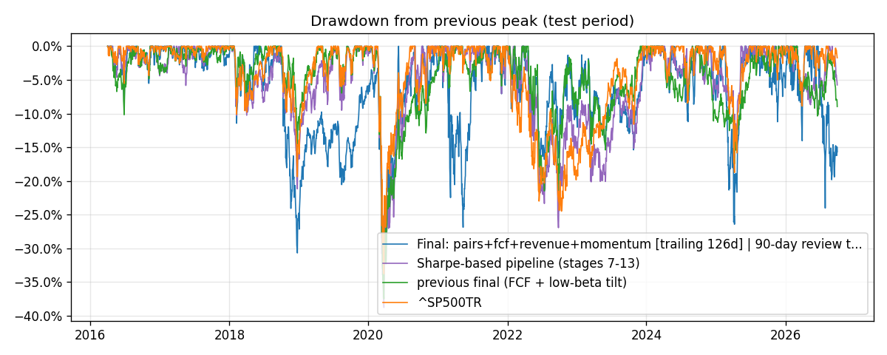
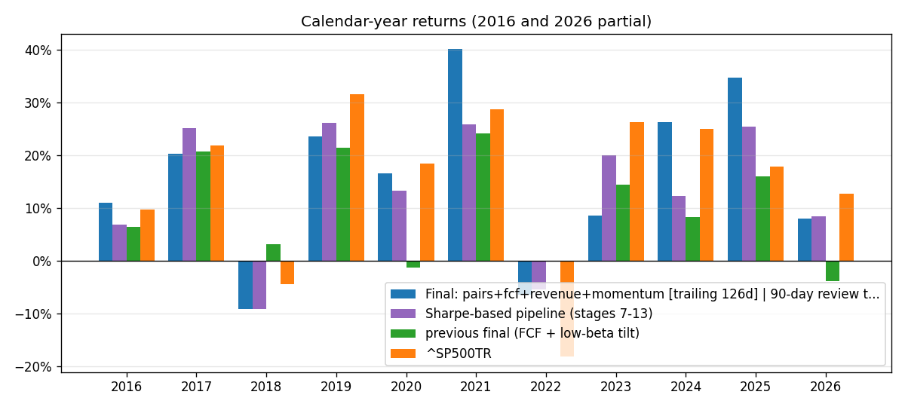
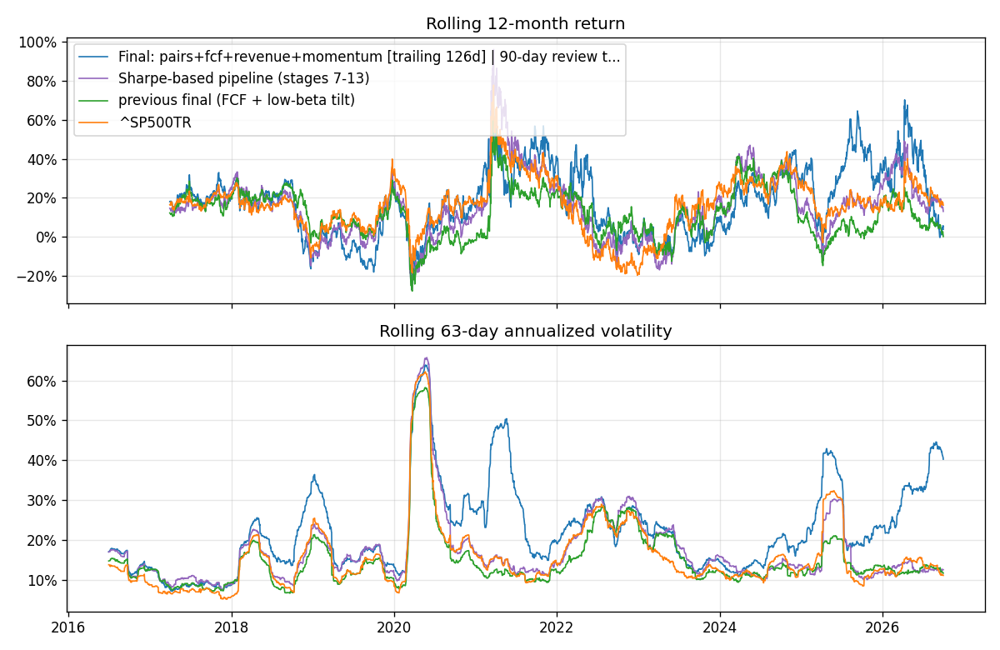
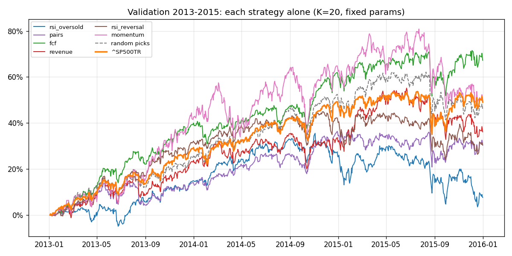
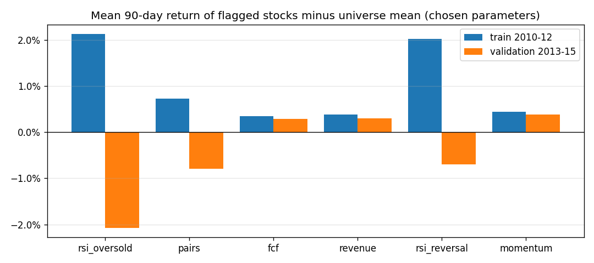
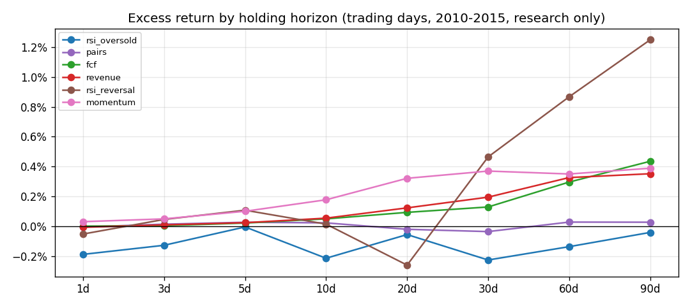
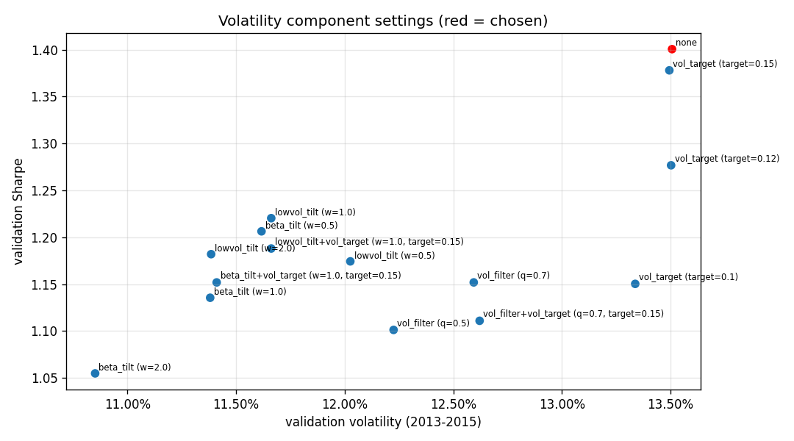
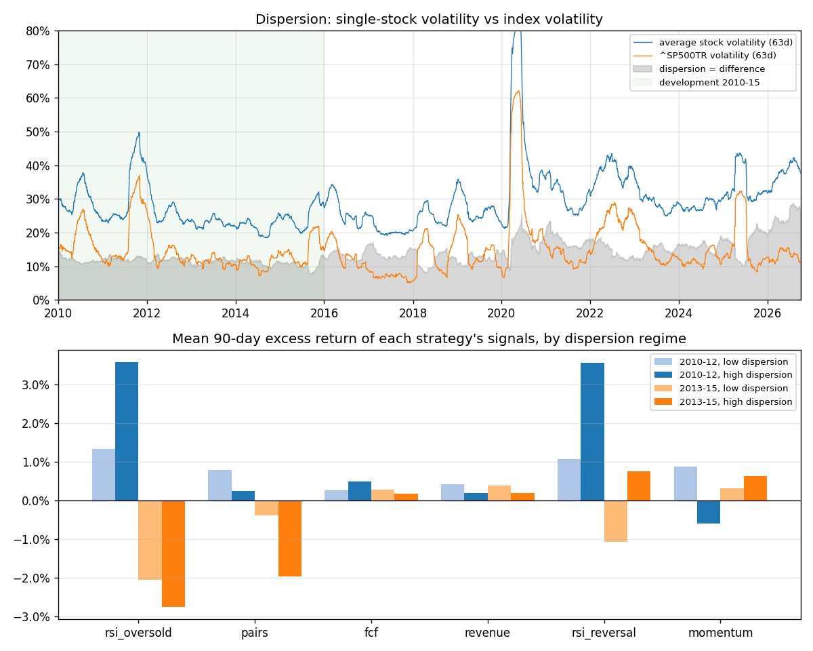

# HW4 – development history and full research log

This is the detailed record behind [README.md](README.md): every strategy, parameter grid, overlay and test run, with the reasons each was kept or dropped.

The system screens a large-cap universe with five strategy signals from my own trading-system design, plus 12-1 momentum and sector revenue leaders. It tunes them on 2010–2015 and builds the portfolio with a long-only backtester that holds every purchase 90 days. A final, return-based search tries **every combination** of the seven signals under six weighting schemes, including dynamic "strategy momentum" weights. It also tries the overlays: sector regime, mega-cap leadership, growth overweight and a 90-day sell-or-buy-back review. Everything is compared with `^SP500TR`.

## Results at a glance (test period 2016-04-01 → 2026-09-30, $1M start)

| | **Final strategy** (pairs + FCF + revenue + momentum, strategy-momentum weights, 90-day review) | Sharpe-based pipeline (stages 7–13) | Previous final (FCF + low-beta tilt) | ^SP500TR |
|---|---:|---:|---:|---:|
| Final value (cash + open positions) | **$4,569,188** | $3,792,819 | $2,724,689 | $4,402,747 |
| CAGR | **15.57%** | 13.54% | 10.02% | 15.16% |
| Volatility (annualized) | 24.8% | 19.2% | 16.8% | 17.8% |
| Max drawdown | −34.6% | −38.8% | −37.5% | −33.8% |
| Sharpe (daily, 2% rf) | 0.63 | 0.66 | 0.54 | 0.77 |
| Sortino | 0.88 | 0.92 | 0.73 | 1.09 |

All numbers use the **repaired prices** (see section 7: unadjusted stock splits found in the data).

**The final strategy beat the benchmark: +$166k, +0.41%/yr.**
- **Risk:** it carried much more risk than the index: 24.8% versus 17.8% volatility. Its Sharpe ratio (0.63) is lower than the index's (0.77), so it did **not** beat the index on a risk-adjusted basis.
- **Why not risk-adjusted:** you asked for selection on return, not volatility, and that is the trade-off.
- **Margin:** the lead is small. Writing off five stuck positions ($123k, section 6) leaves $4.45M, still ahead by $43k.
- **Concentration:** returns are concentrated. The top 20 of 1,627 trades made 70% of the profit (APP, BE, VST, INTC, LITE, GEV…).

**How it was chosen:**
- **Search:** 727 signal combinations, then 1,620 overlay combinations on the best 10.
- **Rule, fixed before the run:** the score is the *worse* of the 2010–12 and the 2013–15 excess return over the index.
- **Development result:** the winner beat the index by +8.8%/yr in 2010–12 and +10.6%/yr in 2013–15.
- **Expected shrinkage:** that dropped to +0.4%/yr in 2016–26. Some of the drop is the normal cost of picking the best of ~2,350 tries.

**Dynamic weighting (your 2021 example):** weights shift each day toward whichever signal earned the most over the last 126 sessions of finished trades.
- **Momentum's share:** 0.46 in 2021 and 0.61–0.76 in 2024–26, when mega-cap momentum led. Pairs and FCF got more weight in 2016, 2019 and 2022.
- **Mega-cap tilt:** a separate tilt that leans into the largest names when they lead was tested too. It didn't make the winner on development data (it lowered the score by 0.6 points on average).

The earlier studies of the regime overlay, volatility component, growth rotation, growth overweight and dispersion are kept in section 4. The test curves for the not-adopted variants are in `outputs/test_curves.csv`.



| Drawdowns | Calendar-year returns |
|---|---|
|  |  |
| **Rolling 12-month return and volatility** | **Validation 2013–15: each strategy alone** |
|  |  |
| **Event study: train vs validation** | **Excess return by holding horizon** |
|  |  |
| **Volatility-component settings (validation)** | **Dispersion and each strategy by dispersion regime** |
|  |  |

---

## 1. How to run

**Setup**, once, from the repository root:

```bash
uv sync --locked
```

Then download `equities_top2000.duckdb` from bCourses into `Lectures/modeling/data/`. To confirm the file, `shasum -a 256` should give the `sha256` listed in `manifest.json`.

**Run:**

```bash
# 1) accounting/timing self-tests -- no data needed, a few seconds
.venv/bin/python Homeworks/HW4/Philip_Szkudlarski/hw4.py --check

# 2) research + validation only (2010-2015); decisions never use a 2016+ outcome, ~10 min
.venv/bin/python Homeworks/HW4/Philip_Szkudlarski/hw4.py --dev-only

# 3) full run: research, selection, then the test period with the frozen configuration, ~10 min
.venv/bin/python Homeworks/HW4/Philip_Szkudlarski/hw4.py

# optional: a different database file
.venv/bin/python Homeworks/HW4/Philip_Szkudlarski/hw4.py --db path/to/file.duckdb
```

**Outputs:**
- Next to `hw4.py`: `cumulative_returns.png` and `charts/*.png`.
- In `outputs/` (ignored by Git):
  - `full_run.log`
  - `data_quality.csv`
  - `research_*.csv` (every parameter set × waiting period, holding horizons, exit rules, signal overlap, regime ICs, dispersion patterns)
  - `validation_*.csv` (every candidate backtest, risk controls, regime overlay, volatility component, 90-day review, growth rotation, growth tilt, dispersion)
  - `search_signal_combinations.csv` (all 727 signal combinations × weightings), `search_with_overlays.csv` (1,620 overlay combinations)
  - `final_configuration.csv`
  - `test_metrics.csv`, `test_annual_returns.csv`, `test_trade_stats.csv`, `test_regimes.csv`, `test_curves.csv`, `test_history.csv` (daily cash, positions, value), `test_fills.csv` (every trade), `test_dynamic_weights_by_year.csv` (strategy weights and mega-cap leadership by year)
  - `signals_latest_day.csv` (each strategy's buy list on 2026-09-30)

**Code map (`hw4.py`):**

| Section | Contents |
|---|---|
| 1 | Universe and screen |
| 2 | Wide price matrices and eligibility, incl. data-quality screens |
| 3 | Technical engine: RSI, volatility, beta |
| 4 | Point-in-time fundamentals |
| 5 | 90-day labels |
| 6 | Six strategy signal generators (the seventh, sector revenue leaders, is in 11h) |
| 7 | Event-study research |
| 8 | ML model |
| 9 | Strategy, backtester |
| 10 | Metrics |
| 11 | Combinations, regime overlay, volatility component, growth/stable rotation, growth tilt, dispersion, factor search (sector revenue leaders, strategy-momentum weights, mega-cap tilt), data-quality report, charts |
| 12 | `main` (stages 1–14, then the test) |
| end | `--check` self-tests |

## 2. Rules and validation design

| Period | Use |
|---|---|
| 2008–2009 | Warm-up for 252-day lookbacks only |
| 2010–2012 | **Train:** choose each strategy's parameters and waiting period |
| 2013–2015 | **Validation:** compare about 370 candidates, then risk controls, regime overlay, volatility component, 90-day review, growth rotation, growth overweight and dispersion (stages 7–13), then the full factor search (stage 14) |
| Jan–Mar 2016 | Buffer |
| Apr 2016 – Sep 2026 | **Test**, with the configuration frozen by the steps above |

- **Event study** (how parameters are chosen): for each parameter set and waiting period, the mean 90-day return of flagged stocks minus that day's universe mean. Dates are sampled every 5 sessions, and the t-statistic is adjusted for overlapping 90-day windows. Only outcomes that ended before the decision date are used.
  - *Fixed* parameters are those chosen once on 2010–12.
  - *Walk-forward* parameters are re-chosen each year (each April in the test period) from the trailing 3 years of finished outcomes.
- **Selection rules, fixed in advance:**
  - **Signal set:** among candidates within 0.10 Sharpe of the best, take the one with the fewest moving parts.
  - **Risk controls:** same rule.
  - **Regime overlay:** adopt only if it adds more than 0.10 validation Sharpe without lowering the 2010–12 Sharpe.
  - **Volatility component:** among settings that lower volatility in both 2010–12 and 2013–15 and keep both Sharpe ratios within 0.10, take the lowest validation volatility.
  - **90-day review, growth rotation, growth overweight and dispersion:** same rule as the regime overlay, measured against the current final strategy.
  - **Full factor search (stage 14), which picks the final strategy:** score = the *worse* of the 2010–12 and the 2013–15 excess CAGR over `^SP500TR`, with no volatility or Sharpe criterion, at my request. Among candidates within 1%/yr of the best score, the one with the fewest parts wins.
- **Trading rules:**
  - $1M start, long only, no leverage.
  - The signal is computed after the close on day t; the buy fills at the **close of t+1** (or later, with a waiting period).
  - Each lot is sold at the first quoted close on or after **entry + 90 calendar days**.
  - Purchases spend available cash, and sales return it. A purchase budget is notional + fee and never exceeds cash.
  - **One company, one position.**

### History of test-period runs (full disclosure)

| Run | What changed (all decided on 2010–2015 data) | Test final value |
|---|---|---|
| 1 | FCF signal, K=20, 30% sector cap | $4.43M |
| 2 | Regime overlay researched, *not adopted* | $4.43M (identical) |
| 3 | Volatility component added at my request, low-beta tilt chosen | $2.98M |
| 4 | Data fix: 9 renamed tickers stored twice | $3.51M |
| 5 | Data fix broadened to one company, one position (27 duplicate series + 17 share-class pairs). A bug left the train-period checks empty | $3.87M (not used) |
| 6 | Bug fixed: walk-forward signals also cover 2010–12 | $2.89M (final until run 10); $3.87M without the volatility component |
| 7 | 90-day review and growth/stable rotation researched at my request, *neither adopted*. Final configuration unchanged; the rotation shown for information | $2.89M (identical); rotation $2.16M. Re-run once to fix a chart label, with identical numbers |
| 8 | Growth overweight researched at my request, *not adopted*. Final configuration unchanged; its best setting shown for information | $2.89M (identical); overweight $2.50M |
| 9 | Dispersion signal researched at my request, *not adopted*. Final configuration unchanged; its best setting shown for information | $2.89M (identical); dispersion-weighted $1.89M |
| 10 | **Data fix:** 218 one-day price errors repaired (unadjusted splits such as NFLX −90% and LVLT +1,390%). **New selection at my request:** return-based full factor search, no volatility optimization. Its winner is the new final | **$4.57M (final)**; previous final on repaired prices $2.72M |

- The volatility component was requested after run 1 showed higher volatility and drawdown than the index. So the *idea* was prompted by the test period, even though its settings were chosen only on 2010–2015.
- The data fixes were triggered by suspicious trades in the test log (DISCA, DISCK and WBD held at once).
- No parameter was ever changed to improve a test result. The final test result is worse than run 1's.
- Runs 7–9 changed nothing in the final strategy. The test results of the rotation, the overweight and the dispersion signal were seen only after the rule had already rejected each on 2010–15 data.
- **Run 10:**
  - **How the data fix was found:** a development-period check of the search's first winner. LVLT's fake +1,085% lot made up half of its 2010–12 profit. It was not found from a test result.
  - **How the winner was chosen:** the search's rule was set before it ran, and the winner was checked on development data (largest lots, concentration) before the test was run.
  - **The new objective (return, not Sharpe) is my request.** It is a change of goal, and the earlier Sharpe-based choice is shown alongside it.
  - **One variant did better in the test but was not chosen:** the dispersion-weighted strategy, whose development rule had rejected it, reached $5.11M. Switching to it now would be choosing on the test.

## 3. Universe: a stand-in for the S&P 500

Each quarter the universe is the **500 largest stocks** by the course's market-cap proxy, after the data-quality screens in section 7.

- New buys are limited to that quarter's list. Open lots are kept until maturity even after a stock drops out.
- Stocks that are inactive today are included, with no survivorship filter.

## 4. Every strategy we tried, and why it worked or didn't

> **Note:** the numbers in this section come from the development runs **before** the price repair (runs 6–9). The repair changes development results too. The Sharpe-based stages now pick RSI oversold + FCF (t-weighted) with the sector overlay (21-day turn), and no volatility component. The 90-day review, rotation, growth overweight and dispersion are again not adopted. Current tables are in `outputs/validation_*.csv` and `research_*.csv`. The conclusions about *why* each idea worked or failed did not change.

**Excess** below means the mean 90-day return of flagged stocks minus the same-day universe mean, using the parameters chosen on 2010–12. "Valid. backtest" is that strategy alone, K=20, fixed parameters, over 2013–15. For comparison, the benchmark returned 14.3% CAGR (Sharpe 0.96) and random picks from the same universe 13.4% (0.85).

| Strategy (parameters chosen on 2010–12) | Train excess (t) | Valid. excess (t) | Valid. backtest CAGR / Sharpe | Verdict |
|---|---|---|---|---|
| 1. **RSI oversold:** RSI(21) ≤ 35 and 21-day vol < its 30-day average, wait 5 | +2.07% (0.46) | −2.13% (−0.64) | 1.4% / 0.04 | ✗ |
| 2. **Pairs divergence:** same industry, 180-day corr ≥ 0.7, \|Δβ₂₅₂\| ≤ 0.1, ratio z ≤ −1.5, EPS ≥ −5% YoY, wait 2 | +0.68% (0.71) | −0.78% (−0.80) | 9.3% / 0.59 | ✗ |
| 3. **FCF growth, no dilution:** quarterly FCF YoY ≥ 20% (or turnaround), shares ≤ +1%, FCF/share > +10%, wait 2 | +0.44% (0.98) | **+0.27% (0.74)** | 17.0% / 1.09 (walk-forward: **18.2% / 1.17**) | ✓ **selected** |
| 4. **Revenue vs peers:** YoY growth ≥ industry median, accelerating, operating margin > 0, wait 2 | +0.34% (1.10) | +0.31% (1.06) | 10.8% / 0.62 | ~ |
| 5. **RSI reversal:** RSI(7) crosses above 25 after 3 rising days, wait 5 | +1.99% (0.45) | −0.68% (−0.22) | 9.6% / 0.61 | ✗ |
| 6. **12-1 momentum** (added): top 10% by 252-day return, skipping the last 21 days, wait 1 | +0.83% (0.88) | +0.29% (0.33) | 12.7% / 0.59 | ~ |

**Why:**

- **RSI oversold – failed.**
  - In large caps, short-term oversold rebounds are small and short-lived. The horizon study shows about 0% or negative excess at every horizon from 1 to 90 days.
  - Signals cluster in market sell-offs, so the strategy becomes market timing, with the deepest validation drawdown (−26%).
  - A 90-day hold is far too long for a reversal effect.
- **Pairs – failed.**
  - Excess return is about zero at every horizon (≤ +0.03%).
  - A big divergence between peers usually reflects news, so the laggard keeps lagging. "Similar beta, high correlation" is not enough to make a spread mean-revert.
  - The HW4 90-day rule leaves no room for a short spread-normalization trade.
- **FCF growth without dilution – worked in development.**
  - It is a slow, fundamental effect: excess return grows steadily with horizon (+0.05% at 10 days, +0.53% at 90), which suits a 90-day hold.
  - About 83 stocks qualify on a typical day, so 20 can be picked with diversification.
  - Picks had market-like beta (about 1.0) and were spread across sectors (checked on the pre-fix data).
  - *Before* the duplicate-listing fix, 79% of 48 neighboring parameter settings also beat the benchmark's validation Sharpe.
  - **In the test it lagged the index by 1.4%/yr.** Its quality/value tilt missed the mega-cap growth rally (2019–20 and 2023–24).
- **Revenue vs peers – positive but weak.**
  - It is the only signal other than FCF that stayed positive in validation (t ≈ 1.1 in both periods).
  - Its backtest still trailed the benchmark: revenue growth is visible to everyone and quickly priced in, and peer groups in a 500-stock universe are small, so the median is noisy.
- **RSI reversal – failed.**
  - Few signals and very noisy outcomes (t = 0.45).
  - Its positive 60–90 day excess (+0.8% to +1.2%) comes from a handful of rebounds in risky names, and it reversed in validation.
- **12-1 momentum – positive but too volatile.**
  - It was positive in both periods, but concentrated in high-volatility winners (validation drawdown −21%), so its Sharpe was low.

**Waiting periods (0, 1, 2, 3, 5 sessions), validation:** no meaningful effect. FCF ranges from +0.27% to +0.31% and revenue from +0.29% to +0.35% across waits. RSI and pairs were negative at every wait.

**Holding horizons and early exits (research only; HW4 requires 90-day holds):**
- **RSI exits:** RSI ≥ 80/85/90 exits changed average returns by less than 0.2 points compared with a fixed 90-day hold.
- **Trailing stops:** a 10% stop cut returns by 34–51%, because it sells into normal volatility.
- **Holding period:** FCF, revenue and momentum all want long holds.

**Signal redundancy:** signals overlap little. At most 31% of one strategy's buy signals are also flagged by another.

**Combinations (57 subsets, each in three weightings):**
- The best, RSI oversold + FCF + RSI reversal weighted by train t-statistic, reached a validation Sharpe of 1.24 versus 1.17 for walk-forward FCF.
- That is within the 0.10 tolerance and relies on two signals that are negative on their own, so the simpler FCF-only candidate was kept.

**ML model – failed.**
- A gradient-boosting regressor was refit each year using only finished outcomes. Its inputs were same-day percentile ranks of 17 indicators plus the strategy flags, and its target was the rank of each stock's 90-day return.
- Validation: K=20 gave 9.8% CAGR (Sharpe 0.55) and K=40 gave 12.1% (0.72), both below random picks.
- The diagnostic rank IC was about 0. The model learned the 2010–12 rebound and kept buying high-beta, high-volatility stocks.
- Ridge regression and shallower trees also stayed at IC ≈ 0.

**Risk controls (validation):**
- A 30% sector cap (1.12) and inverse-volatility sizing (1.11) did not beat equal slots with no cap (1.17), so neither was used.
- Before the data fix the sector cap had helped (1.26). That swing shows how noisy a 3-year validation window is.

**Regime overlay – not adopted.**
- **Idea:** lean toward the sectors or size buckets (mega 1–100 / large 101–250 / smaller 251–500 by dated rank) whose relative strength is high or *starting to rise*. Score = FCF percentile + w × group-strength percentile.
- **Grid:** 36 settings.
- **Result:**
  - The best (sector, 21-day turn) reached 1.23 versus 1.17, short of the +0.10 bar.
  - Group strength has a near-zero rank IC for next-90-day stock returns (−0.018 to +0.019), mostly negative for sectors. Sector leadership mean-reverts over a quarter instead of persisting.

**Volatility component – adopted, and it reduced volatility in the test as intended.** These are the 15 settings (`outputs/validation_volatility_component.csv`):

| Setting | Valid. vol | Valid. Sharpe | Train vol | Train Sharpe |
|---|---|---|---|---|
| none | 13.4% | 1.17 | 19.3% | 0.84 |
| **low-beta tilt w=0.5 (chosen: lowest volatility among admissible)** | **12.1%** | 1.08 | 15.6% | 0.86 |
| low-vol tilt w=0.5 (admissible) | 12.4% | 1.08 | 16.7% | 0.89 |
| volatility target 12% (admissible) | 13.3% | 1.13 | 18.5% | 0.87 |
| stronger low-vol / low-beta tilts (w=1–2) | 11.1–11.7% | 0.86–1.04 | 13.5–15.5% | 0.79–0.88 |
| volatility filter (drop top 30% / 50% vol) | 12.5–12.8% | 0.81–0.97 | 15.9–17.3% | 0.76–0.80 |
| tilt or filter + 15% volatility target | 11.2–12.7% | 0.94–1.05 | 15.1–17.3% | 0.76–0.95 |

- **Tilts work:** they move the portfolio toward steadier stocks.
- **Volatility targeting barely works here.** It can only shrink *new* purchases, while existing lots stay for 90 days, and 2013–15 volatility was mostly below the targets.
- **In the test:**
  - The low-beta tilt delivered 16.8% volatility versus 19.9%, a −38% versus −44% drawdown, and smaller bear-market losses (−61% vs −72% annualized, compared with the index).
  - It underweighted the high-beta tech and growth names that led 2019–2026, which cost about 3%/yr. This is the classic cost of low-beta investing in a strong bull market.

**90-day review – not adopted.**
- **Idea:** check every position at its 90-day mark. If it still qualifies, keep it; if not, sell it.
  - HW4 requires every lot to be sold at maturity. So "keep" means selling and buying it back at the same close as a new 90-day lot, paying 5 bp each way.
  - A maturing stock is bought back if it still ranks in the top 20, 40 or 60 candidates (1×, 2× or 3× K). Otherwise its money goes to the next-best new name.
- **Result** (`outputs/validation_90day_review.csv`):

| Review | Valid. Sharpe | Train Sharpe |
|---|---|---|
| off (current) | **1.08** | 0.86 |
| buy back if in top 20 | 0.90 | 0.84 |
| buy back if in top 40 | 0.91 | 0.95 |
| buy back if in top 60 | 1.08 | 0.84 |

- **Why it didn't help:**
  - Without the review, a strong name that matures is usually bought again a day or two later anyway: 36% of validation buys were repeat purchases within about 97 days.
  - The review's only real effect is the timing of those repeats, which is noise.
  - A quick prototype with fixed parameters showed +0.12 Sharpe for "top 40". The real walk-forward signal didn't confirm it, a warning about fragile small improvements.

**Growth/stable rotation – not adopted.** This is my idea:
- **The rule:**
  - When the market is calm, own the fastest-growing companies.
  - Once one has strongly beaten the market, sell it at maturity and move the money to steadier companies.
  - Buy the growth names back when they drop below their 200-day moving average.
- **How it was built** (`growth_rotation_scores`):
  - **Growth names:** top 20% of revenue growth (YoY, positive operating margin).
  - **Calm market:** the S&P 500's 63-day volatility is below its own one-year median, about 59% of 2010–15 days.
  - **Strong outperformance:** the stock beat the index by more than 20% or 40% over 6 months. Such a winner is not bought again, so its slot passes to stable names when its lot matures.
  - **Buy-back:** a growth name below its 200-day average ranks first in any regime.
  - **Stable names:** fill the other slots, by low beta + low volatility or by the current FCF ranking.
  - **Grid:** 16 settings × 4 review options = 64 backtests (`outputs/validation_growth_rotation.csv`).
- **Result:**
  - The best version reached a validation Sharpe of 0.99 versus 1.08 for the current strategy, and its train Sharpe was 0.61 versus 0.86. It failed both parts of the rule.
  - The best version used a 20% cutoff and the calm switch, with no 200-day buy-back, FCF names as the stable side, and buy-back of names still in the top 60.
- **What each piece did** (average over the 64 backtests):

| Piece | On | Off | Reading |
|---|---|---|---|
| Calm-market switch | 0.70 | 0.70 | No effect. Low-volatility periods don't predict whether growth beats stable over the next quarter |
| 200-day buy-back | 0.65 | 0.75 | Hurt. A fast grower below its 200-day line has usually lost momentum for a reason, and it kept falling |
| Winner cutoff 20% vs 40% | 0.73 | 0.67 | Selling winners earlier helped a little in validation. Over 2016–26 it worked against momentum: the winners kept winning |
| Stable side = FCF ranking vs low beta | 0.75 | 0.66 | The FCF signal is a better stable side than plain low beta |

- **In the test (information only):** $2.16M, 7.6%/yr, Sharpe 0.38, the worst of the versions shown.
  - It beat the index only in 2017 (+45% vs +22%) and 2022 (−7% vs −18%), and trailed in every other year.
  - Its rule of not rebuying stocks that beat the index by 20% kept handing off the very winners that kept driving the index.
  - Its calm-market switch changed sides often, without predicting which side would win.

**Growth overweight – not adopted.** This is my idea:
- **The rule:**
  - Add extra weight to high-revenue-growth stocks when volatility is low.
  - Also add it after stable stocks like pharma and utilities have outperformed for a while.
  - Go back to normal size once about 5% of excess return has been earned, or once that situation has played out.
- **How it was built** (`growth_tilt_episodes`, `apply_growth_tilt`):
  - **Base strategy:** unchanged, the FCF ranking with the low-beta tilt.
  - **Fast growers:** top 20% of YoY revenue growth with positive operating margin, about 90 stocks a day.
  - **While the overweight is on:** new purchases of fast growers get **1.5× or 2×** the normal slot, still capped at 10% of NAV. In the "adds" variant, fast growers without an FCF signal also become candidates.
  - **Low-volatility trigger:** the S&P 500's 63-day volatility is below its one-year median.
  - **Defensive trigger:** a defensive group beat the universe by more than 3% or 5% over 63 or 126 sessions. The groups are pharma ("Drug Manufacturers") + Utilities, or the broader Healthcare + Utilities + Consumer Defensive.
  - **Back to normal:** once the fast-grower basket has earned **3%, 5% or 8%** more than the S&P since the overweight started. It also ends after a year at most, and the low-volatility version ends when volatility rises. The trigger must switch off once before a new episode can start.
  - **90-day rule:** a lot can't be trimmed before its maturity. "Back to normal" means new purchases are normal size again, and the bigger lots shrink back as they mature.
  - **Episodes:** 4–6 in 2010–15; the overweight is on 33–67% of days.
  - **Grid:** 204 settings (`outputs/validation_growth_tilt.csv`).
- **Result:**
  - The best validation setting reached **1.34** Sharpe versus 1.08: defensive sectors up > 5% over 63 days, 2× size, back to normal after +3%, adds non-FCF growers.
  - But its 2010–12 Sharpe fell to 0.69 versus 0.86, so it failed the rule.
  - Only **1 of 204** settings improved both periods by the required amount.
  - On average the overweight *lowered* Sharpe in both periods (validation 0.99–1.05, train 0.79–0.90), so the 1.34 is the luck of picking the best of 204.
- **What each piece did** (averages):
  - **Low-volatility trigger:** a little better in 2010–12 (0.90 vs 0.86), worse in 2013–15 (0.99).
  - **Defensive trigger:** better in 2013–15, when growth caught up after defensives led. Worse in 2010–12, when the fast growers often kept lagging after the trigger fired. The same signal behaved differently in the two windows, a sign it isn't a stable effect.
  - **Adding non-FCF growers:** raised validation Sharpe (1.05 vs 0.98) but cut train Sharpe (0.75 vs 0.85) and added volatility (+1–4 points).
  - **Size (1.5× vs 2×) and exit (3%, 5% or 8%):** barely mattered.
- **In the test (information only, best validation setting):** $2.50M, 9.1%/yr, Sharpe 0.46, versus 0.57 for the final strategy.
  - It beat the index in 2017, 2022, 2023 (+31% vs +26%) and 2025.
  - It trailed the index in 2016, 2018–2021, 2024 and 2026.

**Dispersion signal – patterns found, but not adopted.** This is my idea:
- **The rule:** measure dispersion, the gap between how volatile individual stocks are and how volatile the index is. Use it to lean more into whichever strategies work in the current dispersion regime.
- **How it was built** (`dispersion_series`, `bucket_table`, `dispersion_weights`, `combine_dynamic`):
  - **Measure:** dispersion = average 21- or 63-day realized volatility of the eligible stocks minus `^SP500TR`'s realized volatility over the same window.
    - When it's high, stocks move on their own news, with low correlation.
    - When it's low, everything moves with the market.
    - In 2010–15 it averaged 11.5 points: stocks 26.3% vs index 14.8%.
  - **Regime:** today's dispersion is ranked against the trailing two years and split into 2 regimes (below/above median) or 3 (terciles).
- **Patterns** (`outputs/research_dispersion_patterns.csv`; 63-day measure, 2 regimes). Mean 90-day excess return of each strategy's signals:

| Strategy | 2010–12 low disp. | 2010–12 high disp. | 2013–15 low disp. | 2013–15 high disp. | High minus low, same sign in both periods? |
|---|---|---|---|---|---|
| RSI oversold | +1.27% | **+3.57%** | −2.57% | −1.13% | **yes**: +2.3 and +1.4 points |
| RSI reversal | +1.05% | **+3.53%** | −1.01% | +0.55% | **yes**: +2.5 and +1.6 points |
| Pairs | +0.74% | +0.22% | −0.34% | −1.99% | yes: better at low dispersion |
| Revenue vs peers | +0.38% | +0.17% | +0.43% | +0.16% | yes: better at low dispersion |
| FCF | +0.40% | +0.49% | +0.39% | +0.22% | no, about the same in both |
| Momentum | +1.36% | −0.21% | +0.11% | +0.85% | no, flips |

- **Reading the patterns:**
  - **Mean-reversion signals (RSI oversold and RSI reversal):** clearly better when dispersion is high, in both periods. When stocks move on their own, a sharp individual drop is more often an overreaction that bounces back.
  - **Pairs and revenue vs peers:** better when dispersion is low, when stocks move together and peer comparisons are cleaner.
  - **FCF:** doesn't care about dispersion. It is a slow fundamental effect.
  - The same sign in both periods holds for 4 of 6 strategies with the 63-day measure and 3 of 6 with the 21-day one.
- **The signal:** strategy weights for today's regime come from each strategy's mean excess in that regime. They are estimated only from outcomes that finished before each yearly refit, in an expanding window from 2010. The 2010–12 backtest uses weights estimated on 2010–12, so its train Sharpe is in-sample. Three modes:
  - **weights:** every strategy with a positive mean in this regime, weighted by it;
  - **best:** only the top strategy in this regime;
  - **fcf+lean:** FCF always at weight 1, plus others that worked in this regime.
  - **Grid:** 12 settings (`outputs/validation_dispersion.csv`), each with the same low-beta tilt as the final strategy.
- **Result:** the best, 63-day fcf+lean, reached a validation Sharpe of **1.03 versus 1.08**, so it was not adopted. "best" and "weights" did worse (0.23–0.85).
- **Why the patterns don't make money:**
  - Leaning into RSI when dispersion is high makes RSI *less bad*, not good: in 2013–15 it was still −1.1% in high dispersion. So adding it dilutes FCF.
  - Revenue's low-dispersion edge is only about 0.2–0.3 points.
  - The weights also barely switch. In "fcf+lean", RSI had weight 1 in almost every regime, because its 2010–12 means were positive in both.
- **In the test (information only):**
  - **Result:** $1.89M, 6.3%/yr, Sharpe 0.34, the lowest return of all versions, although its volatility was the lowest (16.0%).
  - **Average test weights:** FCF 1.00, RSI reversal 0.93, revenue 0.82, momentum 0.70, RSI oversold 0.38, pairs 0.16. So it mostly added RSI and revenue signals that kept failing after 2016.
  - **A useful observation from the chart:** since 2020 dispersion has been about twice its 2010–15 level (stock volatility 30–40% vs index 10–15%), and in 2026 it hit about 30 points, a record. That is the mega-cap-led market, where the index is calm while individual stocks swing.

**Full factor search (stage 14) – selected as the final strategy.** This is my request: no volatility optimization, all combinations, data-driven weightings, a sector revenue analysis and dynamic weights by period.
- **New signal – sector revenue leaders** (`generate_sector_revenue_leaders`):
  - **Rule:** buy the fastest revenue growers *within their own sector*, the top 10% of YoY revenue growth among that sector's eligible stocks with positive operating margin (parameters chosen on 2010–12, wait 1). Every sector contributes its own leaders instead of the list coming from one hot sector.
  - **Alone it is weak:** +0.35% excess per 90 days in 2010–12 and −0.03% in 2013–15, about 51 signals a day.
  - **In combinations it helps a little:** it is in 58% of the top 50, and adds +0.4 points to the average score.
- **Weighting methods**, for every subset of the 7 signals:
  - **equal;**
  - **t-weighted:** by each signal's 2010–12 t-statistic;
  - **trailing 126d / 252d:** strategy momentum, each signal weighted by the mean 90-day excess of its signals over the last 126 or 252 signal days whose outcomes are already known;
  - **trailing 252d best:** all weight on that period's best signal;
  - **dispersion:** weights by dispersion regime (section 4).
- **Overlays**, crossed in every combination on the 10 best signal sets:
  - sector regime overlay (off, 21-day turn, 63-day level);
  - **mega-cap leadership tilt:** when the 100 largest stocks beat the universe over 63 or 126 days, rank larger companies higher (w = 0.5 or 1), optionally adding mega caps as candidates. Mega caps led on 52–60% of 2021 days, and on 82–100% of 2023–26 days by the 126-day measure;
  - growth overweight (off, low-vol, defensive);
  - 90-day review (off, top 40).
- **What the search found** (`outputs/search_*.csv`):

| Question | Answer (average effect on the score = worse of train/validation excess CAGR) |
|---|---|
| Which signals help? | **Momentum +2.4 points** (in 86% of the top 50), **FCF +1.2**, revenue vs peers +0.8, RSI reversal +0.7, sector revenue leaders +0.4. RSI oversold −1.0 and pairs −1.2 hurt on average |
| Which weighting? | **Strategy momentum over 252 days was the only method with a positive average score (+0.6).** Equal −0.2, 126-day −0.3, dispersion −0.5, t-weighted −0.6, "best only" −2.0. Single signals average −3.8, so combining clearly helps |
| Do overlays help? | Not on average. Sector overlay −2.4 points, mega-cap tilt −0.6, growth overweight −0.4, 90-day review −0.05. Some specific combinations scored higher, e.g. the top score of +9.5% with mega-cap tilt + growth overweight + review. But they were within 1%/yr of simpler ones, so the simpler won |

- **Winner:** **pairs + FCF + revenue vs peers + 12-1 momentum, strategy-momentum weights over 126 days, plus the 90-day review (buy back if still in the top 40).**
  - 2010–12: +8.8%/yr over the index. 2013–15: +10.6%/yr (CAGR 24.8%, Sharpe 1.24).
  - It was one of 9 candidates within 1%/yr of the best score, and the one with the fewest parts.
  - **Development data check:** largest lots LVS +62%, BKNG +48%, DDD +75%, INCY +59%. The top 10 lots made 30–39% of profit, so no single trade drives it.

## 5. Final strategy

- **Signals** (each a same-day percentile among the stocks it flags):
  - **Pairs divergence:** same-industry pair, 180-day correlation ≥ 0.7, |Δβ| ≤ 0.1, ratio z ≤ −1.5, EPS filter, wait 2.
  - **FCF growth without dilution:** walk-forward parameters re-chosen each April from the trailing 3 years.
  - **Revenue growth vs industry peers:** at or above the industry median, accelerating, positive margin, wait 2.
  - **12-1 momentum:** top 10% by 252-day return skipping the last 21 days, wait 1.
- **Weights (dynamic):** each day, each signal's weight is proportional to its positive mean 90-day excess return over the last 126 trading days whose outcomes were already known (days on which it flagged stocks; at least 20 needed). If none is positive, weights are equal.
  - Score = Σ weight × percentile + 1 point per agreeing signal with positive weight.
  - A stock must be flagged by at least one signal with positive weight.
- **Weights by test year** (`outputs/test_dynamic_weights_by_year.csv`):

| | 2016 | 2017 | 2018 | 2019 | 2020 | 2021 | 2022 | 2023 | 2024 | 2025 | 2026 |
|---|---|---|---|---|---|---|---|---|---|---|---|
| Pairs | 0.64 | 0.36 | 0.00 | 0.44 | 0.21 | 0.22 | 0.42 | 0.15 | 0.14 | 0.17 | 0.27 |
| FCF | 0.15 | 0.41 | 0.23 | 0.14 | 0.06 | 0.14 | 0.17 | 0.39 | 0.14 | 0.05 | 0.02 |
| Revenue | 0.11 | 0.15 | 0.19 | 0.30 | 0.21 | 0.17 | 0.25 | 0.15 | 0.11 | 0.02 | 0.01 |
| Momentum | 0.10 | 0.07 | 0.57 | 0.12 | 0.51 | 0.46 | 0.16 | 0.31 | 0.61 | 0.76 | 0.70 |
| *Mega caps leading (126d, share of days)* | 0.09 | 0.70 | 0.65 | 0.63 | 0.70 | 0.52 | 0.99 | 1.00 | 0.82 | 0.94 | 1.00 |

- **How the weights moved:**
  - They move toward momentum in trending years: 2018, 2020–21 and 2024–26.
  - They move toward pairs and FCF after momentum crashes: 2016, 2019 and 2022–23.
  - That is the "shift weight by period" behavior you asked for, and it comes only from trades already closed.
- **90-day review:** at each lot's maturity, if the stock still ranks in the top 40 candidates it is bought straight back as a new 90-day lot; otherwise it is sold and the slot reused.
- **Positions:**
  - 20 equal slots (NAV/20, capped at 10% of NAV); at most 1 new name a day.
  - One position per company.
  - **No volatility component** (dropped at my request).
- **Assumptions:**
  - 5 bp cost per side, included in the purchase budget.
  - Cash earns 0%.
  - Adjusted and **repaired** prices, so dividends are included once and unadjusted splits are removed.
  - A buy with no quote is skipped.
  - A held stock with no quote is marked at its last price and flagged.
  - An exit waits for the next real quote. No fill is ever invented.

## 6. Test-period results in detail

**Calendar-year returns (%):**

| | 2016* | 2017 | 2018 | 2019 | 2020 | 2021 | 2022 | 2023 | 2024 | 2025 | 2026* |
|---|---|---|---|---|---|---|---|---|---|---|---|
| **Final strategy** | 11.1 | 20.3 | −9.2 | 23.5 | 16.5 | **40.1** | −6.3 | 8.6 | 26.2 | **34.7** | 8.0 |
| Sharpe-based pipeline | 6.9 | 25.1 | −9.1 | 26.2 | 13.2 | 25.8 | −5.4 | 20.0 | 12.2 | 25.5 | 8.5 |
| Previous final (FCF + low-beta) | 6.4 | 20.7 | 3.1 | 21.4 | −1.3 | 24.1 | 0.0 | 14.4 | 8.3 | 15.9 | −3.8 |
| ^SP500TR | 9.8 | 21.8 | −4.4 | 31.5 | 18.4 | 28.7 | −18.1 | 26.3 | 25.0 | 17.9 | 12.7 |

\*partial year

- **Years it beat the index:** 5 of 11: 2016, 2021 (+11 points), 2022 (+12), 2024 and 2025 (+17).
- **Years it lagged most:** 2019 (−8 points) and 2023 (−18 points), the sharp rebounds after the 2018 and 2022 sell-offs. Momentum's weight was low then (0.12 and 0.31), because momentum had just done badly in the decline. Strategy-momentum weights react with a lag.

**Market environments** (annualized mean daily return, final strategy vs index):

| | Strategy | Index |
|---|---|---|
| Bull (6-month index return > +5%) | 25.1% | 23.5% |
| Sideways | 20.3% | 22.5% |
| Bear (< −5%) | −56.5% | −72.4% |
| Low volatility | 5.7% | 9.5% |
| High volatility | 29.5% | 22.0% |

**Trades:**
- 1,703 buys and 1,627 closed lots.
- Win rate 36.5%, average win $14,919, average loss −$5,005, profit factor 1.71. That is a momentum profile: many small losses and a few large winners.
- Average holding period 90.4 days; costs $89,587 in total; 98.9% invested on average.
- Largest contributors: APP $393k, BE $359k, VST $307k, INTC $263k, LITE $238k, GEV $214k. The top 20 lots made 70% of closed profit.

**Stuck positions:**
- Five lots stop quoting while held: MMP, ABC, CLR, EXAS, SPLK, mostly acquisitions.
- They are marked at their last price ($123k) and flagged. Writing them off gives $4.45M, still above the index.

**Interpretation:**
- **Where the edge came from:** the 2016–26 market rewarded momentum in mega-cap and AI-related names. The dynamic weights moved into momentum in exactly those years, which is where the edge over the index came from.
- **The cost:** higher volatility (24.8%) and a lower Sharpe ratio than simply holding the index.
- **The comparison:** the FCF + low-beta strategy, chosen earlier for lower risk, is the opposite trade-off: 16.8% volatility but 10.0% CAGR.

## 7. Data issues found, and how each is handled

Reproduced by every run in `outputs/data_quality.csv`.

| Area | Issue | Size | Handling |
|---|---|---|---|
| Universe | Impossible market-cap proxy values: Timber Pharmaceuticals ranked #1 at **$28.7T** in 2016-Q2, Inpixon at a $1B share price, APDN, the SPAC AAM, BRK-A | 3,496 of 53,500 raw top-500 rows (6.5%) | Screen using information known at selection: 63-day dollar-volume rank ≤ 1,000 of 2,000, ≥ 40 trading days, cap / daily dollar volume ≤ 3,000 (real large caps ≈ 100–600) |
| Universe | Cap proxy mixes split-adjusted prices with share counts on another basis (BKNG, NFLX, ORLY ranks inflated) | Not countable | Real large caps kept; rank order only approximate |
| Prices | **The same security stored under an old and a new ticker** (returns ≥ 0.99 correlated): ABC/COR, ANTM/ELV, AXL/DCH, BGC/BGCP, CDAY/DAY, CHK/EXE, CLI/VRE, CPAY/FLT, CREE/WOLF, DISCA/WBD, DOC/PEAK, EQR/VMRK, FI/FISV, FLG/NYCB, GAP/GPS, GTM/ZI, HOUS/RLGY, LANC/MZTI, LNW/SGMS, MLHR/MLKN, MMC/MRSH, MPT/MPW, PKI/RVTY, PSKY/VIAC, SGI/TPX, SQ/XYZ, TKO/WWE | 27 pairs; 635 company-quarters had 2+ listings of one company in the top 500 | One company, one position: only one listing is buyable while their trailing 63-day correlation is ≥ 0.99. Without this, the backtest held DISCA, DISCK and WBD together |
| Universe | Share classes / same-name listings: BRK-A/B, FOX/FOXA, LEN/LEN-B, HEI/HEI-A, NWS/NWSA, CCL/CUK, UA/UAA, Z/ZG, BALL/BLL (a corrupted copy, corr 0.76), MPLX/MPLXP… | 17 pairs | One listing per company per day |
| Prices | **Unadjusted stock splits in both the adjusted and the raw close**: NFLX −90% (10:1), ORLY −93% (15:1), BKNG −96% (25:1), KLAC −89%, NOW −80%, TSCO −80%, CRWD −74%, COKE −90%, LVLT +1,390% (1:15 reverse split), AAM $0.44 → $25,500. Share counts *are* split-adjusted, and famous splits (AAPL, NVDA, AMZN, WMT) are adjusted correctly | 105 one-day moves below −70% or above +150% | **Repaired at load** (`repair_price_errors`): the move is set to 0 by rescaling all earlier prices, keeping the latest prices. Before this fix, a held stock booked a fake −90% loss or a fake +1,000% gain (LVLT made half of one candidate's 2010–12 profit). No new buys for 252 sessions after; research labels still clipped to [−95%, +300%] |
| Prices | Round-trip glitches: a move beyond ±50% reversed within 10 quotes (HON +99% then −51% a week later, OTRK…) | 113 days | Both days repaired the same way |
| Prices | The repair rule also neutralizes a few *real* extreme moves: NVAX −85% (2016 trial failure), the AMC +301% meme spike (2021), a few bankruptcies | A handful | Small optimistic bias, disclosed. A corporate-actions table would fix this properly |
| Prices | Zero or invalid adjusted closes (BHRB, 2000–01) | 275 rows | Quarantined, never filled |
| Prices | Price rows on dates missing from the market calendar | 28 rows | Quarantined |
| Survivorship | Acquired, delisted or renamed stocks whose quotes stop (MMP, ALXN, DFS, MPLXP, FLT…) | 228 of 1,241 universe stocks are inactive today; 1 has a delisting date | No survivor filter. Held lots are marked at last price and flagged, with a write-off case. **There is no payout table, so no payout is invented** |
| Fundamentals | Filing date missing or not after fiscal period end | 23,664 rows | Row excluded, since its availability can't be dated |
| Fundamentals | `eps_diluted` empty | 0.01% populated | Basic EPS used for the EPS filter |
| Fundamentals | `market_cap` missing | 96.2% of rows | Not used; FCF yield = TTM FCF / (close × reported shares), with values over 100% discarded |
| Fundamentals | `reported_currency` missing | 94.7% of rows | Only same-statement ratios are used, so currency cancels |
| Fundamentals | Values are the vendor's latest (restated) figures, not as originally filed | All rows | Filing-date timing enforced; restatement look-ahead remains (limitation) |
| Fundamentals | `shares_outstanding` may be a weighted average, not period-end shares | Unknown | Used consistently year over year for dilution |
| Fundamentals | Coverage on buyable stock-days: revenue growth 96.7%, FCF growth 94.2%, share growth 96.9%, FCF yield 98.6% | — | A missing value means no signal that day; never filled from future reports |
| Classification | Sector and industry are a current snapshot, not dated history | All stocks | Used for pair and revenue peer groups and the regime overlay (small look-ahead, limitation) |
| Benchmark | `^SP500TR` is complete on all 6,726 sessions | — | Used as the market calendar |

## 8. Checking the accounting and timing

- **`--check` self-tests (16 hand-computable cases):**
  - exact units, fees and cash for a buy and a sale (budget = notional + fee);
  - a 90-day maturity on a Sunday sells Monday; a missing quote at maturity waits for the next quote;
  - a missing quote on entry day skips the order;
  - orders larger than cash are capped (no double-spending);
  - a stock that stops quoting is marked at its last price and flagged;
  - CAGR and drawdown on a known series;
  - the universe screen;
  - point-in-time fundamentals (a quarter filed 2020-05-01 becomes usable 2020-05-02, and YoY uses the same quarter a year earlier);
  - RSI limits;
  - group relative-strength signs and overlay ordering;
  - duplicate-listing and same-name detection;
  - the 90-day review: a stock still ranked first is sold and bought back at the same close, and a stock that drops out is let go so its money buys the replacement;
  - the growth overweight: it starts when the trigger fires, ends at +5% excess, can't restart until the trigger resets, and sizes tilted names 1.5×;
  - dispersion weights: each regime leans into the strategy that worked in it, and a zero-weight strategy's picks are not candidates;
  - factor search: sector revenue leaders pick the top grower of *each* sector; strategy-momentum weights use only outcomes already known; the mega-cap tilt ranks large companies first only while mega caps lead;
  - price repair: a 10:1 unadjusted split and a +100%/−50% glitch become 0% days, while every other return and the latest price are unchanged.
- **Audit of the real test run** (asserted in code):
  - cash equals initial capital plus every fill;
  - final value equals cash plus open lots at their marks;
  - every buy fills after its signal date;
  - every sale is at least 90 days after entry (maximum delay 2 days, from weekends and holidays);
  - cash never goes negative, and no stock has two open lots.
- **Hand check, first lot:** PCG, 877.2163 units bought 2016-04-01 at $56.97 plus a $24.99 fee, sold 2016-06-30 at $61.34. PnL $3,781.54, matching units × exit × (1 − 5 bp) − cost.
- **Largest lot returns:** INTC +179% (Mar–Jun 2026), HOOD +126% (2025), SNDK +124%, BE +119%, APP +117% (Oct 2024 – Jan 2025), PLTR +117% (Aug–Nov 2024). Each built up over many days; the largest single day was +46% (APP, on earnings). None is a data spike.
- **Label check:** AAPL's 2016-03-31 signal label (enter 04-01, exit 06-30, −12.57%) matches a manual calculation from adjusted closes.

## 9. Limitations, risks, next steps

**Limitations and risks:**
- **Statistics:** the signals are weak (no t-statistic reaches 2) and the validation window is short (3 years). Results swing with small data changes (see the sector cap). About 370 candidates in stage 7, the overlay grids, and about 2,350 combinations in the stage 14 search create real multiple-testing risk. The winner's development edge (+8.8 to +10.6%/yr) shrank to +0.4%/yr in the test. Ten test runs were made, all disclosed above.
- **Style and concentration risk:** the final strategy leans into momentum, so it carries higher volatility (24.8%) and depends on a few big winners: the top 20 lots made 70% of profit. Momentum crashes, as in 2022, hit it hard.
- **Data:** restated fundamentals, snapshot sectors, no corporate-action or payout table (splits had to be repaired by rule), an approximate cap ranking.
- **Costs:** 5 bp per side, with no market-impact model.

**What I'd try next:**
- Use a core index-like holding plus FCF picks, to control tracking error against a cap-weighted benchmark.
- Use a longer, multi-cycle walk-forward validation (2000–2015) instead of three years.
- Map acquisitions and renames to proceeds and successors (MMP→OKE, FLT→CPAY).
- Test pairs and RSI with short holds outside the HW4 rules.

## Code reuse and AI use

- **Ideas – mine:**
  - the trading-system design: RSI oversold, pairs divergence, FCF growth without dilution, revenue growth vs peers, RSI reversal;
  - the top-500 universe;
  - the overlays I asked to test: sector/size regime, volatility reduction, growth/stable rotation, growth overweight, dispersion;
  - the search over all signal combinations, the sector revenue leaders, and shifting weight between strategies by period.
- **Data cleaning – builds on my HW2:** the approach comes from my HW2 data-cleaning work (`01_data_cleaning.ipynb` in my HW2 submission, branch `hw_2_Philip_Szkudlarski`): repair one-day price errors by rescaling (there, doubled bars), check adjusted prices for impossible jumps, remove duplicate records, quarantine what can't be fixed without guessing, and flag every repair. Here it is applied to unadjusted splits, duplicate listings and bad market-cap values.
- **Code – mostly AI:** most of the code in `hw4.py` was written by an AI assistant (Claude Code) at my direction. The assistant also proposed parts of the methodology:
  - adding 12-1 momentum;
  - the selection rules;
  - the trailing-performance weighting method.
- **My review:** I reviewed the design decisions, the validation procedure and the results.
- **Reused conventions:** the data conventions (filing-date availability, next-session membership, 90-day labels, quarantining bad prices) follow the course's `Lectures/modeling/README.md` and `course_data.py`.
