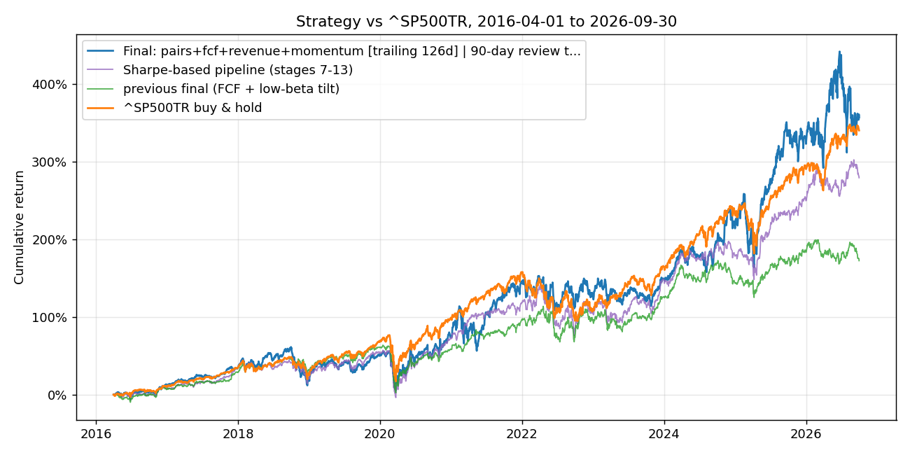
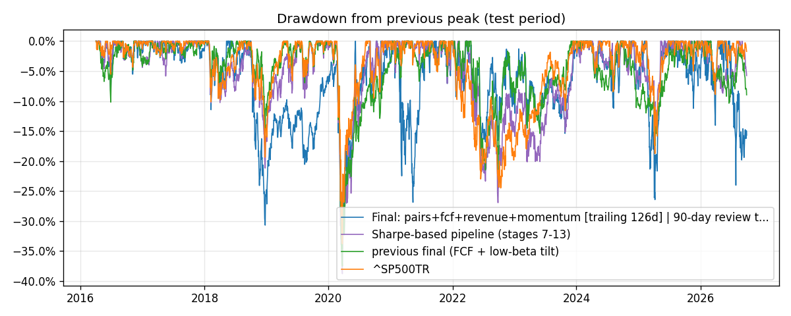
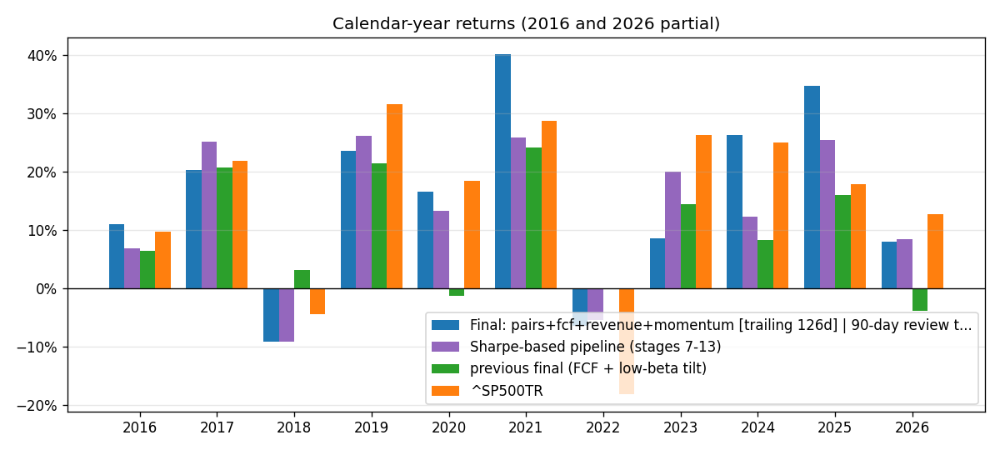

# HW4 – Philip Szkudlarski

The model is long-only and multi-signal. It ranks large-cap stocks by four signals and weights each signal by how well its recent 90-day trades have done. Every purchase is held 90 days and compared with $1M in `^SP500TR`.

## Result (test period 2016-04-01 → 2026-09-30, $1M start)

| | Strategy | ^SP500TR |
|---|---:|---:|
| Final value (cash + open positions) | **$4,569,188** | $4,402,747 |
| CAGR | **15.57%** | 15.16% |
| Max drawdown | −34.6% | −33.8% |
| Sharpe (daily returns, 2% rf) | 0.63 | 0.77 |
| Volatility (annualized) | 24.8% | 17.8% |

**The strategy beat the benchmark by $166k (+0.41%/yr), but not on a risk-adjusted basis.** It ran 7 points more volatility, so its Sharpe ratio is lower and its drawdown slightly deeper.

- **2021 and 2025:** it was well ahead (+40% vs +29%, and +35% vs +18%).
- **2019 and 2023:** it lagged the sharp mega-cap rebounds.
- **Concentration:** returns are concentrated. The top 20 of 1,627 trades made 70% of the profit.
- **Stuck lots:** writing off five lots that stopped trading ($123k, mostly acquisitions) leaves $4.45M, still ahead by $43k.



| Drawdowns | Calendar-year returns |
|---|---|
|  |  |

## How to run

From the repository root, after `uv sync --locked` and placing `equities_top2000.duckdb` in `Lectures/modeling/data/`:

```bash
.venv/bin/python Homeworks/HW4/Philip_Szkudlarski/hw4.py --check     # accounting/timing self-tests, seconds, no data
.venv/bin/python Homeworks/HW4/Philip_Szkudlarski/hw4.py --dev-only  # development 2010-2015 only, ~10 min
.venv/bin/python Homeworks/HW4/Philip_Szkudlarski/hw4.py             # full run incl. test period, ~10 min
```

**Outputs:**
- `cumulative_returns.png` and `charts/`, next to the script.
- Tables and the run log in `outputs/`, which is git-ignored. `test_metrics.csv` and `test_fills.csv` hold every trade, and `test_dynamic_weights_by_year.csv` holds the yearly weights.

## Model

**Features** (all known at the signal close; fundamentals usable from filing date + 1 day):

| Signal | Buys | Why it should predict 90-day returns |
|---|---|---|
| 12-1 momentum | Top 10% by 252-day return, skipping the last 21 days | Trends in returns persist over months |
| FCF growth without dilution | FCF up ≥ threshold YoY, share count flat, FCF/share up; ranked by FCF growth, FCF/share, buybacks, FCF yield | A slow fundamental effect; its excess return grows steadily with the holding horizon |
| Revenue growth vs industry | YoY revenue growth ≥ industry median, accelerating, positive operating margin | Firms out-growing their peers keep being re-rated |
| Pairs divergence | Same-industry pair (correlation ≥ 0.7, similar beta) where this stock lagged (z ≤ −1.5) and EPS is intact | The laggard tends to catch up |

**The model in closed form.** For each signal $s$ on day $t$:

1. **Expected 90-day excess return**, from finished trades only:

$$\hat\mu_s(t) = \frac{1}{|D_s(t)|}\sum_{d \in D_s(t)} r_s(d)$$

   - $D_s(t)$ is the set of days, among the last 126 trading days whose 90-day outcomes are already known at $t$, on which signal $s$ flagged stocks. At least 20 such days are required; otherwise $\hat\mu_s$ counts as 0.
   - $r_s(d)$ is the mean 90-day return of the stocks flagged on day $d$, minus that day's universe average.

2. **Signal weights:**

$$w_s(t) = \frac{\max(\hat\mu_s(t), 0)}{\sum_j \max(\hat\mu_j(t), 0)}$$

   These are equal weights ($1/4$) if no $\hat\mu$ is positive.

3. **Stock score:**

$$\text{score}_i(t) = \sum_s w_s(t)\, p_{i,s}(t) \;+\; \#\{s : i \text{ flagged by } s,\ w_s(t) > 0\}$$

   - $p_{i,s}$ is stock $i$'s percentile among the stocks signal $s$ flags that day.
   - The second term adds a point for each agreeing signal.

4. **Portfolio:** buy the top-scored names into 20 equal slots and hold each 90 days. At maturity, buy a name back if it still ranks in the top 40.

**What is and isn't closed form:**
- **The model is closed form:** every step is a direct calculation (averages, a positive-part ratio, a ranking), with nothing to fit numerically. That is unlike the gradient-boosting model below, which is fit iteratively.
- **Model choice is a search:** it was a discrete search over signal subsets × weighting schemes × overlays, scored on 2010–2015 (see Validation).
- **Signal parameters are a search too:** each signal's parameters were picked from a grid by t-statistic.

This is a simple, transparent model. It updates itself every day using only completed outcomes, as HW4 requires. It also shifts weight between signals by period: momentum's weight rose to 0.46 in 2021 and 0.61–0.76 in 2024–26, while pairs and FCF gained weight after the momentum sell-offs.

**Why this model:** I also built a gradient-boosting regressor on 17 ranked indicators. It was refit each year on completed outcomes and predicted each stock's 90-day return rank. Its out-of-sample rank correlation was about 0, below random stock picks, so it was dropped.

**Portfolio:**
- 20 equal slots (NAV/20, capped at 10% of NAV), with at most 1 new name a day so maturities are staggered.
- One position per company.
- Buys fill at the **next session's close** after the signal. Each lot is sold at the first close on or after **entry + 90 calendar days**.
- At maturity, a stock still ranked in the top 40 is bought straight back as a new 90-day lot.

## Validation

| Period | Use |
|---|---|
| 2010–2012 | Train: choose each signal's parameters (event study of 90-day excess returns, t-stats adjusted for overlapping windows) |
| 2013–2015 | Validation: compare portfolios |
| Jan–Mar 2016 | Buffer |
| Apr 2016 – Sep 2026 | Test |

**Selection rule:** every subset of seven candidate signals was tested under six weighting schemes (727 portfolios). The ten best were then tested with every combination of four optional overlays (1,620 portfolios). Each was scored by the **worse** of its 2010–12 and 2013–15 excess CAGR over the index. A portfolio therefore had to beat the index in both windows, and among near-ties the simplest won.
- **The chosen model:** +8.8%/yr (2010–12) and +10.6%/yr (2013–15) over the index.
- **In the test:** +0.4%/yr. Some of that shrinkage is the expected cost of choosing among many candidates.

**Model selection:** the final model is the one that scored best on 2010–2015 data, under a rule fixed before the search ran. No test-period result was used to pick it. During development I also ran earlier versions of the system on the test period; all 10 runs are listed in [DEVELOPMENT.md](DEVELOPMENT.md), along with every idea tried.

## Backtester and assumptions

- **Daily loop:** exits at maturity → fills of orders planned at the previous close → mark to market → plan the next orders.
- **Cash:** a purchase budget is notional + fee and never exceeds cash; sales return cash the same day.
- **Costs:** 5 bp per side. Cash earns 0%.
- **Prices:** adjusted prices, so dividends are counted once.
- **Missing data:** a buy with no quote is skipped. A held stock with no quote is marked at its last price and flagged. An exit waits for the next real quote. No fill is ever invented.
- **End:** open positions are valued on 2026-09-30, and no later prices are used.

**Accounting checks:**
- **`--check`:** 16 hand-computable cases, including exact units, fees and cash; a weekend maturity; a missing quote at entry or exit; cash capping; CAGR and drawdown; point-in-time fundamentals; the buy-back; and the price repair.
- **Audit asserted on the real run:** cash = $1M + all fills; final value = cash + open lots; every buy after its signal; every sale ≥ 90 days after entry; no negative cash.
- **First lot, checked by hand:** PCG, 877.2163 units at $56.97 + $24.99 fee, sold 2016-06-30 at $61.34, PnL $3,781.54.

## Data issues handled

- **Unadjusted stock splits** in both adjusted and raw prices (NFLX −90%, ORLY −93%, BKNG −96%, LVLT +1,390%…) were repaired at load: 218 days in 87 stocks. A held stock would otherwise book fake −90% losses or +1,000% gains. A few real extreme moves (NVAX −85% in 2016) are neutralized too, a small optimistic bias.
- **The same company under two tickers** (27 renamed pairs, 17 share-class pairs): only one position per company.
- **Impossible market-cap values** (Timber Pharmaceuticals at $28.7T): removed by a dollar-volume screen before choosing each quarter's top 500.
- **No payout table for acquired stocks:** their last price is kept and flagged, and a write-off case is reported.
- **Restated fundamentals and snapshot sectors:** they remain a limitation.

The full table is in `outputs/data_quality.csv` and [DEVELOPMENT.md §7](DEVELOPMENT.md).

## Findings and next steps

**What didn't work:**
- **RSI oversold, RSI reversal and pairs on their own:** reversal effects last days, not 90 days.
- **The gradient-boosting model:** it had no predictive power.
- **A low-beta / low-volatility tilt:** it cut volatility to 16.8% but returned only 10.0%/yr in a mega-cap-led decade, 5 points below the index.
- **Sector rotation, growth/stable rotation, growth overweights and dispersion-based weights:** none improved development results.

**Risks:**
- The strategy carries high volatility.
- It depends on a few large momentum winners. Its weights react with a lag, so it trails sharp rebounds (2019, 2023).
- The validation window is short (3 years), and the search tried many candidates.

**Next steps:**
- A longer walk-forward validation (2000–2015).
- A corporate-actions table instead of the rule-based price repair.
- Volatility-scaled position sizing to bring the Sharpe ratio up to the index's.
- Mean-variance signal weights $w \propto \hat\Sigma^{-1}\hat\mu$, the closed-form information-ratio optimum. The current weights are the special case in which signals have equal risk and are uncorrelated. This version would cut weight on signals that move together (momentum and revenue growth) or are noisy.

## Code reuse and AI use

- **Ideas – mine:**
  - the trading-system design: RSI oversold, pairs divergence, FCF growth without dilution, revenue growth vs peers, RSI reversal;
  - the top-500 universe;
  - the overlays I asked to test: sector/size regime, volatility reduction, growth/stable rotation, growth overweight, dispersion;
  - the search over all signal combinations, the sector revenue leaders, and shifting weight between strategies by period.
- **Data cleaning – builds on my HW2:** the approach comes from my HW2 data-cleaning work (`01_data_cleaning.ipynb` in my HW2 submission, branch `hw_2_Philip_Szkudlarski`): repair one-day price errors by rescaling (there, doubled bars), check adjusted prices for impossible jumps, remove duplicate records, quarantine what can't be fixed without guessing, and flag every repair. Here it is applied to unadjusted splits, duplicate listings and bad market-cap values.
- **Code – mostly AI:** most of the code in `hw4.py` was written by an AI assistant (Claude Code) at my direction. The assistant also proposed parts of the methodology:
  - adding 12-1 momentum;
  - the selection rules;
  - the trailing-performance weighting method.
- **My review:** I reviewed the design decisions, the validation procedure and the results.
- **Reused conventions:** the data conventions (filing-date availability, next-session membership, 90-day labels, quarantining bad prices) follow the course's `Lectures/modeling/README.md` and `course_data.py`.
