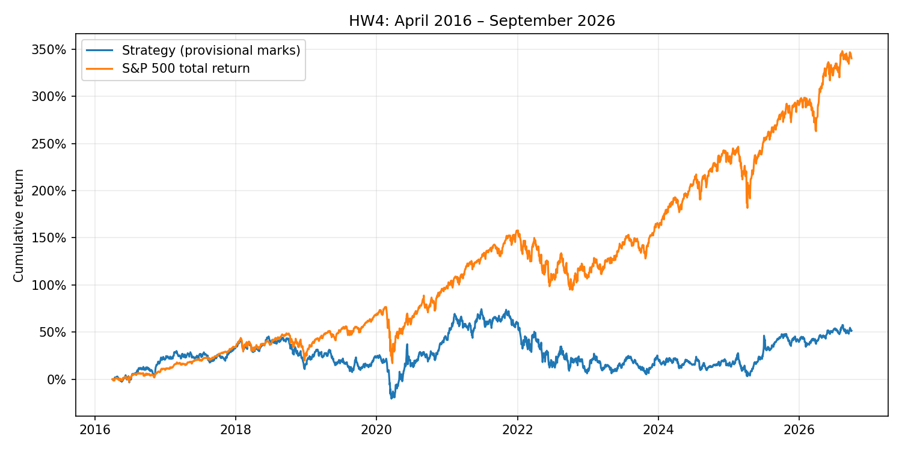

# Findings

## Measured result

These are research results using supplied adjusted prices and provisional stale marks.

| Portfolio | Final value | CAGR | Maximum drawdown | Sharpe |
|---|---:|---:|---:|---:|
| strategy | $1,515,057.68 | 4.04% | -45.41% | 0.200 |
| SP500TR | $4,402,746.78 | 15.17% | -33.79% | 0.773 |

Strategy minus benchmark: $-2,887,689.09; CAGR difference -11.13 percentage points.
The computed strategy does not beat the benchmark under these assumptions.

## Reliability and accounting

Final cash $354,459.57; open-position value $1,160,598.11. There are 127 open lots. Fees paid: $71,298.00.
Final exposure without a quote for more than 5 sessions: $567,853.79 (37.48% of NAV). Maximum such exposure: 38.61%.
Stale lots are frozen at their last observed mark and cannot release cash until an actual quote returns. This is a provisional accounting convention, not an assumed executable exit or verified recovery. Any unresolved exposure prevents a reliable economic performance claim. Set strict_prices=true to stop after five missing sessions.
The price audit found 7,219 daily moves exceeding 50% in absolute size; the ranking audit flagged 1,249 unusually large price/share inputs. These are investigation flags, not verified errors. Raw adjusted prices were not heuristically rewritten.
Cash reconciliation, nonnegative cash, prior-session signals, and final cash plus holdings were checked during the run. Synthetic unit tests separately check fees, exact maturity, weekend maturity, missing entries/exits, and first-day loss measurement.

## Model, validation and strategy

Ridge alpha 10 was selected by mean cross-sectional rank correlation in 2013, 2014 and 2015. Each annual fit uses signals from 2010 onward and only outcomes completed before January 1. Validation outcomes must finish by December 31, 2015. No final-test return selects a parameter. Validation is predictive, not a portfolio return; overlapping 90-day labels are not compounded.
The selected model's mean validation rank IC was -0.0198. A low or negative rank IC is evidence of weak prediction, even for the best candidate. This is a completed modeling experiment, not evidence that the fitted model is useful for investing.
Final fit is April 1, 2016, using development signals through December 2015 whose outcomes have completed. There is no test-period retraining. Imputation, clipping, scaling and target clipping use each training set only.
Each month, buy the top 30 scores using up to 25% of NAV, limited by previously available cash and a 5% per-stock planned weight. The cap is measured at planning prices; overnight moves may breach it. Multiple lots can coexist. No position is sold early to rebalance. Each lot exits after 90 calendar days at the next quoted market close.

## Interpretation and next experiments

The model trades estimated gross 90-day returns; its modest linear structure is easy to inspect and regularize. Momentum, reversal, volatility, drawdown, profitability, leverage and cash-flow ratios describe different risks. The equal-weight selected-stock portfolio differs from a capitalization-weighted index and can have size, industry and style concentration. Cash waiting for new monthly entries and unresolved exits can materially change returns.
All regularization candidates, including unsuccessful ones, are recorded in validation.csv. No post-test strategy search was performed. Next experiments: verified corporate-action and delisting proceeds, sector caps, alternative feature groups, and fee sensitivity evaluated on development data before a new untouched test.
The database uses quarterly capitalization proxies and snapshot metadata, incomplete delisting histories, and restated financial values. Filing-date joins do not restore original filing vintages. Costs are a fixed proportional approximation; market impact, spread variation, taxes and interest on cash are omitted. Adjusted-price units already include the supplied dividend adjustments; dividends are not added again.

## Provenance

The attached hw4.ipynb was read as a reference, not copied. Data loading, base features, filing joins, membership, labels and the preprocessing pipeline reuse Lectures/modeling/course_data.py. The lot backtester and research runner were written for this submission with OpenAI Codex assistance. The student should review the code and explain these assumptions.
