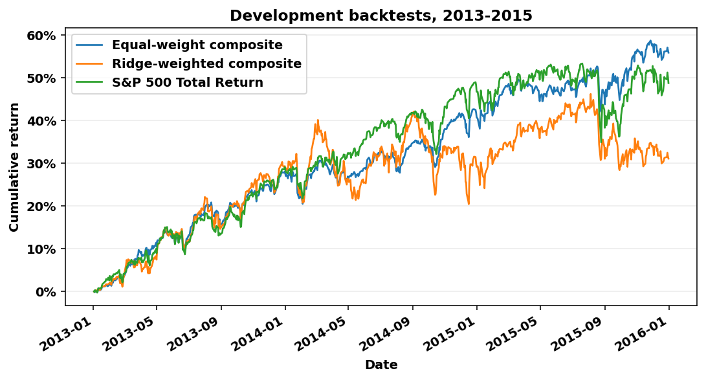
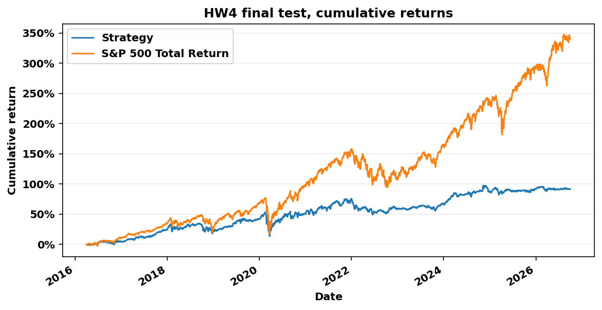

# HW4 · Monthly stock selection with an equal-weight rank composite

Qianhao Meng. The assignment is the [HW4 brief](../../../Lectures/Lecture%208/hw4.md).

## Files

| File | Role |
| --- | --- |
| `data.py` | Load the database in ticker batches, apply the reviewed price events, and build the monthly panel of features and 90-day targets. |
| `price_events.csv` | Reviewed price jumps: documented splits the vendor left out, confirmed real moves, and unresolved breaks, each with its basis. |
| `model.py` | Cross-sectional ranks, the equal-weight composite score, and a Ridge-weighted comparison with walk-forward fits. |
| `backtest.py` | The backtester. A strategy sizes orders, an account books fills, and a daily loop records cash, lots, and NAV. |
| `report.py` | Metrics tables, run diagnostics, the table of holdings carried at an older price, run checks, and the chart. |
| `hw4.py` | Command line entry point for the development comparison and the final test. |
| `test_backtest.py`, `test_research.py`, `test_pipeline.py` | Accounting, timing, and end-to-end tests. |
| `development.md`, `development_returns.png` | Generated development comparison. |
| `results.md`, `cumulative_returns.png` | Generated by the final test. |

Fills, daily NAV, and events from the final test are written to `outputs/`, which Git ignores.

## How to run

Run from the repository root. Use `uv sync --locked` for the environment and place `equities_top2000.duckdb` from bCourses in `Lectures/modeling/data/`.

```bash
.venv/bin/python -m unittest discover -s Homeworks/HW4/Qianhao_Meng -v
```

```bash
.venv/bin/python Homeworks/HW4/Qianhao_Meng/hw4.py
```

```bash
.venv/bin/python Homeworks/HW4/Qianhao_Meng/hw4.py --final-test
```

The second command is the development comparison. It reads data through December 31, 2015 only and takes about 15 seconds. The third runs the chosen strategy on the final test.

With `equities_class.duckdb` in the same data folder, the development comparison also works as a two-second smoke test. Send its output elsewhere so it does not overwrite the full-database report.

```bash
.venv/bin/python Homeworks/HW4/Qianhao_Meng/hw4.py --database Lectures/modeling/data/equities_class.duckdb --output /tmp/hw4_class
```

## Course materials used

| HW4 part | Code here | Lecture source |
| --- | --- | --- |
| 1. Data | `data.load_research_data` | [Data guide](../../../Lectures/modeling/README.md) for tables and known issues. [7.2](../../../Lectures/Lecture%207/2_transformers.ipynb) section 3 for membership by entry quarter. [8.2](../../../Lectures/Lecture%208/2_research_workflow.ipynb) section 7 for batch loading. |
| 2. Features and target | `data._batch_panel`, `model.add_ranks` | 7.2 section 1 for trailing features on the market calendar, sections 2–3 for filing dates and same-date peer comparisons, section 4 for the 90-calendar-day label. |
| 2. Fitted comparison | `model.fit_weights`, `model.walk_forward_scores` | [7.1](../../../Lectures/Lecture%207/1_sklearn_fundamentals.ipynb) sections 2–3 for fit and predict. [7.3](../../../Lectures/Lecture%207/3_models_and_evaluation.ipynb) sections 2–3 for completed labels and annual folds. 8.2 section 3 for refits and the fit audit. |
| 2. Evaluation | `model.rank_ic_by_year`, `hw4.run_development` | 7.3 section 5 for rank IC. 8.2 section 4 for comparing signals under identical trading rules. |
| 3. Backtester | `backtest.py` | [8.1](../../../Lectures/Lecture%208/1_backtesting.ipynb) section 1 for separate roles, section 2 for one lot with fees, section 4 for the daily loop and missing quotes. |
| 4. Benchmark and metrics | `backtest.performance`, `report.py` | 8.1 section 5 for CAGR, drawdown, and Sharpe. 8.2 sections 5–6 for diagnostics and saving what a run needs to be reproduced. |
| 5. Checks | the three test files, `report.reconciliation` | 8.1 section 4 and its last exercise for reconciling the books. 7.2 last exercise for testing that future prices cannot change past features. |

## 1. Data

- Candidates come from `universe_membership` for the quarter of the next-session entry. Stocks that are now inactive stay in.
- A candidate needs 63 complete daily returns and a 63-session median of `close × volume` of at least $5 million. That product is a proxy for dollars traded.
- Vendor quotes are taken as real, so real losses reach features, targets, and NAV.
- A move of more than four times between two observed closes, in either direction, is treated as a break in the price series unless `price_events.csv` explains it. Two reverse splits that the vendor left out of earlier prices, FBC in 2010 and LVLT in 2011, are corrected there. Four collapses after failed drug trials are confirmed as real and kept.
- After an unexplained break the stock's later quotes count as missing. It is not bought again, and a lot already held follows the missing-price policy in section 3. An example is LCI, whose adjusted close goes from 28.09 to 474.08 on 2013-12-13.
- A stock that leaves the universe is no longer bought. A lot already held is still valued every day and sold at maturity.

## 2. Model and validation

**Target.** The gross adjusted-price return from the next session's close to the first quoted close on or after 90 calendar days. This matches the backtester's entry and exit.

**Model.** A fixed-weight score. At the close before the first session of each month, every eligible stock is ranked against the other eligible stocks on four components. The score is the plain average of the four ranks. Each component and its direction come from published research, not from fitting this data.

| Component | Feature | Direction | Reason |
| --- | --- | --- | --- |
| 12-1 momentum | 252-session return that skips the latest 21 sessions | higher is better | Intermediate-horizon price continuation, Jegadeesh and Titman (1993). The latest month is skipped because very recent returns tend to reverse. |
| 52-week high | Price relative to its 252-session high | closer is better | Investors anchor on the high and underreact near it, George and Hwang (2004). |
| Low volatility | 63-session volatility | lower is better | Low-volatility stocks have earned more per unit of risk, Ang, Hodrick, Xing and Zhang (2006), Frazzini and Pedersen (2014). It also lowers portfolio volatility directly. |
| Profitability | Operating income over total assets from the latest filing | higher is better | Profitable firms earn higher returns, Novy-Marx (2013). A filing is usable from the calendar day after its filing date, and a ratio older than 550 days is blank. |

A missing component gets the neutral rank of 0.5. Ranks use only stocks eligible on the same date, so no later information can change them.

**Why equal weights.** I also let Ridge learn non-negative weights on exactly the same four ranks, refitted before each validation year on outcomes that had already ended. Candidates, dates, sleeve, and costs are identical, so only the weights differ. Ridge put zero weight on the 52-week high and almost none on low volatility, because those two had no positive relation in 2010–2012, and it did worse in every respect. Weights estimated from a few years of noisy returns were not stable, which is the argument of DeMiguel, Garlappi and Uppal (2009) for equal weights.

**Validation.** Signals from December 31, 2012 to November 30, 2015, traded under the final rules. Rank IC is the same-date Spearman correlation between the score and the realized 90-day target, using completed outcomes only. It is averaged over the months of each entry year, and the table shows the plain average of the three yearly figures. Full tables are in [development.md](development.md).

| Signal | Mean rank IC | CAGR | Max drawdown | Sharpe |
| --- | ---: | ---: | ---: | ---: |
| 12-1 momentum | +0.031 | 11.18% | −26.60% | 0.471 |
| 52-week high | +0.045 | 11.26% | −11.06% | 0.812 |
| Low volatility | +0.035 | 9.78% | −5.19% | 1.067 |
| Profitability | +0.029 | 13.20% | −10.19% | 0.886 |
| Equal-weight composite | +0.053 | 16.00% | −6.94% | 1.309 |
| Ridge-weighted composite | +0.027 | 9.47% | −15.24% | 0.528 |
| S&P 500 Total Return | | 14.20% | −12.04% | 0.949 |



The composite has no fitted parameters, so there is nothing to retrain during the test. The choices recorded in `hw4.py` before the final test are the equal-weight composite, the top 20 names, and a one-third sleeve.

## 3. Backtester

| Rule | Implementation |
| --- | --- |
| Capital | $1,000,000, long only, no borrowing. A purchase can never exceed available cash. |
| Decisions | Orders are sized at the signal close from that close's cash and NAV. They fill at the next session's close. |
| Sizing | Each month a sleeve of the lesser of cash and one third of NAV is split equally among the top 20 names. There is no cap on a single name or sector, and a stock chosen in consecutive months is held in separate lots. |
| Holding | Every lot has its own maturity 90 calendar days after entry and is sold at the first quoted close on or after it. |
| Cash | Sales add cash at once. Orders already planned keep their budgets, so the same cash is never spent twice. Orders under one cent are skipped. |
| Costs | An assumed 10 basis points on each purchase and each sale, twice the lecture default. The purchase budget includes its fee. |
| Prices | Fractional units of adjusted close. Dividends are already in the adjusted series and are not added again. |
| Cash interest | Zero. |
| Missing prices | A buy with no entry quote is canceled. A due lot with no quote waits for the next quote. Meanwhile it is marked at its last observed price and reported. No fill is ever made at a stale price. |
| Test end | Open lots are valued at their latest marks on September 30, 2026. No later price is read. |

## 4. Benchmark comparison

The benchmark is $1,000,000 in `^SP500TR` from the first test close. CAGR uses elapsed calendar years from that close. Drawdown and returns start from the initial capital, so first-day fees count. Sharpe uses daily returns over a 2% annual rate converted to a daily rate and scaled by the square root of 252.

The final test ran once on the frozen settings, from 2016-04-01 to 2026-09-30. The full output is in [results.md](results.md).

| Metric | Strategy | S&P 500 Total Return |
| --- | ---: | ---: |
| Final value | $1,911,479 | $4,402,747 |
| CAGR | 6.37% | 15.17% |
| Maximum drawdown | −25.98% | −33.79% |
| Sharpe, 2% risk-free | 0.430 | 0.773 |



**The strategy did not beat the benchmark.** It finished 8.80 percentage points of CAGR and $2,491,268 of final value behind.

- Two likely drags were the signal's tilt and idle cash. I did not decompose the gap. The portfolio leans toward calm, profitable stocks, and cash averaged 20.0% of NAV before 2021 and 15.1% over the whole test. It lagged in every strong year, for example +16.0% against +31.5% in 2019 and +5.8% against +26.3% in 2023. It lost less in the weak years, −1.4% against −4.4% in 2018 and −9.5% against −18.1% in 2022.
- A third likely drag, from 2021, was the missing-price policy. A stock under an agreed takeover trades quietly near its high, which is what this score rewards, and its quotes end when the deal closes. Such a lot stays in NAV at its last quote and its cash is not reused. The share of NAV at prices more than five sessions old rose from 5% at the end of 2020 to 44% at the end of 2022. On the final day 47 lots worth $1.00 million, 52.33% of NAV, were carried at an older price. For 46 of them, worth $979,451 or 51.24% of NAV, the price was more than five sessions old. The other one had missed a single session. Most are stocks whose quotes had ended, such as LLTC, ALXN, CERN and SPLK.
- The risks taken were a concentrated book of 20 new names a month with no cap on a name or sector, and a deliberate tilt to low volatility and profitability. The smaller drawdown may owe a good deal to cash and idle holdings rather than to stock selection.
- The four metrics depend on valuing those lots at their last quotes, the oldest from April 2016. They describe this data set under the stated assumptions and are not an unbiased estimate of what the strategy would have earned.

## 5. Checks of accounting and timing

- Three tests use expected values computed by hand. One lot with a $125,000 budget at $100 buys `125000 / 1.001 / 100` units and returns `units × 110 × 0.999` when sold at $110. A holding that loses its quote stays at its last mark. CAGR, drawdown, and Sharpe are checked on a three-point NAV series.
- Other tests check a Sunday maturity, a canceled buy, that a pending buy cannot use cash from a sale on its own fill day, and that a random one-year run reconciles NAV, cash, the fill ledger, and PnL.
- Timing tests check that prices after a signal cannot change its orders, that ranks on one date ignore every other date, that two more years of data leave earlier features and known targets unchanged, and that a fit ignores outcomes ending on or after its date.
- With the class database present, one test feeds the same scores to the lecture backtester and to mine and requires equal daily NAV and cash over 2013–2015.
- Each final run writes its own checks to `results.md`: session range, benchmark starting value, lowest cash balance, and the ledger reconciliation.

## Findings and next steps

- The development result did not carry over. The composite had a Sharpe of 1.31 in 2013–2015, the best of the candidates I compared, and 0.43 in the test. The 1,953 completed lots earned 2.6% on average over 90 days and 58% of them made money. These figures count completed lots only and are not set against the market over the same days, so they do not show selection skill.
- Development had no holding that lost its quotes, so the cost of never recycling that cash did not show until the test. I did not change the rule after seeing the result.
- Ideas that did not help in development. Ridge with learned weights was worse than equal weights on the same ranks. An earlier Ridge on raw price and fundamental features had a negative rank IC. Weekly instead of monthly entries cut idle cash from 22% to 10% but lowered Sharpe, and 40 names or inverse-volatility weights did not beat 20 equal positions. Only the Ridge-weighted comparison is kept in the code.
- What I would try next, on development data only. First a stated rule for a holding in a company that gets acquired. The lecturer said the final trading price can stand in for the buyout price in that case. Stocks whose quotes end for other reasons would need their own justification. Then a screen for stocks that trade like announced takeover targets, a cap on names and sectors, and features with a steadier sign across years.

## Limitations

- Financial records are the vendor's latest values for each period. Delisting records are incomplete and there is no table of delisting proceeds.
- The four-times threshold is a judgment, and price and volume alone cannot tell a vendor error from a real move. I reviewed the breaks of liquid stocks in 2010–2015 one by one. Later ones are mostly unreviewed. Seven documented splits after 2023 are listed in `price_events.csv` but not corrected, because the vendor's jump comes before the real split date. A smaller split that the vendor left out would look like a real fall.
- A holding left at its last valid price keeps its value in NAV and its cash is never reused. `results.md` lists every such lot. Listing them explains the bias but does not remove it, so the four metrics depend on that valuation.
- The 10-basis-point fee ignores market impact, and cash that earns nothing averaged 15.1% of NAV over the test.

## Reused code and AI assistance

I reused `Lectures/modeling/course_data.py` for loading, trailing features, filing joins, dated membership, labels, and prediction metrics. `backtest.py` was written for this homework and does not import the lecture backtester, which is used only as a reference in one test.

I used AI assistants, Claude and Codex, throughout this homework. Codex helped me organize the related code from the lectures, set a general structure, and review the design. Claude fixed bugs, proposed code improvements, and ran the development research. I formed the core code, set the direction, questioned and changed several of their model proposals, and made the final choices on the data rules, the signal, and the position sizing.
