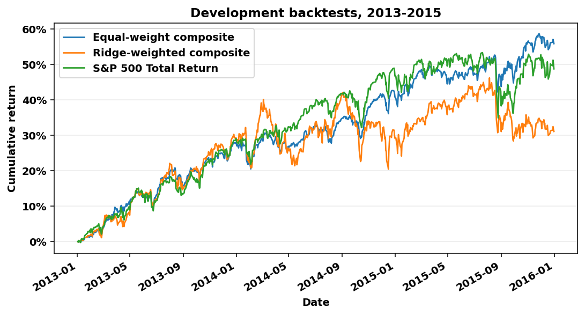

# HW4 development comparison

Signals from 2012-12-31 to 2015-11-30, data through 2015-12-31 only. Every portfolio buys the top 20 names monthly with a 33.3% sleeve unless stated. The Ridge weights are refitted before each validation year on outcomes that had ended.

Of 75,256 candidate signals whose 90-day outcome was due by 2015-12-31, 99.99% have an observed outcome. The others lost their entry or exit quote, so they are absent from rank IC and from any fit.

## Mean monthly rank IC by entry year

| Signal | 2013 | 2014 | 2015 | Mean |
| --- | ---: | ---: | ---: | ---: |
| 12-1 momentum | +0.0509 | -0.0362 | +0.0788 | +0.0312 |
| 52-week high | -0.0204 | +0.0452 | +0.1105 | +0.0451 |
| Low volatility | -0.0819 | +0.1006 | +0.0876 | +0.0354 |
| Profitability | -0.0203 | +0.0411 | +0.0650 | +0.0286 |
| Equal-weight composite | -0.0290 | +0.0640 | +0.1226 | +0.0525 |
| Ridge-weighted composite | -0.0061 | -0.0000 | +0.0861 | +0.0267 |

## Portfolio results

| Portfolio | Final value | CAGR | Maximum drawdown | Sharpe, 2% risk-free | Average cash |
| --- | ---: | ---: | ---: | ---: | ---: |
| 12-1 momentum | $1,373,342 | 11.18% | -26.60% | 0.471 | 22.7% |
| 52-week high | $1,376,083 | 11.26% | -11.06% | 0.812 | 22.4% |
| Low volatility | $1,322,236 | 9.78% | -5.19% | 1.067 | 22.3% |
| Profitability | $1,449,121 | 13.20% | -10.19% | 0.886 | 22.5% |
| Equal-weight composite | $1,559,206 | 16.00% | -6.94% | 1.309 | 22.2% |
| Ridge-weighted composite | $1,310,872 | 9.47% | -15.24% | 0.528 | 22.4% |
| Equal-weight composite, 25% sleeve | $1,471,863 | 13.79% | -7.58% | 1.190 | 28.0% |
| S&P 500 Total Return | $1,487,843 | 14.20% | -12.04% | 0.949 |  |

## Ridge weights learned at each fit

| fit_date | training_rows | last_label_end | first_scored_signal | 12-1 momentum | 52-week high | Low volatility | Profitability |
| --- | ---: | ---: | ---: | ---: | ---: | ---: | ---: |
| 2012-12-31 | 30,630 | 2012-12-03 | 2012-12-31 | 27% | 0% | 8% | 65% |
| 2013-12-31 | 44,320 | 2013-12-30 | 2013-12-31 | 55% | 0% | 0% | 45% |
| 2014-12-31 | 59,183 | 2014-12-30 | 2014-12-31 | 31% | 0% | 0% | 69% |
