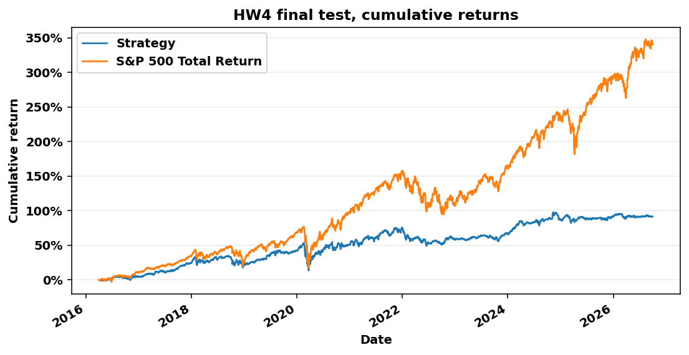

# HW4 final test results

## Settings

| Item | Value |
| --- | ---: |
| Signal | Equal-weight composite of the ranks of 12-1 momentum, 52-week high, Low volatility, Profitability |
| Portfolio | Top 20 names monthly, sleeve of 33.3% of NAV, equal budgets |
| Holding period and fee | 90 calendar days, 10 bp per side |
| Liquidity screen | 63-session median dollar volume of at least $5,000,000 |
| Price-break rule | Moves beyond 4x between observed closes are checked against price_events.csv. Unexplained ones end that stock's quotes |
| Packages | pandas 2.3.3, numpy 2.3.5, scikit-learn 1.8.0, duckdb 1.5.6 |

## Performance

| Metric | Strategy | S&P 500 Total Return |
| --- | ---: | ---: |
| Final value | $1,911,479 | $4,402,747 |
| CAGR | 6.37% | 15.17% |
| Maximum drawdown | -25.98% | -33.79% |
| Sharpe, 2% risk-free | 0.430 | 0.773 |

The strategy finished behind the benchmark by 8.80 percentage points of CAGR and $2,491,268 of final value.

## Run diagnostics

| Item | Strategy |
| --- | ---: |
| Average cash share | 15.1% |
| Fills | 3,971 |
| Fees paid | $79,478 |
| Canceled buys, no entry quote | 2 |
| Sales delayed by a missing quote | 0 |
| Lots with a quote gap over five sessions | 46 |
| Largest value at marks over five sessions old | $979,451 |
| Largest share of NAV at such marks | 51.24% |
| Open lots at the end | 65 |

Of 207,517 candidate signals whose 90-day outcome was due by 2026-09-30, 99.32% have an observed outcome. The others lost their entry or exit quote, so they are absent from rank IC and from any fit.

## Holdings carried at an older price

Holdings carried at an older price on the final day: $1,000,272 in 47 lots, 52.33% of NAV.

Final NAV is $1,911,479 with those lots at their last valid quote, so the four metrics depend on that valuation. As a diagnostic scenario only, final NAV would read $1,883,030 with the lots on an unresolved price break valued at the vendor's last quote on or before the final day. That quote can be on a different price basis from the holding, so it is neither an estimate nor a bound, and it ignores how an earlier sale would have changed later trades.

| Symbol | Entry | Last valid quote | Days at that price | Reason | Value | Share of NAV | Diagnostic value at vendor's last quote |
| --- | ---: | ---: | ---: | ---: | ---: | ---: | ---: |
| HPY | 2016-04-01 | 2016-04-22 | 3813 | no quote | $17,794 | 0.93% | $17,794 |
| LLTC | 2017-02-01 | 2017-03-10 | 3491 | no quote | $17,934 | 0.94% | $17,934 |
| TSRA | 2017-02-01 | 2017-02-22 | 3507 | no quote | $17,264 | 0.90% | $17,264 |
| LLTC | 2017-03-01 | 2017-03-10 | 3491 | no quote | $16,907 | 0.88% | $16,907 |
| ALXN | 2021-05-03 | 2021-07-20 | 1898 | no quote | $28,674 | 1.50% | $28,674 |
| ALXN | 2021-07-01 | 2021-07-20 | 1898 | no quote | $26,362 | 1.38% | $26,362 |
| RAVN | 2021-10-01 | 2021-11-29 | 1766 | no quote | $27,566 | 1.44% | $27,566 |
| UFS | 2021-10-01 | 2021-11-29 | 1766 | no quote | $27,587 | 1.44% | $27,587 |
| CVA | 2021-11-01 | 2021-11-29 | 1766 | no quote | $22,177 | 1.16% | $22,177 |
| RAVN | 2021-11-01 | 2021-11-29 | 1766 | no quote | $22,181 | 1.16% | $22,181 |
| SC | 2021-11-01 | 2022-01-28 | 1706 | no quote | $22,047 | 1.15% | $22,047 |
| UFS | 2021-11-01 | 2021-11-29 | 1766 | no quote | $22,376 | 1.17% | $22,376 |
| SC | 2021-12-01 | 2022-01-28 | 1706 | no quote | $28,036 | 1.47% | $28,036 |
| HRC | 2021-12-01 | 2021-12-10 | 1755 | no quote | $28,266 | 1.48% | $28,266 |
| SC | 2022-01-03 | 2022-01-28 | 1706 | no quote | $26,098 | 1.37% | $26,098 |
| FOE | 2022-02-01 | 2022-04-21 | 1623 | no quote | $16,573 | 0.87% | $16,573 |
| CERN | 2022-04-01 | 2022-06-07 | 1576 | no quote | $23,517 | 1.23% | $23,517 |
| FOE | 2022-04-01 | 2022-04-21 | 1623 | no quote | $23,505 | 1.23% | $23,505 |
| SAFM | 2022-05-02 | 2022-07-21 | 1532 | no quote | $23,938 | 1.25% | $23,938 |
| CERN | 2022-05-02 | 2022-06-07 | 1576 | no quote | $22,549 | 1.18% | $22,549 |
| SAFM | 2022-06-01 | 2022-07-21 | 1532 | no quote | $15,738 | 0.82% | $15,738 |
| CERN | 2022-06-01 | 2022-06-07 | 1576 | no quote | $15,444 | 0.81% | $15,444 |
| MTOR | 2022-06-01 | 2022-08-02 | 1520 | no quote | $15,569 | 0.81% | $15,569 |
| TVTY | 2022-06-01 | 2022-06-27 | 1556 | no quote | $15,487 | 0.81% | $15,487 |
| PSB | 2022-06-01 | 2022-07-19 | 1534 | no quote | $15,393 | 0.81% | $15,393 |
| PSB | 2022-07-01 | 2022-07-19 | 1534 | no quote | $19,312 | 1.01% | $19,312 |
| SAFM | 2022-07-01 | 2022-07-21 | 1532 | no quote | $18,160 | 0.95% | $18,160 |
| MTOR | 2022-07-01 | 2022-08-02 | 1520 | no quote | $19,386 | 1.01% | $19,386 |
| CDK | 2022-07-01 | 2022-07-05 | 1548 | no quote | $19,241 | 1.01% | $19,241 |
| CHNG | 2022-09-01 | 2022-09-30 | 1461 | no quote | $28,605 | 1.50% | $28,605 |
| SHLX | 2022-09-01 | 2022-10-18 | 1443 | no quote | $25,771 | 1.35% | $25,771 |
| SHLX | 2022-10-03 | 2022-10-18 | 1443 | no quote | $20,326 | 1.06% | $20,326 |
| CLR | 2022-11-01 | 2022-11-22 | 1408 | no quote | $1,021 | 0.05% | $1,021 |
| NATI | 2023-08-01 | 2023-10-13 | 1083 | no quote | $26,304 | 1.38% | $26,304 |
| MMP | 2023-09-01 | 2023-09-22 | 1104 | no quote | $23,884 | 1.25% | $23,884 |
| CCF | 2023-11-01 | 2023-11-14 | 1051 | no quote | $21,120 | 1.10% | $21,120 |
| SPLK | 2024-03-01 | 2024-03-18 | 926 | no quote | $25,799 | 1.35% | $25,799 |
| ORLY | 2025-05-01 | 2025-05-22 | 496 | unresolved price break on 2025-05-23 | $30,348 | 1.59% | $1,899 |
| TGI | 2025-06-02 | 2025-07-24 | 433 | no quote | $23,976 | 1.25% | $23,976 |
| CSGS | 2026-03-02 | 2026-05-15 | 138 | no quote | $32,876 | 1.72% | $32,876 |
| CSGS | 2026-04-01 | 2026-05-15 | 138 | no quote | $566 | 0.03% | $566 |
| FOLD | 2026-04-01 | 2026-04-24 | 159 | no quote | $564 | 0.03% | $564 |
| CSGS | 2026-05-01 | 2026-05-15 | 138 | no quote | $21,424 | 1.12% | $21,424 |
| EA | 2026-07-01 | 2026-08-04 | 57 | no quote | $30,893 | 1.62% | $30,893 |
| CPRX | 2026-07-01 | 2026-07-14 | 78 | no quote | $30,315 | 1.59% | $30,315 |
| EA | 2026-08-03 | 2026-08-04 | 57 | no quote | $20,579 | 1.08% | $20,579 |
| DBRG | 2026-08-03 | 2026-09-29 | 1 | no quote | $20,821 | 1.09% | $20,821 |

## Checks on this run

| Check | Result |
| --- | ---: |
| First and last session | 2016-04-01 to 2026-09-30 |
| Benchmark value at the first close | $1,000,000.00 |
| Lowest cash balance | $0.00 |
| Largest gap between NAV and cash plus holdings | $0.000000 |
| Largest gap between cash and the fill ledger | $0.000000 |
| Realized plus unrealized PnL minus the change in NAV | $0.000000 |
| Buys filled after their signal date | 2,018 of 2,018 |
| Buys given a 90-calendar-day maturity | 2,018 of 2,018 |
| Sales on or after maturity | 1,953 of 1,953 |
