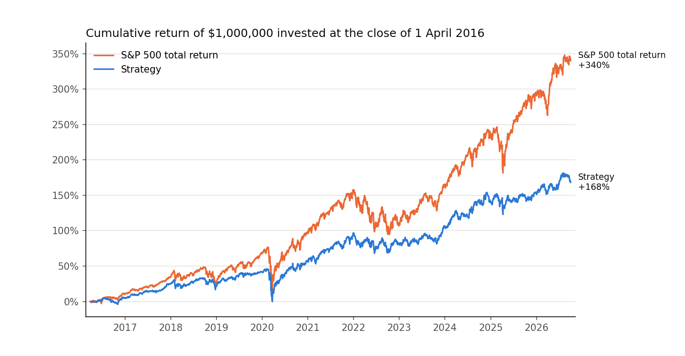

# HW4: stock selection model and backtest

Quentin Benchetrit

`report.ipynb` is the write-up. It runs the whole experiment from the raw database and holds the explanations, the result tables, the chart and the accounting checks. The code it calls is in `hw4/`.

## Result

Test period 1 April 2016 to 30 September 2026, 10 bps of costs per side, no interest on cash.

| | Strategy | S&P 500 TR |
|---|---:|---:|
| Final value of $1,000,000 | $2,682,735 | $4,402,747 |
| CAGR | 9.85% | 15.16% |
| Maximum drawdown | -31.6% | -33.8% |
| Sharpe ratio, 2% risk-free | 0.60 | 0.77 |



The strategy did not beat the index. It finished $1.72M behind, 5.3 points a year. It held low-beta stocks (beta 0.66) through a decade in which the index compounded at 15%, its forecasts were only weakly related to realised returns, and the equal-weighted universe it picks from lagged the index before any selection. Section 7 of the notebook takes these one by one. It also reports that a gradient-boosting model I had rejected in development would have returned 22% a year over the test; that is a finding to follow up, not a result I can claim.

## Approach in short

- **Signal and target.** Each week the features are computed at the close of the second-to-last session. The order is filled at the next close and held 90 calendar days. The target is the return over exactly that window, minus beta times the index return.
- **Features.** 26 cross-sectional ranks covering momentum, risk, profitability, change in fundamentals and value. A statement is used from the day after its filing date.
- **Model.** A ridge regression whose coefficients are constrained to the sign reported in the literature, refit every quarter on all outcomes that are already complete.
- **Validation.** Walk-forward over 2012-2015 with quarterly refits, against an unconstrained ridge, gradient boosting and unfitted equal weights.
- **Trading.** Ten names a week in equal dollar amounts, thirteen overlapping weekly tranches, at most 3% per name and 30% per sector.
- **Backtester.** Written from scratch in `hw4/backtest.py`. `check_backtester.py` verifies it on cases worked out by hand, and section 6 of the notebook audits the real run against the raw price table.

## Running it

From the repository root, with `equities_top2000.duckdb` in `Lectures/modeling/data/`:

```bash
uv sync --locked
cd Homeworks/HW4/Quentin_Benchetrit
uv run python check_backtester.py
uv run papermill report.ipynb report.ipynb --cwd . -k python3
```

The notebook can also be opened and run cell by cell with the `.venv` kernel. A full run takes about seven minutes, most of it in the gradient-boosting comparisons.

## Files

| File | Content |
|---|---|
| `report.ipynb` | write-up, results, checks |
| `hw4/data.py` | loading and cleaning of prices, statements and membership |
| `hw4/features.py` | weekly schedule, features, entry screens, labels |
| `hw4/model.py` | models and walk-forward fitting |
| `hw4/backtest.py` | backtester, weekly strategy, performance measures |
| `check_backtester.py` | accounting cases that can be verified by hand |
| `outputs/` | chart and result tables; the feature panel and the predictions are rebuilt by the notebook and ignored by Git |

Three pieces follow `Lectures/modeling/course_data.py`: the quarantine of unusable price rows in `load_market`, the filing-date handling in `fundamental_events`, and the join on the membership list of the entry quarter. The docstrings say where.

## AI use

Claude reviewed the finished work, which led to one added sentence in section 1 of the notebook, and prepared the Git commit and pull request. The code, analysis and write-up are mine.
