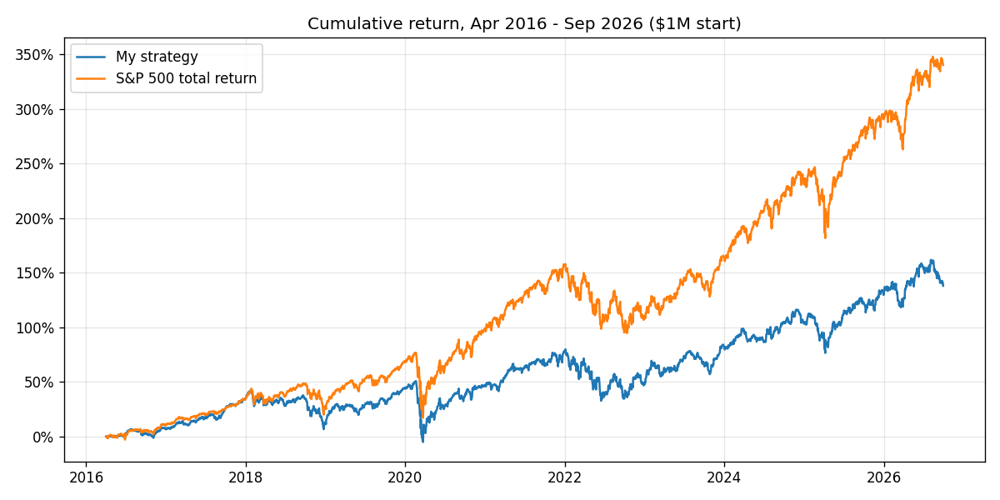

# HW 4: Romir Kant

My strategy did not beat the S&P 500. From April 1, 2016 to September 30, 2026, $1M grew to $2.38M with my strategy and to $4.40M in the S&P 500 total-return index. I lost by $2.02M, or 6.6 percentage points of CAGR a year.



| | My strategy | Stuck stocks at $0 | S&P 500 TR |
|---|---:|---:|---:|
| Final value | $2,379,447 | $2,072,650 | $4,402,747 |
| CAGR | 8.6% | 7.2% | 15.2% |
| Max drawdown | −37.1% | −37.3% | −33.8% |
| Sharpe (2% risk-free) | 0.45 | 0.36 | 0.77 |

Summary:
- Strategy: each week, buy the 25 stocks a ridge model ranks highest and hold each for 90 days.
- Why it lost:
  - My picks earned no more than the average stock.
  - Holding equal amounts of mostly mid-size stocks lagged a decade led by the largest companies.
  - 14% of the money ended up stuck in stocks bought out for cash. The data has no takeover payouts, so the middle column values those stocks at $0.
- Data: the price data had 110 splits that were never adjusted, plus other broken prices. I repair them before running anything.
- Checks: hand-checked tests, and checks on every real trade, all pass.

## How to run

Run `uv sync --locked` from the repository root and put `equities_top2000.duckdb` from bCourses in `Lectures/modeling/data/`. Then, from this folder:

```bash
python test_backtester.py   # 15 hand-checked tests
python audit_data.py        # data audit and list of price repairs
python validate.py          # choose model and settings on 2010-2015 (~5 min)
python final_test.py        # one run on Apr 2016 - Sep 2026 (~2 min)
```

The code is in these files:
- `backtester.py`: the backtester
- `research.py`: data loading, price repair, features, model and strategy
- `pipeline.py`: shared helpers

Results go in `results/`. Large files go in `outputs/`, which Git ignores.

## Data problems

1. Broken prices. `research.clean_prices` repairs them when the data loads and lists every repair in `results/audit_price_repairs.csv`:

   | Problem | Example | Fix | Count |
   |---|---|---|---:|
   | Quote with zero volume | AAM: $0.41 quotes next to real $20,000 trades | No quote | 352,403 rows |
   | Adjusted close frozen while the raw close moves | CSC stuck at $10.04 for years | No quote | 36,173 rows |
   | One-day move over 3× that reverses next day | Bad prints | No quote | 253 rows |
   | Split never adjusted | NFLX 10:1, BKNG 25:1, DD 1:3 | Rescale earlier prices | 110 splits |

   A missed split looks like a crash, so a jump only counts as a split if all of these hold:
   - It is within 5% of a standard ratio.
   - Share volume afterward moves by about that ratio.
   - Dollars traded that day look normal.
   - The S&P 500 moved less than 4% that day.

   I leave out 3:2 splits, because 33% one-day crashes are too common. The repair only recovers facts that were public at the time (a split happened, a print was wrong), and it never drops a stock or invents a price.

2. Wrong size rankings. Adjusted closes and share counts use different split bases, so close × shares ranks penny stocks above Apple (`results/audit_flagged_ranking_inputs.csv`). I use dollars traded (close × volume) instead of size, and I don't screen on price.

3. Backstop screens, using past data only. A stock can be bought only if it has at most 3 zero-volume days in the last 63 sessions and no one-day move above 3× either way in the last year.

## Model and validation

- Features (20), all known at the signal close:
  - Price: momentum, volatility, drawdown, beta, idiosyncratic volatility, dollars traded.
  - Financial: profitability, accruals, valuation yields, leverage, growth. A report is used only from the day after its filing date.
- Each week, each feature becomes its percentile rank among that week's stocks.
- Target: the return from the next session's close to the first close at least 90 days later, the same timing as the trades.
- Model: ridge regression (alpha = 1000) predicting each stock's rank of that return. A simple, heavily shrunk model fits less noise than trees, and ranks stop extreme returns from dominating.

I chose everything on 2010-2015. Before each year 2012-2015, I refit on outcomes that had already ended and predicted that year:

| Model, target | Mean rank correlation | Weeks positive |
|---|---:|---:|
| Ridge, rank | 0.036 | 65% |
| Ridge, excess return | 0.011 | 54% |
| Trees, rank | 0.027 | 68% |
| Trees, excess return | 0.005 | 52% |

Backtesting 2012-2015 over 25, 50 or 100 stocks and a minimum of $1M, $5M or $25M traded a day, the best Sharpe was the top 25 with at least $25M a day. That gave 13.6% CAGR and Sharpe 0.90, against 14.9% and 1.00 for the S&P 500, so even in development it only matched the index.

## Strategy rules

- Buy the top 25 at the close after each week's last session, splitting 1/14 of the portfolio equally among them.
- Sell at the first close on or after 90 calendar days. About 13 weekly groups are open at once, so about 93% of the money is invested.
- Limits: no stock above 5% and no sector above 30%.
- Candidates come from that quarter's `universe_membership` list. A stock that leaves the list is held to maturity.
- Refit every March on outcomes that had already ended.
- $1M start, long only, no borrowing. 10 bps cost per trade, no interest on cash.
- Adjusted prices throughout, so dividends are not added twice.
- A buy with no quote is skipped. A sale with no quote waits for the next one.
- A stock that stops trading is never sold at an invented price. It stays at its last close, or at $0 in the middle column.

## Checking the backtest

- Tests: 15 tests on tiny made-up prices with answers worked out by hand. They cover fees, cash, the 90-day exit, weekend due dates, missing quotes, stocks that stop trading, the metrics, and each price-repair rule (including a crash that must not be treated as a split).
- Every trade: all 13,724 buys and 13,331 sells in the final test pass these checks (`results/test_timing_checks.csv`):
  - Buys fill the session after the signal.
  - Prices match the data.
  - No sale happens before 90 days.
  - There are no trades after the end date.
  - Refits use only finished outcomes.
  - Cash never goes negative, and NAV = cash + holdings every day.
- Worked by hand: one AAPL trade (`results/test_trade_examples.csv`), bought Feb 26, 2018. Its due date was a Sunday and Monday was Memorial Day, so it sold Tue May 29. PnL is $193.75, which matches the backtester.

## Why I lost

1. No edge at the top. The model ranked stocks slightly better than chance (rank correlation 0.027), but my 25 picks earned the same as the average eligible stock (2.9% per 90 days).
2. A size bet I didn't intend. I held equal amounts of mostly mid-size stocks against a size-weighted index, in a decade won by the largest companies.
3. Stuck money. Takeovers with no payout in the data left 18 securities worth $324k, 14% of the portfolio, uninvested by the end. Examples are Focus Financial, Maxim, PPD and Univar.
4. Costs and cash: $114k in trading costs and about 8% cash on average.

## Limitations and next steps

- Financial data are the vendor's latest values, so restatements leak in. Sectors are today's labels.
- The price repair is a set of rules, not a corporate-actions database.
- 10 bps cost ignores market impact. Four validation years make the choice of settings noisy.
- I first ran the final test without the price repair and got $2.30M. Its audit found DD's missed split, which had added $78k of fake profit. I added the repair, re-chose the settings on 2010-2015 only, and reran the test. The conclusion didn't change.

What didn't work:
- Monthly buying: 25% of the money sat idle.
- Gradient-boosted trees.
- Predicting excess return instead of rank.
- Size and price screens.

What I'd try next:
- Compare against an equal-weighted benchmark.
- Treat takeovers as sold at the last price.
- Neutralize sector and size bets.

## Code reuse and AI help

The timing rules and filing-date join follow `Lectures/modeling/README.md` and `course_data.py`. The idea of separate lots with fee-inclusive budgets comes from `Lectures/modeling/backtest.py`. The code is my own. I used Claude to help write and debug the code, design the price repair, and draft this README. I reviewed the design, the audit, and the results.
