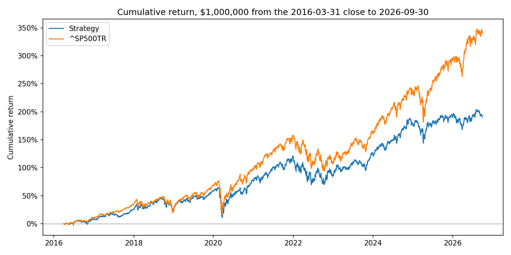
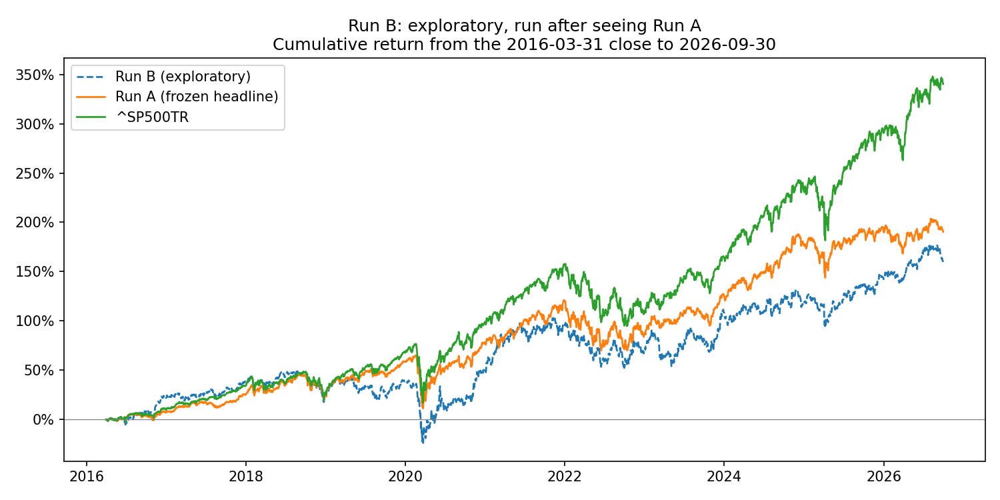

# HW4: Stock Prediction and Trading Strategy — Ryan Beauchamp

---

## 1. Summary

To begin, for this assignment in Homework 4, I built a Ridge model that predicts the rank of each stock’s 90-day return from price features (momentum, volatility, drawdown), financial ratios and sector. It did not beat the benchmark, the total return of the S&P 500. The test ran from April 2016 to September 2026, a stretch where owning large and especially mega cap companies really paid off, and I suspect that hurt a broad, equal-weighted strategy like mine, though I didn’t test that directly.

I also tested GARP-style factors. On development data they didn’t clear the bar I set in advance, so I didn’t use them in the final run. After seeing the final results, I ran a GARP-only version on the test period as an exploratory check, and it did worse (Run B below).

Over the full period, my strategy finished at $2,903,764.64 against $4,402,746.78 for the S&P 500 total return (10.69% vs 15.16% CAGR). The backtest only charges trading costs, about 0.7% a year, so the shortfall isn’t a fee story. Still, an LP paying active-management fees for a result that trailed an index fund would have had plenty of questions.

| | Strategy | ^SP500TR |
|---|---:|---:|
| Final value | $2,903,764.64 | $4,402,746.78 |
| CAGR | 10.69% | 15.16% |
| Max drawdown | −32.52% | −33.79% |
| Sharpe (2% risk-free) | 0.58 | 0.77 |

Starting capital was $1,000,000 for both, from 2016-03-31 to 2026-09-30. If the positions that stopped quoting are valued at zero instead of their last price (see Section 6), the strategy's final value is **$2,095,047.28**, about a 7.3% CAGR.



The strategy kept up reasonably well through 2018, then fell behind during 2019. The gap widened after covid and kept growing, with brief narrowing in 2018 and 2022. A chart like this depends on its starting date, and I started both lines on April 1, 2016, but I don’t think a different start would change the picture, since the gap is large and persistent.

**Run B (exploratory, run after seeing Run A).** The model used onyl these six factors: (`fcf_yield`, `ebitda_yield`, `earnings_yield`, `rev_growth_ttm`, `eps_change_yield`, `op_margin_ttm`), with no sector and none of the 13 baseline features. This six-feature set was never tested in development, and it was not the strategy chosen by my pre-set rule. Everything else matched Run A. Full outputs are in `results/run_b/`.

| | Run B (exploratory) | Run A (frozen headline) | ^SP500TR |
|---|---:|---:|---:|
| Final value | $2,590,092.74 | $2,903,764.64 | $4,402,746.78 |
| CAGR | 9.49% | 10.69% | 15.16% |
| Max drawdown | −48.82% | −32.52% | −33.79% |
| Sharpe (2% risk-free) | 0.44 | 0.58 | 0.77 |
| Final value, stale positions at zero | $1,848,139 | $2,095,047 | n/a |


Run B passed all 13 accounting checks, and Run A's files were checksummed before and after and did not change.

Run B was a narrower test: the same Ridge model and trading rules, but using only six GARP features. I ran it after seeing Run A, so it’s exploratory. It did worse than my main strategy on every headline measure (9.49% CAGR vs 10.69%) and had a much deeper drawdown (−48.8%). By year, the one big win was 2016 (a partial year), it beat the index in 2021 and 2022, and it was strong in absolute terms in 2023. But 2024 was a real laggard, and it trailed the S&P in 8 of 11 years. I’m curious whether the post-covid shift in what the market rewarded explains some of this, but I didn’t test that, so I’m treating it as a hypothesis rather than a finding.



---

## 2. How to run it

Setup, from the repository root:

```bash
uv sync --locked
```

Place `equities_class.duckdb` and `equities_top2000.duckdb` (from bCourses) in `Lectures/modeling/data/`. Both are ignored by Git.

The full run order, with commands, approximate runtimes, memory, inputs and outputs for every script, is in [CODE_MAP.md](CODE_MAP.md). Three commands worth knowing (confirm both against CODE_MAP.md):

```bash
# backtester tests (19 tests)
.venv/Scripts/python -B Homeworks/HW4/Ryan_Beauchamp/test_backtester.py

# Run A, the frozen headline. Run once; results are already saved in results/
.venv/Scripts/python -B Homeworks/HW4/Ryan_Beauchamp/final_run.py --i-confirm-frozen

# Run B, exploratory, run after seeing Run A. Run once; results are in results/run_b/
.venv/Scripts/python -B Homeworks/HW4/Ryan_Beauchamp/run_b.py
```

The final test was run exactly once and was not repeated or tuned. Large generated files go in `outputs/`, which Git ignores. The small files needed to read the results are in `results/`.

To reproduce this, you set up the environment, drop the two DuckDB files into the data folder, and follow the run order in CODE_MAP.md, starting with the tests. The final test was run once against a frozen config, so you don’t need to rerun it, because the results are saved in the results folder. Run B works the same way.

---

## 3. What I built, and why

The pipeline for this builds 13 lecture features for each clean, eligible stock-day and trains a Ridge model to rank stocks by their following 90-day return, where every choice made from 2010–2015 data uses only outcomes that had already finished. A tested backtester then bought the top 50 stocks every 5 trading days (2% cap, 90-day holds, 10 bps fees), and in the frozen run from April 2016 to September 2026 it passed all 13 checks and grew $1M to $2.90M, against $4.40M for the S&P 500 total-return index.

**Target.** The return from the next session's close (the entry) to the first quoted close on or after 90 calendar days later. The model is trained on each date's cross-sectional percentile rank of that return, because raw-return Ridge had no usable signal.

**Features.** The 13 baseline columns plus sector (price features such as 21/63/252-day momentum, 63-day volatility, drawdown, and financial ratios such as net margin, operating ROA, debt/assets, cash/assets, FCF/assets, accruals, and filing age). Financial data counts only from the day after its filing date.

**Model.** Ridge regression (alpha 1000), trained from 2010-01-01 on an expanding window, refitted every January (11 fits in the final run). Every fit uses only outcomes that had already ended before its fit date.

**Validation.** Expanding-window folds for 2012, 2013, 2014 and 2015 inside the development period (2010 to 2015). Mean rank IC was +0.034, with year-to-year inconsistency.

**Retraining.** Fitting once, refitting annually, and refitting quarterly were compared on 2012 to 2015. The differences were small and changed direction from year to year, so annual refitting was chosen mainly for practical reasons (it needs 11 fits, quarterly needs about 42), not because the evidence favored it.

| | Fit once | Annual | Quarterly |
|---|---:|---:|---:|
| Rank IC | 0.0365 | 0.0341 | 0.0368 |
| Top-5% gap (winsorized, per 90 days) | 0.69 pp | 0.88 pp | 0.75 pp |
| Model fits in the final run | 1 | 11 | about 42 |

**Strategy.** Top 50 stocks by score, equal weight, a 2% cap on each stock's *total* position, entry every 5 sessions, each round of buying uses 5/63 of NAV, 10 bps per side.

I chose to hold 50 stocks per round, with no stock above 2% of the portfolio, to stay diversified across periods when different factors are in or out of favor. Concentrated portfolios can suffer larger drawdowns when their few bets go wrong; in development, holding 50 names also beat holding 20 in every grid setting. The trade-off is that the S&P 500 is weighted by market cap, so it lets its winners grow into larger weights, while my strategy is close to equal-weighted and capped. During 2016–2026, when the largest companies led the market, that made the index a very tough benchmark: my picks returned about the same as the average eligible stock, so a large part of the gap came from equal weighting against cap weighting rather than from stock selection.

---

## 4. Data audit

- **Broken price series.** The first validation run had an RMSE near 495 where about 0.2 was expected. Twenty targets accounted for almost all of the squared error. AAM, ranked first in the universe with a capitalization proxy of about $2.5 trillion, had a price series that swung between well under a dollar and tens of thousands of dollars, which looks like two securities under one ticker. VBIV and LCI had similar jumps.
- **Causal clean flag.** A row is excluded if, over the past 252 sessions, the stock had a one-day move larger than a factor of 5 (ln 5) up or down, or if its close is below $1. It uses only data available at the signal date, and a prefix test confirmed that truncating the data does not change earlier values. It excludes 0.54% of development rows (79 stocks).
- **No market-cap ceiling.** A fixed ceiling would work before 2018 only because no real company was that large, and it would remove Apple and Microsoft later.
- **Source limitations (from `Lectures/modeling/README.md`).** Capitalization ranks are approximate. There is no delisting-proceeds table. Financials are the latest vendor values, not original filings. Sector labels are a current snapshot.

Leaving these values in would have skewed the results in a way that nobody could actually have traded. AAM is the clearest example: its price swung from under a dollar to tens of thousands, which looks like two securities sharing a ticker, and a handful of rows like that drove almost all of my first validation error. I built a rule that flags these using only past data, so it doesn’t peek ahead, and it removed about half a percent of rows. It isn’t perfect, since at least one flagged stock (JWN) looks like a false positive, but it kept impossible returns from running the results.

---

## 5. The backtester, and how I checked it

I wrote my own backtester ([backtester.py](backtester.py)). It has four parts: a strategy (decides dollar budgets), an account (books cash, lots and fees), a daily loop (advances the market calendar), and analytics (final value, CAGR, drawdown, Sharpe). The *separation* of strategy, order book, loop and analytics follows the lecture's framework; the code is new.

Key rules:

- Signals are made after the close on day *t* and fill at the close on *t+1*. The strategy never sees the fill price.
- Orders can use only the cash available at the signal close. Money from a sale on the fill day cannot fund that day's purchases.
- Fees come out of the dollar budget: units = budget / (price × (1 + fee)).
- Each purchase is held 90 calendar days, then sold at the first quoted close on or after maturity. Nothing is sold without a quote and no fill is invented.
- **Start convention for the final test:** first signal from the 2016-03-31 close, first fills and the benchmark entry on 2016-04-01, with the starting capital recorded on 2016-03-31.

**Evidence of correctness.**

- **19 unit tests** (`results/test_output.txt`), each with its expected number written before running. Examples: a constant-price round trip returns exactly −$199.80 after 10 bps on $100,000; a Monday entry matures on a Sunday and sells the next Monday; a missing entry quote leaves cash untouched; changing prices after a decision date does not change that decision.
- **13 checks on the final run** (`results/accounting_checks.json`): cash rebuilt from the fills matches recorded cash, NAV equals cash plus holdings every day, cash is never negative, every buy is after its signal date, every sale is on or after its due date, open positions reconcile, no fill after the end date, and every refit used only finished outcomes. The run is tied to the exact frozen config by its SHA-256.


---

## 6. Assumptions

| Item | What I assumed |
|---|---|
| Transaction costs | 10 bps per side on purchases and sales |
| Cash interest | 0% |
| Sharpe ratio | Daily returns, 2% annual risk-free rate, 252 sessions |
| Prices | Adjusted close for fills and marks, so dividends are not added again; fractional units |
| Missing entry quote | The order is rejected and the cash stays |
| Stock that stops quoting | **Held at its last observed price** and never sold without a quote; no payout or zero recovery is assumed because the data has no delisting proceeds |
| Zero-recovery bound | The final report also shows NAV with those positions valued at zero: **$2,095,047.28** |

The stale-quote rule matters. In 2016 to 2026, **246 positions in 34 stocks** stopped quoting and were still held on 2026-09-30, worth **$808,717 (27.9% of final NAV)** at their last price. Many look like acquisitions or called securities, so in reality the cash would have come back and been reinvested. Under my rule it just sits there earning 0%.

**Fee sensitivity (development data, 2012 to 2015):**

| Fee per side | Final value | CAGR | Sharpe |
|---:|---:|---:|---:|
| 0 bps | $1,818,361 | 16.16% | 1.09 |
| 10 bps | $1,764,813 | 15.29% | 1.03 |
| 25 bps | $1,687,439 | 14.00% | 0.94 |

The benchmark's CAGR over the same window was 14.92%, so at 25 bps the strategy falls below it.

I held stocks that stopped quoting at their last observed price, since that’s the last real trade on record. Assuming the price rose would be wrong, and so would assuming zero, because the data has no delisting proceeds. So I report both. The gap is about $808,717, or 27.9% of final NAV, which shows how much of my result depends on something the data can’t tell me.

---

## 7. Results

The strategy trailed the benchmark in 9 of 11 calendar years and was ahead only in 2018 and 2022.

| Year | Strategy | ^SP500TR | Strategy max drawdown | Benchmark max drawdown |
|---|---:|---:|---:|---:|
| 2016 (from Mar 31) | +6.9% | +9.8% | −6.6% | −5.5% |
| 2017 | +16.8% | +21.8% | −5.2% | −2.6% |
| 2018 | +1.3% | −4.4% | −18.0% | −19.4% |
| 2019 | +25.3% | +31.5% | −5.3% | −6.6% |
| 2020 | +12.3% | +18.4% | −32.5% | −33.8% |
| 2021 | +23.5% | +28.7% | −7.0% | −5.1% |
| 2022 | −15.0% | −18.1% | −22.8% | −24.5% |
| 2023 | +21.4% | +26.3% | −8.9% | −9.9% |
| 2024 | +21.9% | +25.0% | −5.7% | −8.5% |
| 2025 | +5.2% | +17.9% | −14.2% | −18.8% |
| 2026 (to Sep 30) | −0.2% | +12.8% | −9.6% | −8.9% |
| Whole period | +190.4% | +340.3% | −32.5% | −33.8% |

**Did the model rank stocks usefully?** Somewhat in ranking, not at the top of the list:

| | Rank IC | Top-5% gap, raw | Top-5% gap, winsorized |
|---|---:|---:|---:|
| Test period, 2016 to 2026 | +0.033 | +0.01 pp | +0.23 pp |
| Development, 2012 to 2015 | +0.034 | +0.58 pp | +0.88 pp |

**Did it pick better stocks than average?** The average 90-day return of what the strategy bought was 3.13%, against 3.17% for the equal-weighted average of all eligible stocks (gross of fees), so there was no net selection skill.

**Why the shortfall?** A rough, back-of-envelope reconciliation of the 4.5-point CAGR gap (approximate, and the pieces are not exactly additive): an equal-weighted broad universe versus a cap-weighted index (about 1.6 points), cash and frozen positions earning 0% (about 1.7), fees (0.7 per year; $137,201 in total), and a few unadjusted splits (about 0.2). Frozen positions averaged 7.0% of NAV over the period and reached 27.9% at the end; cash averaged 5.7%.

The diagnostics point to a few things. The stocks my model picked returned about the same as the average eligible stock (3.13% vs 3.17% per 90 days), so there was no real selection skill. On top of that, an equal-weighted portfolio of many stocks trails a cap-weighted index in a period led by mega caps, and the positions that stopped quoting sat frozen at 0%. My own view, which I didn’t test, is that mega caps were also helped by strong balance sheets and the AI boom, and that the 2% cap and the 90-day hold kept me from riding winners.

---

## 8. How I chose the strategy (development data only)

Eight settings were tried on 2012 to 2015 with annual refits. The benchmark's CAGR over that window was 14.92%.

| Top N | Cap | Entry every | Final value | CAGR | Max drawdown | Sharpe | Avg invested |
|---|---|---|---:|---:|---:|---:|---:|
| 20 | 2% | 5 | $1,362,986 | 8.07% | −6.7% | 0.83 | 51% |
| 20 | 2% | 21 | $1,300,638 | 6.81% | −6.4% | 0.73 | 47% |
| 20 | 5% | 5 | $1,663,254 | 13.59% | −10.9% | 0.89 | 92% |
| 20 | 5% | 21 | $1,497,941 | 10.65% | −11.3% | 0.72 | 85% |
| **50** | **2%** | **5** | **$1,764,813** | **15.29%** | **−10.6%** | **1.03** | **92%** |
| 50 | 2% | 21 | $1,651,460 | 13.39% | −10.4% | 0.95 | 85% |
| 50 | 5% | 5 | $1,774,109 | 15.44% | −10.6% | 1.04 | 93% |
| 50 | 5% | 21 | $1,655,462 | 13.46% | −10.6% | 0.95 | 86% |

The top settings were nearly tied, so the choice (top 50, 2% cap, every 5 sessions) is reasonable but not proven. The best setting beat the benchmark by only about 0.4 points of CAGR over four years, after choosing the best of 8, which is roughly no edge.

**The GARP experiment.** I tested GARP-style features (cash-flow and EBITDA yields to enterprise value, earnings yield, revenue growth, earnings-change yield, operating margin, a standardized earnings surprise, and a rank composite). The adoption rule was fixed *before* running: adopt only if the mean rank IC improves and the top-5% gap improves in at least 3 of 4 years.

| Fold | Baseline IC | +GARP IC | Baseline gap | +GARP gap |
|---|---:|---:|---:|---:|
| 2012 | +0.048 | +0.050 | +0.28 pp | +0.48 pp |
| 2013 | −0.048 | −0.040 | −0.72 pp | −0.69 pp |
| 2014 | +0.049 | +0.063 | +2.35 pp | +1.77 pp |
| 2015 | +0.087 | +0.088 | +1.62 pp | +1.18 pp |
| **Mean** | **+0.034** | **+0.040** | **+0.88 pp** | **+0.68 pp** |

The mean IC improved, but the gap improved in only 2 of 4 years (2012 and 2013), so GARP was not adopted. A GARP-only version had a better development backtest (17.61% CAGR) but failed the same rule, and I did not override it.

---

## 9. Risks and limitations

- **Frozen capital.** 27.9% of final NAV was in positions that stopped quoting, valued at their last price. The zero-recovery bound is $2,095,047.
- **Data errors in held positions.** Some one-day moves on held stocks look like unadjusted stock splits (ORLY, KLAC, and a few others). The six split-like events cost about $75,000 in total. The jump flag only catches moves of 5x or more, so smaller unadjusted splits (2-for-1, 3-for-1) could be missed. Prices were never altered. (`results/diagnostics/D3` and `D4`.)
- **Non-common instruments.** Several held names that stopped quoting appear to be notes or partnership units (UZA, OXSQL, SBBA, SPLP), which a stock universe should not contain. HTFB and CCLDO look similar but are unverified. (`results/diagnostics/D7`.)
- **Overlapping outcomes.** 90-day returns on adjacent days overlap, so statistical tests look stronger than they are.
- **Selection effects.** The strategy was the best of 8 on a four-year window, and the 2015 fold was also used when choosing the target transformation.
- **Source limits.** No delisting-proceeds data, restated financials, a current-snapshot sector classification, approximate capitalization ranks.
- **Costs.** I assumed 10 bps per side. At 25 bps the development edge disappears.

The fixed 90-day holding period keeps the strategy simple, but it has no early exit. In my work we do monthly allocation updates, so I’ve lived this: SVB failed days after a month-end, and the 2025 tariff selloff came right after one, and we had to sit through both. My strategy buys every 5 days, so its exits are staggered, but positions bought just before a shock still ride it out. The second limitation is the stocks that stopped quoting, which were 27.9% of final NAV. I valued them at their last price, and at zero the final value falls from about $2.90M to $2.10M, so my result depends on something the data can’t tell me.

---

## 10. What didn't work, and what I would try next

**Didn't work (with numbers):**

- Raw-return Ridge: rank IC −0.009 and a negative top-5% gap on clean data.
- The unscreened universe: broken price series swamped every error metric.
- Gradient boosting instead of Ridge on the rank target: rank IC 0.027 vs 0.034, and a negative top-5% gap.
- Top 20 with a 2% cap: only about half of the money stayed invested.
- GARP features: not adopted under my own rule.
- GARP-only on the test period (Run B): 9.49% CAGR, −48.8% max drawdown

**What I would try next:**

- A liquidity and instrument-type screen (price, dollar volume, excluding notes and preferred shares).
- An equal-weighted benchmark of the same universe, so the model is compared against a like-for-like baseline.
- A more concentrated strategy with a market cap weighting like the S&P 500, but with a smaller portfolio size.
- Revisiting GARP features with a cleaner source for price and share data.

The S&P 500 is truly a tough benchmark to beat and I see why managers focus more on uncorrelated risk-adjusted returns over total performance. Net of fees, most active strategies lag in the long run and for an everyday person who does not want to worry about complexities, you get a solid bang for your buck with a low-cost S&P 500 index fund.

---

## 11. AI assistance and credits

I used Claude (Anthropic) in the Claude desktop app and in Claude Code to plan the work and to help write and test the code in this folder, and I used Bloomberg's ASKB assistant for ideas on GARP-style factors.

Code reused or adapted: `Lectures/modeling/course_data.py` (data loading, feature, membership, label and fold helpers) is imported and reused. The backtester's separation into strategy, account, daily loop and analytics follows `Lectures/modeling/backtest.py`, but the backtester here is new code. Each script's header comment lists what it reuses.

The Bloomberg ASKB suggestions were used only to generate ideas for the GARP features; I did not cite its sources as evidence.
