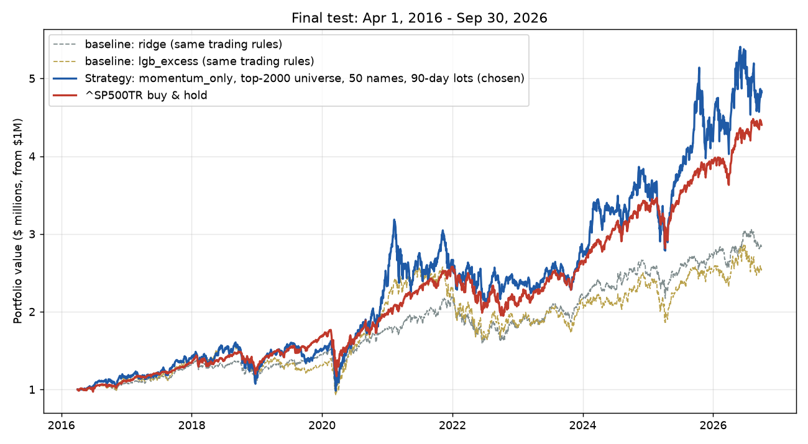
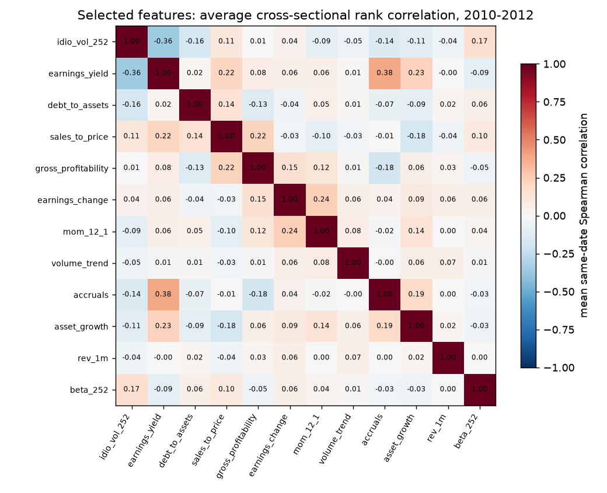

# HW4 — Momentum stock selection (with a LightGBM comparison) vs. the S&P 500 total-return index

**Result.** Over the final test (Apr 1, 2016 – Sep 30, 2026), my submitted strategy turned **$1M into $4.82M (16.17% CAGR)**. The strategy is 12-1 momentum: every two weeks it buys the 50 strongest stocks and holds each for 90 days. Over the same period **`^SP500TR` turned $1M into $4.40M (15.17% CAGR)**.

**The strategy beat the benchmark on return**, by **+1.01 pp of CAGR ($421k)**. It did so with more risk: a lower Sharpe ratio (0.61 vs. 0.77) and a deeper drawdown (−39.4% vs. −33.8%). The edge also depends on how delisted stocks are valued (§10).

I also built and validated a **LightGBM** model on 12 low-correlation features, which was my original, frozen choice, and a **Ridge** model. Under identical trading rules they returned 9.2% and 10.4% a year.



| Final test, Apr 1 2016 – Sep 30 2026 | **Momentum (submitted)** | **^SP500TR** | LightGBM (same rules) | Ridge (same rules) |
|---|---:|---:|---:|---:|
| Final value (cash + open positions) | **$4,824,110** | **$4,402,747** | $2,521,504 | $2,814,761 |
| CAGR | **16.17%** | **15.17%** | 9.21% | 10.36% |
| Annualized volatility | 27.6% | 17.8% | 22.2% | 17.0% |
| Sharpe (daily, 2% rf) | 0.61 | **0.77** | 0.42 | 0.55 |
| Maximum drawdown | −39.4% | **−33.8%** | −41.1% | −30.7% |
| CAGR vs. benchmark | **+1.01 pp** | — | −5.96 pp | −4.80 pp |

All three strategies use the same universe, screens, sizing, costs, and test-period dates; only the stock score differs. The numbers are in [results/final/test_performance.csv](results/final/test_performance.csv).

**Contents:**
1. [How to run](#1-how-to-run)
2. [What I did](#2-what-i-did)
3. [Data, timing, and look-ahead checks](#3-data-timing-and-look-ahead-checks)
4. [Features](#4-features-17-candidates-screened-to-12-with-low-correlation)
5. [Models: momentum, LightGBM, Ridge](#5-models-momentum-lightgbm-and-ridge)
6. [Trading strategy](#6-trading-strategy)
7. [Validation, and how the final strategy was chosen](#7-validation-and-how-the-final-strategy-was-chosen)
8. [Everything I compared](#8-everything-i-compared)
9. [Accounting evidence](#9-evidence-that-the-accounting-and-timing-are-right)
10. [Results, risks, and limitations](#10-results-risks-and-limitations)
11. [Unsuccessful ideas and what I would try next](#11-unsuccessful-ideas-and-what-i-would-try-next)
12. [Sources and AI use](#12-sources-and-ai-use)

---

## 1. How to run

**Setup.** Put `equities_top2000.duckdb` from bCourses in `Lectures/modeling/data/`. The code also looks in the repository root, or you can pass `--db PATH`. Then create an environment from the repository root:

```bash
uv sync --locked && uv pip install lightgbm pyarrow pytest nbconvert ipykernel
```

or, without uv:

```bash
python -m venv .venv && .venv/bin/pip install -r Homeworks/HW4/Shashank_Mishra/requirements.txt
```

On Windows, use `.venv\Scripts\pip`.

**Option A — the notebook.** Open [hw4.ipynb](hw4.ipynb) and choose *Run All*. It runs the whole homework in about 8 minutes:
* data loading
* feature screen
* 2013–2015 validation
* the final test for momentum, LightGBM, and Ridge
* the chart
* accounting checks
* holdings diagnostics

The committed copy already shows its outputs. To re-execute it from the command line:

```bash
cd Homeworks/HW4/Shashank_Mishra
python -m jupyter nbconvert --to notebook --execute --inplace --ExecutePreprocessor.timeout=-1 hw4.ipynb
```

**Option B — the scripts.** These write the tables and charts in `results/`:

```bash
cd Homeworks/HW4/Shashank_Mishra
python -m pytest tests -q        # 8 hand-calculated accounting/timing tests, < 1 s
python run_hw4.py dev            # 2010-2015 only: feature screen, validation, freezes results/chosen_config.json (LightGBM)  ~3 min
python run_hw4.py test           # final test of the frozen LightGBM config                                                   ~2 min
python run_hw4.py dev2           # optional second round of comparisons, 2010-2015 only -> results/round2/                    ~5 min
python run_hw4.py test2          # final test of the round-2 config                                                           ~3 min
python run_hw4.py final          # SUBMITTED strategy: momentum + LightGBM + Ridge under the same rules -> results/final/      ~3 min
```

The first command that needs data builds the 1.66M-row feature panel and caches it in `outputs/panel.parquet` (git-ignored). This adds a few minutes once.

| Path | What it holds |
|---|---|
| [hw4.ipynb](hw4.ipynb) | Runnable walkthrough of the whole homework, with outputs |
| [hw4/backtest.py](hw4/backtest.py) | **My backtester**: lot-based daily simulation, the top-N strategy, the benchmark, and performance metrics |
| [hw4/data.py](hw4/data.py) | Read-only DuckDB loading, price quarantine, availability-dated fundamentals |
| [hw4/features.py](hw4/features.py) | 17 candidate features, 90-day labels, same-date percentile ranks, low-correlation screen |
| [hw4/model.py](hw4/model.py) | LightGBM and Ridge models, walk-forward folds, prediction metrics |
| [run_hw4.py](run_hw4.py) | The pipeline stages, accounting checks, charts |
| [tests/test_backtest.py](tests/test_backtest.py) | Hand-calculated accounting and timing tests |
| [results/final/](results/final/) | **Submitted run**: performance, chart, accounting checks, config |
| [results/](results/), [results/round2/](results/round2/) | Feature screen, validation tables, and the LightGBM test runs |

## 2. What I did

```
equities_top2000.duckdb ─► point-in-time panel: every 5th session 2010–2026, eligible members only
                            17 candidate features → same-date percentile ranks
                            label = next-close entry → first quote ≥ 90 calendar days later
   │
   ├─ feature screen (2010–2012): keep 12 features with mean |ρ| ≤ 0.4
   ├─ walk-forward validation (fit before 2013, 2014, 2015 → continuous 2013–2015 backtests)
   │     LightGBM (3 variants), Ridge, momentum × universe / names / screen grid
   ├─ froze LightGBM (best validation Sharpe among tree models) → final test: 9.2% CAGR
   ├─ second round on 2013–2015 (smaller universes, more models) → final test: 8.8% CAGR
   └─ submitted: 12-1 momentum, best momentum setup in validation → final test: 16.2% CAGR
```

## 3. Data, timing, and look-ahead checks

**Only the provided data is used.** Every input comes from `equities_top2000.duckdb`, opened read-only:
* `prices`
* `benchmark_prices` (^SP500TR)
* `universe_membership`
* `fundamentals`
* `stocks` (sector)

Nothing is downloaded.

**Timing.**
* **Signal → entry → exit.** Features use data through the close of signal date *t*. The buy fills at the **next session's close** (*t+1*). The lot is sold at the first quoted close on or after *t+1* + 90 calendar days. The training label is that same return, so the models predict exactly the trade they make.
* **Universe.** A stock is eligible on *t* only if it is in the quarterly top-2000 list **for the quarter of the entry session** and has 63 complete trailing returns. The code asserts `selection_date ≤ t` for every row. Stocks that later delist stay in the history, so there is no survivorship filter. Held positions are kept when a stock leaves the universe.
* **Fundamentals.**
  * Each one is used from `filing_date + 1 day`.
  * A late filing of an old quarter never replaces a newer one.
  * TTM sums and year-over-year changes combine only consecutive quarters, and become available at the latest filing date among those quarters.
  * Values more than 550 days past fiscal end are blanked.
* **Prices.**
  * Adjusted closes are used for returns, so dividends are never added twice.
  * 275 invalid BHRB rows are quarantined, and 28 off-calendar rows are dropped.
  * Prices are never forward-filled.
  * The $5 screen and market cap use the **unadjusted** close, which avoids the look-ahead hidden in back-adjusted prices.
* **Model fits.** Every fit uses only rows whose exit (`label_end`) is strictly before the fit date, and asserts it ([results/test_refits.csv](results/test_refits.csv)). Features are percentiles within each date, so no preprocessing is fitted across time.

**Remaining small leaks** (see §10):
* Sectors are a current snapshot, used only for the sector cap.
* Fundamentals are the vendor's latest values.
* Membership is a reconstruction.

## 4. Features: 17 candidates, screened to 12 with low correlation

I built **17 standard, economically motivated candidates.** Descriptions are in [results/feature_screen.csv](results/feature_screen.csv).
* **Price/risk:** 12-1 momentum, 1-month reversal, 63-day volatility, 252-day beta, 252-day idiosyncratic volatility, distance from the 52-week high, maximum daily return in 21 days, volume trend.
* **Fundamental:** log market cap, earnings yield, book-to-market, sales-to-price, gross profitability, asset growth, accruals, debt/assets, year-over-year earnings change.

**Screen (2010–2012 matured labels only).**
1. Average the same-date Spearman correlations and rank ICs over dates.
2. Walk the candidates in order of |IC|.
3. Keep a candidate only if its |ρ| with every feature already kept is ≤ 0.4.

| Dropped | Because of |
|---|---|
| vol_63 | ρ = 0.86 with idio_vol_252 |
| max_ret_21 | ρ = 0.66 with idio_vol_252 |
| log_mcap | ρ = −0.65 with idio_vol_252 |
| dist_52w_high | ρ = −0.55 with idio_vol_252 |
| book_to_market | ρ = 0.42 with sales_to_price |

**12 features kept:** `idio_vol_252, earnings_yield, debt_to_assets, sales_to_price, gross_profitability, earnings_change, mom_12_1, volume_trend, accruals, asset_growth, rev_1m, beta_252`. The largest remaining |ρ| is 0.38. These feed LightGBM and Ridge. The momentum strategy uses only `mom_12_1`.



## 5. Models: momentum, LightGBM, and Ridge

### Momentum (submitted)

**Score:** the stock's 12-1 momentum, meaning its return from 12 months ago to 1 month ago, as a percentile among that day's eligible stocks. Nothing is fitted.

**Why it works.** Stocks that outperformed over the past year tend to keep outperforming for the next few months (Jegadeesh & Titman, 1993). The usual explanations are investor under-reaction to news and slow-moving institutional flows. Skipping the most recent month avoids the short-term reversal effect.

**It is not a copy of the S&P 500.** The index holds about 500 large companies weighted by size. This strategy holds about 105 names at a time, equally weighted, picked from all 2000 eligible stocks.
* The median purchase ranked **#1,230** by size, and only 16% came from the top 500.
* Its biggest winners were CVNA, APP, BE, SMCI, and VKTX, which are not index heavyweights.
* It overlaps with the index mainly when the index's leaders are also the market's strongest trends, as with technology in 2023–2025.

### LightGBM (original frozen model, kept as a comparison)

**Target:** the 90-day return **relative to other stocks on the same date**, winsorized at 1%/99% and demeaned. **Inputs:** the 12 screened feature percentiles.

**Why it is a good fit for this problem:**
1. **Nonlinearity and interactions.** Trees can learn, for example, that value matters differently for highly levered firms, without hand-made cross terms.
2. **Robust to messy data.** Splits only use the ordering of a feature, so extreme vendor values can't dominate. Missing fundamentals (about 10% of rows) need no imputation.
3. **Strong regularization for a noisy target.** Each tree has 7 leaves, each leaf needs at least 5,000 stock-weeks, rows and columns are subsampled, and there is an L2 penalty.
4. **Fast.** About 10 s per fit on 1.6M rows, so I refit once a year.

**Why low correlation matters for trees.** Correlated inputs split importance arbitrarily, make splits flip from one refit to the next, and waste column-subsampling draws.

**How it did.** The model ranked stocks slightly better than chance (test rank IC 0.018), but its top picks did not outperform. Its most important feature was sales-to-price, a value signal, and value had a poor decade.

### Ridge (comparison)

A linear model on the same 12 ranks, with α = 10. In validation it had a higher rank IC than LightGBM (0.032 vs. 0.008). In the test it returned 10.4% a year vs. LightGBM's 9.2%. With signals this weak, the trees did not find interactions worth more than a linear combination.

## 6. Trading strategy

* **Every 10 sessions (~2 weeks)** after the close, score all eligible stocks and buy the top **50**. A stock must pass these screens, all known on the signal date:
  * dated universe rank ≤ 2000
  * price ≥ $5 (unadjusted)
  * no one-day move of 100% or more in the past year (a bad-price guard)
  * 12-1 momentum at or above the median (always true for momentum's top 50)
* **Sizing.** Each cohort gets `min(cash, NAV/6)`, split equally across its names. About 6.4 cohorts overlap within 90 days, so the book stays nearly fully invested. Each name is capped at 5% of NAV across its lots, and each sector at 30% of a cohort's names.
* **Exit.** Each lot is sold at the first quoted close on or after its 90-calendar-day maturity.
* **Assumptions.**
  * **10 bps per side** (commission plus spread), with the entry fee included in each budget. The benchmark is fee-free.
  * Cash earns 0%.
  * A buy with no quote at entry is skipped; 4 were skipped in the test.
  * Missing marks are carried at the last price and flagged after 5 sessions.
  * After **63 sessions without a quote**, a lot is **frozen** at its last mark and never sold. This stops a reused ticker from being "sold" at an unrelated company's price (§9).

## 7. Validation, and how the final strategy was chosen

**Validation design.** All validation used **Jan 2010 – Dec 2015**, with expanding-window folds: a model is fit just before the first signal of 2013, 2014, and 2015, on matured labels only, and then scores that year. The fold predictions drive one continuous **2013–2015 backtest**.

**Grid:**
* **Models:** LightGBM with a rank target, LightGBM with an excess-return target, LightGBM with sector as an input; Ridge; momentum.
* **Universe:** top 1000 or top 2000.
* **Names per cohort:** 25 or 50.
* **Momentum screen:** on or off.

Results are in [results/dev_strategy_validation.csv](results/dev_strategy_validation.csv).

| Validation 2013–2015 (best setup per model) | CAGR | Sharpe | Max DD |
|---|---:|---:|---:|
| **Momentum: top 2000, 50 names (submitted setup)** | **26.66%** | **0.86** | −20.8% |
| LightGBM excess target: top 2000, 50 names, screen (frozen) | 13.96% | 0.81 | −13.9% |
| LightGBM rank target | 11.18% | 0.76 | −11.6% |
| LightGBM with sector input | 12.86% | 0.79 | −12.7% |
| Ridge | 12.72% | 0.83 | −13.8% |
| ^SP500TR | 14.05% | 0.94 | −12.0% |

**How the choice was made, in order:**
1. **First rule.** Before any test run, I chose the best validation Sharpe *among LightGBM models*, because the assignment brief asked for a tree model. That LightGBM configuration was frozen in [results/chosen_config.json](results/chosen_config.json) and tested once: **9.2% CAGR**. Momentum and Ridge ran next to it as baselines declared in advance.
2. **Second round** (`dev2`, [results/round2/](results/round2/)). I compared 8 models × 16 setups on 2013–2015 only, adding top-300/500 universes, all 17 features, risk-adjusted momentum, and a LightGBM–momentum blend. The pre-set rule was the best validation Sharpe overall. It picked LightGBM trained on the top 1000 and trading the top 300 (Sharpe 1.03). In the test it made **8.8% CAGR**. Its validation rank IC was negative, so its validation win was most likely luck.
3. **Final submission: momentum.** Across both rounds, momentum had the highest validation return with a Sharpe comparable to the best models'. Its best validation setup (top 2000, 50 names) is exactly the trading rule used everywhere else, so no parameter was tuned on the test. [results/final/chosen_config.json](results/final/chosen_config.json) records this.

**Honest caveat.** Switching from LightGBM to momentum was decided *after* both LightGBM tests had been seen, and momentum's own test result had already been computed as a baseline. The +1.0 pp edge is therefore not a clean out-of-sample result. The LightGBM result in step 1 is the one that was fully pre-committed.

## 8. Everything I compared

| Comparison | Result |
|---|---|
| 17 candidate features → 12 by correlation screen | 5 dropped at \|ρ\| > 0.4; adding them back did not help LightGBM or Ridge (round 2) |
| LightGBM rank target vs. excess-return target | Excess target better in validation |
| LightGBM with vs. without sector input | Sector input hurt (it memorized which sectors had won) |
| LightGBM trained on all stocks vs. only the top 1000 | Top-1000 training: best validation Sharpe but negative IC; test 8.8% |
| LightGBM vs. Ridge | Ridge: higher IC, similar validation Sharpe, slightly better test (10.4% vs. 9.2%) |
| Model-based scores vs. momentum | Momentum: highest return in validation and test (16.2%), with the highest volatility |
| Risk-adjusted momentum (momentum ÷ volatility); LightGBM + momentum blend | Strong validation Sharpe on small universes; not selected |
| Universe top 300 / 500 / 1000 / 2000 | Smaller universes raised validation Sharpe for every model, but not test returns for LightGBM |
| 25 vs. 50 names; momentum screen on or off | 50 names best for momentum; the screen helped LightGBM |

## 9. Evidence that the accounting and timing are right

**Unit tests** ([tests/test_backtest.py](tests/test_backtest.py), 8 passing). Each case is computed by hand:
* **Round trip.** A $500k fee-inclusive buy at $100 with a 10 bp fee gives 4,995.005 units. A sale 90 days later at $110 gives exactly the expected cash, PnL, and NAV.
* **Missing quotes.** A missing quote at maturity defers the sale to the next quoted close. A missing quote at entry skips the buy.
* **Cash.** Budgets above available cash raise an error, so cash can't be spent twice.
* **Lots.** Two lots of the same ticker keep separate maturities.
* **Labels.** Labels use next-session entry and the first quote on or after 90 days.
* **Metrics.** The metric formulas are correct.
* **Ticker reuse.** A ticker that returns after a long gap is frozen, not sold.

**Checks on the submitted run** ([results/final/test_accounting_checks.json](results/final/test_accounting_checks.json)). Every check is re-derived independently from the trade log:

| Check | Result |
|---|---|
| Initial cash + Σ fill cash changes = ending cash | ✅ |
| Initial + Σ realized PnL + unrealized PnL of open lots (net of entry fees) = final NAV | ✅ |
| NAV = cash + holdings on every day; minimum cash ≥ 0 | ✅ (min cash $0.00) |
| Every buy fills at the session immediately after its signal close | ✅ 13,096 buys |
| No sale before maturity; every sale at the first quote on/after maturity | ✅ 12,680 sells (12,678 on the maturity session, 2 later because of missing quotes) |
| 25 random fill prices re-queried from DuckDB match `adj_close` | ✅ |
| Fees paid | $159,631 |

**Worked example, by hand.** MXL was signalled 2016-03-31.
1. The buy filled 2016-04-01 at $18.62 with a budget of $3,333.33: units = 3,333.33 / (18.62 × 1.001) = 178.84.
2. The lot was due and sold 2016-06-30 at $17.98: proceeds = 178.84 × 17.98 × 0.999 = $3,212.33.
3. PnL = 3,212.33 − 3,333.33 = **−$121.00**, which matches the backtester.

The notebook repeats this calculation.

**A bug the checks caught.** An ITG lot bought in 2019 was "sold" in 2026, 1,803 sessions late. The original company had been acquired, and an unrelated issuer reused the ticker. I added the 63-session freeze rule and a regression test, and re-ran everything.

## 10. Results, risks, and limitations

**Year by year** (2016 and 2026 are partial years):

| Year | 2016 | 2017 | 2018 | 2019 | 2020 | 2021 | 2022 | 2023 | 2024 | 2025 | 2026 |
|---|---|---|---|---|---|---|---|---|---|---|---|
| Momentum | 13.9% | 22.6% | −15.3% | 26.8% | 55.9% | 11.2% | −9.5% | 19.2% | 23.7% | 20.6% | 15.2% |
| ^SP500TR | 9.8% | 21.8% | −4.4% | 31.5% | 18.4% | 28.7% | −18.1% | 26.3% | 25.0% | 17.9% | 12.7% |

**Did it beat the benchmark?** Yes, on final value and CAGR: +$421k and +1.01 pp per year. But not on risk-adjusted terms.
* **Higher risk.** Volatility was 27.6% vs. 17.8%, and the Sharpe was 0.61 vs. 0.77. The worst drawdown, −39.4%, came in the Feb 19 – Mar 18, 2020 crash, against −33.8% for the index.
* **Uneven years.** The edge came mostly from 2020 (+55.9% vs. +18.4%) and 2022 (−9.5% vs. −18.1%). It trailed in 2018, 2019, 2021, 2023, and 2024.
* **Risks taken.**
  * About 105 names, equally weighted, tilted to mid and small caps: median size rank #1,230.
  * Heavy in healthcare (24% of buys) and technology (21%).
  * Exposed to momentum crashes when market leadership reverses suddenly.
  * The lot hit rate was only 51%. The median lot earned +0.8%, while the mean was +5.8%: returns come from a few big winners such as CVNA and APP.

**The biggest limitation: delisted stocks.** At the end, **119 open lots worth $918k (19% of NAV)** are in stocks with no final quote, mostly acquisitions, take-privates, and renames. Examples are TERN, COMM, CBAY, MDP, HOUS, GPS→GAP, and HMHC. The database has no delisting-proceeds table, so I carry them at their last price rather than invent a fill.
* Acquisitions usually pay at or above the last price, so this is a reasonable central estimate.
* But **if they were all written to zero, the final value would be $3.91M, below the index's $4.40M.**
* Proceeds that never come back are also never reinvested, which drags in the other direction.

**Other limitations.**
* **Short validation.** Validation covered only 2013–2015, and the choice of momentum came after the test (§7).
* **Data.** Membership is a reconstruction. Fundamentals are the latest vendor values. Sectors are a current snapshot.
* **Costs.** They are a flat 10 bps, with no market impact for the smaller names.
* **Statistics.** IC t-statistics overstate significance because the 90-day labels overlap.

## 11. Unsuccessful ideas and what I would try next

**Did not help:**
* LightGBM in every variant I tried: excess or rank target, sector input, all 17 features, training on large caps only.
* LambdaRank: lower IC.
* Blending LightGBM with momentum.
* Restricting to the 300 largest stocks: better validation, worse test for LightGBM.

**Next:**
* **Delisting proceeds.** Match delisted tickers to deal terms, to value stuck lots properly and recycle their cash.
* **Risk control for momentum.** Volatility scaling or a market-trend filter to soften momentum crashes. Decide it on validation data only.
* **Longer validation history.** If allowed, use pre-2010 labels so the choice isn't based on three years.
* **Costs.** A per-name cost model based on volume.

## 12. Sources and AI use

* **Course conventions.** These are adapted from [`Lectures/modeling/course_data.py`](../../../Lectures/modeling/course_data.py), [`backtest.py`](../../../Lectures/modeling/backtest.py), and the [data guide](../../../Lectures/modeling/README.md):
  * the next-session membership quarter
  * filing date + 1 day and the late-filing rule
  * the 550-day staleness rule
  * fee-inclusive budgets
  * 5-session stale marks

  The code here, including the backtester, is my own implementation; nothing is copied.
* **Feature ideas** come from the standard literature: Jegadeesh & Titman (momentum), Ang et al. (idiosyncratic volatility), Bali et al. (MAX), Novy-Marx (gross profitability), Sloan (accruals), Cooper et al. (asset growth), Bernard & Thomas (post-earnings drift), and Fama & French (value).
* **AI assistance.** This submission was built with Claude (Anthropic's AI assistant) in Claude Code, which the HW4 instructions allow. Claude wrote the code and the notebook and ran the experiments at my direction. I chose the approach (low-correlation features, LightGBM, the comparisons, and the final momentum strategy) and reviewed the design, results, and this write-up.
