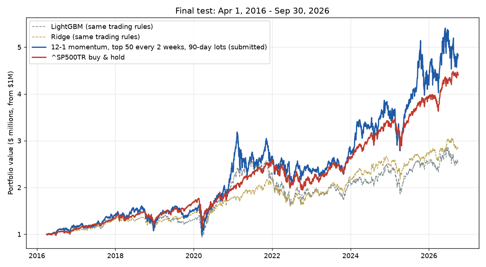

# HW4 — Shashank Mishra: momentum stock selection vs. the S&P 500

My submitted strategy is **12-1 momentum**: every two weeks I buy the 50 stocks with the strongest 12-month price trend (skipping the latest month) and hold each for 90 days. Over the final test (Apr 1, 2016 – Sep 30, 2026) it turned **$1M into $4.82M (16.17% CAGR)**. Over the same period **`^SP500TR` turned $1M into $4.40M (15.17%)**.

**I beat the benchmark on return**, by **+1.01 pp per year ($421k)**, but I took more risk to do it. My Sharpe ratio was lower (0.61 vs. 0.77) and my maximum drawdown was deeper (−39.4% vs. −33.8%).

I also built a **LightGBM** model on 12 low-correlation features, and a **Ridge** model. I ran both under exactly the same trading rules as comparisons.



| Final test, Apr 1 2016 – Sep 30 2026 | **Momentum (submitted)** | **^SP500TR** | LightGBM | Ridge |
|---|---:|---:|---:|---:|
| Final value (cash + open positions) | **$4,824,110** | **$4,402,747** | $2,521,504 | $2,814,761 |
| CAGR | **16.17%** | **15.17%** | 9.21% | 10.36% |
| Annualized volatility | 27.6% | 17.8% | 22.2% | 17.0% |
| Sharpe (daily, 2% rf) | 0.61 | **0.77** | 0.42 | 0.55 |
| Maximum drawdown | −39.4% | **−33.8%** | −41.1% | −30.7% |
| CAGR vs. benchmark | **+1.01 pp** | — | −5.96 pp | −4.80 pp |

The numbers are in [results/test_performance.csv](results/test_performance.csv).

## 1. How to run what I did

**Setup.** I put `equities_top2000.duckdb` from bCourses in `Lectures/modeling/data/`. My code also looks in the repository root, or you can pass `--db PATH`. From the repository root I created an environment with either of these:

```bash
uv sync --locked && uv pip install lightgbm pyarrow pytest nbconvert ipykernel
```

```bash
python -m venv .venv && .venv/bin/pip install -r Homeworks/HW4/Shashank_Mishra/requirements.txt
```

On Windows, use `.venv\Scripts\pip`.

**The quickest way to see everything: my notebook.** I open [hw4.ipynb](hw4.ipynb) and choose *Run All*. It takes about 8 minutes and walks through:
* loading the data
* the feature screen
* 2013–2015 validation
* the final test for momentum, LightGBM, and Ridge
* the chart
* the accounting checks
* what the portfolio held

The committed copy already shows all its outputs.

**The same work as scripts.** This is how I produced the files in `results/`:

```bash
cd Homeworks/HW4/Shashank_Mishra
python -m pytest tests -q     # my 8 hand-calculated accounting/timing tests (< 1 s)
python run_hw4.py dev         # 2010-2015 only: feature screen + validation; writes results/chosen_config.json (~3 min)
python run_hw4.py test        # final test 2016-2026: momentum + LightGBM + Ridge, chart, accounting checks (~3 min)
```

The first run builds the 1.66M-row feature panel and caches it in `outputs/panel.parquet`, which is git-ignored along with the full trade logs. This adds a few minutes once.

| File | What it is |
|---|---|
| [hw4.ipynb](hw4.ipynb) | My full walkthrough, with outputs |
| [hw4/backtest.py](hw4/backtest.py) | **My backtester**: it tracks every purchase, sale, lot, the cash, and daily portfolio value. It also has the top-N strategy, the benchmark, and the performance metrics. |
| [hw4/data.py](hw4/data.py) | Read-only DuckDB loading, the bad-price quarantine, and fundamentals dated by when they became available |
| [hw4/features.py](hw4/features.py) | The 17 candidate features, the 90-day labels, and the low-correlation screen |
| [hw4/model.py](hw4/model.py) | The LightGBM and Ridge models, walk-forward folds, and ranking metrics |
| [run_hw4.py](run_hw4.py) | The `dev` and `test` stages, accounting checks, and charts |
| [tests/test_backtest.py](tests/test_backtest.py) | Accounting and timing tests I can verify by hand |
| [results/](results/) | Small tables and charts from the runs above |

## 2. Data and timing (no look-ahead)

I use only the provided database: prices, `^SP500TR`, quarterly membership, fundamentals, and sectors. Nothing is downloaded.

* **Signal → entry → exit.** My features use data through the close of signal date *t*. I buy at the **next session's close** (*t+1*). I sell at the first quoted close on or after *t+1* + 90 calendar days. The models are trained on exactly that return.
* **Universe.** A stock is eligible only if it is in the dated top-2000 list **for the quarter of the entry session**, and only if it has 63 complete trailing daily returns. My code asserts that the membership was known on the signal date. I never drop stocks because they later disappear, and I keep positions after a stock leaves the universe.
* **Fundamentals.** I use them only from `filing_date + 1 day`. A late filing of an old quarter never replaces a newer one. Values more than 550 days past fiscal end are blanked.
* **Prices.** I use adjusted closes, so dividends are never added twice. I quarantined 275 invalid BHRB rows and dropped 28 off-calendar rows. I never forward-fill prices. The $5 price screen and market cap use the unadjusted close.
* **Model fits.** Every fit uses only rows whose 90-day outcome had already ended before the fit date, and the code asserts this ([results/test_refits.csv](results/test_refits.csv)). Features are percentiles within each date, so no preprocessing is learned across time.

## 3. Features

I built **17 standard candidates**:
* **Price/risk:** 12-1 momentum, 1-month reversal, 63-day volatility, beta, idiosyncratic volatility, distance from the 52-week high, largest daily return in 21 days, volume trend.
* **Fundamental:** log market cap, earnings yield, book-to-market, sales-to-price, gross profitability, asset growth, accruals, debt/assets, year-over-year earnings change.

**How I screened them.** I used only 2010–2012 rows with completed labels:
1. Rank the features by their rank IC (correlation with the next 90-day return).
2. Keep a feature only if its average correlation with every feature already kept is ≤ 0.4.

This dropped five features: 63-day volatility, maximum daily return, log market cap, and distance from the 52-week high, all too close to idiosyncratic volatility; and book-to-market, too close to sales-to-price.

**The 12 I kept:** `idio_vol_252, earnings_yield, debt_to_assets, sales_to_price, gross_profitability, earnings_change, mom_12_1, volume_trend, accruals, asset_growth, rev_1m, beta_252`. The largest remaining correlation is 0.38 ([results/feature_screen.csv](results/feature_screen.csv)).


## 4. Models

**Momentum (submitted).** The score is a stock's 12-1 momentum percentile among that day's eligible stocks, with nothing fitted. Stocks that outperformed over the past year tend to keep outperforming for a few months (Jegadeesh & Titman, 1993), and skipping the latest month avoids short-term reversal.

This is *not* a way of holding the S&P 500. I hold about 105 stocks, equally weighted, chosen from all 2000. My median purchase ranked #1,230 by size, and only 16% came from the top 500. My biggest winners were CVNA, APP, BE, SMCI, and VKTX.

**LightGBM.** The target is the 90-day return relative to other stocks on the same date. I winsorize it at 1%/99% and subtract the date's mean. The inputs are the 12 feature percentiles. I chose LightGBM because:
* **Interactions.** Trees find nonlinear effects and interactions on their own; for example, value can work differently for highly levered firms.
* **Messy data.** Splits only use the ordering of a feature, so extreme vendor values can't dominate. Missing fundamentals need no filling in.
* **Noise.** Strong regularization suits a very noisy target: 7 leaves per tree, at least 5,000 stock-weeks per leaf, subsampling, and an L2 penalty.
* **Speed.** It fits 1.6M rows in about 10 seconds.

Low-correlation inputs keep its splits stable and its feature importances readable. I refit it every spring with an expanding window from 2010.

**Ridge.** A linear model on the same 12 percentiles, with α = 10, refit on the same schedule.

## 5. Trading strategy

* **Every 10 sessions (~2 weeks)** after the close, I score the eligible stocks and buy the top **50**. Every screen uses only information known on the signal date:
  * dated universe rank ≤ 2000
  * price ≥ $5
  * no one-day move of 100% or more in the past year (a bad-price guard)
  * 12-1 momentum at or above the median
* **Sizing.** Each purchase round gets `min(cash, NAV/6)`, split equally across its names. About 6.4 rounds overlap within 90 days, so I stay nearly fully invested. Each stock is capped at 5% of NAV, and each sector at 30% of a round's names.
* **Exit.** Each lot is sold at the first quoted close on or after its 90-day maturity.
* **Assumptions.**
  * Costs are 10 bps per side, included in each budget. The benchmark is fee-free.
  * Cash earns 0%.
  * A buy with no quote at entry is skipped; this happened 4 times.
  * Missing marks are carried at the last price.
  * A lot with no quote for 63 sessions is frozen at its last price and never sold. This stops a reused ticker from being "sold" at an unrelated company's price.

## 6. Validation and how I chose

All my choices used **2010–2015 only**. I fit each model just before the first signal of 2013, 2014, and 2015, using only completed labels. Each model then scored that year, and I ran one continuous **2013–2015 backtest**.

I compared:
* **Models:** momentum; LightGBM with three targets/inputs (excess return, rank, plus sector); Ridge.
* **Universe:** the top 1000 or top 2000.
* **Names per round:** 25 or 50.
* **Momentum screen:** on or off.

The full table is in [results/dev_strategy_validation.csv](results/dev_strategy_validation.csv).

| Validation 2013–2015 (best setup per model) | CAGR | Sharpe | Max DD | Mean rank IC |
|---|---:|---:|---:|---:|
| **Momentum, top 2000, 50 names (submitted)** | **26.66%** | **0.86** | −20.8% | 0.034 |
| Ridge | 12.72% | 0.83 | −13.8% | 0.032 |
| LightGBM, excess-return target | 13.96% | 0.81 | −13.9% | 0.008 |
| LightGBM with sector input | 12.86% | 0.79 | −12.7% | 0.025 |
| LightGBM, rank target | 11.18% | 0.76 | −11.6% | 0.028 |
| ^SP500TR | 14.05% | 0.94 | −12.0% | — |

**How I got to momentum.**
1. I first planned to submit the best LightGBM setup, because I wanted a tree model. I tested it with momentum and Ridge running alongside as comparisons; LightGBM made 9.2% a year.
2. Momentum had clearly the best validation return and the best Sharpe of the three model families. I then chose it as my strategy, with its best validation setup (top 2000, 50 names), which is the same trading rule I used for every model.

I tuned nothing on the test period. But I picked momentum *after* seeing LightGBM's test result, so the +1 pp edge is not a perfectly clean out-of-sample result. [results/chosen_config.json](results/chosen_config.json) records the final setup.

## 7. Checking the accounting and timing

**Unit tests** ([tests/test_backtest.py](tests/test_backtest.py), all 8 pass). Each case is computed by hand:
* **Round trip.** A $500k buy at $100 with a 10 bp fee gives 4,995.005 units. Selling 90 days later at $110 gives exactly the cash, PnL, and NAV I expect.
* **Missing quotes.** A missing quote at maturity delays the sale to the next quoted close. A missing quote at entry skips the buy.
* **Cash.** Spending more than the available cash raises an error.
* **Lots.** Two lots of the same stock keep separate maturities.
* **Labels.** Labels use next-session entry and the first quote on or after 90 days.
* **Metrics.** The metric formulas are correct.
* **Ticker reuse.** A reused ticker is frozen, not sold.

**Checks on my full test run** ([results/test_accounting_checks.json](results/test_accounting_checks.json)). Each one is re-derived from the trade log, independently of the backtester:

| Check | Result |
|---|---|
| Starting cash + every fill's cash change = ending cash | ✅ |
| Starting capital + realized PnL + unrealized PnL of open lots = final NAV | ✅ |
| NAV = cash + holdings on every day; cash never negative | ✅ |
| Every buy fills at the session right after its signal | ✅ 13,096 buys |
| No sale before maturity; every sale at the first quote on/after maturity | ✅ 12,680 sells (2 delayed by missing quotes) |
| 25 random fill prices re-read from DuckDB match `adj_close` | ✅ |
| Fees paid | $159,631 |

**One lot by hand.**
1. MXL was signalled 2016-03-31 and bought 2016-04-01 at $18.62 with $3,333.33: units = 3,333.33 / (18.62 × 1.001) = 178.84.
2. It was sold on its due date, 2016-06-30, at $17.98: proceeds = 178.84 × 17.98 × 0.999 = $3,212.33.
3. PnL = **−$121.00**, which matches the backtester.

**A bug my checks caught.** An ITG lot bought in 2019 was "sold" in 2026, 1,803 sessions late. ITG had been acquired, and a different company later reused the ticker. I added the 63-session freeze rule and a test for it, then re-ran everything.

## 8. Findings

**Year by year** (2016 and 2026 are partial years):

| Year | 2016 | 2017 | 2018 | 2019 | 2020 | 2021 | 2022 | 2023 | 2024 | 2025 | 2026 |
|---|---|---|---|---|---|---|---|---|---|---|---|
| Momentum | 13.9% | 22.6% | −15.3% | 26.8% | 55.9% | 11.2% | −9.5% | 19.2% | 23.7% | 20.6% | 15.2% |
| ^SP500TR | 9.8% | 21.8% | −4.4% | 31.5% | 18.4% | 28.7% | −18.1% | 26.3% | 25.0% | 17.9% | 12.7% |

* **Where the edge came from.** Most of it came from 2020 (+55.9% vs. +18.4%) and 2022 (−9.5% vs. −18.1%). I trailed the index in 2018, 2019, 2021, 2023, and 2024.
* **Risks I took.**
  * The portfolio is concentrated in mid and small caps.
  * It is heavy in healthcare (24% of buys) and technology (21%).
  * It had 28% volatility, against 18% for the index.
  * It is exposed to momentum crashes when market leadership flips suddenly, as in the −39% drawdown from Feb 19 to Mar 18, 2020.
  * Only 51% of lots made money. The median lot earned +0.8% and the mean +5.8%, so a few big winners drove the result.
* **Why LightGBM lost.**
  * It ranked stocks slightly better than chance (test rank IC 0.018), but its top picks did not beat the average stock.
  * Its main feature was sales-to-price, a value signal, and value had a weak decade.
  * Like momentum, it held mostly mid and small caps, but without the trend exposure that caught the decade's big winners.
  * Ridge, on the same features, did slightly better (10.4%).

**Limitations.**
* **Delisted stocks.** At the end, 119 open lots worth **$918k (19% of NAV)** are in stocks that stopped trading, mostly acquisitions and renames such as TERN, COMM, CBAY, HOUS, and GPS. The database has no buyout proceeds, so I carry them at their last price instead of inventing a sale. **If they were worth zero, my final value would be $3.91M, below the index.**
* **Short validation.** Validation covered only three years (2013–2015), and I chose momentum after seeing LightGBM's test result.
* **Data.** Membership is a reconstruction. Fundamentals are the vendor's latest values. Sectors are a current snapshot, used only for the sector cap.
* **Costs.** They are a flat 10 bps, with no market impact.

**Ideas that did not work:**
* Other LightGBM versions: a rank target, sector as an input (it just memorized which sectors had done well), LambdaRank, and blending LightGBM with momentum.
* Restricting the universe to the 300–500 largest stocks: it improved validation Sharpe but did not improve LightGBM's test returns.

**What I would try next:**
* Match delisted tickers to their deal terms, so stuck lots get proper proceeds and their cash is reinvested.
* Add volatility scaling or a market-trend filter to soften momentum crashes, decided on validation data only.
* Validate over more years.
* Use a cost model based on each stock's trading volume.

## 9. Sources and AI use

* **Course conventions.** These come from [`Lectures/modeling/course_data.py`](../../../Lectures/modeling/course_data.py), [`backtest.py`](../../../Lectures/modeling/backtest.py), and the [data guide](../../../Lectures/modeling/README.md):
  * the next-session membership quarter
  * filing date + 1 day
  * the 550-day staleness rule
  * fee-inclusive budgets

  I wrote my own implementation, including the backtester; nothing is copied.
* **Feature ideas** come from the standard literature: Jegadeesh & Titman (momentum), Ang et al. (idiosyncratic volatility), Bali et al. (MAX), Novy-Marx (gross profitability), Sloan (accruals), Cooper et al. (asset growth), and Fama & French (value).
* **AI assistance.** I used Claude (Anthropic) in Claude Code, which this homework allows. It wrote the code and the notebook and ran the experiments at my direction. I chose the approach (low-correlation features, LightGBM, the comparisons, and momentum as the final strategy), and I reviewed the results and this write-up.
