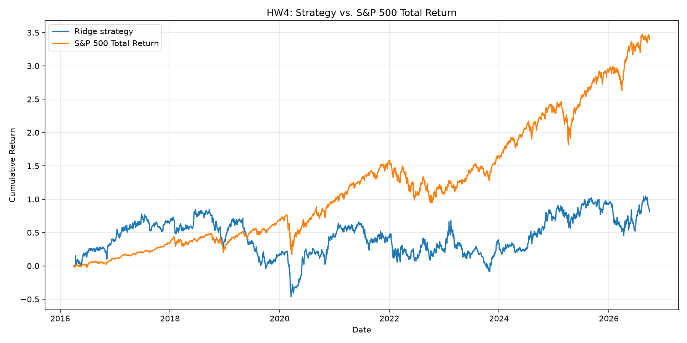

# Homework 4: Stock Prediction and Trading Strategy

## Overview

This project builds a Ridge regression model to predict stock returns over a 90-calendar-day holding period and evaluates a long-only stock-selection strategy against the S&P 500 Total Return Index.

The final backtest uses the full `equities_top2000.duckdb` database from April 1, 2016, through September 30, 2026.

## Features and model

The model uses three price-based predictors:

- **20-day return:** Short-term momentum.
- **60-day return:** Medium-term momentum.
- **20-day volatility:** Standard deviation of the most recent 20 valid daily returns.

Ridge regression was selected as a relatively simple, regularized baseline. The final model uses `alpha=100` with standardized features.

Training targets and features are clipped at the training sample's 1st and 99th percentiles to reduce the influence of extreme observations. Feature clipping limits are estimated from training data only.

## Training and validation

The development period is January 2010 through December 2015. The initial chronological validation experiment trains on observations whose targets finished before January 2014 and validates on 2014–2015 observations.

Ridge regularization parameters of 0.1, 10, and 100 were compared. Validation correlations were approximately −0.024, indicating that the model had weak predictive ranking performance.

The final fixed model uses development-period observations whose holding periods ended before April 1, 2016. The model is not retrained during the final test.

## Trading strategy

The strategy begins with $1,000,000 and follows these rules:

1. Identify eligible stocks using historical quarterly universe membership.
2. Calculate price-based features using information available at the signal date.
3. Rank eligible stocks by predicted 90-day return.
4. Select the ten highest-ranked stocks.
5. Submit purchases for the next trading session's close.
6. Allocate available cash equally among selected orders.
7. Hold each position for 90 calendar days, then sell at the first available closing price on or after maturity.
8. Reinvest available proceeds in the next investment cycle.

The strategy is long-only, uses no leverage, and does not pay interest on cash.

## Backtesting assumptions

Adjusted closing prices are used consistently. Transaction costs and slippage are assumed to be zero, and dividends are not added separately.

Orders without a valid entry price are not filled. Missing exit prices do not generate invented sales; positions remain open until a valid exit quote becomes available.

Daily valuations carry forward the last observed price when a stock quote is missing. This is a limitation because stale prices may not reflect the recoverable value of suspended or delisted securities.

The backtester tracks cash, purchases, sales, open positions, and daily portfolio value. Positions still open on September 30, 2026, are included in final portfolio value.

## Final performance

| Metric | Ridge strategy | S&P 500 Total Return |
|---|---:|---:|
| Starting capital | $1,000,000 | $1,000,000 |
| Final portfolio value | $1,811,338 | $4,402,747 |
| Total return | 81.13% | 340.27% |
| CAGR | 5.82% | 15.17% |
| Maximum drawdown | −70.91% | −33.79% |
| Sharpe ratio (2% risk-free rate) | 0.278 | 0.773 |

The strategy underperformed the S&P 500 Total Return benchmark by approximately 259.13 percentage points of cumulative return.

The final simulation initiated 42 investment cycles and recorded 410 completed stock trades. Ten positions remained open at the test end.



## Accounting and timing verification

The backtester verifies that:

- Cash remains nonnegative.
- Daily portfolio value equals cash plus the marked value of open positions.
- Purchases occur after their corresponding signal dates.
- Sales do not occur before the required 90-calendar-day holding period.
- The simulation reaches September 30, 2026.

The final run passed the cash and portfolio-identity checks.

One position was valued using a stale quote at some point during the test. None of the final open positions had stale quotes. No missing-entry events were reported.

Daily accounting evidence is saved in `backtest_accounting_checks.csv`, and final open positions are saved in `backtest_open_positions.csv`.

## Findings and limitations

The strategy generated a positive absolute return but substantially underperformed the benchmark. Its maximum drawdown was also considerably larger.

The weak validation correlation suggests that the selected price-based features did not reliably predict future 90-day stock returns.

Important limitations include concentrated holdings, extreme price observations, incomplete delisting information, stale-price valuations, zero transaction-cost assumptions, and the possibility of survivorship bias in historical training targets that require available exit prices.

Future improvements could include additional fundamental features with publication-date controls, stronger development-period validation, better delisting treatment, diversification constraints, and transaction-cost sensitivity tests.

## How to run

Place the full `equities_top2000.duckdb` database in:

`Lectures/modeling/data/`

From `Homeworks/HW4/Shravani_Koli/`, run:

```powershell
uv run --no-project --with duckdb --with pandas --with numpy --with scikit-learn python train_model.py
```

Then run:

```powershell
uv run --no-project --with duckdb --with pandas --with numpy --with scikit-learn --with matplotlib python backtest.py
```

The main output files are `backtest_metrics.csv`, `backtest_trades.csv`, `backtest_portfolio.csv`, `backtest_comparison.csv`, `backtest_accounting_checks.csv`, `backtest_open_positions.csv`, and `backtest_performance.png`.

## Code organization

- `inspect_data.py`: Data exploration and anomaly checks.
- `model.py`: Development features and 90-day return targets.
- `train_model.py`: Model training and chronological validation.
- `backtest.py`: Trading simulation, accounting verification, and performance evaluation.

## Attribution and AI assistance

This project was developed using the course-provided DuckDB dataset and assignment specifications. ChatGPT assisted with code generation, debugging, implementation design, and documentation. The analysis and reported results are based on the project's Python scripts and historical database.
