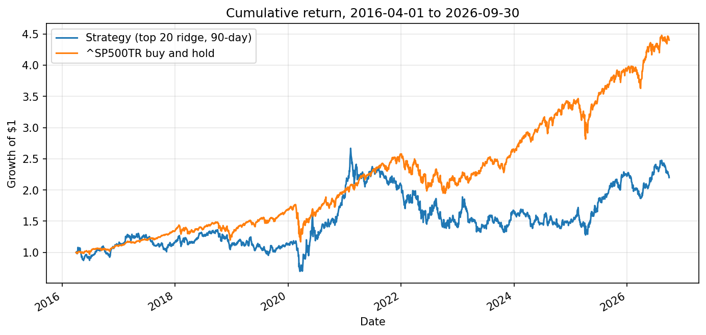

# HW4 – Terence Chiu

A ridge-regression stock score and my own backtester, tested on 2016-04-01 to 2026-09-30 against `^SP500TR`.

## How to run

1. From the repository root, run `uv sync --locked` and use `.venv` as the notebook kernel.
2. Put `equities_top2000.duckdb` from bCourses in `Lectures/modeling/data/` (git-ignored).
3. Open `hw4.ipynb` in this folder and Restart & Run All. Building the panel takes several minutes and a lot of memory.

Files: `hw4.ipynb` (data, model, hand check, schedule, backtest, evaluation) and `hw4_backtester.py` (the backtester).

## Approach

- Features: the course feature set (`course_data.FEATURES`): momentum over 21, 63 and 252−21 days, 63-day volatility, 252-day drawdown, six financial ratios (used from filing date + 1 day), filing age, and sector.
- Target: the 90-calendar-day return from the next session's close (`course_data.make_labels`).
- Training data: eligible universe members with signals from 2010-01-04 to 2015-12-30 whose 90-day outcome finished before the first test trade (2,967,493 rows). 488 targets were above +500%, almost certainly data errors, so training targets are clipped to their 1st and 99th percentiles (−45.1% and +65.2%), computed on development rows only. Clipping affects training only; backtest returns use actual prices.
- Model: ridge regression in the course pipeline (feature clipping, median imputation, scaling, one-hot sector). Ridge is fast on ~3M rows, handles noisy and correlated features by shrinking their weights, and is easy to interpret. Alpha was chosen with `GridSearchCV` on RMSE; alpha = 1000 was selected, the strongest penalty tried, which suggests a very noisy signal.
- Validation: chronological folds from `course_data.date_folds` with validation years 2012, 2013 and 2014, so training data always ends before each validation year.
- Strategy: every 90 calendar days, sell all positions and buy the 20 highest-scoring eligible stocks, equal-weighted. Scores use the close of the signal date; purchases fill at the next session's close; sales happen at the first close on or after 90 days. This gives 43 cycles in the test period. The final cohort, bought 2026-09-29, is valued at the 2026-09-30 close.
- Assumptions:
  - Prices are `adj_close` throughout, so dividends are included and not added again.
  - Transaction costs are 5 bps per side.
  - Idle cash earns 2% a year, accrued daily as 2% / 252.
  - Missing prices: a picked stock with no quote on its entry day is skipped and the cash is split among the rest. A held stock with no quote is valued at its last known price and counted as stale. A matured stock with no quote is not sold until it has a real quote (no invented fills). A stock that never trades again stays frozen at its last price, since the data has no delisting proceeds.

## Results vs `^SP500TR` (2016-04-01 to 2026-09-30)

$1,000,000 in each at the 2016-04-01 close.

| Metric | Strategy | `^SP500TR` |
|---|---|---|
| Final value | $2,199,861 | $4,402,747 |
| CAGR | 7.81% | 15.17% |
| Maximum drawdown | −52.1% | −33.8% |
| Sharpe (2% rf) | 0.33 | 0.77 |

The strategy did not beat the benchmark. It trailed by about 7.4 percentage points a year and finished with half the benchmark's value, with a deeper drawdown and less than half its Sharpe ratio.

## Accounting and timing checks

- Hand check (in the notebook): two stocks over five days, $2,000 split equally, bought on day 0 and sold on day 4, no fees or interest. Cash and portfolio value match the hand-calculated values every day (value 2,000 → 1,910 → 1,850 → 1,870 → 1,900).
- Trade count reconciles: 43 cohorts × 20 buys = 860, plus 42 matured cohorts × 20 sells = 840, minus 4 lots that never had another quote = 836 sells; 860 + 836 = 1,696 trades, matching the backtest.
- After each purchase cash is about 0 (a floating-point remainder of ~1e-10), so the strategy spends exactly what it has and no more.
- Timing: each signal date is the session before its entry, so decisions use only information available before the fill price. Training outcomes all end before 2016-04-01, the first test trade.

## Findings

- Result: the strategy underperformed the index over a decade in which large US stocks did very well. Picking the top 20 from a ~2,000-stock universe likely tilts toward smaller, more volatile names (early picks included BOOT, ENTA and LXRX), which would fit the deeper drawdown and lower Sharpe; I did not measure this.
- Path: the strategy roughly kept pace until early 2021 (it fell harder in the March 2020 crash, then rallied past the index), peaked in early 2021, and then lost about half its value while the index kept rising. That fall is the −52% maximum drawdown, and the strategy never recovered the gap.
- The model's signal is weak: ridge chose the strongest penalty tried, and the model was fitted once on 2010–2015 and never updated during ten years of testing.
- Stale positions: 4 positions in stocks that stopped trading are carried at their last price, about $245,000 of the final value. If they were worthless, the final value would be about $1.95M, so the reported result is, if anything, optimistic.
- Concentration: the top 20 can include two share classes of the same company (FWONK and FWONA in the second cycle), doubling exposure to one business.
- What I'd try next: retrain quarterly with newly completed outcomes; check the daily rank IC of predictions, not just RMSE; compare ridge against a tree model; limit to one share class per company and add sector caps; try overlapping (staggered) cohorts and a larger N; add a liquidity filter.

## Reused code and AI assistance

- Reused with citation from `Lectures/modeling/course_data.py`: `prepare_panel`, `FEATURES`, `make_pipeline` and `date_folds`. The development-row filter and the `GridSearchCV` setup follow Lecture 8's `2_research_workflow.ipynb`.
- AI assistance (Claude Code):
  - Explained concepts and reviewed my code throughout.
  - Created the notebook and backtester skeletons (section structure, method names and docstrings).
  - Fixed syntax errors in my backtester methods, added the trade `side`/`fee` fields, and replaced debug prints with counters.
  - Corrected my schedule cell and my metrics/chart cell.
  - Drafted this README from my results.
- My own work: the backtester logic (buying, selling, valuation, stale handling), the data split and target clipping, the model fitting, and the hand check.
