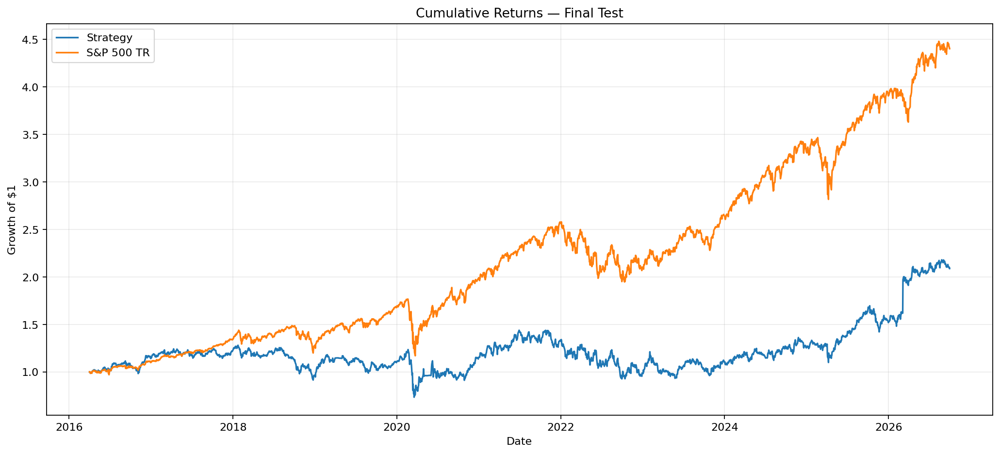

# HW4 — Sector-Aware ML Strategy

**Vanditha Toleti** · UCB MFE Python Preprogram

A Random Forest predicts each stock's 90-day return. Every month, a long-only portfolio buys the top-ranked stock in each sector (growth sleeve) and the top-ranked low-volatility stock in each sector (defensive sleeve), and holds each position for 90 days. A custom daily backtester tests the strategy from April 2016 to September 2026 against `^SP500TR`.

## Results

| Apr 1, 2016 – Sep 30, 2026 | Strategy | `^SP500TR` |
|---|---|---|
| Final value | **$2,087,737** | **$4,402,747** |
| CAGR | 7.26% | 15.17% |
| Max drawdown | −42.70% | −33.79% |
| Daily Sharpe (rf = 2%) | 0.33 | 0.77 |

The strategy roughly doubled $1M after costs, with every trade, fee and cash flow reconciled. It trailed the index: the S&P 500's gains over this period were led by large technology stocks, and an equal-sector portfolio is underweight in that area by design.

## Files

| File | Contents |
|---|---|
| `HW4_Strategy2_Sector_Aware_ML.ipynb` | Notebook 1: data audit, targets, model validation (2013–2015), strategy rules. Classroom database. |
| `HW4_Strategy2_Final_Backtest.ipynb` | Notebook 2: walk-forward fits, monthly picks, backtester, accounting tests, benchmark comparison. Full database. |
| `cumulative_returns.png`, `final_performance_comparison.csv` | Final chart and metrics. |
| `requirements.txt` | Package versions used. |

## How to run

1. Python 3.12+: `pip install -r Homeworks/HW4/Vanditha_Toleti/requirements.txt` (or `uv sync`).
2. Put `equities_class.duckdb` and `equities_top2000.duckdb` in `Lectures/modeling/data/`.
3. Run notebook 1, then notebook 2 (about 20 minutes, mostly model fitting). Notebook 2 caches the full-universe panel under `Lectures/modeling/outputs/hw4_final/` and reuses it on later runs. Outputs and databases are Git-ignored.

## Method

- **Features:** the 12 course features (momentum, volatility, drawdown and fundamentals), each used only after it was available. Sector groups the picks but is not a model input, because only current sector labels exist.
- **Target:** return from the next session's close to the first close at least 90 calendar days later, with an exit delay of at most 5 sessions.
- **Model:** Ridge, Random Forest and Gradient Boosting were compared on expanding-window folds for 2013–2015. Each fold trains only on outcomes that ended before the fold starts, with targets winsorized at the 1st and 99th percentiles. **Random Forest** won: it had the highest rank IC (about 0.06) and was the only model positive in every year. In the final test it is refit once a year using only completed outcomes.
- **Portfolio:** 50% growth and 50% defensive, equal-weighted, with caps of 10% per stock and 20% per sector. Signals are taken at month-end and filled at the next close; each position is held 90 days. Candidates come from each quarter's universe, including stocks that are inactive today.
- **Backtester:** $1M, long-only, no leverage. Fills only at real closing prices, 10 bps per trade, 0% interest on cash. Sales are processed before purchases so cash is never spent twice, and every skipped order is logged.

## Accounting and timing checks

- Hand-checkable tests: a buy and sell with fees, no double-spending, the position cap, a delayed exit when a quote is missing, and the skip log.
- Full run:
  - Cash reconciles to the ledger and never goes negative.
  - Every fill uses a real quote; 25 sampled fills match the database.
  - Buys fill the session after their signal, starting April 1, 2016, and sales occur within 5 sessions of maturity.
  - No price after September 30, 2026 is used, and every model fit uses only outcomes that ended before the fit.

## Findings

- **What worked:**
  - The strategy was profitable after about $99k of fees, and both sleeves made money on closed trades (defensive about $603k, growth about $377k).
  - 53% of trades were winners, and the strategy beat the index in 2016, 2025 and 2026.
  - Costs barely matter: CAGR is 8.05% at 0 bps.
- **What held it back:**
  - Equal sector weights against a tech-led index.
  - Volatile growth picks (24.6% annualized volatility vs 17.8% for the index).
  - Each monthly cohort used nearly all the capital, so the portfolio effectively rotated quarterly and 1,832 monthly orders were skipped for lack of cash.
- **Data caveat:** three positions stopped trading before they could be sold (LPI, HOUS, RCB) and are carried at their last price, 17% of the final value. Valuing them at zero gives $1.73M (5.3% CAGR).
- **Next steps:**
  - Weight sectors by market cap or rank across the whole universe.
  - Size each monthly cohort at about one-third of the portfolio.
  - Add a liquidity screen.
  - Predict returns relative to the market.

## Limitations

Sector labels are current snapshots, fundamentals are the vendor's latest values (so they may include restatements), and there are no delisting proceeds. Model selection used a 30-stock development sample.

## Code reuse

Data loading, features, membership mapping, labels and the preprocessing pipeline come from the course's `Lectures/modeling/course_data.py`. The data audit, stock selector, walk-forward pipeline and backtester were written for this homework.
