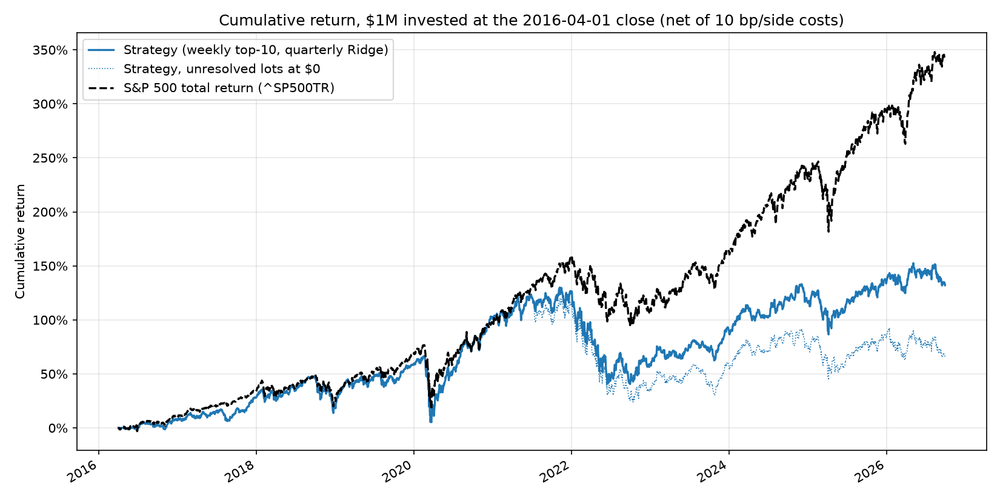

# HW4 — Stock prediction and trading strategy (Vasileios Dimitropoulos)

**Result in one line:** the pre-registered strategy (weekly top-10 stocks from a quarterly-refitted Ridge model) turned $1,000,000 into **$2,320,392** (CAGR **8.35%**, Sharpe 0.41) over Apr 1 2016 – Sep 30 2026. $1,000,000 in `^SP500TR` grew to **$4,402,747** (CAGR **15.16%**, Sharpe 0.77). **The strategy did not beat the benchmark.** It finished $2.08M behind, −6.82 percentage points per year.



## Contents

| Path | What it is |
|---|---|
| `hw4_strategy.ipynb` | **Main deliverable.** Executed notebook: data → validation → frozen choices → final test → accounting checks → robustness → disclosed post-test revision |
| `hw4lib/data.py` | Read-only DuckDB loading into wide (session × symbol) price matrices; quarantine of invalid/off-calendar rows |
| `hw4lib/features.py` | Weekly schedule, causal price/fundamental/valuation features, dated eligibility, 90-day labels |
| `hw4lib/model.py` | Same-date rank preprocessing, Ridge / LightGBM / momentum models, walk-forward fitting, forecast metrics |
| `hw4lib/strategy.py` | `WeeklyTopN`: weekly purchases with name and sector caps |
| `hw4lib/backtester.py` | **My backtester**: account/ledger, lots, daily loop, missing and suspect quotes |
| `hw4lib/analytics.py` | Metrics (final value, CAGR, max drawdown, Sharpe) and independent accounting audits |
| `hw4lib/pipeline.py` | Configuration and the cached feature panel |
| `tests/test_backtester.py` | 13 hand-checkable accounting and timing tests |
| `tests/test_pipeline_class_db.py` | 3 end-to-end tests on the small class database (features → labels → walk-forward → backtest → audits) |
| `results/` | Small committed outputs: performance tables, chart, validation tables, fit audit, accounting checks, open lots |
| `outputs/` | Large generated files (feature panel, fills, daily NAV). Git-ignored and recreated by the notebook |

## How to run

1. Download `equities_top2000.duckdb` (and optionally `equities_class.duckdb`) from bCourses to `Lectures/modeling/data/` (SHA-256 `a028641d…` / `e6d703b8…` per `manifest.json`).
2. Create the environment from this folder (Python 3.12):
   ```
   uv venv HW4 --python 3.12
   uv pip install --python HW4/Scripts/python.exe duckdb pandas numpy scikit-learn scipy lightgbm pyarrow matplotlib ipykernel nbconvert pytest
   ```
   (macOS/Linux: use `HW4/bin/python`.)
3. Run the tests: `HW4/Scripts/python.exe -m pytest tests -q`. All 16 should pass in a few seconds: 13 accounting/timing unit tests plus 3 end-to-end tests that run the whole pipeline on `equities_class.duckdb` (skipped if that file is missing). This is how I got the code working before using the full database.
4. Run the notebook end to end (about 3 minutes): `HW4/Scripts/python.exe -m nbconvert --to notebook --execute --inplace hw4_strategy.ipynb`, or open it with the `HW4` kernel and *Run All*. The first run builds `outputs/panel.parquet` (about 30 s).

## 1. Features, model and validation

**Universe and timing.** Signals are computed after the close of the **first session of each week**, and purchases fill at the **next session's close**. A stock can be bought only if it is in `universe_membership` for the quarter of the *entry* session, and that list's `selection_date` ≤ signal date. It must also pass these screens, all known at the signal date:
- a quote on the signal date and 63 complete daily returns;
- raw close ≥ $5;
- average dollar volume over 63 sessions ≥ $2M;
- **no ×3 (or ÷3) quote-to-quote jump in the last 252 sessions** (data-quality screen).

Stocks that leave the universe are never deleted, and open lots are kept to maturity.

**Features (28 numeric + sector).**
- *Price* (adjusted, no filling): momentum over 5/21/63/126 sessions and 12-1 month momentum; 63- and 252-day volatility; maximum daily return over 21 days; drawdown from the 252-day high; 252-day beta to the S&P 500; log dollar volume.
- *Fundamentals:* usable from filing date + 1 day, and blanked if the fiscal period ended more than 550 days earlier. TTM gross profit/assets, ROA, ROE, operating margin, accruals, FCF/assets; debt/assets, cash/assets; YoY asset growth and sales growth; net buybacks/assets; days since the filing.
- *Valuation:* point-in-time shares from the quarterly selection × signal-date close. Log market cap, earnings yield, book/price, sales/price, FCF yield.
- *Sector*, using the snapshot labels.

**Preprocessing.** Each feature becomes its **percentile rank among the eligible stocks on the same date**. Nothing is learned across time, so nothing can leak. This also neutralizes vendor unit and currency problems.

**Target.** Each stock's 90-day return is converted to its same-date percentile rank among eligible stocks (minus 0.5). This is a relative-return forecast that a top-N rule can use directly, and it's robust to broken price series. For example, LCI's adjusted price jumps 28 → 474 in one session in Dec 2013, a broken split adjustment worth "+2,700%" in raw labels. The rank target is recomputed **inside each fit's training rows**, so a same-date peer whose outcome had not yet finished at the fit date can never influence another row's target.

**Validation (development only, 2010–2015).** I used four yearly walk-forward folds (2012–2015). Each model is fitted at the first signal of the year on rows from 2010 onward **whose 90-day outcome had already ended** (`label_end < fit_date`). Metrics are the mean weekly rank IC and the average 90-day return of the top-20 picks (capped at −90%/+100%) minus the S&P 500 over the same window (`results/validation_models.csv`):

| Model | Mean IC | Top-20 − S&P per 90 days | Worst year |
|---|---|---|---|
| 12-1 momentum (no fit) | 0.036 | −1.40% | −7.9% |
| **Ridge α=1000 (chosen)** | **0.018** | **+0.58%** | **−0.5%** |
| Ridge α=10 / 100 / 10000 | 0.012–0.019 | +0.51% to +0.65% | −0.8% to −1.1% |
| LightGBM regression | 0.007 | −0.64% | −2.9% |
| LightGBM lambdarank | −0.014 | −0.28% | −4.7% |

**Why Ridge?** LightGBM was my prior choice. With only 2–5 years of training data, though, the trees fit noise, and lambdarank (which optimizes the top of each week's ranking directly) did worse still. A heavily penalized linear model was the most stable. All signals are weak (IC ≈ 0.02), and 2013 (a "junk rally") was negative for every model.

**Strategy choices** were also made on development data, with full backtests over 2012–2015 and one rule fixed in advance: highest development Sharpe (`results/dev_strategy_selection.csv`). The winner was **quarterly refits** (expanding window) and **top 10 per week**: CAGR 18.7% vs S&P 14.9%, Sharpe 1.03 vs 1.00. Yearly refits and N=20/40 were weaker.

## 2. Trading rules and assumptions

| Item | Choice |
|---|---|
| Capital and constraints | $1,000,000; long only; no borrowing or leverage |
| Purchases | Weekly, the 10 highest scores, equal fee-inclusive budgets. First 13 weeks: NAV/13 per week (spreads entry over one holding period). After that, all available cash is reinvested: cash plus the expected proceeds of lots maturing at that close |
| Limits | ≤ 5% of NAV per stock, ≤ 30% per sector. If a name is at its cap, the next-best name is used |
| Holding | Each purchase is a separate lot, sold at the close on entry + 90 calendar days, or the next session with an accepted quote |
| Same-day cash | Sales execute before purchases. If actual proceeds are below plan, all purchases are scaled down proportionally, so cash never goes negative and is never spent twice |
| Transaction costs | **10 bp per side** on every buy and sell (sensitivity: 0 and 25 bp) |
| Cash interest | **0%**: idle cash earns nothing. Sharpe uses a 2% annual risk-free rate converted to a daily rate |
| Prices | Adjusted closes ("adjusted-price units"), so dividends are already included and are **not added again** |
| Missing quote | Holding carried at its last accepted mark for ≤ 5 sessions ("stale"); a maturing sale waits for the next accepted quote |
| No quote for > 5 sessions | **Unresolved:** no sale or payout is invented and the capital stays frozen. I report NAV with these lots at their last mark (headline) **and at $0 (lower bound)** |
| Suspect quotes | A quote more than ×3 or ÷3 from the last accepted mark is not traded on or used for valuation. A fall is accepted after 5 sessions (a real crash is booked as a loss); a rise is never accepted, so a broken series cannot inflate NAV |
| Benchmark | $1,000,000 in `^SP500TR` at the **first test close (2016-04-01)**, the same close as the strategy's first purchases (signal 2016-03-31). Both series start from a shared $1,000,000 initial-capital row dated 2016-03-31, so the strategy's first-day fees appear in its first return (lecture convention) |
| Metrics | CAGR over actual days / 365.25; max drawdown on daily NAV; Sharpe = √252 × mean(daily return − daily rf) / sd(daily return) |

## 3. Final test results (Apr 1 2016 – Sep 30 2026)

| | Final value | Total return | CAGR | Max drawdown | Volatility | Sharpe (rf 2%) |
|---|---|---|---|---|---|---|
| **Strategy** (headline, unresolved lots at last mark) | **$2,320,392** | 132.0% | **8.35%** | **−38.9%** | 19.8% | **0.41** |
| Strategy, lower bound (unresolved lots at $0) | $1,655,393 | 65.5% | 4.92% | −44.5% | 21.7% | 0.24 |
| **S&P 500 TR** | **$4,402,747** | 340.3% | **15.16%** | **−33.8%** | 17.8% | **0.77** |

The final value includes cash and the 176 lots still open on Sep 30 2026. No later prices are used. The strategy lagged the benchmark in **10 of 11 calendar years** and beat it only in 2020 (+9.7 pp). The worst years were 2021 (−18.1 pp), 2024 (−12.5 pp) and 2022 (strategy −29.5% vs S&P −18.1%); see `results/calendar_year_returns.csv`.

**Robustness** (`results/robustness.csv`):

| Variant | Final value | CAGR |
|---|---|---|
| Ridge top-10, 0 / 10 / 25 bp per side | $2.58M / $2.32M / $2.08M | 9.44% / 8.35% / 7.21% |
| Ridge top-10, unresolved lots assumed paid at last mark (accounting sensitivity) | $2.54M | 9.27% |
| 12-1 momentum top-10, same backtester (baseline) | $7.41M (lower bound $4.43M) | 21.0% (lower bound 15.2%) |

## 4. Evidence that the accounting and timing are right

- **Unit tests** (`tests/test_backtester.py`, 13 pass). Each one is a hand-checkable case:
  - a buy and sell with fees, worked out by calculator;
  - weekend maturity → next session;
  - missing quote at maturity → deferred sale;
  - a delisting is frozen, never sold;
  - suspect spikes are ignored;
  - a persistent drop is accepted and a persistent jump up is not;
  - cash cannot be spent twice, and a decision must come before its fill;
  - the strategy sees only the previous close;
  - orders larger than cash are refused;
  - same-day proceeds are scaled to actual cash;
  - name and sector caps;
  - CAGR and drawdown by hand.
- **Hand check in the notebook.** The first test lot (WBA, signal 2016-03-31, bought at the 2016-04-01 close) is recomputed from raw prices: units, fee, due date 2016-06-30, sale cash and PnL all match the ledger.
- **Independent rebuilds over the full test** (`results/accounting_checks.csv`):
  - cash rebuilt from the fill ledger matches to $0.00;
  - NAV rebuilt from fills × raw quotes matches on every day except 4. Those 4 sessions are a ÷3 price drop that the backtester deliberately ignored until it persisted for 5 sessions;
  - final NAV = cash + open lots;
  - realized + unrealized PnL = NAV − $1M.
- **Timing checks:**
  - all 5,489 buys filled at the session after their signal;
  - every due date = entry + 90 days;
  - no sale before maturity, and all 5,313 sales on the first session on or after maturity;
  - every model fit used only labels that ended before its first scored signal (`results/fit_audit.csv`).

**Data gaps that affect the result.** 46 open lots ($665,000, **29% of final NAV**) are unresolved: their quotes stopped (WPF in 2021, CCMP, CHNG, DTP, FOCS, ARNC, SQSP, PRFT, BECN, COMM, …). Most are completed cash acquisitions. The database has no delisting-proceeds table, so I don't assume a payout. Their capital stays frozen, which is why the headline and lower bound differ ($2.32M vs $1.66M). If they had paid their last price at maturity, the strategy would have ended at $2.54M, still far below the S&P. Other gaps: 27 off-calendar price rows quarantined; 443 symbols with at least one ×3 quote jump since 2008; 1 order rejected for a missing quote.

**Audit of implausible universe-ranking inputs** (`results/ranking_input_audit.csv`). 402 membership rows (27 symbols) have a selection close above $1M, more than 30B shares, or a capitalization proxy above $6T. The extreme case is BRK-A, ranked #1 with a proxy of about $1.4 quadrillion (class-A price × a share count on a different basis). I did not "correct" these, because no source supports a specific fix. They can slightly distort universe membership and my size/valuation features, but those features enter the model as same-date ranks, so a bad value only moves one stock to the end of the ranking. The strategy traded one flagged symbol, SIX (7 buys, realized PnL −$5,378), flagged only for 2010-Q4 (shares > 30B), years before it was bought.

## 5. Findings

**Why it lost.** The model's ranking was **not** worthless out of sample: the test-period mean weekly rank IC was +0.025 (positive in 7 of 11 years), similar to development. Most of the gap comes from what was being ranked and how the portfolio held it:

1. **The investable universe itself lagged the S&P.** Over the test, the equal-weighted eligible universe returned about 0.9% less than the S&P per 90 days (roughly 12% vs 16% a year). The S&P is cap-weighted, and 2016–2026 was dominated by a few mega-caps. An equally weighted portfolio of 10 names from ~1,900 mostly mid-cap stocks starts several points a year behind.
2. **A weak signal, concentrated in the tail.** In return units (`results/test_calibration_by_decile.csv`), the realized 90-day return rises only weakly with the forecast: bottom decile +2.22%, deciles 2–9 +2.6% to +3.3%, top decile +3.39% (top − bottom +1.17% per 90 days). The S&P returned +3.76% over the same windows, so **even the top decile lagged the index**. Buying just 10 names a week puts the portfolio in the noisiest part of the ranking.
3. **Frozen capital** from acquired stocks (≈ 0.9 pp per year) and **costs** (≈ 1.1 pp per year at 10 bp per side).
4. **Risk.** Beta 0.98, correlation 0.88, tracking error 9.2% per year, and a deeper drawdown (−38.9% vs −33.8%), concentrated in 2022. 30% of purchases were in Technology (at the sector cap) and 19% in Financials.

**Unsuccessful ideas, all tried on development data:**
- LightGBM regression and lambdarank (unstable with short training windows);
- an excess-return target (worse than the rank target);
- a Ridge + LightGBM blend;
- restricting purchases to the largest 300–1,000 stocks (no improvement);
- yearly instead of quarterly refits;
- buying 20 or 40 names instead of 10.

Two portfolio-mechanics bugs were found and fixed *during development*, before the test. Friday signals left sale proceeds idle for a week (10–12% average cash); fixed with Monday signals plus same-day maturity proceeds, leaving about 2% cash. The second fix: the "accept a jump after 5 sessions" rule would have booked LCI's broken ×17 jump as a gain, so upward jumps are now never accepted.

**Disclosed post-test revision (not out-of-sample).** After seeing the test result I diagnosed two things. The model tends to buy pending-acquisition targets (pinned prices look calm), and I had never backtested the momentum baseline on development data. On development data only, I compared Ridge, momentum and a blend, each with and without a deal-target screen (21-day volatility < 8%), using the same "highest development Sharpe" rule. Development data picked **Ridge + screen**. Momentum was poor in 2012–2015: CAGR 6.8%, max drawdown −42%. Re-running the test once gave **$2,461,510 (CAGR 8.96%, Sharpe 0.43)**, still far behind the S&P. Momentum's strong test result ($7.4M) would not have been chosen on development evidence. Picking it now would be data snooping, and its lower bound ($4.43M, 98 unresolved lots) is no better than the index.

**What I would try next:**
1. Cap-aware construction: value-weighted or benchmark-relative weights within the universe, or the model as a tilt on an index-like core rather than a 10-stock equal-weight bet.
2. More names and a lower turnover rule, to reduce noise and costs.
3. Explicit merger-arb detection from filings or news, and a proper delisting-proceeds source.
4. Training on 2000–2009 outcomes as well, if allowed. I used only signals from 2010 onward, reading "earlier data is available for lookbacks" as feature history only.
5. A regime- or volatility-aware blend of momentum and quality, validated on a longer development window.

## 6. Limitations

- **Data:**
  - Survivorship is reduced but not removed: there are only 2 recorded delisting dates in the union and no proceeds, so the frozen-capital treatment is a bound, not a fact.
  - Fundamentals are latest vendor values for each fiscal period, not original filing versions (restatements leak a little).
  - Sectors are current snapshot labels.
  - Shares and prices can have inconsistent split bases, so market-cap and valuation features are approximate.
  - TTM sums use the three earlier fiscal quarters as stored by the vendor once the latest quarter is available; an earlier quarter whose own filing date is invalid is still included (it was almost certainly filed before the later quarter).
  - Dollar volume uses vendor volume, which may itself be split-adjusted.
- **Execution:** fills at the exact close with a flat 10 bp cost; no market impact, borrow or taxes. Positions are small (about $10k–$40k per lot) relative to the $2M liquidity screen.
- **Statistics:** weekly 90-day labels overlap, so IC t-statistics are optimistic. The development window (4 validation years) is short, and model and portfolio choices were made on it; the gap between development (18.7% CAGR) and test shows how much selection and regime luck there was.
- The post-test revision is reported for transparency only and is **not** an out-of-sample result.

## 7. Code reuse and AI assistance

- **Adapted from the course code** (`Lectures/modeling/course_data.py`, `backtest.py`, Lecture 8 notebooks):
  - the quarantine rules for invalid and off-calendar prices;
  - next-session membership;
  - filing date + 1 day availability, the late-filing and 550-day staleness rules;
  - the label definition (first close on or after entry + 90 days, ≤ 5 sessions late);
  - the walk-forward `label_end < fit_date` rule;
  - fee-inclusive budgets and lot-based OMS design;
  - the metric definitions (CAGR over 365.25 days, Sharpe over 252 sessions with a daily 2% hurdle).

  Each adapted function says so in its docstring.
- **Written for this homework:**
  - the backtester, ledger and daily loop: missing, suspect and unresolved quotes, same-day proceeds with scaling, upper and lower NAV bounds;
  - the strategy, the wide-matrix feature engine and the TTM/YoY fundamentals;
  - the rank preprocessing, the models and validation, the audits and the tests.
- **AI assistance:** the code, tests and this write-up were developed with an AI coding assistant (Claude Code) working under my direction in this repository. All design decisions (timing, missing-price policy, model and strategy selection rules, freezing choices before the test, and disclosing the post-test revision) were reviewed by me. I can explain every part of the submission.
