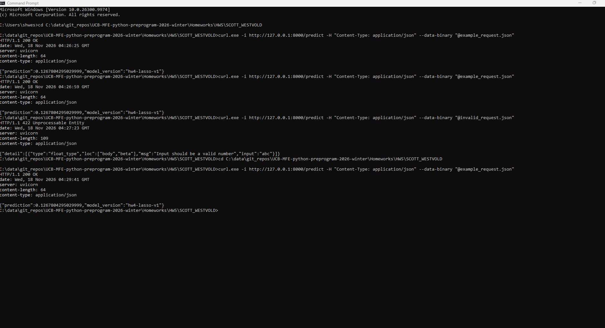

# HW5 – Serving my HW4 Fama-French signal model

## Model being served
- **Version:** `hw4-lasso-v1`
- **What it is:** five single-feature `LassoCV` models (TimeSeriesSplit, 5 folds), one per signal.
  Each was trained on one column named `value` to predict `ret90` (90-day forward return).
- **Training period:** 2010-01-01 to 2015-12-31
- **Output:** each signal's prediction is clipped to ±0.20, then the five are averaged.
  I average the five because that is the signal which my portfolio trades on.
- **Artifact:** `model.joblib` (dict of 5 fitted models), saved from `fama_backtester.py` in HW4.

## Input contract (`POST /predict`)
All five fields are required, must be numbers (no strings/booleans), finite (no NaN/inf), and no extra fields are allowed.

| Field | Meaning | Units | Allowed range | Why this range |
|---|---|---|---|---|
| `book_value` | Ratio of book equity (total assets − total liabilities) to market cap | ratio | -5 to 20 | Should be reasonably bounded and not oscillate to extreme levels. It can technically go negative for companies with negative book value, but that is an anomaly. |
| `small_large` | Market cap of the company. Factor predicting that larger firms enjoy stronger forward returns due to higher business moats | USD | > 0 to 1e13 | Market cap must be positive; $10 trillion is above any company. |
| `profitability` | Operating income / revenue; shows the robustness of a company's earnings streams | ratio | -5 to 5 | A margin ratio that can go negative, but not without bound. |
| `investment_aggression` | How much a firm invests relative to its asset base (252-day average capex / total assets) | ratio | -5 to 5 | A ratio to total assets; values far outside ±5 would be data errors. |
| `beta` | 3-year trailing beta to the S&P 500, **multiplied by −1**. The beta is inverted such that we position against high beta names in favor of low beta stocks. | unitless | -5 to 5 | Stock betas rarely exceed ±3; ±5 leaves margin. |

## Output contract
| Field | Meaning |
|---|---|
| `prediction` | average predicted 90-day return (decimal, e.g. 0.05 = 5%), always finite |
| `model_version` | `hw4-lasso-v1` |

## Status codes
- **200**: valid input, prediction returned
- **422**: invalid input (missing/extra field, wrong type, NaN/inf, out of range). Checked by `InputData` before the model runs, with a backup check in `predict`.
- **500**: model failed. Details go to the server log, not the response.

## Example
`example_request.json` is a real HW4 row (CCO, 2013-02-04). Expected prediction ≈ 0.1268.

## Docker
The Docker setup was sourced from the Lecture 9 demo (`Lectures/Lecture 9/demo/`).

### Running the container
Requires Docker Desktop running ("Engine running"). From the repository root:

```sh
cd Homeworks/HW5/SCOTT_WESTVOLD
docker build -t mfe-hw5:local .
docker run --rm --name mfe-hw5 -p 127.0.0.1:8000:8000 mfe-hw5:local
```

Then open http://127.0.0.1:8000/docs.

### Requests to the container (screenshots)
The two screenshots below show requests sent to the Docker container: a valid request (200), an invalid request (422), and a valid request after stopping and restarting the same image (200).

- `curl_commands.png`: the curl requests and their responses
- `container output.png`: the container's server log, including the stop and restart




### Tests run on the container app

**1. Valid request (CCO, 2013-02-04)** – expected 200
```json
{
  "book_value": 1.1147826145574693,
  "small_large": 2509979940.0,
  "profitability": 0.13373864279744413,
  "investment_aggression": -0.017334605246461385,
  "beta": -1.0109610258272559
}
```

**2. Invalid request (`beta` is not a number)** – expected 422
```json
{
  "book_value": 1.1147826145574693,
  "small_large": 2509979940.0,
  "profitability": 0.13373864279744413,
  "investment_aggression": -0.017334605246461385,
  "beta": NA
}
```

### Container output
```text
C:\data\git_repos\UCB-MFE-python-preprogram-2026-winter\Homeworks\HW5\SCOTT_WESTVOLD>docker run --rm --name mfe-hw5 -p 127.0.0.1:8000:8000 mfe-hw5:local
INFO:     Started server process [1]
INFO:     Waiting for application startup.
/usr/local/lib/python3.12/site-packages/sklearn/base.py:463: InconsistentVersionWarning: Trying to unpickle estimator LassoCV from version 1.9.1 when using version 1.8.0. This might lead to breaking code or invalid results. Use at your own risk. For more info please refer to:
https://scikit-learn.org/stable/model_persistence.html#security-maintainability-limitations
  warnings.warn(
INFO:     Application startup complete.
INFO:     Uvicorn running on http://0.0.0.0:8000 (Press CTRL+C to quit)
INFO:     172.17.0.1:48536 - "GET /docs HTTP/1.1" 200 OK
INFO:     172.17.0.1:48536 - "GET /openapi.json HTTP/1.1" 200 OK
INFO:     172.17.0.1:48540 - "POST /predict HTTP/1.1" 200 OK
INFO:     172.17.0.1:47612 - "POST /predict HTTP/1.1" 200 OK
INFO:     172.17.0.1:47616 - "POST /predict HTTP/1.1" 422 Unprocessable Entity
INFO:     172.17.0.1:50708 - "POST /predict HTTP/1.1" 422 Unprocessable Entity
```

## Lint output
Ruff formatting, fixes, and lint checks (`python -m ruff format .`, `python -m ruff check .`):


## Test results
All 4 tests in `tests/test_app.py` pass (`python -m pytest -q -s`, run in the local `.venv`):


### Latency report
| Metric | Result |
|---|---|
| Median | 3.08 ms |
| p95 | 5.12 ms |

- **Measurement method:** in-process FastAPI `TestClient` (not real localhost HTTP, not curl), run with pytest in the local Python 3.12 `.venv`.
- **Procedure:** 3 untimed warm-up requests, then 20 timed requests using `time.perf_counter`. Each request used the CCO example input with each value randomly adjusted by up to ±1%. All 20 returned 200.
- **Hardware:** Dell laptop, Windows 11 Home.
- **Budget:** no latency budget asserted; the numbers are reported only.

## What would need attention before real deployment
- **Model version 2:** I would want to adjust the Lasso model and do a version 2. The regression is somewhat challenged due to the massive variety of companies; individual sector-driven regressions would likely be better.
- **Regular retraining and data refresh:** I would want some mechanism to rerun the model and refresh the data regularly, and display the portfolio figures, so the portfolio could update itself and keep its latest positions up to date.
- **Data quality checks in the container:** The data could be stale and the app would not know. As long as the program receives 5 floats in the right ranges it will run, which creates a risk should it receive bad data.
- **Scale up the container:** I'd like to scale up the Docker container to do the entire portfolio update rather than just the factor prediction model.

## Sources
- The invalid input test (`test_predict_invalid_input` in `tests/test_app.py`) was adapted from the Lecture 9 demo (`Lectures/Lecture 9/demo/`).

## AI usage
Claude was used iteratively, small step by small step. Claude suggested the best action for each small step of the project, helping condense the technical terms into easy to follow steps and code.

- **Code:** Claude provided the initial suggestion for each line of code, but this was done very iteratively in small to modest increments.
- **Example request:** Claude created `example_request.json` from the CCO row in `reference_predictions.json`.
- **README:** Claude wrote the README text; I directed what each section should contain and when to add it, and provided the signal descriptions and design reasoning.
