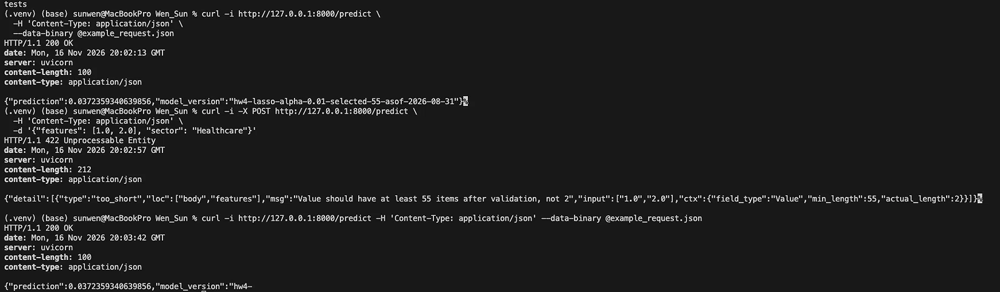

# HW5: Productionized HW4 model service - Wen Sun

This folder serves completed HW4 stock-return model through a tested
FastAPI endpoint, packages it with Docker, and documents the input/output
contract and reproduction steps.

## Model being served

- Final HW4 model: `Lasso(alpha=0.01, max_iter=10000)`.
- Feature selection: factors whose absolute mean daily IC on the HW4 purged
  training folds was at least `0.01`.
- Preprocessing:
  - quantile clip numeric features at the 1st/99th percentiles learned on training rows;
  - median imputation with missing-value indicators;
  - standardization;
  - one-hot encoding of `sector` with `handle_unknown="ignore"`.
- Prediction target: 90-calendar-day forward return, winsorized to
  `[-0.9, 5.0]` during fitting.
- Artifact: `model.joblib`.
- Version: `hw4-lasso-alpha-0.01-selected-55-asof-2026-08-31`.
- Training as-of date: `2026-08-31`.
- Training rows: `388,234`.
- Maximum training label end: `2026-07-30`.

The model and preprocessing are loaded once in the FastAPI lifespan. Requests
never fit or refit the pipeline.

## Input contract

`POST /predict` accepts a JSON object with exactly two fields:

```json
{
  "features": [0.34, 0.19, "... 55 total numeric values ..."],
  "sector": "Healthcare"
}
```

`features` is a fixed-length JSON array of exactly 55 numeric values in the
same order used by the final HW4 model. Each value must be a JSON number with a
fractional part (for example `0.34`, not `true`, or `"0.34"`), must be
finite, and must satisfy `abs(value) <= 1e12`. This bound is a safety guard; the
HW4 pipeline already clips feature tails.

`sector` is a non-empty string of at most 64 characters. Unknown sectors are
handled by the fitted one-hot encoder.

The 55 numeric features, in order, are:

```python
[
    "operating_roa",
    "sector_relative_operating_roa",
    "sector_profitability_rank",
    "sector_relative_fcf_to_assets",
    "fcf_to_assets",
    "volatility_63",
    "sector_relative_volatility_63",
    "sector_relative_net_margin",
    "cash_to_assets",
    "debt_to_assets",
    "volatility_21",
    "amihud_illiquidity_63",
    "amihud_illiquidity_21",
    "net_margin",
    "sector_relative_cash_to_assets",
    "sector_relative_volatility_21",
    "amihud_illiquidity_10",
    "sector_relative_amihud_illiquidity_63",
    "volatility_10",
    "sector_relative_amihud_illiquidity_21",
    "drawdown_252",
    "momentum_252_21",
    "sector_relative_volatility_10",
    "sector_relative_amihud_illiquidity_10",
    "momentum_5_252_5",
    "sector_relative_drawdown_252",
    "sector_relative_momentum_252_21",
    "sector_relative_debt_to_assets",
    "sector_relative_momentum_5_252_5",
    "momentum_10",
    "turnover_21",
    "turnover_63",
    "momentum_5_10_5",
    "sector_relative_momentum_10",
    "turnover_10",
    "sector_relative_momentum_5_10_5",
    "relative_volume_63",
    "sector_relative_relative_volume_63",
    "return_volume_corr_63",
    "relative_volume_21",
    "relative_volume_10",
    "filing_age_days",
    "sector_relative_relative_volume_21",
    "sector_relative_return_volume_corr_63",
    "sector_relative_relative_volume_10",
    "sector_relative_filing_age_days",
    "sector_relative_turnover_10",
    "momentum_5_63_5",
    "sector_relative_turnover_21",
    "sector_relative_turnover_63",
    "momentum_63",
    "sector_relative_momentum_5_63_5",
    "sector_relative_return_volume_corr_10",
    "return_volume_corr_10",
    "sector_relative_momentum_63",
]
```

`sector` is the 56th and final DataFrame column.

Units for the numeric fields:

- `momentum_*`: fractional return over the window, for example `0.01` is 1%.
- `volatility_*`: annualized volatility.
- `drawdown_252`: fraction below the 252-session high (typically `<= 0`).
- financial ratios such as `net_margin`, `operating_roa`, `debt_to_assets`,
  `cash_to_assets`, and `fcf_to_assets`: dimensionless fractions; values can
  be negative.
- `filing_age_days`: calendar days.
- `relative_volume_*`: ratio to the trailing average; `0` is average volume.
- `amihud_illiquidity_*`: scaled `|return| / dollar_volume * 1_000_000`.
- `return_volume_corr_*`: correlation, normally in `[-1, 1]`.
- `turnover_*`: fraction of market-value proxy traded.
- `sector_relative_*`: same units as the corresponding base feature, expressed
  as the difference from the same-date sector median.
- `sector_profitability_rank`: same-date, same-sector percentile in `[0, 1]`.

Validation rules produce `422 Unprocessable Entity` for:

- missing `features` or `sector`;
- extra JSON fields;
- wrong feature count;
- non-finite numeric values;
- numeric strings, or booleans JSON values in `features`;
- non-string or empty `sector`;
- values outside the documented magnitude bound.

Inference errors are intentionally not converted into successful predictions.
They return `500` and are logged server-side.

## Output contract

Successful responses have status `200` and the shape:

```json
{
  "prediction": 0.0372359340639856,
  "model_version": "hw4-lasso-alpha-0.01-selected-55-asof-2026-08-31"
}
```

`prediction` is always a finite `float`.

## Example input and expected result

`example_request.json` is an actual HW4 scoring row:

- symbol: `ZYME`
- date: `2026-08-31`
- sector: `Healthcare`

The direct HW4-pipeline prediction for this row is recorded in
`model_metadata.json` as `expected_prediction`:

```json
0.0372359340639856
```

The positive test compares the API response against both this recorded value
and a fresh direct pipeline call.

## Local setup

Use Python 3.12:

```sh
python3.12 -m venv .venv
source .venv/bin/activate
python -m pip install -r requirements.txt
```

Run the service:

```sh
python -m uvicorn app:app --host 127.0.0.1 --port 8000
```

Interactive docs are available at <http://127.0.0.1:8000/docs>.

## Test, lint, and format

```sh
python -m ruff check .
python -m ruff format --check .
python -m pytest -q
```

The test suite covers:

1. a valid request against the real saved model;
2. missing/extra fields, wrong width, invalid types, non-finite values, and
   bounds;
3. an inference failure returning `500`;
4. a warm-up plus 20 timed successful requests, with median and p95 reported in
   the pytest output.

## Latency Report
- Method: In-process FastAPI TestClient (measured with `time.perf_counter`)
- Hardware: macOS-15.0-x86_64 (Intel Mac)
- Requests: 20 successful requests after 3 warm-up requests
- **Median latency: 7.780 ms**
- **P95 latency: 9.224 ms**

## Docker

Build and run from this folder:

```sh
docker build -t mfe-hw5:local .
docker run --rm --name mfe-hw5 -p 127.0.0.1:8000:8000 mfe-hw5:local
```

The image uses `python:3.12-slim`, sets `/app` as the working directory,
installs `requirements.txt`, and copies `app.py`, `hw4_model.py`,
`model.joblib`, and `example_request.json`. Local `.venv`, tests, notebooks,
and cache directories are excluded by `.dockerignore`.

## Request evidence

Valid request:

```sh
curl -i http://127.0.0.1:8000/predict \
  -H 'Content-Type: application/json' \
  --data-binary @example_request.json
```

Expected response status is `200` with a finite `prediction` and
`model_version`.

Rejected request:

```sh
curl -i http://127.0.0.1:8000/predict \
  -H 'Content-Type: application/json' \
  --data-binary '{"features":[0.34,0.19],"sector":"Healthcare"}'
```

Expected response status is `422`.

Restart evidence:

```sh
docker stop mfe-hw5
docker run --rm --name mfe-hw5 -p 127.0.0.1:8000:8000 mfe-hw5:local
curl -i http://127.0.0.1:8000/predict \
  -H 'Content-Type: application/json' \
  --data-binary @example_request.json
```

The same image returns the same model version and a finite prediction after a
restart.

## Request Evidence


## Acknowledgments
- Used AI assistant to help debug FastAPI validation logic. All generated code was reviewed, tested locally, and executed successfully in the Docker container.

## Notes

Before a real deployment, the service should add:

- authentication and rate limiting;
- structured request IDs and access logs;
- a health/readiness endpoint;
- secret management for any downstream data access;
- a model registry and artifact signing;
- monitoring and alerting for validation-error rate, inference latency, and
  model drift.
