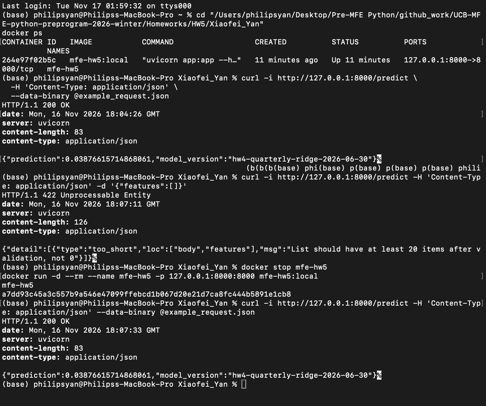

# HW5: HW4 stock return prediction service

## Milestone 1: API contract

The service uses the final HW4 quarterly Ridge fit dated **2026-06-30** (`hw4-quarterly-ridge-2026-06-30`). The prediction is a **fractional** expected stock return, not a percentage: HW4's target buys at the next market session's adjusted close and exits at the first observed adjusted close on or after 90 calendar days. For example, `0.04` means a predicted 4% return over that holding period. It is a model estimate, not a guaranteed return.

Send `POST /predict` with a JSON object containing exactly one key, `features`. Its value must be a list of **exactly 20 finite JSON numbers** in the order below. Numeric strings, booleans, `null`, non-finite numbers, extra fields, and values outside the inclusive bounds are rejected with HTTP 422. There are no categorical inputs. The endpoint creates a one-row pandas DataFrame with the original HW4 column names before prediction.

All price returns, growth rates, margins, and asset ratios below are **fractions**, not percent units. Adjusted close is used for return features; `range_21` uses raw high, low, and close. The broad bounds reject impossible signs and clearly malformed magnitudes without imposing the fitted model's 1st/99th percentile clipping thresholds on callers. The saved preprocessing still clips, imputes, and scales as learned in HW4. This API requires complete finite input even though the fitted imputer can handle missing training values.

| # | Feature | Meaning and units | Allowed range |
|---:|---|---|---:|
| 1 | `return_5` | Adjusted-close return over 5 market sessions; fraction | [-1, 100] |
| 2 | `momentum_21` | Adjusted-close return over 21 sessions; fraction | [-1, 100] |
| 3 | `momentum_252_21` | Return from 252 sessions ago to 21 sessions ago; fraction | [-1, 100] |
| 4 | `volatility_63` | Standard deviation of daily simple returns over 63 sessions, annualized by √252; fraction | [0, 100] |
| 5 | `drawdown_252` | Adjusted close divided by its 252-session rolling maximum, minus 1; fraction | [-1, 0] |
| 6 | `relative_momentum_63` | Stock 63-session return minus benchmark 63-session return; fraction | [-100, 100] |
| 7 | `beta_252` | 252-session covariance of stock and benchmark daily returns divided by benchmark variance; unitless | [-100, 100] |
| 8 | `range_21` | 21-session mean of (raw high − raw low) / raw close; fraction | [0, 100] |
| 9 | `volume_ratio_21_252` | Mean daily share volume over 21 sessions divided by mean over 252; unitless | [0, 10000] |
| 10 | `log_dollar_volume_21` | Natural log of 21-session mean of raw close × share volume; log of price-units × shares per session | [-30, 60] |
| 11 | `operating_roa` | Quarterly operating income / total assets; fraction | [-1000, 1000] |
| 12 | `gross_margin` | Quarterly gross profit / revenue; fraction | [-1000, 1000] |
| 13 | `revenue_yoy` | Quarterly revenue / same-quarter prior-year revenue − 1; fraction | [-1, 1000] |
| 14 | `asset_growth_yoy` | Total assets / same-quarter prior-year total assets − 1; fraction | [-1, 1000] |
| 15 | `debt_to_assets` | Total debt / total assets; fraction | [0, 1000] |
| 16 | `cash_to_assets` | Cash and equivalents / total assets; fraction | [0, 1000] |
| 17 | `fcf_to_assets` | Free cash flow / total assets; fraction | [-1000, 1000] |
| 18 | `accruals_to_assets` | (Net income − operating cash flow) / total assets; fraction | [-1000, 1000] |
| 19 | `current_ratio` | Current assets / positive current liabilities; unitless | [0, 10000] |
| 20 | `filing_age_days` | Calendar days since the financial filing became available; days | [0, 36500] |

The lower bound of -1 for price returns and growth rates follows from ratios of positive values. Drawdown cannot exceed 0. Volatility, price range, and volume ratio cannot be negative. Financial ratios have generous upper bounds because small denominators can create large but finite values. `log_dollar_volume_21` may be negative for dollar-volume proxies below 1. Filing age cannot be negative. These are request validation limits, not claims about typical market values.

Valid input returns HTTP 200, for example `{"prediction": 0.03876615714868061, "model_version": "hw4-quarterly-ridge-2026-06-30"}`. Unexpected inference failures are logged on the server and return HTTP 500 with a generic message.

## Run locally

From this homework directory, create a separate Python 3.12 environment, install the pinned dependencies, and run:

```sh
python3.12 -m venv .venv
source .venv/bin/activate
python -m pip install -r requirements.txt
python -m uvicorn app:app --host 127.0.0.1 --port 8000
```

On Windows, create the environment with `py -3.12 -m venv .venv` and activate it with `.venv\Scripts\Activate.ps1` in PowerShell. The service needs the included `model.joblib`, `model_reference.json`, and importable `hw4_pipeline.py` alongside `app.py`; the HW4 database and export script are not needed to run the API.

Open <http://127.0.0.1:8000/docs> or send the saved HW4 input with:

```sh
curl -i http://127.0.0.1:8000/predict -H 'Content-Type: application/json' --data-binary @example_request.json
```

`model.joblib` contains the fitted Ridge model and its learned quantile clipping, median imputation, and scaling. The service loads it once at startup from this directory and imports the custom transformer in `hw4_pipeline.py`; it does not read the HW4 database or refit the model. `model_reference.json` records the original HW4 prediction used to check the serialized artifact. `export_hw4_model.py` documents how the artifact was recreated from the local HW4 feature cache and saved HW4 scores; it is not needed to serve requests.

The feature definitions and preprocessing structure adapt `Homeworks/HW4/Xiaofei_Yan/feature_panel.py` and `Lectures/modeling/course_data.py`. The model fit procedure follows `Homeworks/HW4/Xiaofei_Yan/run_strategy.py`. Codex assisted with the artifact export, API implementation, and documentation; the numerical reference is from the saved HW4 score file.

## Milestone 2: Tests and latency

Run `python -m pytest -q` (or `make test` with this environment active). To print the latency measurement, use `python -m pytest -q -s`. The tests use reusable fixtures that start and stop the FastAPI lifespan for each client. They cover:

1. A real saved-model prediction: HTTP 200, exact response fields, finite output, agreement with a direct pipeline call, and agreement with the HW4 reference score within `rtol=1e-7, atol=1e-9`. The reference `0.03876615714878504` was recorded from HW4's `outputs/final/predictions/scores_2026-06-30.csv` for symbol `A` on `2026-06-30`, before wrapping the model in this API. The input row is in `example_request.json`.
2. Missing and extra fields; wrong list length; string, boolean, null, object, and non-finite feature values; and feature-specific out-of-range values. Each must return 422, and a spy confirms that inference was never called.
3. A deliberately raised model error on otherwise valid input: HTTP 500, detailed exception in the server log, and no exception detail in the response.
4. Three warm-up requests followed by 30 successful timed requests. Each elapsed time is measured around an in-process FastAPI `TestClient.post` call with `time.perf_counter`; the test reports median and 95th percentile. This includes request handling and inference, but excludes actual network transport and Docker overhead. There is no fixed pass/fail latency budget.

On a MacBook Pro with Apple M4 Pro (14 CPU cores, 24 GB RAM), running Python 3.12.10 locally on 2026-11-17, the 30-request TestClient run measured **median 1.46 ms** and **p95 1.73 ms**. The full suite reported **16 passed**. These figures are machine- and run-specific.

## Milestone 3: Docker image

Install and start Docker first. From **this submission directory** (where the Dockerfile is located), build and run the service:

```sh
docker build -t mfe-hw5:local .
docker run --rm --name mfe-hw5 -p 127.0.0.1:8000:8000 mfe-hw5:local
```

The container listens on port 8000; the port mapping exposes it only on the host's loopback address. If host port 8000 is occupied, stop the other process or map a different host port, such as `-p 127.0.0.1:8001:8000`, and use that port in the request. In a second terminal from this submission directory:

```sh
curl -i http://127.0.0.1:8000/predict \
  -H 'Content-Type: application/json' \
  --data-binary @example_request.json
```

Stop the foreground container with Ctrl+C. The image uses `python:3.12-slim`, installs the pinned requirements, and copies `app.py`, `hw4_pipeline.py`, `model.joblib`, and `model_reference.json` into `/app`. The custom `QuantileClipper` class must be importable for joblib to load the fitted HW4 pipeline. `.dockerignore` uses an explicit allowlist, so the build context excludes the local `.venv`, databases, credentials, tests, and large generated outputs.

## Milestone 4: Makefile and code checks

With the homework environment active, run these commands from this directory:

```sh
make test
make lint
make format
make build
make run
```

`make lint` runs `python -m ruff check .` and `python -m ruff format --check .`; `make format` applies Ruff formatting. The Docker commands use the Docker CLI on `PATH`, with a fallback to Docker Desktop's standard macOS application path. You can override the executable with `make build DOCKER=/path/to/docker` if needed. Keep only one `make run` container on host port 8000 at a time.

Verified locally on 2026-11-17: `make test` passed all 16 tests; `make lint` passed both Ruff checks; `make format` left all five Python files unchanged; `make build` completed; `make run` started the container; and a request to the restarted container returned HTTP 200 with the HW4 prediction. The application keeps the fitted preprocessing and Ridge model construction in `hw4_pipeline.py`, separate from FastAPI request handling in `app.py`; `export_hw4_model.py` is a separate offline artifact creation script.

Recorded check output:

```text
$ make test
16 passed
$ make lint
All checks passed!
5 files already formatted
```

## Milestone 5: Container request evidence

The terminal screenshot below shows a real request to `mfe-hw5:local` returning HTTP 200 with prediction `0.03876615714868061` and model version `hw4-quarterly-ridge-2026-06-30`. It also shows an invalid empty feature list returning HTTP 422, `docker stop mfe-hw5`, a new `docker run` of the same image, and a second valid request returning HTTP 200 with the same prediction and version.



## Before real deployment

This course service is exposed only on localhost. A broader deployment would need authentication and request limits, monitoring for inference failures and feature drift, a controlled process for validating new model artifacts, and evaluation against later realized 90-day returns before anyone relies on its predictions.
